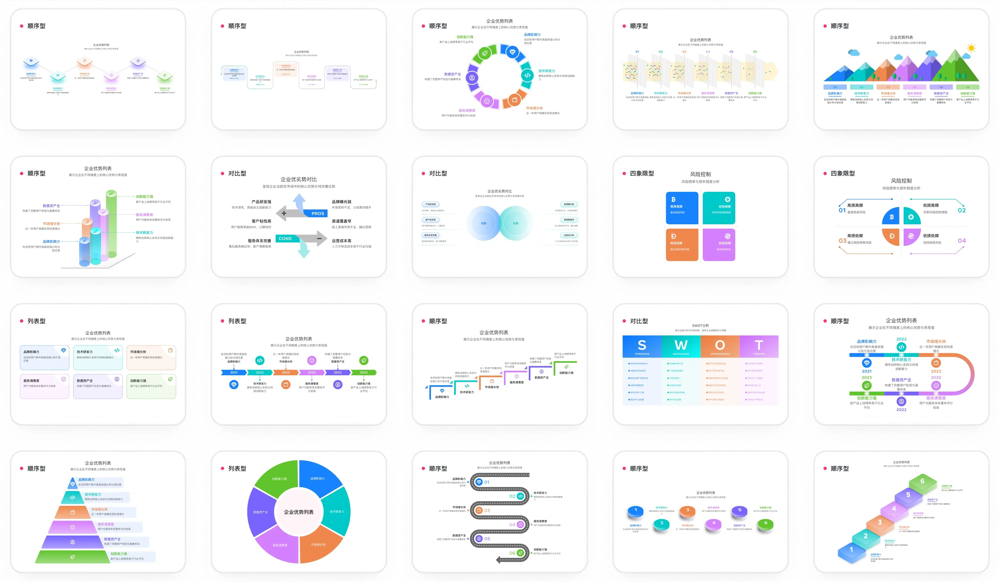

# AntV Infographic

> Source: https://github.com/antvis/infographic — by antvis — captured 2026-09-02T17:15:42Z — stats-at-capture: stars=6531; npm=@antv/infographic

## Article

**URL:** https://github.com/antvis/Infographic

## What it is

Infographic generation and rendering framework from AntV (Alibaba). AI-friendly syntax, ~200 built-in templates, theme system, built-in editor, SVG output. npm package `@antv/infographic`.

## Notable files / links

- `skills/` — agent skills for infographic generation
- Gallery: infographic.antv.vision/gallery
- AI agent page: infographic.antv.vision/ai
- Supports streaming AI output and rendering

## Key README excerpts (summarized)

> "Bring words to life with AI." Features: AI-tuned config/syntax, ready-to-use templates, hand-drawn/gradient themes, editable SVG renderer. Quick start: `new Infographic({ container, editable: true }).render(\`infographic list-row-simple-horizontal-arrow\`)`.

## Media

## Links

- https://infographic.antv.vision
- https://infographic.antv.vision/gallery
- https://infographic.antv.vision/ai
