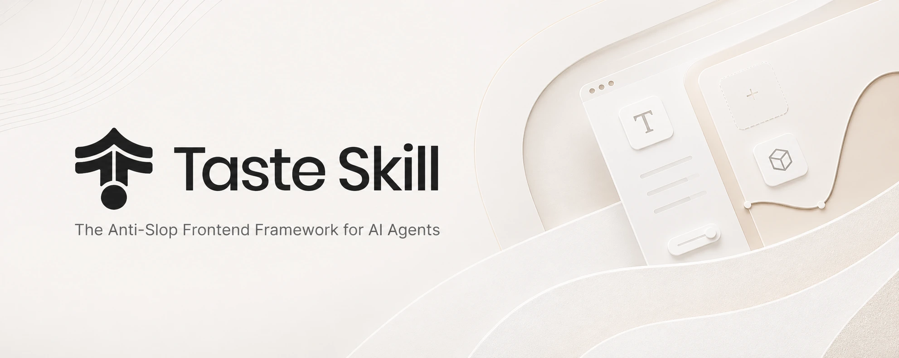

# Taste Skill

> Source: https://github.com/Leonxlnx/taste-skill — by Leonxlnx — captured 2026-09-02T17:15:42Z — stats-at-capture: stars=83632; homepage=https://tasteskill.dev

## Article

**URL:** https://github.com/Leonxlnx/taste-skill

## What it is

Portable Agent Skills repo ("Anti-Slop Frontend Framework") that upgrades AI-built UIs: layout, typography, motion, spacing. Includes image-generation skills for reference boards. Compatible with Codex, Cursor, Claude Code via agent-skills standard.

## Notable files / links

- `skills/` — individual SKILL.md files
- https://tasteskill.dev — docs, changelog, examples
- Vercel agent-skills compatible; MIT licensed
- Sponsors: interfaces.dev, React Bits, Emil Kowalski/animations.dev

## Key README excerpts (summarized)

> "Portable Agent Skills that upgrade AI-built interfaces: stronger layout, typography, motion, and spacing instead of boilerplate-looking UIs." Also includes image-generation skills for reference boards to hand off to coding agents.

## Media

## Links

- https://tasteskill.dev
- https://github.com/vercel-labs/agent-skills
