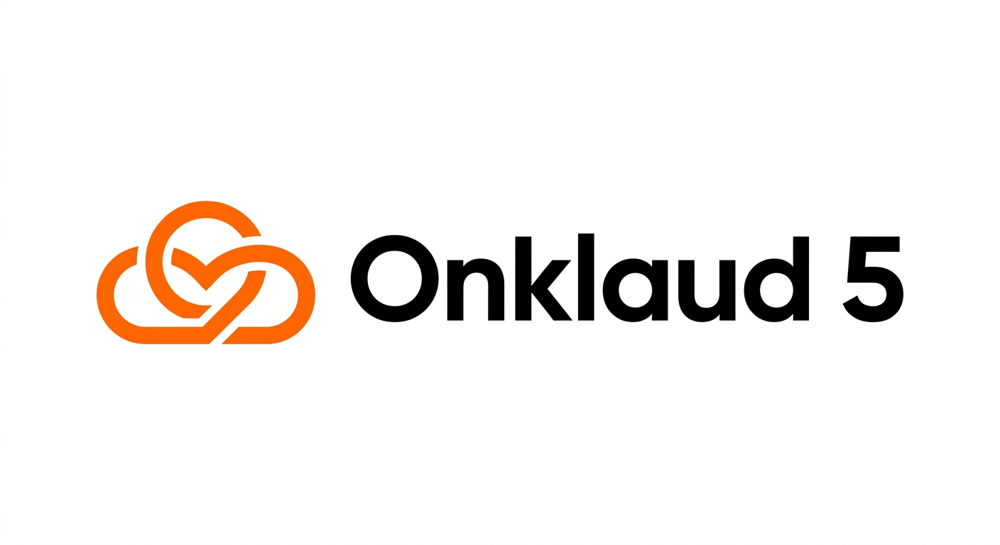

# Onklaud 5 : a fusion model pipeline matching Fable 5 at 1/100th the cost. 57% of tasks at $0. Open source.

> Source: https://www.reddit.com/r/OpenSourceAI/comments/1ujr89i/onklaud_5_a_fusion_model_pipeline_matching_fable/
> Author: u/korro_ai
> Posted: 2026-06-30T14:45:10+00:00
> Captured: 2026-10-15T08:55:18+00:00
> Score: 32 · Comments: 4
> Community: r/OpenSourceAI

## Post

We've spent the last few weeks building something that changed how we think about AI assisted coding.

**The problem nobody talks about**

Every AI coding tool works the same way: one model does everything. It generates code. Then it reviews its own code. Same brain. Same blind spots. Same biases.

This is insane. In real engineering, you never let a developer review their own pull request. It defeats the entire purpose of code review. Yet every AI assistant does exactly that — and we've all accepted it.

Worse: \~60% of coding tasks already have a stdlib solution. "Read a JSON file" is json.load(). It's been in Python since 2.6. But your AI assistant will happily generate 20 lines of custom code and charge you tokens for the privilege.

**What we built**

Onklaud 5 (https://github.com/KorroAi/onklaud-5) is a fusion pipeline. Not a model. 3 AI models (Kimi K2.7 + GLM 5.2 + DeepSeek V4 Pro) working through a structured 6 stage council, surrounded by 4 cost saving infrastructure layers.

**The 3 models:**

Kimi K2.7 (Moonshot AI): primary code generation. HumanEval 99.0

GLM 5.2 (Z.AI / Tsinghua): architecture design, independent code review, final arbitration. 1M context. Open weights.

DeepSeek V4 Pro: direct API engine for lightweight tasks. Significantly cheaper per token than going through OpenRouter. Handles simple work so Kimi and GLM only get called when needed.

**The 4 cost saving layers (all $0, all offline):**

1. **Ponytail Ladder** checks if stdlib, native functions, or existing deps can solve it. 57% of tasks stop here. $0. Under 100ms.

2. **Immune Memory** stores every failure pattern. Scans future tasks BEFORE code is written. 19 patterns, 50% detection, growing every session.

3. **Headroom** provides 60 to 95% context compression. Prevents quality degradation in 50+ message sessions. Keeps the pipeline coherent when single model systems fall apart.

4. **Quality Gate** scores output across 7 dimensions on a 10/10 scale. Broken code blocked before it ships.

**The pipeline:**

GLM designs architecture → Kimi generates code → BOTH independently review → disagreements trigger GLM arbitration → quality gate blocks anything below 10/10.

Measured results (2026-06-22, real hardware)

57.1% tasks resolved at $0 (35 real tasks, 3 languages, 95% CI)

100% syntax pass rate (deterministic, 14 files)

67.2% context reduction (Headroom)

96.7% pipeline test pass rate (29/30 tests)

Cost: literally cents for hours of iteration. We built 4 production systems with this and spent less than a coffee.

Full research paper with methodology and statistical analysis included in the repo.

**Why this matters**

The AI industry is obsessed with bigger models. But the real frontier isn't model size. It's architecture. Ensemble methods have been standard in ML for 20+ years. It's time coding assistants caught up.

Model agnostic. Swap models in and out. The pipeline, verification, immune memory, and quality gate stay intact.

[**https://github.com/KorroAi/onklaud-5**](https://github.com/KorroAi/onklaud-5)

Research paper, benchmarks, demo video. All in the repo. python test\_pipeline.py to verify everything.
## Media

> Original media URL: https://i.redd.it/2rjd49bflfah1

## Thread

> u/korro_ai · 2026-07-04T14:05:33+00:00 · score 1 · [comment](https://www.reddit.com/r/OpenSourceAI/comments/1ujr89i/onklaud_5_a_fusion_model_pipeline_matching_fable/ovib5x0/)

haha keep me updated if you do it

> u/korro_ai · 2026-07-04T14:05:17+00:00 · score 1 · [comment](https://www.reddit.com/r/OpenSourceAI/comments/1ujr89i/onklaud_5_a_fusion_model_pipeline_matching_fable/ovib41p/)

Not natively, but you can swap it in on specific pipeline stages. Hermes works decently for the Ponytail stage (structured decomposition, function calling is its strength) and can hold its own on the gate. Where it falls short is the dual review and arbitration stages — Kimi and GLM are just better at adversarial analysis and catching subtle inconsistencies. If you're running locally and want to experiment, start with Ponytail only and compare outputs. You'll see the gap pretty quickly on anything complex.

## Comments

> u/mymindspam · 2026-07-02T17:34:49+00:00 · score 1 · [comment](https://www.reddit.com/r/OpenSourceAI/comments/1ujr89i/onklaud_5_a_fusion_model_pipeline_matching_fable/ov5ql5k/)

This is amazing! The last part is to put it on virtual machine for damage control as I do with GLM on Pi consign agent 

> u/kiwipaul17 · 2026-07-04T09:37:08+00:00 · score 1 · [comment](https://www.reddit.com/r/OpenSourceAI/comments/1ujr89i/onklaud_5_a_fusion_model_pipeline_matching_fable/ovh80fb/)

Will it wirk with Hermes?

## Links

- https://github.com/KorroAi/onklaud-5
