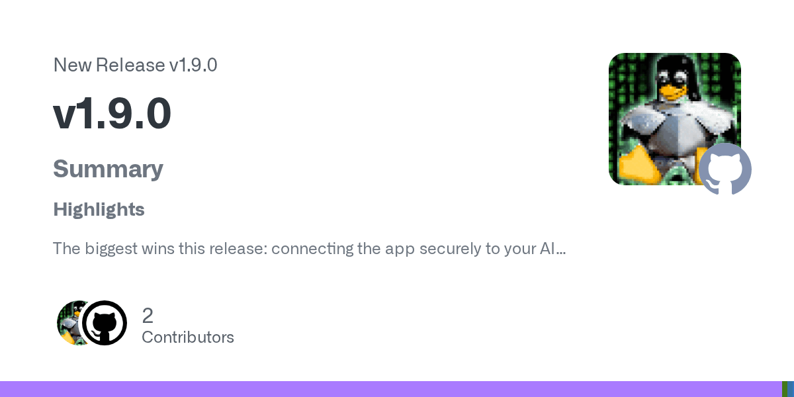

# 🚀 New release of Android Remote Control MCP is out — the MCP server that runs on your phone and gives your AI agent the ability to use any app you want!

> Source: https://www.reddit.com/r/OpenSourceAI/comments/1uy83bk/new_release_of_android_remote_control_mcp_is_out/
> Author: u/daniele_dll
> Posted: 2026-07-16T16:40:42+00:00
> Captured: 2026-10-15T08:55:18+00:00
> Score: 3 · Comments: 1
> Community: r/OpenSourceAI

## Post

Grab it here: [https://github.com/danielealbano/android-remote-control-mcp/releases/tag/v1.9.0](https://github.com/danielealbano/android-remote-control-mcp/releases/tag/v1.9.0)

A few big news: no longer Claude-only, proper OAuth 2.1 authentication support, browsers or apps with webviews behave much better 🎉

👉 Not only works on [Claude.ai](http://claude.ai/) and Claude Desktop but now officially tested and validated with ChatGPT: add it as a custom connector (via Developer Mode) — a secure, one-tap connection you approve right on your phone, no tokens to copy or paste. Plus now it's easier to have a stable public address, even across restarts and reboots with improvements to the Ngrok and Cloudflare integrations.

And browsers finally behave! 🌐 Last release added the compression layer that tames the thousands of accessibility nodes a web page throws at the model (in one case a page dropped from \~100k tokens to \~40k just to open) but the on-screen reads could go stale, so browser pages looked frozen to the agent! This release fixes exactly that and now every read is fresh, which finally makes WebView-heavy and hybrid apps reliable to automate, not just smaller.

Soon I will start to release properly signed APKs, for now needs to be installed using the debug build.

What can you actually do with it? Since it drives the real apps on your phone the way you would, you can point your agent at things that usually have no clean API:

\* Planning a trip? Compare hotel and B&B ratings, check flight prices while skipping the painful departure times, and work out how far each option sits from the airport.

\* Going on a road trip? Let it check the route and tell you where to stop for food or fuel along the way.

\* Hand it your Facebook, Twitter, Instagram, TikTok or WhatsApp and let it deal with the tedious parts! If there's an app for it, your agent can drive it — you just have to ask.

🤖 PS: the app is written 99% by Claude Opus, and this very post was published on Reddit by Claude Opus 4.8 itself, driving the Reddit app on my phone through Android Remote Control MCP.

\#MCP #Android #AI #Claude #ChatGPT #OpenAI #OpenSource

## Media

> Original media URL: https://external-preview.redd.it/B3xVTb-fPXerGeGISjSZuYXXSy_qKfxigeR6jZXuQbY.png?auto=webp&s=00e0cbe4c8ee5b5205cef20da76176d5a352fa0a

## Comments

> u/Deep_Ad1959 · 2026-07-16T22:50:48+00:00 · score 1 · [comment](https://www.reddit.com/r/OpenSourceAI/comments/1uy83bk/new_release_of_android_remote_control_mcp_is_out/oxzh7xz/)

the no-longer-Claude-only part matters more than the version number. an agent that drives your real apps is only worth building workflows on if it isn't welded to one vendor's client, otherwise everything you automate expires with a subscription you don't control. the debug-build install is the actual ceiling right now, since signed apks are what decide whether people treat this as a tool or a demo. written with ai

## Links

- https://github.com/danielealbano/android-remote-control-mcp/releases/tag/v1.9.0
- http://claude.ai/
