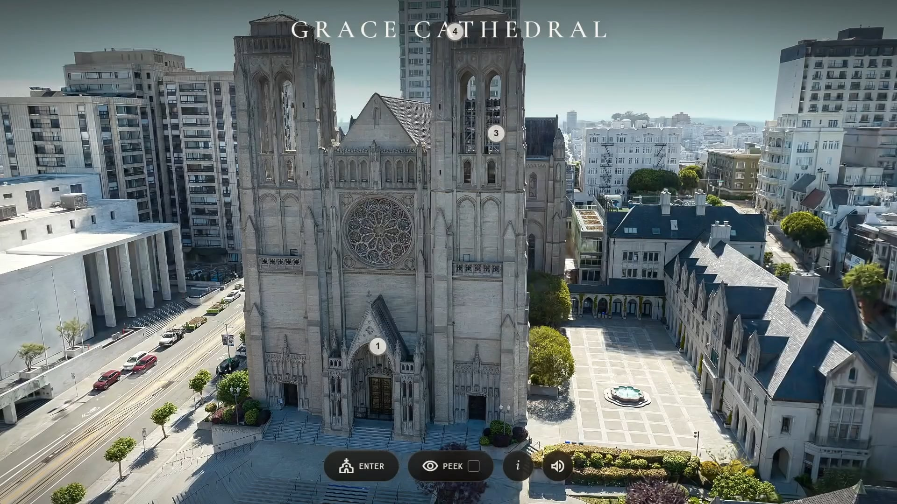

# How we built the Grace Cathedral browser experience

> Source: https://www.reddit.com/r/GaussianSplatting/comments/1v4e576/how_we_built_the_grace_cathedral_browser/
> Author: u/MayorOfMonkeys
> Posted: 2026-07-23T13:36:05+00:00
> Captured: 2026-10-15T08:55:18+00:00
> Score: 368 · Comments: 14
> Community: r/GaussianSplatting

## Post

Two days ago, the [Grace Cathedral browser experience](https://vincentwoo.com/3d/grace_cathedral/) was launched.

This was a joint collaboration between Vincent Woo and PlayCanvas. Vincent scanned the location in exquisite detail and [Donovan Hutchence](https://www.linkedin.com/in/dhutchence/) from the PlayCanvas team built the browser app.

This represents 3 years of technology development by PlayCanvas:

* Streamed SOG with LOD
* High performance WebGPU-powered splat renderer
* Custom shader system

...and much more. The best part? It's all [free and open source](https://github.com/playcanvas/engine).

We wanted to follow up the launch with a write up explaining how the app was built:

[https://blog.playcanvas.com/building-the-grace-cathedral-experience](https://blog.playcanvas.com/building-the-grace-cathedral-experience)

Let us know what bits you liked best...and what we missed that we could have added! And if you have any further questions about the 'how' of the experience, just ask.

## Media

> Original media URL: https://external-preview.redd.it/aTQzMmw2YzdlemVoMQFEFpaPFmPSrwEnIGCprdRK8yqAKVBJjYLMY_0t_mn0.png?format=pjpg&auto=webp&s=e276770b100a57c90be9fefb2432d1568dd4f53c

[media/02-reddit-media.mp4](media/02-reddit-media.mp4)

> Original media URL: https://v.redd.it/ktjs28b7ezeh1

## Comments

> u/jasteinerman · 2026-07-23T14:54:38+00:00 · score 11 · [comment](https://www.reddit.com/r/GaussianSplatting/comments/1v4e576/how_we_built_the_grace_cathedral_browser/ozalao1/)

This is fantastic! Great work, and thanks for the detailed writeup - really interesting tech

> u/SanoKei · 2026-07-23T15:20:17+00:00 · score 8 · [comment](https://www.reddit.com/r/GaussianSplatting/comments/1v4e576/how_we_built_the_grace_cathedral_browser/ozar86c/)

Play Canvas is really going 110% into splats and it's going to be ruin for babylonjs, and phaser 3d. I was a race in that horse but a what a red ocean its become. I wish them luck, from everything I've seen, it's a good direction and they seem very competent

> u/thmsn1005 · 2026-07-23T16:18:41+00:00 · score 6 · [comment](https://www.reddit.com/r/GaussianSplatting/comments/1v4e576/how_we_built_the_grace_cathedral_browser/ozb4zq6/)

damn i love the cutout effect you are doing on the walls! seems like you did some pretty cool new techniques on this.

> u/JFPhotoscans · 2026-07-23T16:43:51+00:00 · score 5 · [comment](https://www.reddit.com/r/GaussianSplatting/comments/1v4e576/how_we_built_the_grace_cathedral_browser/ozbb0ws/)

This has shown me how buildings should be presented, it's superb! Great scan work to boot, that's one heck of a job

> u/aaaayyyylmaoooo · 2026-07-23T17:40:17+00:00 · score 6 · [comment](https://www.reddit.com/r/GaussianSplatting/comments/1v4e576/how_we_built_the_grace_cathedral_browser/ozboo7a/)

this is one of the most impressive things I’ve seen

> u/AngelicBread · 2026-07-24T03:17:26+00:00 · score 5 · [comment](https://www.reddit.com/r/GaussianSplatting/comments/1v4e576/how_we_built_the_grace_cathedral_browser/ozexlf8/)

Do you know what he used for the interior imaging? Just incredible detail.

> u/CptCaramack · 2026-07-24T11:41:27+00:00 · score 3 · [comment](https://www.reddit.com/r/GaussianSplatting/comments/1v4e576/how_we_built_the_grace_cathedral_browser/ozgtfuf/)

Thankyou very much, this information is amazing - I am not too far off being able to produce things like this but this is so slick and the internal+external view is great, plus the interactive elements you have included have really taken this to the next level, this is the kind of quality that I'm striving for so thankyou for the information! I'm going to read through and come back if I have a question x

> u/possiblyquestionabl3 · 2026-07-24T00:22:37+00:00 · score 3 · [comment](https://www.reddit.com/r/GaussianSplatting/comments/1v4e576/how_we_built_the_grace_cathedral_browser/oze3fnt/)

I lived literally 2 blocks away from it (on Powell) for 3 years and never experienced the inside of it until today (mainly because I'm cheap as hell)

I agree with the others, this is fantastic!

> u/Plomekq · 2026-07-25T14:18:58+00:00 · score 3 · [comment](https://www.reddit.com/r/GaussianSplatting/comments/1v4e576/how_we_built_the_grace_cathedral_browser/ozopxlg/)

What was used to capture this?  
And what GPU did you use to make the splats?  
How long did generating the splats take for the main building, and how long did the cleanup take (if there was any)?

also what software did you use for generating the splats?

This looks insanely impressive I would like to know more.

> u/DiscipleOf1 · 2026-08-09T06:40:15+00:00 · score 1 · [comment](https://www.reddit.com/r/GaussianSplatting/comments/1v4e576/how_we_built_the_grace_cathedral_browser/p2lncyl/)

Would love to know the answer to these as well! 

> u/Resident_Proposal_57 · 2026-07-26T13:37:05+00:00 · score 1 · [comment](https://www.reddit.com/r/GaussianSplatting/comments/1v4e576/how_we_built_the_grace_cathedral_browser/ozv4a6h/)

How do you scan this, and what is this software. 

> u/FastCow8369 · 2026-07-29T15:50:48+00:00 · score 1 · [comment](https://www.reddit.com/r/GaussianSplatting/comments/1v4e576/how_we_built_the_grace_cathedral_browser/p0hnud0/)

Very impressive! And the performance seems really solid 😮

> u/Birkendock · 2026-07-30T05:46:38+00:00 · score 1 · [comment](https://www.reddit.com/r/GaussianSplatting/comments/1v4e576/how_we_built_the_grace_cathedral_browser/p0m75tw/)

wow this is sick. how many images did you use to train? it's very detailed including indoors. did you use a drone to capture everything? i'm a bit of a noob. how long was the training process?

> u/Comfortable_Leave787 · 2026-08-12T10:23:31+00:00 · score 1 · [comment](https://www.reddit.com/r/GaussianSplatting/comments/1v4e576/how_we_built_the_grace_cathedral_browser/p37ojlz/)

Amazing!!!

## Links

- https://vincentwoo.com/3d/grace_cathedral/
- https://www.linkedin.com/in/dhutchence/
- https://github.com/playcanvas/engine
- https://blog.playcanvas.com/building-the-grace-cathedral-experience
