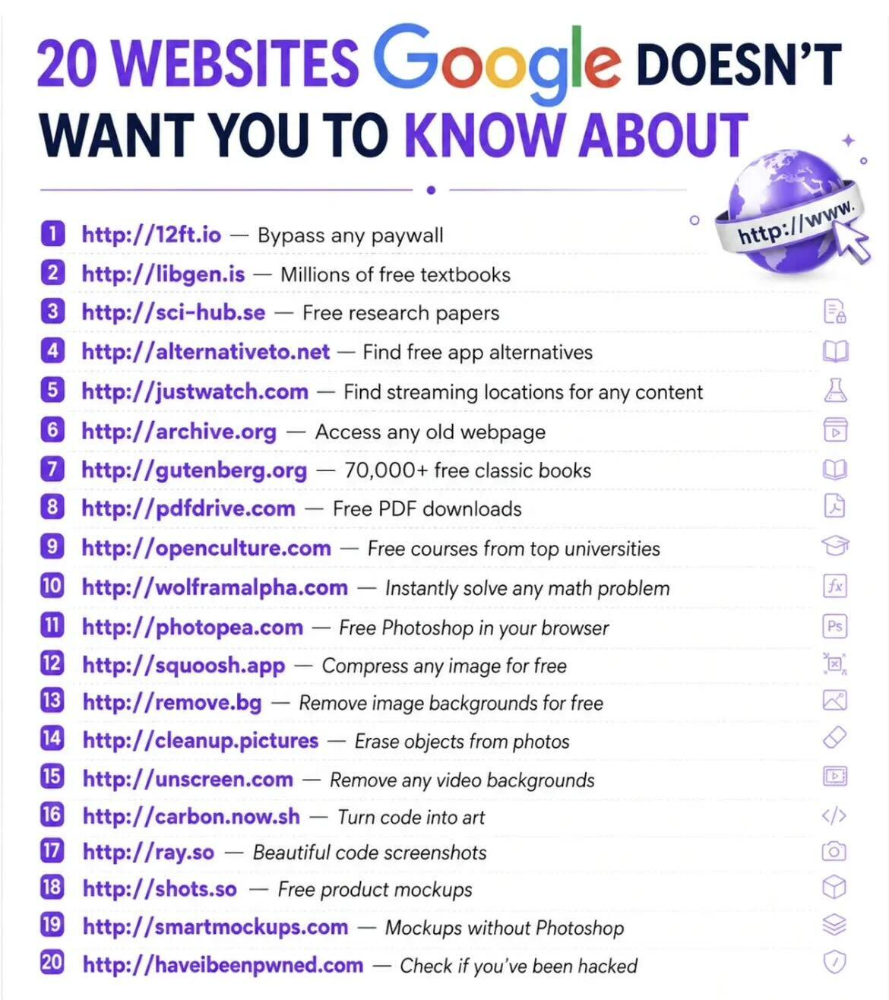

# 20 Websites Google Doesn't want you to know

> Source: https://www.reddit.com/r/theaiwaves/comments/1vht9fa/20_websites_google_doesnt_want_you_to_know/
> Author: u/No_Recipe6244
> Posted: 2026-08-07T06:55:02+00:00
> Captured: 2026-10-15T08:55:18+00:00
> Score: 2067 · Comments: 26
> Community: r/theaiwaves

## Post

## Media

> Original media URL: https://i.redd.it/g1p2sjsmhwhh1.jpeg

> Original media URL: https://preview.redd.it/g1p2sjsmhwhh1.jpeg?auto=webp&s=47b38187339ede4a6f42807457f25b84064e20c3

## Comments

> u/[deleted] · 2026-08-07T11:03:55+00:00 · score 5 · [comment](https://www.reddit.com/r/theaiwaves/comments/1vht9fa/20_websites_google_doesnt_want_you_to_know/p28qqtv/)

[removed]

> u/Michaelth20 · 2026-08-07T19:22:31+00:00 · score 1 · [comment](https://www.reddit.com/r/theaiwaves/comments/1vht9fa/20_websites_google_doesnt_want_you_to_know/p2bpkby/)

Why what’s up with “http” honest question I really don’t know 😂 

> u/[deleted] · 2026-08-07T19:39:51+00:00 · score 1 · [comment](https://www.reddit.com/r/theaiwaves/comments/1vht9fa/20_websites_google_doesnt_want_you_to_know/p2btgo5/)

[removed]

> u/Michaelth20 · 2026-08-07T20:18:52+00:00 · score 2 · [comment](https://www.reddit.com/r/theaiwaves/comments/1vht9fa/20_websites_google_doesnt_want_you_to_know/p2c25dn/)

Ok I gotcha, I’m not sending top secret files anyway. But I got what you’re saying 

> u/theemilyann · 2026-08-07T21:04:17+00:00 · score 1 · [comment](https://www.reddit.com/r/theaiwaves/comments/1vht9fa/20_websites_google_doesnt_want_you_to_know/p2cc3o6/)

People watching your traffic doesn’t have anything to do with top-secret files. In the same way that you can be concerned about state surveillance, even if your “not doing anything illegal.”

> u/mlrhazi · 2026-08-08T22:48:59+00:00 · score 1 · [comment](https://www.reddit.com/r/theaiwaves/comments/1vht9fa/20_websites_google_doesnt_want_you_to_know/p2jn8yv/)

man in the middle can also modify the content you are receiving. very big problem :)  
this is tru even when only the first request is http, /  
even if afterwards the server redirects to https, it's too late.

> u/Michaelth20 · 2026-08-07T22:24:39+00:00 · score 0 · [comment](https://www.reddit.com/r/theaiwaves/comments/1vht9fa/20_websites_google_doesnt_want_you_to_know/p2cs9vo/)

Yeah between my watch,phone, and t.v. What sites I visited is the least of my worries and now we got this “flock camera” (USA) if I have be afraid I guess we should all go off grid. Nah I like my conveniences. I feel like it’s all to keep people in panic mode. To lower your vibration.  Really I don’t care if “they” know I ate chicken nuggets then went home and jacked off to gay porn. (Straight guy here) Maybe I’ll get a discount at Micky D’s or some free Blue Chew. 

> u/theemilyann · 2026-08-10T17:16:39+00:00 · score 1 · [comment](https://www.reddit.com/r/theaiwaves/comments/1vht9fa/20_websites_google_doesnt_want_you_to_know/p2vegsv/)

If something is free, you are the product. 

> u/CognitiveDissonuts · 2026-08-07T13:18:34+00:00 · score 6 · [comment](https://www.reddit.com/r/theaiwaves/comments/1vht9fa/20_websites_google_doesnt_want_you_to_know/p29ec48/)

http://12ft.io  is not reachable  (404)

> u/Living_Cycle405 · 2026-08-08T04:30:55+00:00 · score 3 · [comment](https://www.reddit.com/r/theaiwaves/comments/1vht9fa/20_websites_google_doesnt_want_you_to_know/p2eisa8/)

Yes, that’s the reason Google is hiding this from us 😁 

> u/DiggingforPoon · 2026-08-07T21:09:25+00:00 · score 2 · [comment](https://www.reddit.com/r/theaiwaves/comments/1vht9fa/20_websites_google_doesnt_want_you_to_know/p2cd6hy/)

it was shut down LAST year...

> u/yladimyr · 2026-08-07T17:23:57+00:00 · score 1 · [comment](https://www.reddit.com/r/theaiwaves/comments/1vht9fa/20_websites_google_doesnt_want_you_to_know/p2ay1qa/)

[ Removed by Reddit ]

> u/MJ_SAROUKH · 2026-08-08T17:01:49+00:00 · score 1 · [comment](https://www.reddit.com/r/theaiwaves/comments/1vht9fa/20_websites_google_doesnt_want_you_to_know/p2hovn2/)

There are no alternatives

> u/zeit_reisender · 2026-08-09T00:19:49+00:00 · score 1 · [comment](https://www.reddit.com/r/theaiwaves/comments/1vht9fa/20_websites_google_doesnt_want_you_to_know/p2k3bm5/)

[https://www.removepaywall.com/](https://www.removepaywall.com/)

> u/lthrboytom · 2026-08-09T02:16:07+00:00 · score 1 · [comment](https://www.reddit.com/r/theaiwaves/comments/1vht9fa/20_websites_google_doesnt_want_you_to_know/p2kmnh3/)

This website is only 10 months old, so not very old according to URLVoid.com 

> u/AirWrath99 · 2026-08-07T09:13:10+00:00 · score 1 · [comment](https://www.reddit.com/r/theaiwaves/comments/1vht9fa/20_websites_google_doesnt_want_you_to_know/p28bw38/)

PDF driver is no longer active

> u/theemilyann · 2026-08-07T21:04:31+00:00 · score 1 · [comment](https://www.reddit.com/r/theaiwaves/comments/1vht9fa/20_websites_google_doesnt_want_you_to_know/p2cc5g4/)

Many of these sites have been taken down

> u/akirkyun · 2026-08-08T09:48:21+00:00 · score 1 · [comment](https://www.reddit.com/r/theaiwaves/comments/1vht9fa/20_websites_google_doesnt_want_you_to_know/p2fln5r/)

✨✨😵

> u/darthjamie2002 · 2026-08-09T23:06:57+00:00 · score 1 · [comment](https://www.reddit.com/r/theaiwaves/comments/1vht9fa/20_websites_google_doesnt_want_you_to_know/p2qfvkq/)

Why are there no wwws in these addresses?

> u/Pontific2 · 2026-08-11T16:18:58+00:00 · score 1 · [comment](https://www.reddit.com/r/theaiwaves/comments/1vht9fa/20_websites_google_doesnt_want_you_to_know/p32blz3/)

Using "www" is rudimentary. 

> u/sup3rs0n1cp3rc3pt10n · 2026-08-10T11:44:40+00:00 · score 1 · [comment](https://www.reddit.com/r/theaiwaves/comments/1vht9fa/20_websites_google_doesnt_want_you_to_know/p2tg3qn/)

I can safely say that page 10, Wolfram Alpha, does not solve an arbitrary complex math problem 😅 Even Wolfram Mathematica does not. 

> u/GTAROLEPLAYONLINE · 2026-08-11T21:21:21+00:00 · score 1 · [comment](https://www.reddit.com/r/theaiwaves/comments/1vht9fa/20_websites_google_doesnt_want_you_to_know/p34a6ls/)

Que interesante todo eso

