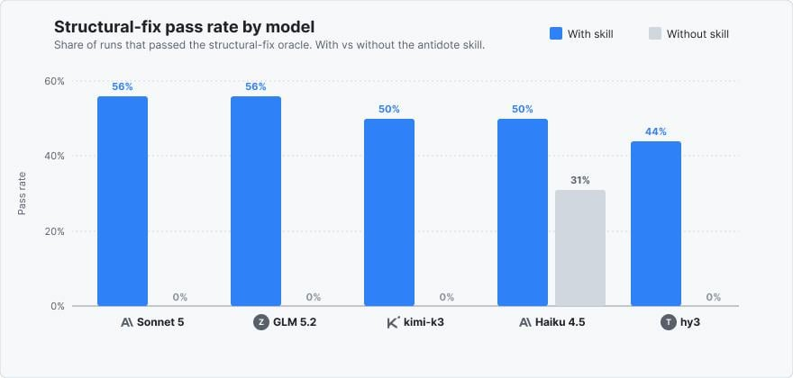

# AI skill that stops agents from writing patchwork code. Claude's structural-fix rate went from 0% to 56%.

> Source: https://www.reddit.com/r/claudeskills/comments/1vtuk9s/ai_skill_that_stops_agents_from_writing_patchwork/
> Author: u/Greatermoose
> Posted: 2026-08-20T20:10:08+00:00
> Captured: 2026-10-15T08:55:18+00:00
> Score: 64 · Comments: 2
> Community: r/claudeskills

## Post

Most AI coding agents do not fix code. They patch it. They add a null check, swallow an error, or wrap the problem in a guard. The next code path that forgets the guard breaks again. The rot keeps spreading.

Antidote is a skill for these agents. It stops them from patching symptoms. It makes them fix the root cause instead.

It does three things. First, it makes the agent validate data once at the boundary. Second, it makes the agent use the correct type or schema so bad data cannot get inside. Third, it makes the agent delete the broken path instead of writing more glue code around it.

Use it to fix one issue or to audit a whole codebase. Just invoke `/antidote` or say "audit for overcomplication".

**How I built it**

Antidote is one [`SKILL.md`](http://SKILL.md) prompt in 

SKILL.md. It tells the agent to fix root causes and avoid defensive guards. I added a thin manifest for each platform in .claude-plugin, .codex-plugin, .cursor-plugin, .devin-plugin, .grok-plugin, plugin, .pi, and .opencode. Each manifest points back to the same prompt.

It is free and open source under the MIT license.

**Benchmark**

The benchmark uses the skill-eval-harness. It gives the agent broken code and asks for a structural fix. A script oracle then checks the result. Without antidote, four of five models got 0% correct structural fixes. With antidote, the rates were:

* Claude Sonnet 5: 56%
* GLM 5.2: 56%
* Moonshot Kimi K3: 50%
* Tencent Hy3: 44%
* Claude Haiku 4.5: 50% (up from 31%)

One root-cause fix replaces a dozen defensive guards.

It is a pure-prompt skill. No scripts, no network, no dependencies. It works in Claude Code, Codex, Cursor, Devin, Grok, Pi, and OpenCode. It also works in any agent that reads the Agent Skills [`SKILL.md`](http://SKILL.md) format.

Install it with `npx skills add Avtr99/antidote` or from each agent's plugin store.

Check the benchmark and source at [https://github.com/Avtr99/antidote](https://github.com/Avtr99/antidote)

## Media

> Original media URL: https://i.redd.it/vt3rzi1o6lkh1.jpeg

> Original media URL: https://preview.redd.it/vt3rzi1o6lkh1.jpeg?auto=webp&s=b328c142cb8f7c580e00c6d74aaa55c5097432d6

## Thread

> u/Greatermoose · 2026-08-21T20:14:47+00:00 · score 1 · [comment](https://www.reddit.com/r/claudeskills/comments/1vtuk9s/ai_skill_that_stops_agents_from_writing_patchwork/p53d8av/)

Hey, I am currently testing with some more evals.. will update it soon

## Comments

> u/vedmaka · 2026-08-21T11:14:03+00:00 · score 1 · [comment](https://www.reddit.com/r/claudeskills/comments/1vtuk9s/ai_skill_that_stops_agents_from_writing_patchwork/p504ebk/)

This eval does not seem to be very representative, did you try to compare with other evals?

## Links

- http://SKILL.md
- https://github.com/Avtr99/antidote
