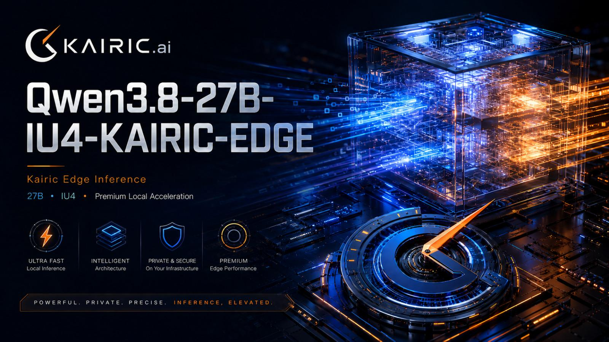

# Qwen3.8-27B-IU4-KAIRIC-EDGE, a performace optimize model for Strix Halo by Kairic.ai better performance, better quality.

> Source: https://www.reddit.com/r/StrixHalo/comments/1vv5wel/qwen3827biu4kairicedge_a_performace_optimize/
> Author: u/Narrow_Corgi923
> Posted: 2026-08-22T07:36:56+00:00
> Captured: 2026-10-15T08:55:18+00:00
> Score: 65 · Comments: 83
> Community: r/StrixHalo

## Post

Qwen3.8-27B-IU4-KAIRIC-EDGE is a performance-focused Qwen3.8-27B model for AMD Strix Halo gfx1151. To our knowledge, this is the world's first use of an accelerated IU4 lane in an LLM on AMD gfx1151, and it is the first public introduction to Kairic.ai, an AI hardware and software optimization company building performance inference infrastructure.

Kairic Edge combines Prompt Forge, Dual View, and the accelerated IU4 lane. It connects selected 4-bit activations and weights to AMD's native unsigned/signed 4-bit matrix instruction for prompt and multi-token verification shapes. The important result is not simply a smaller model: it is a working, end-to-end native IU4 compute route inside a served 27B language model.

https://huggingface.co/jcbtc/Qwen3.8-27B-IU4-Kairic-Edge

Custom runtime required. Standard llama.cpp does not understand the Kairic sidecars or --kairic-edge. Build and run the immutable Kairic Edge v1 source release. The bundled runner enables Kairic Edge, prompt caching, the qualified 256K configuration, and native MTP4 by default.

Release highlights

47.73 generated tokens/s across the 164-task coding suite, 85.0% above Unsloth Dynamic Q4 and 88.6% above Unsloth Dynamic Q6 in the collected configured-system runs.

158/164 HumanEval Base and 152/164 HumanEval Plus: Base tied the Q4 comparison and Plus passed four more tasks; it also passed one more Base and two more Plus tasks than the Q6 comparison.

The native IU4 instruction harness reached 104.66 TOPS, or 1.94× the matched FP16 matrix result and 1.93× the matched IU8 result on the same device and run.

The inclusive IU4 feed-forward operator was 2.52–3.48× faster across tested prompt shapes; pooled prompt processing increased 56.03% in the controlled lane A/B.

The complete native companion set is 9.13 GiB / 46.3% smaller than the matched 8-bit companion inventory, despite including an additional projection family.

The validated prompt cache cut repeated-prefix prompt time by 98.39–99.87% from 2K through 32K tokens.

Prompt Forge and Dual View

Kairic Edge is a Dual View model. Its GGUF is the authoritative view for model storage, quality-sensitive selection, target decode, and unsupported shapes. Three .pfs companions provide phase-specialized execution views for eligible feed-forward, recurrent-projection, and output-projection work.

Prompt Forge is the runtime layer that loads those companion views, identifies the physical request shape, and routes only qualified prompt or verification operations through the faster view. It fails closed to the authoritative path when a shape or operation is outside the validated envelope. This lets the model favor a compact authoritative representation for bandwidth-sensitive work while using a hardware-native representation where wider matrix operations can exploit it.

Dual View does have a memory cost: the accelerated companions add 10.57 GiB beside the 15.48 GiB GGUF. The gain is a phase-specialized compute path without making the accelerated view authoritative for every operation.

Why the IU4 lane matters

Many “4-bit” releases use four bits for storage but expand weights into wider arithmetic before the expensive matrix operation. Kairic Edge routes supported shapes through AMD RDNA 3.5's documented V\_WMMA\_I32\_16X16X16\_IU4 instruction: packed unsigned 4-bit activations × signed 4-bit weights, with 32-bit integer accumulation and explicit scale/zero-point reconstruction.

That distinction matters because it turns low precision into a compute advantage, not just a capacity advantage. On Radeon 8060S / gfx1151, the arithmetic advantage survived packing, transforms, corrections, output conversion, model routing, and serving. The release is deliberately hybrid: unsupported or behavior-sensitive operations stay on their qualified fallback paths.

To our knowledge, this is the world's first production-facing use of an accelerated IU4 lane in an LLM on AMD gfx1151. This is not a claim that every operation in the model runs natively at four bits, that M1 decode is native IU4, or that this is a vendor-wide or energy-efficiency result.

Coding evaluation and throughput

The table reports our collected 164-task, chat-adapted HumanEval/EvalPlus harness. Every arm ran on the same AMD Ryzen AI Max+ 395 / Radeon 8060S gfx1151 host with one slot, F16 target/draft KV, batch 2048, ubatch 512, 16 target threads, 32 batch threads, native MTP4, deterministic sampling, one trajectory per task, and no repair retry.

## Media

> Original media URL: https://i.redd.it/i4ds7zzxqvkh1.jpeg

> Original media URL: https://preview.redd.it/i4ds7zzxqvkh1.jpeg?auto=webp&s=7da4dba448919f2b08060df615a007a34fd1d5ec

## Comments

> u/kownieyo · 2026-08-22T13:26:21+00:00 · score 8 · [comment](https://www.reddit.com/r/StrixHalo/comments/1vv5wel/qwen3827biu4kairicedge_a_performace_optimize/p57tkyp/)

Very interestning! Ran into a problem, we found a reproducible correctness issue with Kairic Edge’s warm MTP/cache path.

Setup: CachyOS, Ryzen AI Max+ 395 with Radeon 8060S (`gfx1151`), 128 GB unified memory, ROCm 7.2.4, the official Qwen3.8-27B-IU4-Kairic-Edge model plus all three sidecars, and the official ROCmFPX v1.1 tag (`e1da26b`). We used full `ROCm0` offload, flash attention, F16 KV, one slot, MTP depth 4, prompt caching and `KAIRIC_EDGE_COMPATIBILITY_MODE=1`.

Our deterministic test asks for a JSON array containing integers 1–80 with their square, cube and parity. The cold response validates correctly, including `31³ = 29791`. Repeating the identical cached prompt produces `31³ = 29779` instead. With v1.1 this happened on all three warm repetitions, and we reproduced the same behavior with the earlier version.

Disabling MTP kept the result correct, although decoding dropped to roughly 12.3 tok/s. This suggests an interaction between MTP and the warm prompt-cache/checkpoint path rather than a basic model arithmetic failure.

Separately, the v1.1 runtime successfully handled a 130,809-token prompt in a 262,144-token slot, so the large-context runtime itself appears stable.

> u/Ciru-ai · 2026-08-23T00:38:37+00:00 · score 2 · [comment](https://www.reddit.com/r/StrixHalo/comments/1vv5wel/qwen3827biu4kairicedge_a_performace_optimize/p5bks9b/)

Looking in to this ty

> u/cato_gts · 2026-08-22T11:51:13+00:00 · score 8 · [comment](https://www.reddit.com/r/StrixHalo/comments/1vv5wel/qwen3827biu4kairicedge_a_performace_optimize/p57db7u/)

It appeared to have excellent performance, so I even completed the build to try it out, but I gave up on using it because the usability was too complex and the environment made it difficult to run in parallel with other models. At the very least, for many people to use it, it seems it needs to be usable in an environment like Lemonade or Unsloth Studio.

> u/Ciru-ai · 2026-08-22T11:56:24+00:00 · score 5 · [comment](https://www.reddit.com/r/StrixHalo/comments/1vv5wel/qwen3827biu4kairicedge_a_performace_optimize/p57e3gp/)

Thanks for the report, I'll try to make it easier next time ❤️❤️

> u/cato_gts · 2026-08-22T12:48:43+00:00 · score 4 · [comment](https://www.reddit.com/r/StrixHalo/comments/1vv5wel/qwen3827biu4kairicedge_a_performace_optimize/p57mrdg/)

I pay tribute to the excellent work. I am not sure if this is possible with my limited knowledge, but I think usability would be much higher if you created additional draft types using a llamacpp fork and stacked additional files within a single file of that type.

> u/Miserable-Dare5090 · 2026-08-22T16:17:14+00:00 · score 2 · [comment](https://www.reddit.com/r/StrixHalo/comments/1vv5wel/qwen3827biu4kairicedge_a_performace_optimize/p58smri/)

Can you apply similar principles to your Ling Flash quant? Which already flies

> u/Ciru-ai · 2026-08-23T00:46:51+00:00 · score 3 · [comment](https://www.reddit.com/r/StrixHalo/comments/1vv5wel/qwen3827biu4kairicedge_a_performace_optimize/p5bm5sc/)

Yes looking at it now , might be able to double prefill.

> u/Miserable-Dare5090 · 2026-08-23T13:38:51+00:00 · score 1 · [comment](https://www.reddit.com/r/StrixHalo/comments/1vv5wel/qwen3827biu4kairicedge_a_performace_optimize/p5em9s9/)

I set it up on Strix, I will test it as soon as you get it out :D

> u/Ciru-ai · 2026-08-23T14:35:39+00:00 · score 2 · [comment](https://www.reddit.com/r/StrixHalo/comments/1vv5wel/qwen3827biu4kairicedge_a_performace_optimize/p5exu5j/)

https://huggingface.co/jcbtc/Ling-3.0-Flash-CIRU-IU4

Now you have to test and let me know how it goes as payment. 

> u/Miserable-Dare5090 · 2026-08-23T17:14:25+00:00 · score 1 · [comment](https://www.reddit.com/r/StrixHalo/comments/1vv5wel/qwen3827biu4kairicedge_a_performace_optimize/p5fwwmw/)

Same vLLM fork as the last one? Downloading and testing now

Will also test if it improves decode with the dspark drafter on top

> u/Ciru-ai · 2026-08-23T18:55:32+00:00 · score 1 · [comment](https://www.reddit.com/r/StrixHalo/comments/1vv5wel/qwen3827biu4kairicedge_a_performace_optimize/p5gjxq5/)

That would be great sorry I accidentally uploaded it without uploading the runner but it's there now.

> u/Miserable-Dare5090 · 2026-08-23T19:03:18+00:00 · score 1 · [comment](https://www.reddit.com/r/StrixHalo/comments/1vv5wel/qwen3827biu4kairicedge_a_performace_optimize/p5glmxh/)

I am using it with the previous runner (strix native runner) lmk if your upload includes dspark for bailing (it’s not unfortunately present on your previous fork)

> u/Ciru-ai · 2026-08-23T19:53:54+00:00 · score 1 · [comment](https://www.reddit.com/r/StrixHalo/comments/1vv5wel/qwen3827biu4kairicedge_a_performace_optimize/p5gwj41/)

It will not receive the new native IU4 prefill acceleration unless launched with the new ciru/ling3-gfx1151-iu4 runner.

I couldn't get the D spark working for it well enough.

> u/Miserable-Dare5090 · 2026-08-23T19:07:07+00:00 · score 1 · [comment](https://www.reddit.com/r/StrixHalo/comments/1vv5wel/qwen3827biu4kairicedge_a_performace_optimize/p5gmgq6/)

https://preview.redd.it/efxivsoza6lh1.jpeg?width=1760&format=pjpg&auto=webp&s=7faf9411bf52550d3fdeeddc499f286acdec686f

  
Llama-benchy latest version used for quick benchmark at depth 4096 and concurrency c4 (PP 1024 and TG 512)

> u/myownseo · 2026-08-22T11:56:13+00:00 · score 1 · [comment](https://www.reddit.com/r/StrixHalo/comments/1vv5wel/qwen3827biu4kairicedge_a_performace_optimize/p57e2hv/)

Wait so this isn’t usable in lemonade?? Pardon my ignorance, I’ve spent the past two days trying the new dynamic v3 which seems to be slower and cause crazy testing loops with my benchmarks compared to original unsloth ggufs. Seeing this got me super excited for some more usable speeds

> u/[deleted] · 2026-08-22T11:58:53+00:00 · score 1 · [comment](https://www.reddit.com/r/StrixHalo/comments/1vv5wel/qwen3827biu4kairicedge_a_performace_optimize/p57eh0v/)

[removed]

> u/myownseo · 2026-08-22T12:24:44+00:00 · score 1 · [comment](https://www.reddit.com/r/StrixHalo/comments/1vv5wel/qwen3827biu4kairicedge_a_performace_optimize/p57ioc9/)

thanks! I'll see if I can get it working. 

> u/cato_gts · 2026-08-22T12:45:52+00:00 · score 1 · [comment](https://www.reddit.com/r/StrixHalo/comments/1vv5wel/qwen3827biu4kairicedge_a_performace_optimize/p57m9nj/)

I am not saying it is completely impossible. If you input environment variables during the Lemonade startup and try various cases, there is likely a way to make it possible, but I am saying that there would likely be some trade-offs involved. I sincerely hope this method becomes widespread.

> u/[deleted] · 2026-08-22T08:03:23+00:00 · score 5 · [comment](https://www.reddit.com/r/StrixHalo/comments/1vv5wel/qwen3827biu4kairicedge_a_performace_optimize/p56lc7m/)

[removed]

> u/johan2114h · 2026-08-22T11:13:52+00:00 · score 1 · [comment](https://www.reddit.com/r/StrixHalo/comments/1vv5wel/qwen3827biu4kairicedge_a_performace_optimize/p577xu4/)

Are the TG numbers averages across the whole HumanEval? Im surprised you get higher TG if acceptance is lower

> u/[deleted] · 2026-08-22T11:39:05+00:00 · score 1 · [comment](https://www.reddit.com/r/StrixHalo/comments/1vv5wel/qwen3827biu4kairicedge_a_performace_optimize/p57bi51/)

[removed]

> u/johan2114h · 2026-08-22T12:13:33+00:00 · score 1 · [comment](https://www.reddit.com/r/StrixHalo/comments/1vv5wel/qwen3827biu4kairicedge_a_performace_optimize/p57gtca/)

I will give it a try

> u/PayMe4MyData · 2026-08-22T12:21:16+00:00 · score 1 · [comment](https://www.reddit.com/r/StrixHalo/comments/1vv5wel/qwen3827biu4kairicedge_a_performace_optimize/p57i3g5/)

Any ideas on how to increase acceptance?

> u/One-Cry297 · 2026-08-22T12:14:12+00:00 · score 4 · [comment](https://www.reddit.com/r/StrixHalo/comments/1vv5wel/qwen3827biu4kairicedge_a_performace_optimize/p57gx81/)

Would be nice to have toolboxed official version for runner

> u/dread_stef · 2026-08-22T12:30:56+00:00 · score 3 · [comment](https://www.reddit.com/r/StrixHalo/comments/1vv5wel/qwen3827biu4kairicedge_a_performace_optimize/p57jptc/)

Yes or a plain docker image. Would be much appreciated.

> u/port86 · 2026-08-23T13:26:21+00:00 · score 5 · [comment](https://www.reddit.com/r/StrixHalo/comments/1vv5wel/qwen3827biu4kairicedge_a_performace_optimize/p5ejsc3/)

I've managed to get a docker image with it working with llama-share if you want me to share it. Its not a toolbox nor is it perfect by any ways or means, but it was a slog to get it going so it may be of value.

> u/m00sef00t1397 · 2026-08-23T16:27:23+00:00 · score 1 · [comment](https://www.reddit.com/r/StrixHalo/comments/1vv5wel/qwen3827biu4kairicedge_a_performace_optimize/p5fmcb3/)

I'd be interested 

> u/port86 · 2026-08-23T16:42:04+00:00 · score 2 · [comment](https://www.reddit.com/r/StrixHalo/comments/1vv5wel/qwen3827biu4kairicedge_a_performace_optimize/p5fplpo/)

I'm rebuilding it just now as the author pushed a new version. I'll see where i can push the container to. 

> u/theologi · 2026-08-23T16:44:08+00:00 · score 1 · [comment](https://www.reddit.com/r/StrixHalo/comments/1vv5wel/qwen3827biu4kairicedge_a_performace_optimize/p5fq2nm/)

remindme! 3 days

> u/port86 · 2026-08-23T18:00:59+00:00 · score 2 · [comment](https://www.reddit.com/r/StrixHalo/comments/1vv5wel/qwen3827biu4kairicedge_a_performace_optimize/p5g7poq/)

here ya go [https://hub.docker.com/r/cllmfandango/kairic-llamaswap](https://hub.docker.com/r/cllmfandango/kairic-llamaswap)

i've only tested it on my local pc so don't be shocked if it doesn't work. it does have the binaries compiled for strix halo on there though, so worst case you can start up the container and grab them out. 

> u/RemindMeBot · 2026-08-23T16:44:58+00:00 · score 1 · [comment](https://www.reddit.com/r/StrixHalo/comments/1vv5wel/qwen3827biu4kairicedge_a_performace_optimize/p5fq9mt/)

I will be messaging you in 3 days on [**2026-08-26 16:44:08 UTC**](http://www.wolframalpha.com/input/?i=2026-08-26%2016:44:08%20UTC%20To%20Local%20Time) to remind you of [**this link**](https://www.reddit.com/r/StrixHalo/comments/1vv5wel/qwen3827biu4kairicedge_a_performace_optimize/p5fq2nm/?context=3)

[**1 OTHERS CLICKED THIS LINK**](https://www.reddit.com/message/compose/?to=RemindMeBot&subject=Reminder&message=%5Bhttps%3A%2F%2Fwww.reddit.com%2Fr%2FStrixHalo%2Fcomments%2F1vv5wel%2Fqwen3827biu4kairicedge_a_performace_optimize%2Fp5fq2nm%2F%5D%0A%0ARemindMe%21%202026-08-26%2016%3A44%3A08%20UTC) to send a PM to also be reminded and to reduce spam.

^(Parent commenter can ) [^(delete this message to hide from others.)](https://www.reddit.com/message/compose/?to=RemindMeBot&subject=Delete%20Comment&message=Delete%21%201vv5wel)

**RemindMeBot is switching to username summons.** Instead of `!RemindMe 1 day`, use `u/RemindMeBot 1 day`. [More info.](https://www.reddit.com/r/RemindMeBot/comments/1tskg07/remindmebot_is_switching_to_username_summons/)

*****

|[^(Info)](https://www.reddit.com/r/RemindMeBot/comments/e1bko7/remindmebot_info_v21/)|[^(Custom)](https://www.reddit.com/message/compose/?to=RemindMeBot&subject=Reminder&message=%5BLink%20or%20message%20inside%20square%20brackets%5D%0A%0ARemindMe%21%20Time%20period%20here)|[^(Your Reminders)](https://www.reddit.com/message/compose/?to=RemindMeBot&subject=List%20Of%20Reminders&message=MyReminders%21)|[^(Feedback)](https://www.reddit.com/message/compose/?to=Watchful1&subject=RemindMeBot%20Feedback)|
|-|-|-|-|

> u/port86 · 2026-08-23T18:08:21+00:00 · score 2 · [comment](https://www.reddit.com/r/StrixHalo/comments/1vv5wel/qwen3827biu4kairicedge_a_performace_optimize/p5g9db2/)

linked it in the comment thread somewhere.

> u/port86 · 2026-08-23T18:08:28+00:00 · score 1 · [comment](https://www.reddit.com/r/StrixHalo/comments/1vv5wel/qwen3827biu4kairicedge_a_performace_optimize/p5g9e74/)

linked it in the comment thread somewhere.

> u/TheRealREZOR · 2026-08-22T16:21:50+00:00 · score 5 · [comment](https://www.reddit.com/r/StrixHalo/comments/1vv5wel/qwen3827biu4kairicedge_a_performace_optimize/p58tmuk/)

Why OP was banned on reddit?

> u/Revolutionary_Loan13 · 2026-08-22T17:28:33+00:00 · score 3 · [comment](https://www.reddit.com/r/StrixHalo/comments/1vv5wel/qwen3827biu4kairicedge_a_performace_optimize/p598ajf/)

This is something I wonder as well

> u/Ciru-ai · 2026-08-23T00:39:16+00:00 · score 2 · [comment](https://www.reddit.com/r/StrixHalo/comments/1vv5wel/qwen3827biu4kairicedge_a_performace_optimize/p5bkw9g/)

thats weird, ill try to find out

(good thing I didnt post it! :))

> u/Teslaaforever · 2026-08-23T03:05:52+00:00 · score 3 · [comment](https://www.reddit.com/r/StrixHalo/comments/1vv5wel/qwen3827biu4kairicedge_a_performace_optimize/p5c8u30/)

I've tried every Qwen3 8B and 27B models, and all of them become very slow on big context. They reach 7-8 tok/s, which, in my opinion, is not usable. I've tried DFlash, MTP, and this one, and all become slow. Also, it loops very bad until I enabled a repeat penalty of 1.05 and enabled reasoning and increased the temperature.

> u/TheRealREZOR · 2026-08-22T13:04:34+00:00 · score 5 · [comment](https://www.reddit.com/r/StrixHalo/comments/1vv5wel/qwen3827biu4kairicedge_a_performace_optimize/p57pk87/)

https://preview.redd.it/lj0mce8edxkh1.png?width=1650&format=png&auto=webp&s=420960f8340e4cfb1319be7b45887dc485f934f0

> u/[deleted] · 2026-08-22T13:15:21+00:00 · score 2 · [comment](https://www.reddit.com/r/StrixHalo/comments/1vv5wel/qwen3827biu4kairicedge_a_performace_optimize/p57ripn/)

[deleted]

> u/tamerlanOne · 2026-08-22T08:31:44+00:00 · score 4 · [comment](https://www.reddit.com/r/StrixHalo/comments/1vv5wel/qwen3827biu4kairicedge_a_performace_optimize/p56okts/)

Un importante maggiore consumo di ram a fronte di un notevole incremento di TG in inferenza è un prezzo equo su strix halo 

> u/[deleted] · 2026-08-22T08:42:22+00:00 · score 3 · [comment](https://www.reddit.com/r/StrixHalo/comments/1vv5wel/qwen3827biu4kairicedge_a_performace_optimize/p56pr5o/)

[removed]

> u/BobtheGodGamer · 2026-08-22T10:36:31+00:00 · score 7 · [comment](https://www.reddit.com/r/StrixHalo/comments/1vv5wel/qwen3827biu4kairicedge_a_performace_optimize/p572zht/)

Higher ram usage is perfectly acceptable for strix halo

> u/lol-its-funny · 2026-08-22T07:55:44+00:00 · score 2 · [comment](https://www.reddit.com/r/StrixHalo/comments/1vv5wel/qwen3827biu4kairicedge_a_performace_optimize/p56kgdv/)

WTF is this ?? Better performance? Where is the table/plot? 

> u/PayMe4MyData · 2026-08-22T09:38:03+00:00 · score 2 · [comment](https://www.reddit.com/r/StrixHalo/comments/1vv5wel/qwen3827biu4kairicedge_a_performace_optimize/p56w0yh/)

What do you mean by "better quality"?

> u/[deleted] · 2026-08-22T09:49:13+00:00 · score 2 · [comment](https://www.reddit.com/r/StrixHalo/comments/1vv5wel/qwen3827biu4kairicedge_a_performace_optimize/p56xar5/)

[removed]

> u/PayMe4MyData · 2026-08-22T10:04:05+00:00 · score 2 · [comment](https://www.reddit.com/r/StrixHalo/comments/1vv5wel/qwen3827biu4kairicedge_a_performace_optimize/p56z0za/)

I could argue that what you are seeing is just noise. Being equally good but faster is already nice, no need for false claims.

> u/Dazzling_Equipment_9 · 2026-08-22T15:23:10+00:00 · score 2 · [comment](https://www.reddit.com/r/StrixHalo/comments/1vv5wel/qwen3827biu4kairicedge_a_performace_optimize/p58h3o0/)

I feel that the performance is very good, and 27b is becoming more and more practical on strixhalo.

> u/Legal-Ad-3901 · 2026-08-23T00:23:09+00:00 · score 2 · [comment](https://www.reddit.com/r/StrixHalo/comments/1vv5wel/qwen3827biu4kairicedge_a_performace_optimize/p5bi4ze/)

my results on vulkan

|**Metric**|**Kairic IU4**|**UD-Q4\_K\_XL (prod)**|
|:-|:-|:-|
|**TG, 300-tok prose**|26.0 tok/s|16.4 tok/s|
|**TG, 400-tok code**|33.3 tok/s|27.1 tok/s|
|**10 coding tasks, greedy+think-off, agg TG**|30.7 tok/s|30.2 tok/s|
|**Same, wall/task**|3.53 s|3.38 s|
|**Cold PP, \~10k prompt**|**495 tok/s**|267 tok/s|
|**Vision (mmproj)**|Not in release|Yes|
|**Disk, model + extras**|28.0 GB|20.0 GB|

> u/Legal-Ad-3901 · 2026-08-23T02:24:55+00:00 · score 1 · [comment](https://www.reddit.com/r/StrixHalo/comments/1vv5wel/qwen3827biu4kairicedge_a_performace_optimize/p5c2frf/)

i also tried n-gram addon and adaptive depth but both regressed speed [https://www.reddit.com/r/LocalLLaMA/comments/1vqzud4/llamacpp\_adaptive\_mtp\_pr27210/](https://www.reddit.com/r/LocalLLaMA/comments/1vqzud4/llamacpp_adaptive_mtp_pr27210/)

> u/rosco1502 · 2026-08-23T06:46:20+00:00 · score 2 · [comment](https://www.reddit.com/r/StrixHalo/comments/1vv5wel/qwen3827biu4kairicedge_a_performace_optimize/p5d2epi/)

No reasoning/thinking?

> u/Early-Peace-5504 · 2026-08-22T10:54:17+00:00 · score 2 · [comment](https://www.reddit.com/r/StrixHalo/comments/1vv5wel/qwen3827biu4kairicedge_a_performace_optimize/p575ar9/)

Best performance I've seen on my box. I'm super impressed. I will keep an eye out for this side car concept. :)

> u/vladosyar · 2026-08-22T10:41:56+00:00 · score 1 · [comment](https://www.reddit.com/r/StrixHalo/comments/1vv5wel/qwen3827biu4kairicedge_a_performace_optimize/p573oav/)

Can i run it on hx370 96GB?

> u/Intelligent_Lab1491 · 2026-08-22T10:56:15+00:00 · score 1 · [comment](https://www.reddit.com/r/StrixHalo/comments/1vv5wel/qwen3827biu4kairicedge_a_performace_optimize/p575k3f/)

I used the guide on HF, but the curl command returns the following error:

Exact-Q8 argmax accepts only one unmodified greedy completion (  temperature=0, top\_k=0/1, top\_p=1, min\_p=0) with no probabilities, penalties, grammar,     
logit bias, LoRA, or speculation is limited to draft-MTP and modified ngram; disable the argmax fast path otherwise

> u/Ciru-ai · 2026-08-22T11:54:48+00:00 · score 2 · [comment](https://www.reddit.com/r/StrixHalo/comments/1vv5wel/qwen3827biu4kairicedge_a_performace_optimize/p57dus8/)

Rebuild runner, same model file:

cd ~/projects/ROCmFPX
git fetch origin --tags
git checkout kairic-edge-qwen38-27b-v1.1

cmake --build build-kairic --target llama-server -j"$(nproc)"

Then, enable compatibility mode flag:

export KAIRIC_EDGE_COMPATIBILITY_MODE=1
./scripts/run-kairic-edge-gfx1151.sh

 It's about 10% slower

> u/Intelligent_Lab1491 · 2026-08-22T19:55:25+00:00 · score 1 · [comment](https://www.reddit.com/r/StrixHalo/comments/1vv5wel/qwen3827biu4kairicedge_a_performace_optimize/p5a3tdd/)

Same error :-(

> u/Additional_Date_2791 · 2026-08-23T11:01:32+00:00 · score 1 · [comment](https://www.reddit.com/r/StrixHalo/comments/1vv5wel/qwen3827biu4kairicedge_a_performace_optimize/p5dwpfv/)

Haven't been able to perform any agent tool calls, etc without compatibility mode. In compatibility mode it is about 16-18 t/s and 150tg when context reaches about 100k.  Is it expected, or not?

PS: Context 133k and 7-9 t/s.

> u/nasone32 · 2026-08-22T12:47:41+00:00 · score 1 · [comment](https://www.reddit.com/r/StrixHalo/comments/1vv5wel/qwen3827biu4kairicedge_a_performace_optimize/p57mky5/)

the instruction V\_WMMA\_I32\_16X16X16\_IU4 is available also on RDNA3 cards (7900 xtx and similar).

> u/Revolutionary_Loan13 · 2026-08-22T17:30:32+00:00 · score 1 · [comment](https://www.reddit.com/r/StrixHalo/comments/1vv5wel/qwen3827biu4kairicedge_a_performace_optimize/p598q9l/)

This is basically what I'm looking for 50ish TPS on an intelligent model.  Unsloth Studio now allows custome llama.cpp builds, if you can get that to run it you'll have a much bigger audience.   I'd also settle for a docker image to try it out

> u/InfusedBush · 2026-08-22T21:32:38+00:00 · score 1 · [comment](https://www.reddit.com/r/StrixHalo/comments/1vv5wel/qwen3827biu4kairicedge_a_performace_optimize/p5anht8/)

YIPEEE!! FINALLY

> u/FairBandicoot5021 · 2026-08-23T17:19:28+00:00 · score 1 · [comment](https://www.reddit.com/r/StrixHalo/comments/1vv5wel/qwen3827biu4kairicedge_a_performace_optimize/p5fy2za/)

I don't really understand the reason why move away from RocmFPx ? I mean this thing needs so much more work to get going, why ?

> u/AdministrativeMeat3 · 2026-08-23T09:00:59+00:00 · score -1 · [comment](https://www.reddit.com/r/StrixHalo/comments/1vv5wel/qwen3827biu4kairicedge_a_performace_optimize/p5di8pt/)

OP was banned and this Ciru-ai guy is one of the few people I've ever blocked on reddit. This is obvious slop marketing, but these guys are extra sus.

Edit: I said "these" guys but everything posted across reddit, hugging face and github is all the same dude.

> u/stereohype · 2026-08-23T16:44:43+00:00 · score 2 · [comment](https://www.reddit.com/r/StrixHalo/comments/1vv5wel/qwen3827biu4kairicedge_a_performace_optimize/p5fq7js/)

but is the advertised product valid or slop, that's the real question

> u/westsunset · 2026-08-24T02:37:23+00:00 · score 2 · [comment](https://www.reddit.com/r/StrixHalo/comments/1vv5wel/qwen3827biu4kairicedge_a_performace_optimize/p5izosy/)

What's sus? It works 

> u/AdministrativeMeat3 · 2026-08-24T02:57:03+00:00 · score -2 · [comment](https://www.reddit.com/r/StrixHalo/comments/1vv5wel/qwen3827biu4kairicedge_a_performace_optimize/p5j2vx4/)

Running Qwen 3.8 27B at 47 to/s on Strix halo? not a chance in hell. And even if they can prove it's real it's likely a nightmare version that's not worth running anyway

> u/westsunset · 2026-08-24T03:02:03+00:00 · score 3 · [comment](https://www.reddit.com/r/StrixHalo/comments/1vv5wel/qwen3827biu4kairicedge_a_performace_optimize/p5j3ovi/)

Multiple people have variations of 27b getting close to 50. You're not paying attention. Do what you want, but it's weird to randomly decide to turn away performance 

> u/AdministrativeMeat3 · 2026-08-24T04:40:09+00:00 · score -1 · [comment](https://www.reddit.com/r/StrixHalo/comments/1vv5wel/qwen3827biu4kairicedge_a_performace_optimize/p5ji085/)

"multiple people" - you mean random people posting benchmarks at temperature 0 and reasoning off, this dudes model performs the same or worse than the unsloth q4 on regular tasks with regular settings and there is no guarantee that the mixture of different weights isnt making the model itself worse

> u/westsunset · 2026-08-24T04:41:47+00:00 · score 3 · [comment](https://www.reddit.com/r/StrixHalo/comments/1vv5wel/qwen3827biu4kairicedge_a_performace_optimize/p5ji86s/)

You can literally run it yourself. I am

## Links

- https://huggingface.co/jcbtc/Qwen3.8-27B-IU4-Kairic-Edge
