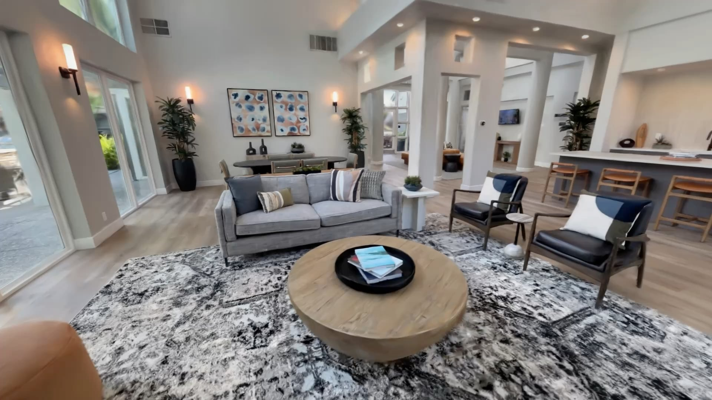

# 3D Gaussian Splat from any Video (Including 360) locally in your machine for free. 
Works with Intel, AMD, NVIDIA, Apple Silicon (Mac).

> Source: https://www.reddit.com/r/GaussianSplatting/comments/1vvf7ou/3d_gaussian_splat_from_any_video_including_360/
> Author: u/ArunKurian
> Posted: 2026-08-22T15:22:14+00:00
> Captured: 2026-10-15T08:55:18+00:00
> Score: 799 · Comments: 90
> Community: r/GaussianSplatting

## Post

No sign ups, No subscriptions, No upgrades, No Limits, fully local and free.   
  
\- A 5 Min 360 video took about 2 hours in a modern PC with a dedicated GPU.  
\- Metal / Vulkan accelerated SFM and trainer.   
\- Ships with SOTA Splat rendering engine : Auto LOD and COLLISION generation, tested on scenes with more than 250 million splats, no LOD popping.   
\- Render and export videos with keyframes.  
\- One click publish to AirVis to share with others. View in VR, standalone or CloudXR with Foveated Streaming for VisionPro.   
  
  
Check out [airvisstudio.com](http://airvisstudio.com)

## Media

> Original media URL: https://external-preview.redd.it/Y2Z1bDBua3MweWtoMX71SZnErRNgxaOWCFmdO-xV5U97NMvkBhOD7OIBSBS1.png?format=pjpg&auto=webp&s=2fb022d791bd08329d06ff46cdf2a2ea25af8b9f

[media/02-reddit-media.mp4](media/02-reddit-media.mp4)

> Original media URL: https://v.redd.it/nbc2tbks0ykh1

## Thread

> u/ArunKurian · 2026-08-23T08:10:51+00:00 · score 3 · [comment](https://www.reddit.com/r/GaussianSplatting/comments/1vvf7ou/3d_gaussian_splat_from_any_video_including_360/p5dcgvd/)

Thanks for checking out, really appreciate the detailed review and feedback. 

We hid a lot of knobs to keep it simple. But can enable some under the super user mode (just a toggle in settings), will change the 100K limit to 500K now, let me know what else you would like.  

Did you have issues with the current masking models ? I think there are some licensing restrictions for SAM3, maybe can add an option to plug in any external segmenting model under super user settings too, lmk.  

> u/ArunKurian · 2026-08-25T04:01:13+00:00 · score 1 · [comment](https://www.reddit.com/r/GaussianSplatting/comments/1vvf7ou/3d_gaussian_splat_from_any_video_including_360/p5qkdgc/)

Just pushed an update with Preset option in Splat training. Classic option is the OG gsplat default settings, should be very similar quality. 

> u/ArunKurian · 2026-08-22T18:27:57+00:00 · score 4 · [comment](https://www.reddit.com/r/GaussianSplatting/comments/1vvf7ou/3d_gaussian_splat_from_any_video_including_360/p59leqv/)

Initial lobby is iPhone 17, Exterior house is Insta360 X5 

> u/ArunKurian · 2026-08-22T18:35:26+00:00 · score 5 · [comment](https://www.reddit.com/r/GaussianSplatting/comments/1vvf7ou/3d_gaussian_splat_from_any_video_including_360/p59n1dw/)

Unfortunately not at the moment. All core tech is using vulkan api, so should be an easy enough port to Linux. At some point if enough requests come in, we will definitely.   

> u/ArunKurian · 2026-08-23T02:49:03+00:00 · score 2 · [comment](https://www.reddit.com/r/GaussianSplatting/comments/1vvf7ou/3d_gaussian_splat_from_any_video_including_360/p5c696l/)

Getting a lot of requests, so yup adding it soon. 

> u/ArunKurian · 2026-08-22T20:21:25+00:00 · score 2 · [comment](https://www.reddit.com/r/GaussianSplatting/comments/1vvf7ou/3d_gaussian_splat_from_any_video_including_360/p5a96qp/)

Yup. There are already some UE plugins for importing Splat scenes, we are also working on a SOTA version for huge scenes, should be out in a couple of weeks. 

> u/ArunKurian · 2026-08-23T15:50:10+00:00 · score 1 · [comment](https://www.reddit.com/r/GaussianSplatting/comments/1vvf7ou/3d_gaussian_splat_from_any_video_including_360/p5fe0fa/)

Mm strange, when pressing new workspace does it not do anything? 

> u/ArunKurian · 2026-08-23T15:49:16+00:00 · score 1 · [comment](https://www.reddit.com/r/GaussianSplatting/comments/1vvf7ou/3d_gaussian_splat_from_any_video_including_360/p5fdt6u/)

Is it only happening for older scenes like this or does it happen in recent scenes too ?   
Pixel gpus are really hard to work with took some time to tune for mali, now they switched go powervr i think. Will try to get one and tune it. Older scenes build lod tree on load maybe thats whats broken, if the newer scenes work fine. 

> u/ArunKurian · 2026-08-23T15:45:38+00:00 · score 1 · [comment](https://www.reddit.com/r/GaussianSplatting/comments/1vvf7ou/3d_gaussian_splat_from_any_video_including_360/p5fd0la/)

Caspar vulkan still experimental fast path for mapping, you can goto options in structure from motion, disable Vulkan acceleration for Sparse model to do it in CPU. 

> u/ArunKurian · 2026-08-23T22:28:50+00:00 · score 1 · [comment](https://www.reddit.com/r/GaussianSplatting/comments/1vvf7ou/3d_gaussian_splat_from_any_video_including_360/p5hs642/)

Plan to keep it free forever, AirVis platform with Cloud option will be the only paid offering.

> u/ArunKurian · 2026-08-26T13:42:07+00:00 · score 1 · [comment](https://www.reddit.com/r/GaussianSplatting/comments/1vvf7ou/3d_gaussian_splat_from_any_video_including_360/p609xet/)

We are figuring out a easy way to do it, for now we suggest importing the scan to SuperSplat editor, https://superspl.at/editor

Drop the model in, select areas you want to remove using the selecting tool, delete and export. 

> u/ArunKurian · 2026-09-01T12:48:05+00:00 · score 1 · [comment](https://www.reddit.com/r/GaussianSplatting/comments/1vvf7ou/3d_gaussian_splat_from_any_video_including_360/p763k5p/)

Ya will add it to the list. 

> u/ArunKurian · 2026-08-22T18:29:40+00:00 · score 2 · [comment](https://www.reddit.com/r/GaussianSplatting/comments/1vvf7ou/3d_gaussian_splat_from_any_video_including_360/p59ls4u/)

it might work, haven’t tested yet.

> u/ArunKurian · 2026-08-22T19:34:52+00:00 · score 3 · [comment](https://www.reddit.com/r/GaussianSplatting/comments/1vvf7ou/3d_gaussian_splat_from_any_video_including_360/p59zlno/)

Studio is fully free and has no limits. There is just a recommendation that you can override, just turn on super user in settings. 

> u/ArunKurian · 2026-08-22T20:29:36+00:00 · score 1 · [comment](https://www.reddit.com/r/GaussianSplatting/comments/1vvf7ou/3d_gaussian_splat_from_any_video_including_360/p5aav9g/)

Ya need to be a 360 video. 

> u/ArunKurian · 2026-08-22T22:41:05+00:00 · score 1 · [comment](https://www.reddit.com/r/GaussianSplatting/comments/1vvf7ou/3d_gaussian_splat_from_any_video_including_360/p5b07yb/)

Try airvis app, there are many scans people have shared 

> u/ArunKurian · 2026-08-23T02:47:46+00:00 · score 1 · [comment](https://www.reddit.com/r/GaussianSplatting/comments/1vvf7ou/3d_gaussian_splat_from_any_video_including_360/p5c620e/)

Hmm it is technically possible. We didn’t know if people really wanted to perform training on phones. Maybe we can enable a local training option in phone some time. 

> u/ArunKurian · 2026-08-24T03:35:50+00:00 · score 1 · [comment](https://www.reddit.com/r/GaussianSplatting/comments/1vvf7ou/3d_gaussian_splat_from_any_video_including_360/p5j8w8n/)

Thanks for the feedback, I do see a solid bug that can cause real bad quality issues in some datasets in Windows. Patching it now, will issue an update by tomorrow. 

> u/ArunKurian · 2026-08-25T04:09:04+00:00 · score 2 · [comment](https://www.reddit.com/r/GaussianSplatting/comments/1vvf7ou/3d_gaussian_splat_from_any_video_including_360/p5qljhr/)

Just pushed an update. Now you can pick Presets in Splat trainer, Classic option is the default gsplat trainer settings, Lite is mobile friendly output.   
Issue was that, we tuned trainer to push the splats to be more distributed and more opaque to help low power mobile gpu blend them easier when rendering, because of the added logic, some scenes would trip a  safety fuse and fall into really low quality setting.   
Classic option should take care of it and we also thought maybe it’s good to have it anyways. 

> u/ArunKurian · 2026-08-25T19:28:56+00:00 · score 1 · [comment](https://www.reddit.com/r/GaussianSplatting/comments/1vvf7ou/3d_gaussian_splat_from_any_video_including_360/p5v56cn/)

In Splat training preset options default is Lite, best for outputs to run in Mobile gpus, recently added Classic option, matching Gsplat strategy, should be much closer.

## Comments

> u/Nebulafactory · 2026-08-23T02:28:30+00:00 · score 18 · [comment](https://www.reddit.com/r/GaussianSplatting/comments/1vvf7ou/3d_gaussian_splat_from_any_video_including_360/p5c30dh/)

Been testing several other workflows to make finished splats from 360 footage and thought I'd give this a try.

Overall its honestly great considering its a free alternative that also works for MAC.

Quality-wise it is sadly not a replacement for something such as Litchfield Studio (the base 30€ paid version) as the masking is much better with their free use of SAM3 and has wider customization in reconstruction settings.

Using already made sparseclouds in COLMAP I still got slightly better quality training in Litchfield or Nerfstudio (also not a fan of the artifial 100k steps limit) but still really close quality to the point it wouldn't matter.

So yeah, the fact that youve encompased the full workflow into a simple no-subscription compatible for multiple platforms and with rivaling quality to that of similar alternatives earns my respect!

> u/Nebulafactory · 2026-08-23T14:55:13+00:00 · score 1 · [comment](https://www.reddit.com/r/GaussianSplatting/comments/1vvf7ou/3d_gaussian_splat_from_any_video_including_360/p5f1zi4/)

No worries!

I did see the super user setting but didn't really feel like it added much on that regards\^\^"

Similar to litchfield if possible I'd heavily suggest adding an option to use an external api token for SAM3.

Yours worked mostly fine but didn't appear to properly segment and missed/masked areas not meant to be.

> u/nullrecord · 2026-08-26T07:09:17+00:00 · score 1 · [comment](https://www.reddit.com/r/GaussianSplatting/comments/1vvf7ou/3d_gaussian_splat_from_any_video_including_360/p5ymfcq/)

>  free alternative that also works for MAC

Have you tried [3D Splat App](https://3dsplatapp.com/)? It's also free for Mac and pretty good. I'm not the author nor am I promoting it, I just use it and like it. The author's thread is [here](https://www.reddit.com/r/GaussianSplatting/comments/1s9jkv6/free_splat_training_app_for_mac/).

> u/losangelenoporvida · 2026-08-22T16:05:43+00:00 · score 17 · [comment](https://www.reddit.com/r/GaussianSplatting/comments/1vvf7ou/3d_gaussian_splat_from_any_video_including_360/p58q5rq/)

Looks good!  Will check it out - thanks for your work!

> u/Infinitecontextlabs · 2026-08-22T16:29:27+00:00 · score 4 · [comment](https://www.reddit.com/r/GaussianSplatting/comments/1vvf7ou/3d_gaussian_splat_from_any_video_including_360/p58va0x/)

Awesome, keep going!

> u/dbaker1989 · 2026-08-22T18:06:51+00:00 · score 5 · [comment](https://www.reddit.com/r/GaussianSplatting/comments/1vvf7ou/3d_gaussian_splat_from_any_video_including_360/p59gsx6/)

Very cool. What camera did you use for the house one?

> u/Roducktor · 2026-08-22T18:10:48+00:00 · score 4 · [comment](https://www.reddit.com/r/GaussianSplatting/comments/1vvf7ou/3d_gaussian_splat_from_any_video_including_360/p59hnwm/)

Just tested it and it works great (on mac)! For now I just uploades images from a old splat and it worked way smoother than with the colmap/ brush workflow I’ve been using before. Great work!

> u/steve91945 · 2026-08-22T18:15:55+00:00 · score 2 · [comment](https://www.reddit.com/r/GaussianSplatting/comments/1vvf7ou/3d_gaussian_splat_from_any_video_including_360/p59irx4/)

Let me know if there is a Linux version for DGX Spark

> u/Sweet_Outside826 · 2026-08-23T01:11:20+00:00 · score 1 · [comment](https://www.reddit.com/r/GaussianSplatting/comments/1vvf7ou/3d_gaussian_splat_from_any_video_including_360/p5bqasy/)

Wondering the same for DGX.

> u/Sweaty_Chair_4600 · 2026-08-23T02:33:01+00:00 · score 3 · [comment](https://www.reddit.com/r/GaussianSplatting/comments/1vvf7ou/3d_gaussian_splat_from_any_video_including_360/p5c3qku/)

Any linux support soon?

> u/mickabrig7 · 2026-08-23T08:39:54+00:00 · score 2 · [comment](https://www.reddit.com/r/GaussianSplatting/comments/1vvf7ou/3d_gaussian_splat_from_any_video_including_360/p5dfu84/)

Pls pls pls 🙏 
Can't wait to try it out

> u/Bibs628 · 2026-08-23T20:08:28+00:00 · score 1 · [comment](https://www.reddit.com/r/GaussianSplatting/comments/1vvf7ou/3d_gaussian_splat_from_any_video_including_360/p5gznh9/)

That would be fantastic, also the thing looks great ^^

> u/w3398608 · 2026-08-22T17:44:57+00:00 · score 2 · [comment](https://www.reddit.com/r/GaussianSplatting/comments/1vvf7ou/3d_gaussian_splat_from_any_video_including_360/p59byko/)

Can we have it in 4D? XD

> u/Honest-Sandwich-1075 · 2026-08-22T20:13:58+00:00 · score 2 · [comment](https://www.reddit.com/r/GaussianSplatting/comments/1vvf7ou/3d_gaussian_splat_from_any_video_including_360/p5a7msy/)

This looks amazing.   
I have a question, with my new Mac Studio arriving next week, can I create a Splat of a scene, then export it into Unreal Engine?

Can, and how can this be done!

Will deffo download though! Great stuff!

> u/Honest-Sandwich-1075 · 2026-08-22T20:23:11+00:00 · score 2 · [comment](https://www.reddit.com/r/GaussianSplatting/comments/1vvf7ou/3d_gaussian_splat_from_any_video_including_360/p5a9jvw/)

Love it. This is just the piece of software I was looking for! 🙌🏼 

> u/dbbernales · 2026-08-22T22:52:15+00:00 · score 2 · [comment](https://www.reddit.com/r/GaussianSplatting/comments/1vvf7ou/3d_gaussian_splat_from_any_video_including_360/p5b26lv/)

so it is possible also to export to blender?

> u/TacticalSugarPlum · 2026-08-22T20:18:43+00:00 · score 2 · [comment](https://www.reddit.com/r/GaussianSplatting/comments/1vvf7ou/3d_gaussian_splat_from_any_video_including_360/p5a8mgn/)

Pretty cool. Would gyro/accelerometer/GPS data help? Perhaps in future versions?

> u/Many-Victory-1825 · 2026-08-22T23:01:26+00:00 · score 2 · [comment](https://www.reddit.com/r/GaussianSplatting/comments/1vvf7ou/3d_gaussian_splat_from_any_video_including_360/p5b3t5s/)

THANK YOU SO MUCH! I've been trying to Gaussian Splat on my RX 7900XT for like over a year now and have had 0 luck. I've always dealt with bugs, crashes, random errors that weren't well documented, out of date, or the solutions just didn't work. I was just waiting till the 5080 Super came out cause of the performance, VRAM I need for work, and possibly a USB-C aftermarket model. This is the first time where the whole thing was just streamlined and just worked.

> u/ufimizm · 2026-08-23T10:22:40+00:00 · score 2 · [comment](https://www.reddit.com/r/GaussianSplatting/comments/1vvf7ou/3d_gaussian_splat_from_any_video_including_360/p5drscr/)

Sounds great, but it seems broken, for me at least - i am on Windows 11. Downloaded it, a window opened to view the video and it never proceed from there.

https://preview.redd.it/w3cfufsbp3lh1.png?width=1822&format=png&auto=webp&s=801014a77020cc314ea44147d23c52b7f6f2ede7

> u/ufimizm · 2026-08-23T18:35:03+00:00 · score 1 · [comment](https://www.reddit.com/r/GaussianSplatting/comments/1vvf7ou/3d_gaussian_splat_from_any_video_including_360/p5gfdfb/)

Perhaps I misunderstood the workflow, will check again.

Edit: Yes, sorry, my bad. I thought I was in a workspace already and the next step was opening the video and then I proceed from there ...  
Edit 2: Works really well!

> u/dperetti · 2026-08-24T22:35:55+00:00 · score 1 · [comment](https://www.reddit.com/r/GaussianSplatting/comments/1vvf7ou/3d_gaussian_splat_from_any_video_including_360/p5oyf2l/)

Made exactly the same mistake. Small UX issue here 😉

> u/Parking-Lemon-4203 · 2026-08-23T11:20:17+00:00 · score 2 · [comment](https://www.reddit.com/r/GaussianSplatting/comments/1vvf7ou/3d_gaussian_splat_from_any_video_including_360/p5dz92h/)

Hello ! I find your app really awesome. I will probably use in my work as a Engineer. But I'm facing an issue on my Google Pixel 11 Pro, the gaussian splats are strange...

For example, this scene [https://airvis.com/view/tWY6b0SdHhddVsrAij5O](https://airvis.com/view/tWY6b0SdHhddVsrAij5O)

Looks like the image on my phone

https://preview.redd.it/bsv2n1apz3lh1.png?width=1080&format=png&auto=webp&s=d5790641150907322dad3fd3102c80e367c63d6a

> u/Stir-Fried-Shrimp · 2026-09-09T22:38:38+00:00 · score 1 · [comment](https://www.reddit.com/r/GaussianSplatting/comments/1vvf7ou/3d_gaussian_splat_from_any_video_including_360/p8u8s7j/)

Same problem here and on pixel 11 pro also :/

> u/DefiantTechnology910 · 2026-08-23T11:23:41+00:00 · score 2 · [comment](https://www.reddit.com/r/GaussianSplatting/comments/1vvf7ou/3d_gaussian_splat_from_any_video_including_360/p5dzpqw/)

Airvis Studio: Caspar Vulkan mapping failed (colmap.exe exited with code -1073741819.). Partial mapper output was cleared; no Ceres, precision, or mapper-mode retry will run.

how do i fix this

> u/Lost-Upstairs-5311 · 2026-08-23T23:32:47+00:00 · score 1 · [comment](https://www.reddit.com/r/GaussianSplatting/comments/1vvf7ou/3d_gaussian_splat_from_any_video_including_360/p5i3sfm/)

are you trying to use a fisheye model? if so, capsar based BA optimization for that lens model is not yet written for colmap.

EDIT: this is only for the cuda implementation of colmap. I have no idea about caspar in vulkan for SFM.

> u/DefiantTechnology910 · 2026-08-23T23:47:11+00:00 · score 1 · [comment](https://www.reddit.com/r/GaussianSplatting/comments/1vvf7ou/3d_gaussian_splat_from_any_video_including_360/p5i6c63/)

I tried 360 video from MP4 and used their workflow by clicking next at every step

> u/Lost-Upstairs-5311 · 2026-08-24T00:49:25+00:00 · score 1 · [comment](https://www.reddit.com/r/GaussianSplatting/comments/1vvf7ou/3d_gaussian_splat_from_any_video_including_360/p5ih9wl/)

so very likely they are using either fisheye or equirect. For colmap on github, caspar is still only limited to simple pinhole with radial distortion. There are PR's for opencv pinhole, but none for fisheye yet. It is all in CUDA though. 

Looks like airvis has their own implementation of caspar in vulkan, which is not implemented in colmap github. And if they are like the github, their implementations are for only simple models.

Although a fallback to CPU would absolutely kill your speed.

> u/DefiantTechnology910 · 2026-08-24T03:16:32+00:00 · score 1 · [comment](https://www.reddit.com/r/GaussianSplatting/comments/1vvf7ou/3d_gaussian_splat_from_any_video_including_360/p5j5yi1/)

yeah it's dead slow

> u/HappyImagineer · 2026-08-23T13:13:08+00:00 · score 2 · [comment](https://www.reddit.com/r/GaussianSplatting/comments/1vvf7ou/3d_gaussian_splat_from_any_video_including_360/p5eha4c/)

PSA: The application is not limited to 1000 images or specific video length, you have to enable Super User from the Settings panel (gear in top left of window) but the application will not remember your settings on Mac so you have to re-enable it each time.

> u/Ok_Amoeba481 · 2026-08-23T22:17:32+00:00 · score 2 · [comment](https://www.reddit.com/r/GaussianSplatting/comments/1vvf7ou/3d_gaussian_splat_from_any_video_including_360/p5hq27w/)

Looks to be closed-source, so how long until the other shoe drops and you start a subscription model?

> u/kakarotken · 2026-08-26T11:01:22+00:00 · score 2 · [comment](https://www.reddit.com/r/GaussianSplatting/comments/1vvf7ou/3d_gaussian_splat_from_any_video_including_360/p5zfw0i/)

Hi I am new to this and thanks for your application i bought litchfield but without understanding the mechanics it didn't provide any usable output meanwhile your presets helped a lot , can you please tell if there are any tools to clean the GS all the blur stuff etc thanks again 

> u/kakarotken · 2026-09-01T12:24:01+00:00 · score 1 · [comment](https://www.reddit.com/r/GaussianSplatting/comments/1vvf7ou/3d_gaussian_splat_from_any_video_including_360/p75z48s/)

Thanks I checked it didn't get the expected output, another thing while researching i found like other tools use something called SAM for masking do you plan to use it in near future 

> u/kakarotken · 2026-09-01T18:43:30+00:00 · score 1 · [comment](https://www.reddit.com/r/GaussianSplatting/comments/1vvf7ou/3d_gaussian_splat_from_any_video_including_360/p78c59n/)

Thanks

> u/Vegetable-Corner1701 · 2026-08-22T17:36:00+00:00 · score 1 · [comment](https://www.reddit.com/r/GaussianSplatting/comments/1vvf7ou/3d_gaussian_splat_from_any_video_including_360/p599y0i/)

Seems promising,thanks for sharing will check it out

> u/Eliiiiiiiiiias · 2026-08-22T18:01:41+00:00 · score 1 · [comment](https://www.reddit.com/r/GaussianSplatting/comments/1vvf7ou/3d_gaussian_splat_from_any_video_including_360/p59foa1/)

I love you for doing this!

> u/VisibleFun9995 · 2026-08-22T18:02:28+00:00 · score 1 · [comment](https://www.reddit.com/r/GaussianSplatting/comments/1vvf7ou/3d_gaussian_splat_from_any_video_including_360/p59fubf/)

Can you also make a intel mac version ?Thanks 😬

> u/ThinkBackKat · 2026-08-22T18:07:03+00:00 · score 1 · [comment](https://www.reddit.com/r/GaussianSplatting/comments/1vvf7ou/3d_gaussian_splat_from_any_video_including_360/p59guhn/)

Does it work on videos that are software stabilized?

> u/Natural_Team_1904 · 2026-08-22T18:31:45+00:00 · score 1 · [comment](https://www.reddit.com/r/GaussianSplatting/comments/1vvf7ou/3d_gaussian_splat_from_any_video_including_360/p59m8ac/)

This looks great going to try this out!

> u/adi0398 · 2026-08-22T18:40:24+00:00 · score 1 · [comment](https://www.reddit.com/r/GaussianSplatting/comments/1vvf7ou/3d_gaussian_splat_from_any_video_including_360/p59o496/)

Awesome

> u/smoggybong · 2026-08-22T18:56:44+00:00 · score 1 · [comment](https://www.reddit.com/r/GaussianSplatting/comments/1vvf7ou/3d_gaussian_splat_from_any_video_including_360/p59rmua/)

Unreal. Huge thanks

> u/Johnbackwaters · 2026-08-22T19:32:20+00:00 · score 1 · [comment](https://www.reddit.com/r/GaussianSplatting/comments/1vvf7ou/3d_gaussian_splat_from_any_video_including_360/p59z2rn/)

100s video upload limit otherwise it is 20usd/month

> u/Johnbackwaters · 2026-08-22T21:24:47+00:00 · score 1 · [comment](https://www.reddit.com/r/GaussianSplatting/comments/1vvf7ou/3d_gaussian_splat_from_any_video_including_360/p5alz95/)

Okay thanks I will check it out now! 

> u/meta-meta-meta · 2026-08-22T20:25:58+00:00 · score 1 · [comment](https://www.reddit.com/r/GaussianSplatting/comments/1vvf7ou/3d_gaussian_splat_from_any_video_including_360/p5aa47w/)

Do I need to stitch the 360 video first? I have some raw captures from a Samsung Gear 360

> u/polawiaczperel · 2026-08-22T21:15:03+00:00 · score 1 · [comment](https://www.reddit.com/r/GaussianSplatting/comments/1vvf7ou/3d_gaussian_splat_from_any_video_including_360/p5ak2gg/)

I am looking for a technical partner from Europe with budget (like me), that would like to map whole countries. 

> u/n8dahwgg · 2026-08-22T22:14:54+00:00 · score 1 · [comment](https://www.reddit.com/r/GaussianSplatting/comments/1vvf7ou/3d_gaussian_splat_from_any_video_including_360/p5avei9/)

Cant wait to try this out. Thanks for doing this!

> u/FilteredOscillator · 2026-08-22T22:37:17+00:00 · score 1 · [comment](https://www.reddit.com/r/GaussianSplatting/comments/1vvf7ou/3d_gaussian_splat_from_any_video_including_360/p5azjst/)

Be interested to try this in VR. What would be the quickest workflow to scan my space and view it on quest? 

> u/Lost-Upstairs-5311 · 2026-08-22T22:38:46+00:00 · score 1 · [comment](https://www.reddit.com/r/GaussianSplatting/comments/1vvf7ou/3d_gaussian_splat_from_any_video_including_360/p5azt8u/)

Looks great, but where can we browse some sample splats? I don't see any on your website. 

I will be very impressed if you can deliver on no LOD popping. Both spark and supersplat are not there yet IMO. 

> u/Embarrassed-Car4720 · 2026-08-23T02:45:10+00:00 · score 1 · [comment](https://www.reddit.com/r/GaussianSplatting/comments/1vvf7ou/3d_gaussian_splat_from_any_video_including_360/p5c5naj/)

Is it possible to perform local convert on an iPad / iPhone like Scantic?  I have the app but it sends it to the cloud to convert.  

> u/Ovalman · 2026-08-23T13:59:45+00:00 · score 1 · [comment](https://www.reddit.com/r/GaussianSplatting/comments/1vvf7ou/3d_gaussian_splat_from_any_video_including_360/p5eqgns/)

Google Colab has free GPU's the user can leverage that could do the crunching. I built an end-to-end Image Recognition Model on Android that uses Colab.

I had a go at building my own 3D Splat pipeline but I failed miserably. I couldn't get anything to look remotely like the actual image I was trying to reproduce. I have my own GPU but the plan if I got it working was to use Colab GPUs. Give it a check out, the free tier gives a load of hours use per day of a very powerful GPU. You can also save checkpoints which is handy if you run out of your daily quota.

Thanks for this, I'm running my first splat now.

> u/Fluid-Explanation-75 · 2026-08-23T11:45:50+00:00 · score 1 · [comment](https://www.reddit.com/r/GaussianSplatting/comments/1vvf7ou/3d_gaussian_splat_from_any_video_including_360/p5e2toj/)

Google's next step, then true virtual reality will follow.  

> u/Fluid-Explanation-75 · 2026-08-23T11:53:23+00:00 · score 1 · [comment](https://www.reddit.com/r/GaussianSplatting/comments/1vvf7ou/3d_gaussian_splat_from_any_video_including_360/p5e3y5d/)

Google's next step, after which true virtual reality will arrive, all the training data compiled from Picasa, Flickr, and fotolog should be appreciated.

> u/HEnny7555 · 2026-08-23T14:55:45+00:00 · score 1 · [comment](https://www.reddit.com/r/GaussianSplatting/comments/1vvf7ou/3d_gaussian_splat_from_any_video_including_360/p5f23n4/)

Look amazing

> u/Fit-While5365 · 2026-08-23T16:16:55+00:00 · score 1 · [comment](https://www.reddit.com/r/GaussianSplatting/comments/1vvf7ou/3d_gaussian_splat_from_any_video_including_360/p5fk042/)

can GS support laterar movment? left /right? 

> u/Right_Special_2375 · 2026-08-23T16:56:22+00:00 · score 1 · [comment](https://www.reddit.com/r/GaussianSplatting/comments/1vvf7ou/3d_gaussian_splat_from_any_video_including_360/p5fsu04/)

When I enable SuperUser, there is still a max cap input of 15min video or 1000 images. Is there anyway to change this? 

Many thanks for sharing with the community! Testing this out to compare against other workflows. 

> u/Tongue_Chow · 2026-08-23T17:28:55+00:00 · score 1 · [comment](https://www.reddit.com/r/GaussianSplatting/comments/1vvf7ou/3d_gaussian_splat_from_any_video_including_360/p5g0aq8/)

Beautiful. As a surveyor this tech could enable a lot. I saw another similar open source product but this looks better quality. Is there a way to 'add point' in the render and then compare to given point locations to marry coordinate systems and ensure scale and everything are accurate to real world conditions and after aligning the render be able to add more 'points' to extract features..

> u/[deleted] · 2026-08-24T01:05:35+00:00 · score 1 · [comment](https://www.reddit.com/r/GaussianSplatting/comments/1vvf7ou/3d_gaussian_splat_from_any_video_including_360/p5ik3ei/)

[removed]

> u/[deleted] · 2026-08-24T16:27:09+00:00 · score 2 · [comment](https://www.reddit.com/r/GaussianSplatting/comments/1vvf7ou/3d_gaussian_splat_from_any_video_including_360/p5mm0h3/)

[removed]

> u/TimetravelerDD · 2026-08-24T06:54:42+00:00 · score 1 · [comment](https://www.reddit.com/r/GaussianSplatting/comments/1vvf7ou/3d_gaussian_splat_from_any_video_including_360/p5jysm8/)

can it work with more then video at once?  
edit: apparently not

> u/rats4final · 2026-08-24T07:54:35+00:00 · score 1 · [comment](https://www.reddit.com/r/GaussianSplatting/comments/1vvf7ou/3d_gaussian_splat_from_any_video_including_360/p5k5qu4/)

This looks very interesting, will try later, THANKS

> u/TimetravelerDD · 2026-08-24T10:30:00+00:00 · score 1 · [comment](https://www.reddit.com/r/GaussianSplatting/comments/1vvf7ou/3d_gaussian_splat_from_any_video_including_360/p5ko8s4/)

does it take into account position metadata embedded into pictures or videos?

> u/miusoftheTaiga · 2026-08-24T23:59:53+00:00 · score 1 · [comment](https://www.reddit.com/r/GaussianSplatting/comments/1vvf7ou/3d_gaussian_splat_from_any_video_including_360/p5pekcy/)

Wonderful stuff

> u/naelbasman · 2026-08-25T19:24:05+00:00 · score 1 · [comment](https://www.reddit.com/r/GaussianSplatting/comments/1vvf7ou/3d_gaussian_splat_from_any_video_including_360/p5v4152/)

I tried it and I think the Splatting trainer is less good than Litchfeld studio and im wondering why

> u/Londonskaterboi · 2026-08-26T12:20:18+00:00 · score 1 · [comment](https://www.reddit.com/r/GaussianSplatting/comments/1vvf7ou/3d_gaussian_splat_from_any_video_including_360/p5zta6u/)

no linux version?

> u/Unic00 · 2026-09-27T03:08:42+00:00 · score 1 · [comment](https://www.reddit.com/r/GaussianSplatting/comments/1vvf7ou/3d_gaussian_splat_from_any_video_including_360/pcap3en/)

Is there support for linux?

> u/aurioerox · 2026-08-22T19:14:05+00:00 · score 1 · [comment](https://www.reddit.com/r/GaussianSplatting/comments/1vvf7ou/3d_gaussian_splat_from_any_video_including_360/p59vami/)

Hey dm’ed u - would love to help u grow thsi

> u/Signager · 2026-08-22T19:15:37+00:00 · score 1 · [comment](https://www.reddit.com/r/GaussianSplatting/comments/1vvf7ou/3d_gaussian_splat_from_any_video_including_360/p59vm6t/)

This looks great, thank you!

Begginer question: Why make this when there's Reality Scan from Epic?

> u/HittyPittyReturns · 2026-08-23T02:40:54+00:00 · score 0 · [comment](https://www.reddit.com/r/GaussianSplatting/comments/1vvf7ou/3d_gaussian_splat_from_any_video_including_360/p5c4zkt/)

Because “reality scan from epic” can’t do this… ?

> u/Bessfren · 2026-08-26T08:59:09+00:00 · score 0 · [comment](https://www.reddit.com/r/GaussianSplatting/comments/1vvf7ou/3d_gaussian_splat_from_any_video_including_360/p5yzpqk/)

What is Gaussian splat 

## Links

- http://airvisstudio.com
