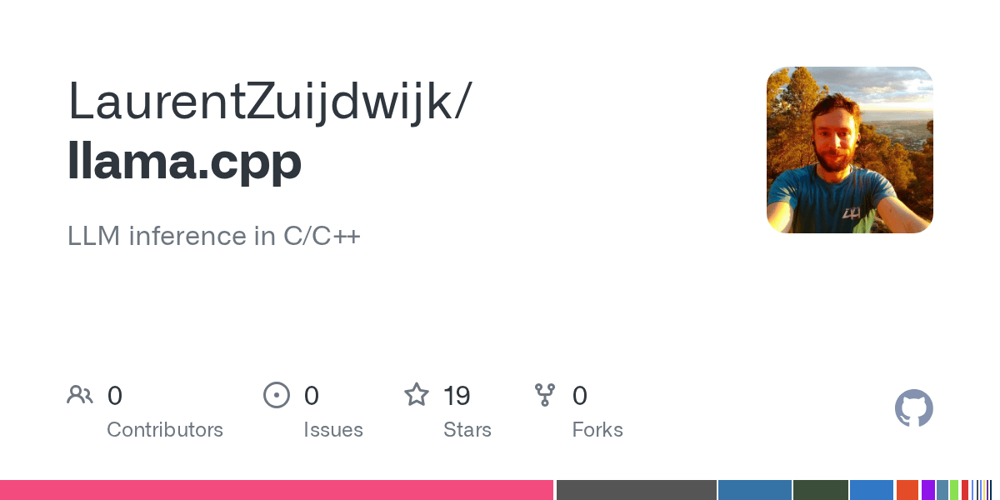

# Qwen3.8 27B ---> 65 t/s decode! Try it out

> Source: https://www.reddit.com/r/StrixHalo/comments/1vxx51g/qwen38_27b_65_ts_decode_try_it_out/
> Author: u/Dutchnamn
> Posted: 2026-08-25T11:28:46+00:00
> Captured: 2026-10-15T08:55:18+00:00
> Score: 92 · Comments: 83
> Community: r/StrixHalo

## Post

Follow up from my post a few days ago. We are now happy with the performance and hope some of you will try it. It would be especially helpful if the gains are validated on other hardware. 

How did we get there?

Token speculation:  
MTP and DFlash work well to speed up inference work, especially for dense models. However, different content types need different settings. Llama.cpp only supports a single value.  
This fork introduces adaptive speculation. You set the minimum and maximum and the engine will adjust the number of tokens that are suggested. This leads to improvements in token generation, especially in Qwen3.8. This is what enabled the 65 tokens per second.

After days of benchmarking other optimisations, we found improvements that affect prefill as well. Ornith now achieves 100t/s generation and 1800 on prefill.

I haven't published the Qwen3.8 fp4 dflash sidecar yet, hope to do that later and update this post.

It would be great to see confirmation of some of these numbers.  

Github: [https://github.com/LaurentZuijdwijk/llama.cpp](https://github.com/LaurentZuijdwijk/llama.cpp)  
  
Release: [https://github.com/LaurentZuijdwijk/llama.cpp/releases](https://github.com/LaurentZuijdwijk/llama.cpp/releases)

## Media

> Original media URL: https://external-preview.redd.it/raQ2EYqTQsesNOmBZfGz8UEj7QQ3kGAknEy4reVRcVY.png?auto=webp&s=b319e9540a3de144128bdaa8fcf019f5b85d02cb

## Thread

> u/Dutchnamn · 2026-08-25T12:02:29+00:00 · score 2 · [comment](https://www.reddit.com/r/StrixHalo/comments/1vxx51g/qwen38_27b_65_ts_decode_try_it_out/p5sbo5d/)

Yes, adaptive speculation will work on any quant and on ROCm as well. It has to do with the MTP/DFlash settings, not the quant type. Let me know what numbers you get. 

> u/Dutchnamn · 2026-08-25T12:06:28+00:00 · score 2 · [comment](https://www.reddit.com/r/StrixHalo/comments/1vxx51g/qwen38_27b_65_ts_decode_try_it_out/p5scd4z/)

There is a pre built release in the repo

> u/Dutchnamn · 2026-08-25T12:38:58+00:00 · score 5 · [comment](https://www.reddit.com/r/StrixHalo/comments/1vxx51g/qwen38_27b_65_ts_decode_try_it_out/p5siejh/)

The adaptive speculation can be a PR. Need a bit more validation across hardware. The fork contains other optimisations for vulkan/strix

> u/Dutchnamn · 2026-08-25T15:29:54+00:00 · score 2 · [comment](https://www.reddit.com/r/StrixHalo/comments/1vxx51g/qwen38_27b_65_ts_decode_try_it_out/p5tjn44/)

Maybe. Depends on the feedback I get but I think it will be useful

> u/Dutchnamn · 2026-08-25T16:11:17+00:00 · score 2 · [comment](https://www.reddit.com/r/StrixHalo/comments/1vxx51g/qwen38_27b_65_ts_decode_try_it_out/p5ttgcz/)

I only found that out today. But that PR is only for mtp and not dflash and uses a different algo as well. 

> u/Dutchnamn · 2026-08-26T11:30:18+00:00 · score 4 · [comment](https://www.reddit.com/r/StrixHalo/comments/1vxx51g/qwen38_27b_65_ts_decode_try_it_out/p5zkhtk/)

Mate, I spent days benchmarking this and fixing bugs from upstream. You are free not to use it. And yes best not to pull binaries but to build it yourself. 

Dflash was broken for some quants in mainline on vulkan.

> u/Dutchnamn · 2026-08-25T13:42:42+00:00 · score 2 · [comment](https://www.reddit.com/r/StrixHalo/comments/1vxx51g/qwen38_27b_65_ts_decode_try_it_out/p5svfym/)

Yes. Everything is configurable and it will work with any quant basically. Of  course your performance results might differ. 

> u/Dutchnamn · 2026-08-25T20:14:59+00:00 · score 1 · [comment](https://www.reddit.com/r/StrixHalo/comments/1vxx51g/qwen38_27b_65_ts_decode_try_it_out/p5vfz0t/)

The lemonade devs can contact me at any time 

> u/Dutchnamn · 2026-08-25T22:15:58+00:00 · score 2 · [comment](https://www.reddit.com/r/StrixHalo/comments/1vxx51g/qwen38_27b_65_ts_decode_try_it_out/p5w6tr4/)

Oh I didn't mean it in a negative way. Happy to help and yes, I might contact them. 

> u/Dutchnamn · 2026-08-26T22:12:23+00:00 · score 1 · [comment](https://www.reddit.com/r/StrixHalo/comments/1vxx51g/qwen38_27b_65_ts_decode_try_it_out/p63k5v3/)

Nice! It is better to build it yourself than use those releases!

> u/Dutchnamn · 2026-08-25T15:34:46+00:00 · score 1 · [comment](https://www.reddit.com/r/StrixHalo/comments/1vxx51g/qwen38_27b_65_ts_decode_try_it_out/p5tkrpm/)

How would you run it? As a docker container?

> u/Dutchnamn · 2026-08-25T16:36:10+00:00 · score 2 · [comment](https://www.reddit.com/r/StrixHalo/comments/1vxx51g/qwen38_27b_65_ts_decode_try_it_out/p5tzgqa/)

It is all backwards compatible indeed. Just optimised for adaptive speculation, FPx quants and some vulkan tricks. 

> u/Dutchnamn · 2026-08-26T07:05:42+00:00 · score 1 · [comment](https://www.reddit.com/r/StrixHalo/comments/1vxx51g/qwen38_27b_65_ts_decode_try_it_out/p5ylzbt/)

What is slower? Dflash? That is expected. MTP should be faster than maonline

> u/Dutchnamn · 2026-08-26T07:10:53+00:00 · score 2 · [comment](https://www.reddit.com/r/StrixHalo/comments/1vxx51g/qwen38_27b_65_ts_decode_try_it_out/p5ymmly/)

I measured up to 32k and ther is still improvement. Use MTP for long context. 

> u/Dutchnamn · 2026-08-25T14:00:59+00:00 · score 3 · [comment](https://www.reddit.com/r/StrixHalo/comments/1vxx51g/qwen38_27b_65_ts_decode_try_it_out/p5szfk5/)

I am not. How do I get there?

> u/Dutchnamn · 2026-08-25T17:47:14+00:00 · score 1 · [comment](https://www.reddit.com/r/StrixHalo/comments/1vxx51g/qwen38_27b_65_ts_decode_try_it_out/p5ugqvs/)

You could ask kyuz0 to add my fork to his toolbox of course. I am busy creating a repo that will make it easier to install this 

> u/Dutchnamn · 2026-08-25T14:27:06+00:00 · score 1 · [comment](https://www.reddit.com/r/StrixHalo/comments/1vxx51g/qwen38_27b_65_ts_decode_try_it_out/p5t57y0/)

[https://huggingface.co/agentionai/Qwen3.8-27B-DFlash2-ROCmFP4-FAST-GGUF](https://huggingface.co/agentionai/Qwen3.8-27B-DFlash2-ROCmFP4-FAST-GGUF)

Uploaded it very recently. Will update the readme. Thanks for trying it out!

> u/Dutchnamn · 2026-08-25T14:42:11+00:00 · score 2 · [comment](https://www.reddit.com/r/StrixHalo/comments/1vxx51g/qwen38_27b_65_ts_decode_try_it_out/p5t8nnh/)

You can just use the z-labs gguf this is based on. It is the same as that. In a specific combination this gave higher acceptance and led to the benchmark numbers.

> u/Dutchnamn · 2026-08-25T15:01:15+00:00 · score 1 · [comment](https://www.reddit.com/r/StrixHalo/comments/1vxx51g/qwen38_27b_65_ts_decode_try_it_out/p5td24s/)

The difference is small. I would say try it out. I have Q4 and Q6 and FP4. Each with different reasoning settings. 

> u/Dutchnamn · 2026-08-25T16:37:33+00:00 · score 1 · [comment](https://www.reddit.com/r/StrixHalo/comments/1vxx51g/qwen38_27b_65_ts_decode_try_it_out/p5tzstu/)

Did you set the adaptive speculative decoding flag? Also, adaptive MTP might be good in your case

> u/Dutchnamn · 2026-08-25T16:49:05+00:00 · score 2 · [comment](https://www.reddit.com/r/StrixHalo/comments/1vxx51g/qwen38_27b_65_ts_decode_try_it_out/p5u2ldi/)

There is quite a bit of info in the readme. batching is important, as is min and max for speculation. For max numbers ask for creation of json. 

It would make sense to try to copy my setup, see if you get the same numbers and then try those for Q8. Tbh, I didn't bench Q8 too much. 

> u/Dutchnamn · 2026-08-26T07:09:00+00:00 · score 1 · [comment](https://www.reddit.com/r/StrixHalo/comments/1vxx51g/qwen38_27b_65_ts_decode_try_it_out/p5yme32/)

I will look at this.

> u/Dutchnamn · 2026-08-26T12:19:19+00:00 · score 1 · [comment](https://www.reddit.com/r/StrixHalo/comments/1vxx51g/qwen38_27b_65_ts_decode_try_it_out/p5zt3mc/)

I might have found something. Will try to replicate and push out a fix. 

> u/Dutchnamn · 2026-08-25T18:07:35+00:00 · score 2 · [comment](https://www.reddit.com/r/StrixHalo/comments/1vxx51g/qwen38_27b_65_ts_decode_try_it_out/p5ulqtf/)

I didn't test it. Can you give it a go? 

> u/Dutchnamn · 2026-08-25T23:27:34+00:00 · score 1 · [comment](https://www.reddit.com/r/StrixHalo/comments/1vxx51g/qwen38_27b_65_ts_decode_try_it_out/p5wkp0h/)

Not really. I am interested if it feels faster in daily use. For me ornith now feels like using Claude code speed wise. Quite amazing. Qwen dense feels like an MoE

> u/Dutchnamn · 2026-08-25T19:16:40+00:00 · score 1 · [comment](https://www.reddit.com/r/StrixHalo/comments/1vxx51g/qwen38_27b_65_ts_decode_try_it_out/p5v2a2a/)

Thanks! 

> u/Dutchnamn · 2026-08-27T12:18:45+00:00 · score 1 · [comment](https://www.reddit.com/r/StrixHalo/comments/1vxx51g/qwen38_27b_65_ts_decode_try_it_out/p6765um/)

Thanks! AMD is working on a lighter weight runtime, we will see what that brings!

> u/Dutchnamn · 2026-08-25T14:11:23+00:00 · score 1 · [comment](https://www.reddit.com/r/StrixHalo/comments/1vxx51g/qwen38_27b_65_ts_decode_try_it_out/p5t1p8r/)

What has quality issues? The quant you tried? You can use this llamacpp fork with any quant

## Comments

> u/Zhelgadis · 2026-08-25T11:58:32+00:00 · score 10 · [comment](https://www.reddit.com/r/StrixHalo/comments/1vxx51g/qwen38_27b_65_ts_decode_try_it_out/p5sazan/)

Does it also work on q8 quant? That's a game changer 

> u/Zhelgadis · 2026-08-25T12:03:58+00:00 · score 2 · [comment](https://www.reddit.com/r/StrixHalo/comments/1vxx51g/qwen38_27b_65_ts_decode_try_it_out/p5sbxeg/)

Need to build your branch first. I used kyuz0's toolboxes till now, so little practical experience on this 

> u/Revolutionary_Loan13 · 2026-08-26T15:08:18+00:00 · score 2 · [comment](https://www.reddit.com/r/StrixHalo/comments/1vxx51g/qwen38_27b_65_ts_decode_try_it_out/p60tcf4/)

I moved from the toolboxes to lemonade server as that is even easier 

> u/Potential-Leg-639 · 2026-08-25T12:31:57+00:00 · score 1 · [comment](https://www.reddit.com/r/StrixHalo/comments/1vxx51g/qwen38_27b_65_ts_decode_try_it_out/p5sh2bf/)

Create a directory, cd into it, start an agent and tell it what you want to do and which hardware you have. It will download the repo and build it with parameters for strix halo. At the end you will have a working llama.cpp built.

> u/Potential-Leg-639 · 2026-08-27T19:58:44+00:00 · score 2 · [comment](https://www.reddit.com/r/StrixHalo/comments/1vxx51g/qwen38_27b_65_ts_decode_try_it_out/p6a4bpx/)

Those 65 are not reproduceable, maybe for a millisecond with a tiny request. For normal context sizes this repo gave me low speeds.

> u/ConsiderationLate768 · 2026-08-25T12:29:45+00:00 · score 7 · [comment](https://www.reddit.com/r/StrixHalo/comments/1vxx51g/qwen38_27b_65_ts_decode_try_it_out/p5sgnd2/)

What makes this specific to strix halo instead of being a PR for main llama?

> u/AdditionalPuddings · 2026-08-25T15:26:59+00:00 · score 3 · [comment](https://www.reddit.com/r/StrixHalo/comments/1vxx51g/qwen38_27b_65_ts_decode_try_it_out/p5tiymg/)

Are there long term plans to push upstream? Really appreciate the work here to add knobs for the halo series.

> u/PeoBran · 2026-08-25T16:05:40+00:00 · score 1 · [comment](https://www.reddit.com/r/StrixHalo/comments/1vxx51g/qwen38_27b_65_ts_decode_try_it_out/p5ts4c3/)

There is already a PR#27210  
https://github.com/ggml-org/llama.cpp/pull/27210#issue-5167413588

> u/madezaen · 2026-08-26T11:14:45+00:00 · score 1 · [comment](https://www.reddit.com/r/StrixHalo/comments/1vxx51g/qwen38_27b_65_ts_decode_try_it_out/p5zhyzd/)

> The fork contains other optimisations for vulkan/strix

Arbitrary vibecoded changes?
This is why I hate this "install my fork" approach, essentially I'm supposed to run random executable on my machine. With the mainline llama.cpp, a lot of people interact with both the code and binaries, so any funny business will be caught eventually. Here? There could be a credential stealer added for all we know.

> u/mecshades · 2026-08-26T14:34:50+00:00 · score 1 · [comment](https://www.reddit.com/r/StrixHalo/comments/1vxx51g/qwen38_27b_65_ts_decode_try_it_out/p60lmax/)

Glad I am not the only one who feels similarly. I am fatigued by a bunch of mysterious forks popping up. I don't have time to comb through all the source to verify if something malicious has been injected or not and that's a big vector of attack for some. I'm not that desperate for faster decode. If it's true, it will show up in official llama.cpp eventually.

> u/AdministrativeMeat3 · 2026-08-26T16:56:27+00:00 · score 0 · [comment](https://www.reddit.com/r/StrixHalo/comments/1vxx51g/qwen38_27b_65_ts_decode_try_it_out/p61j5jb/)

Most of the time these guys aren't pushing out malware, but they are wildly overstating what they're able to achieve.

Hitting 65 t/s decode with no thinking and temperature 0 with some random ass speculative decoding approach means nothing to me. I wish these people would actually be upfront about what they achieve under real conditions doing real inference work. 

I almost guarantee the amount of token rejections you're going to get from this approach is going to make the model effectively useless. 

> u/hiImMate · 2026-08-25T12:58:12+00:00 · score 2 · [comment](https://www.reddit.com/r/StrixHalo/comments/1vxx51g/qwen38_27b_65_ts_decode_try_it_out/p5sm7ub/)

sorry, I'm super new, this works with Unsloth GGUF version without any cost to accuracy?

> u/hiImMate · 2026-08-25T18:09:22+00:00 · score 3 · [comment](https://www.reddit.com/r/StrixHalo/comments/1vxx51g/qwen38_27b_65_ts_decode_try_it_out/p5um6dl/)

okay I managed to get it running on Windows + Lemonade + MTP - it's pretty much the same as the built-in mtp head in terms of performance. Sadly lemonade and dflash does not wanna work together too much so that's it for experimenting right now. 

> u/pstuart · 2026-08-25T20:05:35+00:00 · score 2 · [comment](https://www.reddit.com/r/StrixHalo/comments/1vxx51g/qwen38_27b_65_ts_decode_try_it_out/p5vdsiv/)

The velocity of Lemonade development is very encouraging, so I imagine these issues will not be ignored.

> u/pstuart · 2026-08-25T22:14:08+00:00 · score 1 · [comment](https://www.reddit.com/r/StrixHalo/comments/1vxx51g/qwen38_27b_65_ts_decode_try_it_out/p5w6g9a/)

Sure, but as others have noted that the Lemonade discord is quite active and you can chat there and have an open conversation. Just a suggestion, you do you.

> u/pstuart · 2026-08-25T22:17:53+00:00 · score 2 · [comment](https://www.reddit.com/r/StrixHalo/comments/1vxx51g/qwen38_27b_65_ts_decode_try_it_out/p5w77kq/)

All good. It's a valuable forum if you're interested wringing performance from your strix halo.

> u/Potential_Block4598 · 2026-08-26T16:46:23+00:00 · score 1 · [comment](https://www.reddit.com/r/StrixHalo/comments/1vxx51g/qwen38_27b_65_ts_decode_try_it_out/p61gpal/)

How did you do this ?!

> u/hiImMate · 2026-08-26T16:55:09+00:00 · score 2 · [comment](https://www.reddit.com/r/StrixHalo/comments/1vxx51g/qwen38_27b_65_ts_decode_try_it_out/p61iuab/)

Point free chatgpt at the github (not /releases) and tell it you want to build windows vulkan back-end and to give step-by-step powershell instrcutions for a custom folder. It will help you build the windows version wtih an .exe output that works with lemonade

then you can set the lemonade back-end to your custom exe.

> u/bwelton · 2026-08-25T15:32:17+00:00 · score 2 · [comment](https://www.reddit.com/r/StrixHalo/comments/1vxx51g/qwen38_27b_65_ts_decode_try_it_out/p5tk6yi/)

Any likelyhood of releasing a version for us Windows users (non WSL) ?  
I would like to either use it directly as llama.cpp and / or update Lemonade or LM Studio to use it if possible ?

Great work anyway, well done. 

> u/bwelton · 2026-08-25T15:39:35+00:00 · score 1 · [comment](https://www.reddit.com/r/StrixHalo/comments/1vxx51g/qwen38_27b_65_ts_decode_try_it_out/p5tlwbu/)

llama-server 

> u/paul-home · 2026-08-25T15:38:37+00:00 · score 1 · [comment](https://www.reddit.com/r/StrixHalo/comments/1vxx51g/qwen38_27b_65_ts_decode_try_it_out/p5tlo8t/)

Me too! This looks amazing.

> u/Potential_Block4598 · 2026-08-26T16:47:18+00:00 · score 1 · [comment](https://www.reddit.com/r/StrixHalo/comments/1vxx51g/qwen38_27b_65_ts_decode_try_it_out/p61gxd0/)

Building on windows is very tricky and raises other issues tbh   
You could try it but it is not pleasant 

Meanwhile WSL is now easier to have ROCm running on 

> u/willardtjustice · 2026-08-25T16:34:13+00:00 · score 2 · [comment](https://www.reddit.com/r/StrixHalo/comments/1vxx51g/qwen38_27b_65_ts_decode_try_it_out/p5tyzvy/)

I'm somewhat new to this (a couple of months) and have a GMKTec EVO X2, so I should be able to run this given it's the same chipset. Question, I should be able to continue running other models if I use this custom build on my machine, just likely not see the gains unless I use the specific models that are tuned here?

> u/willardtjustice · 2026-08-25T16:49:54+00:00 · score 2 · [comment](https://www.reddit.com/r/StrixHalo/comments/1vxx51g/qwen38_27b_65_ts_decode_try_it_out/p5u2soj/)

Thank you good sir, will pull the release later today and check it all out.  Thanks again!

> u/Potential-Leg-639 · 2026-08-25T18:27:39+00:00 · score 2 · [comment](https://www.reddit.com/r/StrixHalo/comments/1vxx51g/qwen38_27b_65_ts_decode_try_it_out/p5uqmv4/)

Why no vision?

> u/fsalucard · 2026-08-26T00:25:10+00:00 · score 2 · [comment](https://www.reddit.com/r/StrixHalo/comments/1vxx51g/qwen38_27b_65_ts_decode_try_it_out/p5wvgxo/)

It's cool for short context.  Starts at >500 prefill and can get decent decode speeds, but crashes to 80 prefill by 100k context which becomes cumbersome.  I don't have this problem with standard llama.cpp, but it's slower at low-context.

> u/Head_Cucumber7615 · 2026-08-26T17:50:02+00:00 · score 1 · [comment](https://www.reddit.com/r/StrixHalo/comments/1vxx51g/qwen38_27b_65_ts_decode_try_it_out/p61w0pr/)

I see the same crash (device lost) at around 90k comtext with DFlash2, doesn't crash with MTP. However, MTP seems to be significantly slower.

> u/fsalucard · 2026-08-26T17:51:12+00:00 · score 1 · [comment](https://www.reddit.com/r/StrixHalo/comments/1vxx51g/qwen38_27b_65_ts_decode_try_it_out/p61watg/)

Yup, the crashing I meant was in speed but it does completely crash after some back and forth at high context.  I can get to 130-150k but it's crawling (50 prefill) and eventually crashes.

> u/Dazzling_Equipment_9 · 2026-08-26T01:30:00+00:00 · score 2 · [comment](https://www.reddit.com/r/StrixHalo/comments/1vxx51g/qwen38_27b_65_ts_decode_try_it_out/p5x7cdp/)

Is there tg and pp speed performance when the context reaches 10k, 20k, 40k, 60k, 90k, 120k…… ...? I think stability in a long context is the key to being really practical.

> u/stereohype · 2026-09-03T16:48:12+00:00 · score 2 · [comment](https://www.reddit.com/r/StrixHalo/comments/1vxx51g/qwen38_27b_65_ts_decode_try_it_out/p7lxzre/)

Good numbers on the structured-output class — I benched this fork's claims a few days ago and wrote up the full receipts. Some data points that might be useful for anyone deciding which stack to run:

**The 65 t/s is real but content-class-specific.** Same class (repetitive structured emission) measured 48 t/s peak on Nathan's v0.7.3 line with the MTP sidecar on Flash-Next. On Qwen3.8-27B + DFlash2, I see 34 t/s on JSON emission and 30 t/s sustained on mixed agent traffic. The spread between "structured output" and real agent traffic is the biggest variable nobody's benchmarking — which is why I built a [game-build harness](https://github.com/aic0d3r/neon-ladder) that measures agent workloads specifically.

**Laurent's adaptive draft-sizing controller is genuinely good** — I ported it onto Nathan's fork ([PR #8](https://github.com/Nathanw1014/llama.cpp/pull/8)) and it wins +25% on tool-call emission classes over fixed draft width on DFlash2. Full credit to Laurent for the design. But it loses on MTP chained drafts (same controller, same harness, both directions measured) — so the right stack depends on your drafter mechanism.

**Where I saw the fork's binary fall behind Nathan's line** (same models, same template, same session): shallow prefill was actually ahead (+12.7%), but deep prefill collapsed — -37.6% at 32k, -61.9% at 64k. And spec-decode throughput ran ~50% under Nathan's under identical config. That was on the b10641 tag; may have improved since.

**The practical takeaway for agent workloads on this APU:** Nathan's v0.7.3 with native build + your system Mesa stable is the fastest full-stack I've measured — 30-40 t/s sustained decode on real agent sessions (peak 48.7), 353 t/s prefill with Flash-Next + MTP. The portable payload leaves 6-24% on the table vs a native build, which matters more than the fork choice at that point.

Happy to share bench configs if anyone wants to reproduce — the harness is [public](https://github.com/aic0d3r/neon-ladder) and one cell takes ~25 minutes.

> u/ZookeepergameOdd7025 · 2026-09-08T22:34:51+00:00 · score 2 · [comment](https://www.reddit.com/r/StrixHalo/comments/1vxx51g/qwen38_27b_65_ts_decode_try_it_out/p8mya7a/)

太強了

> u/Competitive_Gap7906 · 2026-08-25T12:29:59+00:00 · score 2 · [comment](https://www.reddit.com/r/StrixHalo/comments/1vxx51g/qwen38_27b_65_ts_decode_try_it_out/p5sgoxu/)

Hi u/Dutchnamn , are you on the Strix Halo discord community? It would be great to discuss with you 😄 .

> u/Competitive_Gap7906 · 2026-08-25T15:04:32+00:00 · score 4 · [comment](https://www.reddit.com/r/StrixHalo/comments/1vxx51g/qwen38_27b_65_ts_decode_try_it_out/p5tdsxk/)

[https://discord.gg/pnPRyucNrG](https://discord.gg/pnPRyucNrG)

It's the public discord that you can find on this website -> [https://strixhalo.wiki/](https://strixhalo.wiki/) (i am not the admin but we are a lot of people)

> u/PeoBran · 2026-08-25T16:53:07+00:00 · score 2 · [comment](https://www.reddit.com/r/StrixHalo/comments/1vxx51g/qwen38_27b_65_ts_decode_try_it_out/p5u3kse/)

Is it possible to have a docker container with llama-server in it ? Like kyuz0 toolbox here : https://github.com/kyuz0/amd-strix-halo-toolboxes#experimental--custom-toolboxes

Thank you

> u/Trakeen · 2026-08-25T21:30:30+00:00 · score 0 · [comment](https://www.reddit.com/r/StrixHalo/comments/1vxx51g/qwen38_27b_65_ts_decode_try_it_out/p5vx9sc/)

Any agent can build that for you. I run multiple llama containers on a halo with different models for different purposes

> u/Icy_Article8511 · 2026-08-25T14:24:35+00:00 · score 1 · [comment](https://www.reddit.com/r/StrixHalo/comments/1vxx51g/qwen38_27b_65_ts_decode_try_it_out/p5t4nlo/)

Trying to reproduce this using given command lines, where can i find Qwen3.8-27B-DFlash2-Q4\_0\_ROCMFP4\_FAST.gguf ?

> u/omlette_du_chomage · 2026-08-25T14:37:08+00:00 · score 2 · [comment](https://www.reddit.com/r/StrixHalo/comments/1vxx51g/qwen38_27b_65_ts_decode_try_it_out/p5t7hvl/)

Is there a Q8?

> u/omlette_du_chomage · 2026-08-25T14:54:32+00:00 · score 1 · [comment](https://www.reddit.com/r/StrixHalo/comments/1vxx51g/qwen38_27b_65_ts_decode_try_it_out/p5tbhzs/)

Thanks! Any idea what I could expect with Q8?

> u/omlette_du_chomage · 2026-08-25T16:34:36+00:00 · score 2 · [comment](https://www.reddit.com/r/StrixHalo/comments/1vxx51g/qwen38_27b_65_ts_decode_try_it_out/p5tz37l/)

On Q8 K L model with Q8 DFlash2 I think I see about 10% increase with tok/s, but prefill starts much higher ~532 vs ~380-350 without DFlash.

I haven't run any benchmarks, just looking at logs

> u/omlette_du_chomage · 2026-08-25T16:41:32+00:00 · score 1 · [comment](https://www.reddit.com/r/StrixHalo/comments/1vxx51g/qwen38_27b_65_ts_decode_try_it_out/p5u0rcj/)

Yes, although I'm not sure whether the rest of my flags are optimal. Would you suggest a full config for my setup/Q8? 

> u/Icy_Article8511 · 2026-08-26T00:43:49+00:00 · score 1 · [comment](https://www.reddit.com/r/StrixHalo/comments/1vxx51g/qwen38_27b_65_ts_decode_try_it_out/p5wywmt/)

I got an assert in a code writing task.

>1.09.887.711 I slot print\_timing: id  2 | task 163 | prompt processing, n\_tokens =   7894, progress = 1.00, t =  20.93 s / 377.15 tokens per second  
/home/laurent/Projects/llama.cpp/src/models/dflash.cpp:405: GGML\_ASSERT(n\_blocks > 0 && n\_tokens % n\_blocks == 0) failed  
:  
\#6  0x00007f73dea6cfec in build\_dflash2\_conv(llm\_graph\_context&, ggml\_tensor\*, ggml\_tensor\*, ggml\_tensor\*, int) () from /home/durand/prj/q38rocm-2/llama-b10641/libllama.so.0  
\#7  0x00007f73dea6f917 in llama\_model\_dflash::graph<false>::graph(llama\_model const&, llm\_graph\_params const&) () from /home/durand/prj/q38rocm-2/llama-b10641/libllama.so.0

for performance i get about 40 t/s when running ./scripts/benchmark.py, so something isnt quite right:

>\[1/4\] Benchmarking: Binary Search Tree (Python)... 44.07 tok/s | TTFT: 561.32ms | MTP Acc: 74.6%  
\[2/4\] Benchmarking: Math Puzzle (Widget Factory)... 39.75 tok/s | TTFT: 375.43ms | MTP Acc: 65.9%  
\[3/4\] Benchmarking: JSON Entity Extractor... 44.11 tok/s | TTFT: 368.34ms | MTP Acc: 74.8%  
\[4/4\] Benchmarking: UMA vs Discrete Architecture... 32.51 tok/s | TTFT: 316.15ms | MTP Acc: 59.6%

this is using the binary prebuilt binary ./llama-b10641/llama-server

HW is bosgame M5 128gb, fedora 44, 7.1.8-200, linux/strix halo settings should be mostly okay, but could always have missed something.

> u/Queasy_Asparagus69 · 2026-08-25T17:55:39+00:00 · score 1 · [comment](https://www.reddit.com/r/StrixHalo/comments/1vxx51g/qwen38_27b_65_ts_decode_try_it_out/p5uit56/)

Any improvements for deepseek flash 0731?

> u/Queasy_Asparagus69 · 2026-08-25T18:12:50+00:00 · score 1 · [comment](https://www.reddit.com/r/StrixHalo/comments/1vxx51g/qwen38_27b_65_ts_decode_try_it_out/p5un0ls/)

Yeah, will try tonight. Do you prefer a certain test command?

> u/krezolpl · 2026-08-25T18:41:18+00:00 · score 1 · [comment](https://www.reddit.com/r/StrixHalo/comments/1vxx51g/qwen38_27b_65_ts_decode_try_it_out/p5utwze/)

I have dual rx9070 setup with 32gb vram, will test it out

> u/Orchicon · 2026-08-25T22:52:36+00:00 · score 1 · [comment](https://www.reddit.com/r/StrixHalo/comments/1vxx51g/qwen38_27b_65_ts_decode_try_it_out/p5we09x/)

Guess I know what I'll be trying tonight!

Are these numbers under heavy context or just simple questions?

> u/Head_Cucumber7615 · 2026-08-26T04:36:36+00:00 · score 1 · [comment](https://www.reddit.com/r/StrixHalo/comments/1vxx51g/qwen38_27b_65_ts_decode_try_it_out/p5y2kqf/)

Tried it out today, getting ~30 t/s decode with dflash on rocmfp4 compared to ~20 t/s with mainstream llama with MTP. 
In log t/s go between 20 and 40, but I was not able to see 65 t/s. Built from sources. Am I missing anything? 

> u/feelspeaceman · 2026-08-27T12:11:00+00:00 · score 1 · [comment](https://www.reddit.com/r/StrixHalo/comments/1vxx51g/qwen38_27b_65_ts_decode_try_it_out/p674rbe/)

This is very cool! I hope one day we will get a kernel optimized build for Strix Halo like Ninfer of 5090, this will push the hardware efficiency to closer to maximum theory.

> u/Duviwin · 2026-08-25T14:09:13+00:00 · score 0 · [comment](https://www.reddit.com/r/StrixHalo/comments/1vxx51g/qwen38_27b_65_ts_decode_try_it_out/p5t184t/)

Tried it out, unfortunately it looks like it has quality issues. I tried it with deepswe, it failed my first 4 easy tasks set, while some other qwen3.8 rocmfp4 fast score 4/4.

> u/[deleted] · 2026-08-25T15:02:00+00:00 · score 1 · [comment](https://www.reddit.com/r/StrixHalo/comments/1vxx51g/qwen38_27b_65_ts_decode_try_it_out/p5td88o/)

[removed]

> u/Duviwin · 2026-08-25T15:04:00+00:00 · score 1 · [comment](https://www.reddit.com/r/StrixHalo/comments/1vxx51g/qwen38_27b_65_ts_decode_try_it_out/p5tdokw/)

So great decode speed numbers, but both pp speed and eventual eval quality are both blockers for me.

> u/Duviwin · 2026-08-25T15:10:04+00:00 · score 1 · [comment](https://www.reddit.com/r/StrixHalo/comments/1vxx51g/qwen38_27b_65_ts_decode_try_it_out/p5tf2da/)

Hmm, maybe I shouldn't be using that lmcoleman model with vulkan though, could that be it?

> u/Duviwin · 2026-08-26T14:33:08+00:00 · score 1 · [comment](https://www.reddit.com/r/StrixHalo/comments/1vxx51g/qwen38_27b_65_ts_decode_try_it_out/p60l8ih/)

https://preview.redd.it/81n6qhpqcqlh1.png?width=1504&format=png&auto=webp&s=315cf3a7ef5e96103f34e16752b5941b349bf4b7

So tried with the julianmb model now (with llama server flags from repo readme, listed below). PP is better but still drops quickly after 10K context. And quality still worse, not passing any deespswe test, my llama cpp gets stuck in generation phase and when I turned off reasoning, the model went into a loop.  

In thescreenshot above speeds vs context use of a few deepswe runs.

      -hf  julianmb/Qwen-3.8-27B-ROCmFP4-FAST-GGUF:FAST \
      -hfd agentionai/Qwen3.8-27B-DFlash2-ROCmFP4-FAST-GGUF \

> u/weirdw3azel · 2026-08-26T21:57:53+00:00 · score 1 · [comment](https://www.reddit.com/r/StrixHalo/comments/1vxx51g/qwen38_27b_65_ts_decode_try_it_out/p63h4ks/)

I think that this quant might actually be the problem.  Gave it some tasks doing basic web design and it didn't perform as well as unsloths Q4. It consistently performs worse than unsloth in my tests but unsloth just works although its slower.

> u/mcdull2k · 2026-08-27T12:58:37+00:00 · score 0 · [comment](https://www.reddit.com/r/StrixHalo/comments/1vxx51g/qwen38_27b_65_ts_decode_try_it_out/p67dw3l/)

Always name the ctx when telling t/s
1024 is pretty useless even you got 999t/s

## Links

- https://github.com/LaurentZuijdwijk/llama.cpp
- https://github.com/LaurentZuijdwijk/llama.cpp/releases
