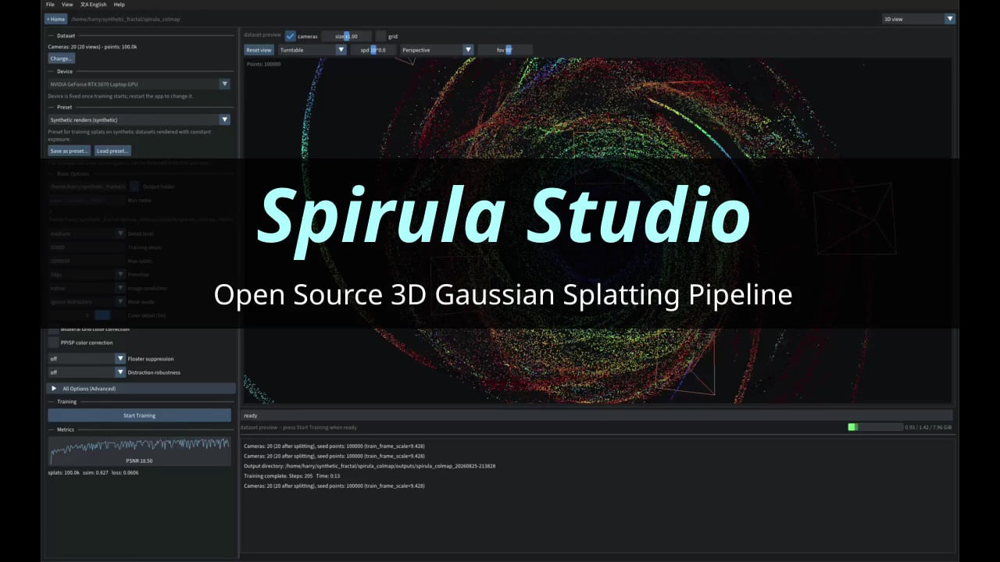

# Open Source 3DGS Training Pipeline - NVIDIA / AMD / Intel / Apple, Train 10M SH3 Gaussians in 8GB, 360 Camera Support, Lightning-Fast SfM, Meshing Support - Feedback Welcome

> Source: https://www.reddit.com/r/GaussianSplatting/comments/1w0by3s/open_source_3dgs_training_pipeline_nvidia_amd/
> Author: u/harry7557558
> Posted: 2026-08-28T00:49:21+00:00
> Captured: 2026-10-15T08:55:18+00:00
> Score: 230 · Comments: 56
> Community: r/GaussianSplatting

## Post

Been working on a 3DGS trainer for the past two years, recently added support for various features, so I think it might be helpful to post about it. Link: [github.com/harry7557558/spirula-studio](http://github.com/harry7557558/spirula-studio)

## Media

> Original media URL: https://external-preview.redd.it/ZWFjZzk3eG1pMG1oMc0ZfA_IhbmYTWBtRLYjk-RRFAsNVnCwE8xY0kc6o-Cl.png?format=pjpg&auto=webp&s=8228ec24ce52eb0a7fd90a8e848cf18afb3e5fcd

[media/02-reddit-media.mp4](media/02-reddit-media.mp4)

> Original media URL: https://v.redd.it/b4mwu1xmi0mh1

## Thread

> u/harry7557558 · 2026-08-28T01:24:14+00:00 · score 6 · [comment](https://www.reddit.com/r/GaussianSplatting/comments/1w0by3s/open_source_3dgs_training_pipeline_nvidia_amd/p6bz0nt/)

Hi, assuming you are talking about the garage video - If you read the progress bar it's around 2 hours (elapsed + ETA), on a laptop with RTX 5070 (8GB VRAM) - was intended to demonstrate VRAM efficiency. Regarding speed, on an RTX 4080 Super, training Mip-NeRF 360 bicycle scene for 5M Gaussians without bilagrid/PPISP takes 8min35s with Vulkan and 5min42s with CUDA. If you want to see a benchmark, you can always launch with environment variable SS\_PROFILE=1 and normally close it after training, it will print per-kernel breakdown - in my experiment, with large number of Gaussians, the most time consuming part is actually optimizer, not forward/backward pass. Hope this helps\~

> u/harry7557558 · 2026-08-28T02:43:04+00:00 · score 3 · [comment](https://www.reddit.com/r/GaussianSplatting/comments/1w0by3s/open_source_3dgs_training_pipeline_nvidia_amd/p6cd5x9/)

Hi, there's a pre-built binary for Mac, but it's for an older version (v2026.8.17) - see "Notes" under release description. I don't own a Mac myself, I borrowed one from my friend to validate support, and I've returned it. If decide to build the latest code from source, feel free to contribute a binary if you want to, or let me know if you get any build error.

> u/harry7557558 · 2026-08-28T13:14:29+00:00 · score 3 · [comment](https://www.reddit.com/r/GaussianSplatting/comments/1w0by3s/open_source_3dgs_training_pipeline_nvidia_amd/p6euc6i/)

Definitely - issues and PRs are welcome. Looking forward for the fix.

> u/harry7557558 · 2026-08-28T03:13:57+00:00 · score 1 · [comment](https://www.reddit.com/r/GaussianSplatting/comments/1w0by3s/open_source_3dgs_training_pipeline_nvidia_amd/p6ci6qs/)

Hmm, I never noticed that issue before. Are folder names rendering as tofu/question marks in the GUI, or are you having trouble importing data? In either case, consider submitting a GitHub issue so I won't forget it. Thanks.

> u/harry7557558 · 2026-08-28T04:15:13+00:00 · score 3 · [comment](https://www.reddit.com/r/GaussianSplatting/comments/1w0by3s/open_source_3dgs_training_pipeline_nvidia_amd/p6cre8n/)

Hi, the VRAM has been heavily optimized for large number of splats, and to some extent large number of mid resolution images, although not (yet) for high resolution images. I did tried training 10M SH3 on 7680x7680 images and it hit OOM with 8GB VRAM, but with 3840x3840 images, there's 1-2GB room left. I can work on optimizing VRAM for high resolution images if it's a popular request.

> u/harry7557558 · 2026-08-28T04:23:29+00:00 · score 2 · [comment](https://www.reddit.com/r/GaussianSplatting/comments/1w0by3s/open_source_3dgs_training_pipeline_nvidia_amd/p6csjsw/)

It was a synthetic dataset with 200 8K images - I don't personally have a camera with 8k resolution. Number of images is generally not a VRAM bottleneck, unless you have high thousands/tens of thousands of images that can stress bilateral grid. From my profiling, for under 1000 images the VRAM overhead is generally negligible, and it depends more on the resolution of a single image.

> u/harry7557558 · 2026-08-28T13:10:57+00:00 · score 2 · [comment](https://www.reddit.com/r/GaussianSplatting/comments/1w0by3s/open_source_3dgs_training_pipeline_nvidia_amd/p6etmbl/)

Hi, I've never did a formal comparison between built in SfM and Reality Scan - I've heard a story where Spirula succeed but RS failed to align all images, and another story that's exactly the opposite, so I believe more experiment is needed. Functionality wise, Spirula's built-in SfM supports very wide fisheye like in typical 360 cameras, as well as equirectangular, and it exports COLMAP compatible format. Let me know if you have any insight into how the two software compare.

> u/harry7557558 · 2026-08-28T13:13:42+00:00 · score 3 · [comment](https://www.reddit.com/r/GaussianSplatting/comments/1w0by3s/open_source_3dgs_training_pipeline_nvidia_amd/p6eu6jq/)

Hi, Spirula'a built-in SfM is actually an independent one written from scratch, partially with help of AI coding tools. It's not a vendored third party module - you can find more details by reading the code.

> u/harry7557558 · 2026-08-29T13:28:24+00:00 · score 2 · [comment](https://www.reddit.com/r/GaussianSplatting/comments/1w0by3s/open_source_3dgs_training_pipeline_nvidia_amd/p6lu4ba/)

30 minute video have worked for me before, and it supports regular non-spherical cameras. Try it, let me know if you experience any issue.

> u/harry7557558 · 2026-08-29T13:32:50+00:00 · score 1 · [comment](https://www.reddit.com/r/GaussianSplatting/comments/1w0by3s/open_source_3dgs_training_pipeline_nvidia_amd/p6luym8/)

Hi, sorry to hear that you have trouble with it - I believe [this comment](https://www.reddit.com/r/GaussianSplatting/comments/1w0by3s/comment/p6gaijq/?utm_source=share&utm_medium=web3x&utm_name=web3xcss&utm_term=1&utm_content=share_button) exists, try launch it again and let me know if it works for you. I did looked a bit into that but could not reproduce it on my end. In the next release, I'll add a crash log with traceback, to make crash reporting easier in case anyone submits a GitHub issue.

## Comments

> u/Astral-Lemmons · 2026-08-28T01:24:11+00:00 · score 15 · [comment](https://www.reddit.com/r/GaussianSplatting/comments/1w0by3s/open_source_3dgs_training_pipeline_nvidia_amd/p6bz0cs/)

oh wow. and here I've been wrestling with colmap and litchfield the past week. this is amazing

> u/Ninjatogo · 2026-08-28T17:07:25+00:00 · score 6 · [comment](https://www.reddit.com/r/GaussianSplatting/comments/1w0by3s/open_source_3dgs_training_pipeline_nvidia_amd/p6gaijq/)

This is very impressive. The performance is so smooth.

I'm seeing a bug where the application crashes when I open a dataset for the first time however. Without changing anything about the dataset, I open it a second time and it works.

> u/planetelc · 2026-08-31T23:06:59+00:00 · score 6 · [comment](https://www.reddit.com/r/GaussianSplatting/comments/1w0by3s/open_source_3dgs_training_pipeline_nvidia_amd/p72rq8d/)

what kind of black magic have you done here???? I used a video that took me almost 17h to process (8+ hours in COLMAP and 8+ hours in Litchfeld) ans your software gave me a cleaner splat on less than 2 hours! congratulation! do you intend to stay on opensource model or do you plan to change to a paid version in the futur?

> u/MiamiGunworks · 2026-08-28T01:15:13+00:00 · score 5 · [comment](https://www.reddit.com/r/GaussianSplatting/comments/1w0by3s/open_source_3dgs_training_pipeline_nvidia_amd/p6bxcxr/)

How did you train 10M splats in 25 minutes with thousands of images? Or is that just the SFM time? Do you care to share benchmarks on your forward and backward pass?

> u/MiamiGunworks · 2026-08-28T01:27:29+00:00 · score 1 · [comment](https://www.reddit.com/r/GaussianSplatting/comments/1w0by3s/open_source_3dgs_training_pipeline_nvidia_amd/p6bzma9/)

Ah sorry, I'm on mobile and couldn't see the text on the progress bar. 

I'll check it out tomorrow. I'm writing my own with a focus on speed and I'd like to compare.

> u/Adventurous_Exit2832 · 2026-08-28T10:39:07+00:00 · score 3 · [comment](https://www.reddit.com/r/GaussianSplatting/comments/1w0by3s/open_source_3dgs_training_pipeline_nvidia_amd/p6e3g1a/)

as someone who's new to making Gaussian splats, what makes this software different from the other ones?

> u/Maliander_80 · 2026-08-28T20:52:12+00:00 · score 7 · [comment](https://www.reddit.com/r/GaussianSplatting/comments/1w0by3s/open_source_3dgs_training_pipeline_nvidia_amd/p6hp57k/)

It's an unusual combination:

* Free and open source with pre-build binaries, so low barrier of entry.
* Has the entire pipeline: image extraction, masking, alignment and training. Just no editing or hosting.
* Uses a custom engine for the alignment with extremely fast results for large scenes.
* Uses a custom engine for training with emphasis on speed and memory efficiency, allowing higher splat count and higher resolution source images.
* Supports direct use of 360 camera footage.
* Runs on your own device, so maximum control, but you do need a GPU.

> u/NanasiAttila · 2026-08-29T19:17:27+00:00 · score 3 · [comment](https://www.reddit.com/r/GaussianSplatting/comments/1w0by3s/open_source_3dgs_training_pipeline_nvidia_amd/p6nuyvc/)

Congratulations! I've been testing it for 2 days and it's very promising. I think it's a gamechanger app!

> u/ZeitgeistArchive · 2026-08-28T02:23:15+00:00 · score 2 · [comment](https://www.reddit.com/r/GaussianSplatting/comments/1w0by3s/open_source_3dgs_training_pipeline_nvidia_amd/p6c9rgj/)

Good job! Do i have to build it on my mac or is there prebuilt binaries for mac?

> u/77sevens · 2026-09-02T17:40:02+00:00 · score 1 · [comment](https://www.reddit.com/r/GaussianSplatting/comments/1w0by3s/open_source_3dgs_training_pipeline_nvidia_amd/p7f1q6d/)

I just built that binary and ran it on this Macbook M4 Pro with 48GM memory.  
Runs great!  
had it build a scene that used multiple videos. I’m impressed.  
I can give you that binary if you want. 

> u/OosAvocate65 · 2026-08-28T12:50:04+00:00 · score 2 · [comment](https://www.reddit.com/r/GaussianSplatting/comments/1w0by3s/open_source_3dgs_training_pipeline_nvidia_amd/p6ephws/)

Found a bug in masking, are you open to PR fixes?

> u/Proper_Rule_420 · 2026-08-28T17:07:41+00:00 · score 2 · [comment](https://www.reddit.com/r/GaussianSplatting/comments/1w0by3s/open_source_3dgs_training_pipeline_nvidia_amd/p6gaknl/)

Amazing work done here ! Bravo ! 

> u/geeohgo · 2026-08-29T17:57:31+00:00 · score 2 · [comment](https://www.reddit.com/r/GaussianSplatting/comments/1w0by3s/open_source_3dgs_training_pipeline_nvidia_amd/p6ndv31/)

I've been testing this for the last couple of days. I'm really impressed. I'm an orphan of postshot and I had never found a good alternative. Now this tool is amazing! It's really comprehensive, yet intuitive (except that, in my opinion, "create a dataset" should come before "open a dataset" on the main screen). And the results, with the added features such as normals extraction, are even better than postshot's.

Thank you very much for all the effort you've put into this.

Edit: by the way, kudos on the tooltips! Everything is really well explained!

> u/geeohgo · 2026-08-30T12:45:11+00:00 · score 1 · [comment](https://www.reddit.com/r/GaussianSplatting/comments/1w0by3s/open_source_3dgs_training_pipeline_nvidia_amd/p6s8gv9/)

By the way, where is it downloading the models (such as MoGe and the one for segmentation)?

  
Edit: I found them in "C:\\Users\\username\\AppData\\Local\\spirula-studio\\models" - It would be great to be able to choose a different folder.

> u/Inthehead35 · 2026-09-06T02:27:27+00:00 · score 2 · [comment](https://www.reddit.com/r/GaussianSplatting/comments/1w0by3s/open_source_3dgs_training_pipeline_nvidia_amd/p836pp4/)

Spectacular,  this is game changing, usually spent 40-50 minutes in colmap, this finished in minutes with the same results, you saved me a crap ton of time. This is some kind of black magic bro

> u/Consistent_Bed_7607 · 2026-08-28T03:08:40+00:00 · score 1 · [comment](https://www.reddit.com/r/GaussianSplatting/comments/1w0by3s/open_source_3dgs_training_pipeline_nvidia_amd/p6chcj6/)

Love the work! I've been studying and using the project, and I'm really enjoying it so far. One issue I've noticed, though, is that file paths seem to break when folder names contain special characters. It's a bit inconvenient.

> u/Consistent_Bed_7607 · 2026-08-31T17:32:50+00:00 · score 1 · [comment](https://www.reddit.com/r/GaussianSplatting/comments/1w0by3s/open_source_3dgs_training_pipeline_nvidia_amd/p70p0li/)

Note: English isn't my first language, so I asked Claude to write this up as

a short report of what happened on my machine. The measurements and file

references below are from my own dataset and my own build.

\---

Windows: dataset path with non-ASCII characters fails in the GUI

Version 2026.8.23, Windows 11, ACP 1252.

Pasting or browsing to this folder in the dataset field:

E:\\...\\Tecnologia e Inovação\\...\\Máximo Aldana\\Ap 125m²\\3ds Max\\dataset

gives "dataset path does not exist", while the field renders the path

correctly on screen. Both entry points fail. The same path passed to the

CLI with --data resolves normally.

Cause. Paths are carried as narrow std::string and handed to

std::filesystem::path (parse\_dataset, ColmapParser.cpp:939). On MSVC that

constructor interprets char strings in the ANSI code page, not UTF-8 --

while both GUI sources produce UTF-8:

  \- the native dialog converts the wide result with

WideCharToMultiByte(CP\_UTF8, ...) at NativeDialog.cpp:56;

  \- GLFW's clipboard returns UTF-8, so a pasted path is UTF-8 too.

Either way the bytes are then misread as CP1252 and the lookup fails.

ImGui renders them as UTF-8, which is why the path looks correct while not

resolving. The CLI works only by coincidence: argv arrives already

converted to ACP, so the encodings happen to agree.

Two confirmations that the narrow interpretation is ACP and not UTF-8: a

lone 0xE1 ("á" in CP1252) is not valid UTF-8, yet resolves through the CLI;

and a CJK folder name degrades to '?' at the argv boundary before main()

runs:

spirula train synthetic --data "C:\\...\\日本語テスト"

error: dataset path does not exist: C:\\...\\??????

Suggested fix: keep paths as std::filesystem::path or UTF-8 internally and

convert explicitly at the boundaries -- u8path / char8\_t where the string

is known to be UTF-8, and wmain (or GetCommandLineW + CommandLineToArgvW)

so the command line is never routed through the ANSI code page.

\---

Separate request, same area -- non-binary masks.

decode\_mask\_into (src/data/DataManager.cpp) binarises on load:

img\[i\] = (uint8\_t)(img\[i\] != 0);

and depth supervision gates on a zero sentinel (per\_pixel\_losses.slang,

depth\_mask = ref\_depth != 0.0f). Both are all-or-nothing, so a producer

cannot express partial confidence in a pixel.

That matters for synthetic datasets, where per-pixel validity is known

exactly rather than estimated. On a rendered interior, an opaque wall is

fully trustworthy, clear glass carries no usable surface geometry, and a

partially reflective surface sits between the two. Collapsing that to 0/1

puts a hard supervision cliff along every window edge: adjacent pixels go

from fully constrained to entirely unconstrained.

Measured on a 630-camera architectural dataset, 29.3% of pixels reach the

trainer with no depth supervision at all (median 20.8%, worst frame 98.1%),

almost all of it glass. Those regions are where the reconstruction shows

floaters and wavy normals.

Request: let a grayscale mask (or a separate per-pixel confidence map)

scale the geometry loss instead of gating it -- weight 1.0 opaque, \~0.3

partially refractive, 0.0 clear glass. Colour supervision would stay

unchanged. This costs one multiply where the mask boolean is currently

applied, and it is information a renderer already has and currently has no

way to hand over.

> u/Wimiam1 · 2026-08-28T03:42:55+00:00 · score 1 · [comment](https://www.reddit.com/r/GaussianSplatting/comments/1w0by3s/open_source_3dgs_training_pipeline_nvidia_amd/p6cmox4/)

Oh this is super neat! I’ll definitely have to give it a try. 10M splats on 8gb VRAM is great. How does it handle high resolution images? I saw some of the examples had 5k+. Were those all 4k and not downsampled? 

> u/TheStupidLui · 2026-08-28T04:41:38+00:00 · score 2 · [comment](https://www.reddit.com/r/GaussianSplatting/comments/1w0by3s/open_source_3dgs_training_pipeline_nvidia_amd/p6cv2of/)

That would be great! I'm using 120Mpx images. 

> u/OosAvocate65 · 2026-08-28T09:23:32+00:00 · score 2 · [comment](https://www.reddit.com/r/GaussianSplatting/comments/1w0by3s/open_source_3dgs_training_pipeline_nvidia_amd/p6dtre7/)

Yup same here, recently discovered 120MP (3s to capture) 360 captures in Osmo 360. I’m just amazed at the quality of Gaussian Splats that come out!

> u/Wimiam1 · 2026-08-28T11:38:59+00:00 · score 1 · [comment](https://www.reddit.com/r/GaussianSplatting/comments/1w0by3s/open_source_3dgs_training_pipeline_nvidia_amd/p6ecmk6/)

This is exactly what I’m wanting to do

> u/Wimiam1 · 2026-08-28T04:16:23+00:00 · score 1 · [comment](https://www.reddit.com/r/GaussianSplatting/comments/1w0by3s/open_source_3dgs_training_pipeline_nvidia_amd/p6crk66/)

Ah ok, makes sense! And how many 8K images were in that dataset? 

> u/Wimiam1 · 2026-08-28T04:33:59+00:00 · score 1 · [comment](https://www.reddit.com/r/GaussianSplatting/comments/1w0by3s/open_source_3dgs_training_pipeline_nvidia_amd/p6cu0e4/)

Oh that’s very interesting! I’ve always assumed it scales pretty much linearly with the amount of images! Thanks for setting me straight

> u/copopt · 2026-08-28T06:13:53+00:00 · score 1 · [comment](https://www.reddit.com/r/GaussianSplatting/comments/1w0by3s/open_source_3dgs_training_pipeline_nvidia_amd/p6d74gp/)

I've also been following your project for a while. In fact it was the only one that didn't crash mid training on my Intel GPU or in Colab. So, many thanks for the project.
I can supply you a 8K video if you want.
Thanks once again.

> u/AgilePainting931 · 2026-08-28T04:55:48+00:00 · score 1 · [comment](https://www.reddit.com/r/GaussianSplatting/comments/1w0by3s/open_source_3dgs_training_pipeline_nvidia_amd/p6cx257/)

Does this also have asset harverter built in?

> u/the4thgoatboy · 2026-08-28T09:47:01+00:00 · score 1 · [comment](https://www.reddit.com/r/GaussianSplatting/comments/1w0by3s/open_source_3dgs_training_pipeline_nvidia_amd/p6dwlf3/)

Looking forward to trying this! Lichtfeld was too heavy for my 8gb VRAM laptop (probably much better now, haven't tried the latest version), and postshot is just too expensive.

How does your built in SFM compare to using Reality Capture? Thats always been decently fast for me, but of course a little tedious to export.

> u/the4thgoatboy · 2026-08-30T08:54:33+00:00 · score 1 · [comment](https://www.reddit.com/r/GaussianSplatting/comments/1w0by3s/open_source_3dgs_training_pipeline_nvidia_amd/p6reabw/)

My insight now after rebuilding (from video) some old projects is.... that I'm not touching Reality Scan any more 😅 Your's is clearly faster, cooler to use (love the UI!), and cuts off all the tedious work. If there's any quality reduction, I'm not seeing it. Actually, all my splats are looking much better now that I can use more VRAM, plus all the training quality options/optimizations you've added. Fantastic!! 

Just my two cents, I wouldn't add more pipeline features, way better doubling down on what you've already built. Also, your annotations are super helpful!! 

> u/ad2003 · 2026-08-28T10:06:10+00:00 · score 1 · [comment](https://www.reddit.com/r/GaussianSplatting/comments/1w0by3s/open_source_3dgs_training_pipeline_nvidia_amd/p6dyzjd/)

Looks great. 

> u/Almost-Purple · 2026-08-28T12:39:40+00:00 · score 1 · [comment](https://www.reddit.com/r/GaussianSplatting/comments/1w0by3s/open_source_3dgs_training_pipeline_nvidia_amd/p6enic6/)

What are you using for sfm?

> u/PedrotheDuck · 2026-08-28T21:43:48+00:00 · score 1 · [comment](https://www.reddit.com/r/GaussianSplatting/comments/1w0by3s/open_source_3dgs_training_pipeline_nvidia_amd/p6hzty8/)

I tried it and compared to other solutions from this subreddit i've gotten the fastest and best results so far. Thanks so much for this, great work!

> u/raccoon8182 · 2026-08-29T06:05:15+00:00 · score 1 · [comment](https://www.reddit.com/r/GaussianSplatting/comments/1w0by3s/open_source_3dgs_training_pipeline_nvidia_amd/p6k7vak/)

I have 30 minutes of video shot from a phone, will this split the video into frames and process or is that too big or does it only do spherical video

> u/OVRCAST_studio · 2026-08-29T06:08:42+00:00 · score 1 · [comment](https://www.reddit.com/r/GaussianSplatting/comments/1w0by3s/open_source_3dgs_training_pipeline_nvidia_amd/p6k89ys/)

OK tested and working. It used around 7Gb of vram to create a 10M SH3 splat, nice!!! But when I tried to create a 30M SH1 splat the VRAM got to 100% very quickly (I have 16GB). This should be enough to do it, but it wasnt

> u/HelpMeWithPico · 2026-08-29T10:10:27+00:00 · score 1 · [comment](https://www.reddit.com/r/GaussianSplatting/comments/1w0by3s/open_source_3dgs_training_pipeline_nvidia_amd/p6l00zy/)

I'm very new to gaussian splats and was a little sad that spirula just crashed immediately upon launch for me. Unfortunately I'm also too stupid to know what I'm talking about or how to make a bug report, so I'll just leave this here and hope it helps anyone:  
  
Faulting module name: MSVCP140.dll  
Faulting module version: 14.31.31103.0  
Exception code: 0xc0000005  
Fault offset: 0x00000000000132a8

> u/kaizencali · 2026-08-29T12:52:21+00:00 · score 1 · [comment](https://www.reddit.com/r/GaussianSplatting/comments/1w0by3s/open_source_3dgs_training_pipeline_nvidia_amd/p6lnkcn/)

BROOO! that's amazing. I just tested footage from my insta x5 and it gave super dope result! thanks so much and keep going! God Bless you!

> u/VrFrog · 2026-08-29T16:23:53+00:00 · score 1 · [comment](https://www.reddit.com/r/GaussianSplatting/comments/1w0by3s/open_source_3dgs_training_pipeline_nvidia_amd/p6mtove/)

Great work!  
Easy to pick up on default settings, but enough knobs for tinkerers.  
Such a relief after my usual Reality Scan => Colmap => Brush shuffle.  
UI feels genuinely well-thought-out. 

> u/Ok_Supermarket3382 · 2026-08-29T17:15:48+00:00 · score 1 · [comment](https://www.reddit.com/r/GaussianSplatting/comments/1w0by3s/open_source_3dgs_training_pipeline_nvidia_amd/p6n4sjk/)

Insane project, well done sir! How are you supporting 360 ERP exactly? Both from sfm and actual splatting? Did you compare it to colmap? Also how are you meshing? Would love to contribute but there doesn’t seem to be a doc site outlining architecture and patterns, would make things significantly easier for onboarding. You can even make it with ai but needs someone that already understands the project to make sure it’s actually useful!

> u/Lost-Upstairs-5311 · 2026-08-31T04:01:23+00:00 · score 2 · [comment](https://www.reddit.com/r/GaussianSplatting/comments/1w0by3s/open_source_3dgs_training_pipeline_nvidia_amd/p6x45eq/)

You should go to the github repo and start reading all the README's. All the the stages have very detailed ones. Best docs I have seen in a project in a long time. Also the code is pretty readable

> u/fl3xtra · 2026-08-30T02:02:43+00:00 · score 1 · [comment](https://www.reddit.com/r/GaussianSplatting/comments/1w0by3s/open_source_3dgs_training_pipeline_nvidia_amd/p6pwp4s/)

Can I feed it 5 different camera angles as long as there's enough overlap?

> u/Senior_Relation9710 · 2026-08-31T13:42:43+00:00 · score 1 · [comment](https://www.reddit.com/r/GaussianSplatting/comments/1w0by3s/open_source_3dgs_training_pipeline_nvidia_amd/p6z9yks/)

I'm a noob and I always run into a bug when starting the dataset training that causes the software to close.

happens on rx 6700 xt with the latest AMD drivers

> u/HappyImagineer · 2026-09-03T17:12:10+00:00 · score 1 · [comment](https://www.reddit.com/r/GaussianSplatting/comments/1w0by3s/open_source_3dgs_training_pipeline_nvidia_amd/p7m3ntl/)

Your software is exceptional, I'm on Mac and it solves almost every problem I have had with all the other splat software available. I trained a splat from video to splat but now I would like to add another camera source into the same dataset, since each camera gets it's own folder I did the whole process with the second camera source, how can I combine them to be part of the same splat? I don't mind retraining I just don't see a way to select two datasets/camera together for training. 

> u/Snoo62043 · 2026-09-07T23:23:44+00:00 · score 1 · [comment](https://www.reddit.com/r/GaussianSplatting/comments/1w0by3s/open_source_3dgs_training_pipeline_nvidia_amd/p8g3j9g/)

I gave this a go and got mixed results. Using a Insta360 X4 I recorded my office using  a sinusoidal pattern and then ran the video through your software to pretty good results compared to what I have acheived to date. Then I tried a much larger dataset by scanning our entire first pavilion to see what the software could handle. I think I did a decent job of covering the entire pavilion, but I am getting middling to poor results. I'd very much like to pick your brain on what you think might be the issue. Also I noticed that increasing the quality gave me actually worse results. 

> u/Bogonavt · 2026-09-12T10:51:39+00:00 · score 1 · [comment](https://www.reddit.com/r/GaussianSplatting/comments/1w0by3s/open_source_3dgs_training_pipeline_nvidia_amd/p9bubil/)

First of all, thanks for the awesome work! Trying it out. Spirula has trained me a nice 3dgs scene. Then, trying to generate a mesh using images. It gives me this error. I've tried using 16 bit pngs and exrs. Please help me out what am I doing wrong?

https://preview.redd.it/7i1iccitk2ph1.jpeg?width=1259&format=pjpg&auto=webp&s=d743e09d102536de5a2a5a1550cb0a4ae2c8643b

> u/RaisinKey3837 · 2026-09-15T03:43:57+00:00 · score 1 · [comment](https://www.reddit.com/r/GaussianSplatting/comments/1w0by3s/open_source_3dgs_training_pipeline_nvidia_amd/p9w3cx5/)

Fantastic stuff, always great to see more people throwing their hat in the ring, especially with software as good as this :\]

> u/Infinitecontextlabs · 2026-08-28T01:11:58+00:00 · score 1 · [comment](https://www.reddit.com/r/GaussianSplatting/comments/1w0by3s/open_source_3dgs_training_pipeline_nvidia_amd/p6bwrbt/)

Your 2 years of work is spectacular, keep going!

## Links

- http://github.com/harry7557558/spirula-studio
