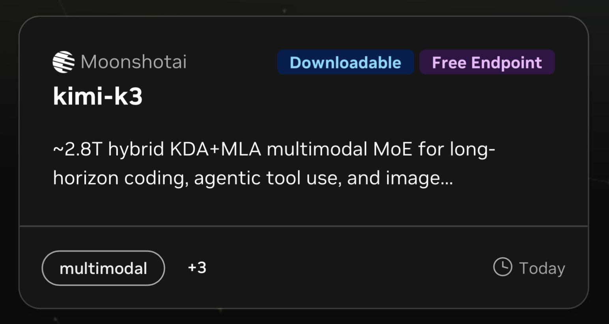

# Kimi K3 and DeepSeek 4 Pro are FREE on NVIDEA NIM (60 req/min.)

> Source: https://www.reddit.com/r/opencodeCLI/comments/1w0swod/kimi_k3_and_deepseek_4_pro_are_free_on_nvidea_nim/
> Author: u/afanasenka
> Posted: 2026-08-28T14:58:27+00:00
> Captured: 2026-10-15T08:55:18+00:00
> Score: 412 · Comments: 87
> Community: r/opencodeCLI

## Post

Can't be used all day long of course, but enough for relaxed coding/chatting.   
[https://build.nvidia.com/moonshotai/kimi-k3](https://build.nvidia.com/moonshotai/kimi-k3)  
[https://build.nvidia.com/deepseek-ai/deepseek-v4-pro-0813](https://build.nvidia.com/deepseek-ai/deepseek-v4-pro-0813)  

## Media

> Original media URL: https://i.redd.it/smikqboeq4mh1.jpeg

> Original media URL: https://preview.redd.it/smikqboeq4mh1.jpeg?auto=webp&s=64d7dd3c30da5e41b86a94c0cebdb703d62d57a8

## Thread

> u/afanasenka · 2026-08-28T15:16:11+00:00 · score 4 · [comment](https://www.reddit.com/r/opencodeCLI/comments/1w0swod/kimi_k3_and_deepseek_4_pro_are_free_on_nvidea_nim/p6fkuch/)

😂😂😂

> u/afanasenka · 2026-08-28T15:25:09+00:00 · score 1 · [comment](https://www.reddit.com/r/opencodeCLI/comments/1w0swod/kimi_k3_and_deepseek_4_pro_are_free_on_nvidea_nim/p6fmwk6/)

💯🤣

> u/afanasenka · 2026-08-28T15:40:10+00:00 · score -4 · [comment](https://www.reddit.com/r/opencodeCLI/comments/1w0swod/kimi_k3_and_deepseek_4_pro_are_free_on_nvidea_nim/p6fqcjf/)

Well, this is the way 😏

> u/afanasenka · 2026-08-28T15:04:57+00:00 · score 29 · [comment](https://www.reddit.com/r/opencodeCLI/comments/1w0swod/kimi_k3_and_deepseek_4_pro_are_free_on_nvidea_nim/p6fib55/)

Opencode config:

    "nvidia-nim": {
      "npm": "@ai-sdk/openai-compatible",
      "name": "NVIDIA",
      "options": {
        "baseURL": "https://integrate.api.nvidia.com/v1",
        "apiKey": "[your_api_key_here]",
      },
      "models": {
        "moonshotai/kimi-k3": {
          "name": "Kimi K3",
        },
        "deepseek-ai/deepseek-v4-pro-0813": {
          "name": "DS4 Pro",
        }
      }
    }

> u/afanasenka · 2026-08-28T15:25:26+00:00 · score 0 · [comment](https://www.reddit.com/r/opencodeCLI/comments/1w0swod/kimi_k3_and_deepseek_4_pro_are_free_on_nvidea_nim/p6fmyvd/)

Sure 😛

> u/afanasenka · 2026-08-28T15:34:29+00:00 · score 2 · [comment](https://www.reddit.com/r/opencodeCLI/comments/1w0swod/kimi_k3_and_deepseek_4_pro_are_free_on_nvidea_nim/p6fp1u8/)

I doubt so :)) anyway, it is very limited,  just to try a model a bit - not for serious workflow.

## Comments

> u/Sama02 · 2026-08-28T15:26:42+00:00 · score 25 · [comment](https://www.reddit.com/r/opencodeCLI/comments/1w0swod/kimi_k3_and_deepseek_4_pro_are_free_on_nvidea_nim/p6fn9e3/)

Been using nim for months. Just great. Tho if you can spare 1$ give it to tokenrouter for free and unlimited access to qwen3.8max

Edit:Glm5.3 instead as of today

> u/Prior-Meeting1645 · 2026-08-28T16:42:08+00:00 · score 6 · [comment](https://www.reddit.com/r/opencodeCLI/comments/1w0swod/kimi_k3_and_deepseek_4_pro_are_free_on_nvidea_nim/p6g4ngf/)

What? Free unlimited access to 3.8 max for $1? There’s no way whats the catch please 

> u/Sama02 · 2026-08-28T17:32:39+00:00 · score 3 · [comment](https://www.reddit.com/r/opencodeCLI/comments/1w0swod/kimi_k3_and_deepseek_4_pro_are_free_on_nvidea_nim/p6ggcb7/)

You have to top up 1$ that is the catch.

> u/Prior-Meeting1645 · 2026-08-28T20:04:29+00:00 · score 9 · [comment](https://www.reddit.com/r/opencodeCLI/comments/1w0swod/kimi_k3_and_deepseek_4_pro_are_free_on_nvidea_nim/p6heqsf/)

Thats not a catch though $1 for unlimited use is crazy

> u/Sama02 · 2026-08-28T20:27:32+00:00 · score 2 · [comment](https://www.reddit.com/r/opencodeCLI/comments/1w0swod/kimi_k3_and_deepseek_4_pro_are_free_on_nvidea_nim/p6hjs58/)

Ikr

> u/Prior-Meeting1645 · 2026-08-29T00:36:38+00:00 · score 2 · [comment](https://www.reddit.com/r/opencodeCLI/comments/1w0swod/kimi_k3_and_deepseek_4_pro_are_free_on_nvidea_nim/p6ivo9r/)

Yeah which means there still is a catch… either its so heavily quantized and is not ZDR or its not even really glm 5.3. Any way we can check?

> u/Vancecookcobain · 2026-08-29T05:29:30+00:00 · score 1 · [comment](https://www.reddit.com/r/opencodeCLI/comments/1w0swod/kimi_k3_and_deepseek_4_pro_are_free_on_nvidea_nim/p6k3kkn/)

Benchmark it

> u/Sama02 · 2026-08-28T17:39:07+00:00 · score 4 · [comment](https://www.reddit.com/r/opencodeCLI/comments/1w0swod/kimi_k3_and_deepseek_4_pro_are_free_on_nvidea_nim/p6ghu4j/)

They moved it to glm5.3 free instead.

> u/auggie246 · 2026-08-28T16:43:35+00:00 · score 2 · [comment](https://www.reddit.com/r/opencodeCLI/comments/1w0swod/kimi_k3_and_deepseek_4_pro_are_free_on_nvidea_nim/p6g4zf5/)

Is this some promotion?, what do you mean by $1

> u/Sama02 · 2026-08-28T17:40:16+00:00 · score 3 · [comment](https://www.reddit.com/r/opencodeCLI/comments/1w0swod/kimi_k3_and_deepseek_4_pro_are_free_on_nvidea_nim/p6gi3qb/)

They always have one or two top of the line free models with unlimited access they jst replaced qwen with glm 5.3 free

> u/C_then_B · 2026-08-28T18:18:07+00:00 · score 2 · [comment](https://www.reddit.com/r/opencodeCLI/comments/1w0swod/kimi_k3_and_deepseek_4_pro_are_free_on_nvidea_nim/p6gqswz/)

What does unlimited mean here? Surely there is some sort of cap or can I just blast it all day?

> u/Sama02 · 2026-08-28T18:19:33+00:00 · score 3 · [comment](https://www.reddit.com/r/opencodeCLI/comments/1w0swod/kimi_k3_and_deepseek_4_pro_are_free_on_nvidea_nim/p6gr4mj/)

Well it's a lot I'm blasting it all day with a couple agents and a few sub-agents.

> u/Sama02 · 2026-08-28T17:33:57+00:00 · score 1 · [comment](https://www.reddit.com/r/opencodeCLI/comments/1w0swod/kimi_k3_and_deepseek_4_pro_are_free_on_nvidea_nim/p6ggn7r/)

You need to fill your account once with a credit card for identity verification to avoid abuses 1$ is enough it's also the minimum.

> u/TV_Engine · 2026-08-28T17:24:50+00:00 · score 1 · [comment](https://www.reddit.com/r/opencodeCLI/comments/1w0swod/kimi_k3_and_deepseek_4_pro_are_free_on_nvidea_nim/p6gej4i/)

I can’t seem to find it

> u/Sama02 · 2026-08-28T17:38:38+00:00 · score 2 · [comment](https://www.reddit.com/r/opencodeCLI/comments/1w0swod/kimi_k3_and_deepseek_4_pro_are_free_on_nvidea_nim/p6ghq1d/)

They changed it for glm5.3 free just today

> u/redblood252 · 2026-08-29T07:17:24+00:00 · score 1 · [comment](https://www.reddit.com/r/opencodeCLI/comments/1w0swod/kimi_k3_and_deepseek_4_pro_are_free_on_nvidea_nim/p6kgb6h/)

Getting "this token has no access to model z-ai/glm-5.3-free" after topping up $1 so don't know how to get it to work

> u/Sama02 · 2026-08-29T07:45:18+00:00 · score 1 · [comment](https://www.reddit.com/r/opencodeCLI/comments/1w0swod/kimi_k3_and_deepseek_4_pro_are_free_on_nvidea_nim/p6kjjaz/)

That's weird... Works fine on my side. Try reaching out to the support maybe?

> u/TheQuatum · 2026-08-29T23:34:32+00:00 · score 1 · [comment](https://www.reddit.com/r/opencodeCLI/comments/1w0swod/kimi_k3_and_deepseek_4_pro_are_free_on_nvidea_nim/p6p829u/)

Break this down. I dont understand at all. How is this real?

> u/Personal-Try2776 · 2026-08-28T15:13:55+00:00 · score 91 · [comment](https://www.reddit.com/r/opencodeCLI/comments/1w0swod/kimi_k3_and_deepseek_4_pro_are_free_on_nvidea_nim/p6fkboj/)

DELETE THIS POST BEFORE THEY GET SPAMMED AND REMOVED PLEASE

> u/Vancecookcobain · 2026-08-28T15:29:35+00:00 · score 12 · [comment](https://www.reddit.com/r/opencodeCLI/comments/1w0swod/kimi_k3_and_deepseek_4_pro_are_free_on_nvidea_nim/p6fnxg3/)

You can only use like a million tokens before you're shut off dude.

> u/Odd_Error_6736 · 2026-08-28T16:03:20+00:00 · score 4 · [comment](https://www.reddit.com/r/opencodeCLI/comments/1w0swod/kimi_k3_and_deepseek_4_pro_are_free_on_nvidea_nim/p6fvp7k/)

as if this stops them

> u/Guilty-Newspaper920 · 2026-08-29T17:58:22+00:00 · score 0 · [comment](https://www.reddit.com/r/opencodeCLI/comments/1w0swod/kimi_k3_and_deepseek_4_pro_are_free_on_nvidea_nim/p6ne1nr/)

Nvidia nim has no token limits

> u/NihilisticLurcher · 2026-08-28T16:31:31+00:00 · score 3 · [comment](https://www.reddit.com/r/opencodeCLI/comments/1w0swod/kimi_k3_and_deepseek_4_pro_are_free_on_nvidea_nim/p6g26pz/)

too late

> u/Vancecookcobain · 2026-08-28T15:24:16+00:00 · score 12 · [comment](https://www.reddit.com/r/opencodeCLI/comments/1w0swod/kimi_k3_and_deepseek_4_pro_are_free_on_nvidea_nim/p6fmpaa/)

Bro you only get like a million tokens and it shuts off the faucet 😂

These people are idiots thinking you can use this for free like Ox Alpha...

It's a short ride and then your done

> u/TheQuatum · 2026-08-29T23:35:14+00:00 · score 1 · [comment](https://www.reddit.com/r/opencodeCLI/comments/1w0swod/kimi_k3_and_deepseek_4_pro_are_free_on_nvidea_nim/p6p86o3/)

Really? 

> u/Vancecookcobain · 2026-08-29T23:35:39+00:00 · score 1 · [comment](https://www.reddit.com/r/opencodeCLI/comments/1w0swod/kimi_k3_and_deepseek_4_pro_are_free_on_nvidea_nim/p6p89cu/)

Yup

> u/IndividualPiglet2723 · 2026-08-28T15:36:54+00:00 · score 11 · [comment](https://www.reddit.com/r/opencodeCLI/comments/1w0swod/kimi_k3_and_deepseek_4_pro_are_free_on_nvidea_nim/p6fplq8/)

Hermes agent folks coming to abuse it 

> u/CzarnaDziuraCLI · 2026-08-29T20:06:17+00:00 · score 1 · [comment](https://www.reddit.com/r/opencodeCLI/comments/1w0swod/kimi_k3_and_deepseek_4_pro_are_free_on_nvidea_nim/p6o4ysh/)

Ciekawe kiedy agenci hermesa się obudzą 💫 

> u/IndividualPiglet2723 · 2026-08-29T20:10:13+00:00 · score 1 · [comment](https://www.reddit.com/r/opencodeCLI/comments/1w0swod/kimi_k3_and_deepseek_4_pro_are_free_on_nvidea_nim/p6o5r6j/)

Wdym

> u/CzarnaDziuraCLI · 2026-08-29T20:36:08+00:00 · score 2 · [comment](https://www.reddit.com/r/opencodeCLI/comments/1w0swod/kimi_k3_and_deepseek_4_pro_are_free_on_nvidea_nim/p6oaytz/)

rozbierz na czynniki pierwsze hermesa, czymkolwiek, to zrozumiesz

> u/CheesecakeLimp7140 · 2026-08-30T15:54:21+00:00 · score 2 · [comment](https://www.reddit.com/r/opencodeCLI/comments/1w0swod/kimi_k3_and_deepseek_4_pro_are_free_on_nvidea_nim/p6t9yv6/)

Why not connect using command and then enter api key?

https://preview.redd.it/3abuofevajmh1.png?width=2196&format=png&auto=webp&s=0054daf3dd113d815ada2392ad193a518d5ebbc4

> u/peva3 · 2026-08-28T15:23:17+00:00 · score 10 · [comment](https://www.reddit.com/r/opencodeCLI/comments/1w0swod/kimi_k3_and_deepseek_4_pro_are_free_on_nvidea_nim/p6fmh5p/)

Shhh don't talk about Nvidia NIN it's the best kept secret right now in AI 

> u/Vancecookcobain · 2026-08-28T15:30:11+00:00 · score 5 · [comment](https://www.reddit.com/r/opencodeCLI/comments/1w0swod/kimi_k3_and_deepseek_4_pro_are_free_on_nvidea_nim/p6fo2fx/)

It's only for like a million tokens bro....where are yall pretending like you can use it for any lengthy period of time.

> u/peva3 · 2026-08-28T15:41:21+00:00 · score 2 · [comment](https://www.reddit.com/r/opencodeCLI/comments/1w0swod/kimi_k3_and_deepseek_4_pro_are_free_on_nvidea_nim/p6fqmej/)

Not sure how you're using it, but I've done way more than a million tokens, it's all about rate limits with NIN, if you're doing low token slow requests, you can do a shit load of stuff before you hit a limit.

> u/EffectiveEngine2751 · 2026-08-28T16:32:22+00:00 · score 3 · [comment](https://www.reddit.com/r/opencodeCLI/comments/1w0swod/kimi_k3_and_deepseek_4_pro_are_free_on_nvidea_nim/p6g2do7/)

Yeah, I dont think this people understand how use nin xd

Aand this shitpost talking about kimi is gonna kill kimi for free on nvidia 

> u/Prior-Meeting1645 · 2026-08-28T16:42:45+00:00 · score 2 · [comment](https://www.reddit.com/r/opencodeCLI/comments/1w0swod/kimi_k3_and_deepseek_4_pro_are_free_on_nvidea_nim/p6g4skj/)

Please tell us then

> u/EffectiveEngine2751 · 2026-08-28T16:55:00+00:00 · score 2 · [comment](https://www.reddit.com/r/opencodeCLI/comments/1w0swod/kimi_k3_and_deepseek_4_pro_are_free_on_nvidea_nim/p6g7ngv/)

I use 3 api key and max 20 req/min for key

If u can mantain low the rpm, u can do a LOT of work

Im using DSH with a better ptc mode and zen/kilo/openrouter/chatgpt luna as subagents

The problem is the nerfed cx of nvidia

> u/Prior-Meeting1645 · 2026-08-28T20:05:01+00:00 · score 1 · [comment](https://www.reddit.com/r/opencodeCLI/comments/1w0swod/kimi_k3_and_deepseek_4_pro_are_free_on_nvidea_nim/p6heuy0/)

Thanks!!

> u/TheQuatum · 2026-08-29T23:36:38+00:00 · score 1 · [comment](https://www.reddit.com/r/opencodeCLI/comments/1w0swod/kimi_k3_and_deepseek_4_pro_are_free_on_nvidea_nim/p6p8fkb/)

20 requests per minute per day? That is a lot, or am I wrong?

> u/EffectiveEngine2751 · 2026-08-30T03:47:37+00:00 · score 1 · [comment](https://www.reddit.com/r/opencodeCLI/comments/1w0swod/kimi_k3_and_deepseek_4_pro_are_free_on_nvidea_nim/p6qcjer/)

I think 1 tool call is 1 request in nvidia. Also, is 20 req for minute 

> u/TheQuatum · 2026-08-30T10:58:21+00:00 · score 1 · [comment](https://www.reddit.com/r/opencodeCLI/comments/1w0swod/kimi_k3_and_deepseek_4_pro_are_free_on_nvidea_nim/p6rss2e/)

What does that mean exactly? I've seen a skill to rate limit, but I'm not understanding.

> u/EffectiveEngine2751 · 2026-08-30T17:06:30+00:00 · score 1 · [comment](https://www.reddit.com/r/opencodeCLI/comments/1w0swod/kimi_k3_and_deepseek_4_pro_are_free_on_nvidea_nim/p6tpzh9/)

Isnt a skill my friend. Is a setting in your harness 

> u/Ill-Bat-1518 · 2026-08-29T00:13:59+00:00 · score 2 · [comment](https://www.reddit.com/r/opencodeCLI/comments/1w0swod/kimi_k3_and_deepseek_4_pro_are_free_on_nvidea_nim/p6irrn7/)

I do same thing as other person but i use a proxy and 2-3 accounts per proxy and have vibe coded a program to manage these free accounts 

You can truly just use all you want with enough accounts and proxies are cheap like $1 for 100 a month

> u/Prior-Meeting1645 · 2026-08-29T00:31:04+00:00 · score 1 · [comment](https://www.reddit.com/r/opencodeCLI/comments/1w0swod/kimi_k3_and_deepseek_4_pro_are_free_on_nvidea_nim/p6iuq2o/)

As in IP proxies? Can u tell me more pls. I will vibecode my own but I just need the direction

> u/TheQuatum · 2026-08-29T23:35:54+00:00 · score 1 · [comment](https://www.reddit.com/r/opencodeCLI/comments/1w0swod/kimi_k3_and_deepseek_4_pro_are_free_on_nvidea_nim/p6p8azs/)

Share the program. 

> u/Prior-Meeting1645 · 2026-08-29T00:31:49+00:00 · score 0 · [comment](https://www.reddit.com/r/opencodeCLI/comments/1w0swod/kimi_k3_and_deepseek_4_pro_are_free_on_nvidea_nim/p6iuulz/)

Also ai can be a pain for grey area stuff like this they refuse citing ToS. How do u prompt it to not refuse?

> u/Vancecookcobain · 2026-08-28T15:45:15+00:00 · score 1 · [comment](https://www.reddit.com/r/opencodeCLI/comments/1w0swod/kimi_k3_and_deepseek_4_pro_are_free_on_nvidea_nim/p6frisj/)

Hit a limit?? Dude once the limit is hit and you don't have any credits it's over. You can't use it anymore....and most models it's like a million tokens....I actually wouldn't be surprised if Kimi was way less...a million tokens can be sucked up in less than 15 minutes if you are doing serious agentic coding.

> u/Prior-Meeting1645 · 2026-08-28T16:42:22+00:00 · score 1 · [comment](https://www.reddit.com/r/opencodeCLI/comments/1w0swod/kimi_k3_and_deepseek_4_pro_are_free_on_nvidea_nim/p6g4pe7/)

Cached or uncached?

> u/codeVerine · 2026-08-28T17:52:21+00:00 · score 1 · [comment](https://www.reddit.com/r/opencodeCLI/comments/1w0swod/kimi_k3_and_deepseek_4_pro_are_free_on_nvidea_nim/p6gkvx8/)

No caching support

> u/No_Committee8392 · 2026-08-28T20:06:30+00:00 · score 2 · [comment](https://www.reddit.com/r/opencodeCLI/comments/1w0swod/kimi_k3_and_deepseek_4_pro_are_free_on_nvidea_nim/p6hf6gm/)

This isnt true?

> u/Vancecookcobain · 2026-08-29T02:19:54+00:00 · score 1 · [comment](https://www.reddit.com/r/opencodeCLI/comments/1w0swod/kimi_k3_and_deepseek_4_pro_are_free_on_nvidea_nim/p6jcwxa/)

Try it and find out 😂

> u/SnowBoy_00 · 2026-08-28T18:38:02+00:00 · score 1 · [comment](https://www.reddit.com/r/opencodeCLI/comments/1w0swod/kimi_k3_and_deepseek_4_pro_are_free_on_nvidea_nim/p6gvdqf/)

And with crappy context length, I might add. All models served through NIM start hallucinating waaaaay before their source API counterparts. 

> u/Possible_Door_9719 · 2026-08-28T17:28:59+00:00 · score 4 · [comment](https://www.reddit.com/r/opencodeCLI/comments/1w0swod/kimi_k3_and_deepseek_4_pro_are_free_on_nvidea_nim/p6gfhqi/)

The big models on Nvidia Nim are unusable 

> u/timmeh1705 · 2026-08-28T15:16:53+00:00 · score 3 · [comment](https://www.reddit.com/r/opencodeCLI/comments/1w0swod/kimi_k3_and_deepseek_4_pro_are_free_on_nvidea_nim/p6fl03r/)

Not going to be free for much longer now 

> u/[deleted] · 2026-08-28T15:26:06+00:00 · score 3 · [comment](https://www.reddit.com/r/opencodeCLI/comments/1w0swod/kimi_k3_and_deepseek_4_pro_are_free_on_nvidea_nim/p6fn4gg/)

[removed]

> u/Ill-Bat-1518 · 2026-08-29T00:14:50+00:00 · score 1 · [comment](https://www.reddit.com/r/opencodeCLI/comments/1w0swod/kimi_k3_and_deepseek_4_pro_are_free_on_nvidea_nim/p6irwsi/)

Not true i use this for couple months all day its perfectly fine. Plus if you make more accounts you get more usage and nvidia dont seem to mind

> u/literally_niko · 2026-08-28T16:01:52+00:00 · score 3 · [comment](https://www.reddit.com/r/opencodeCLI/comments/1w0swod/kimi_k3_and_deepseek_4_pro_are_free_on_nvidea_nim/p6fvd6n/)

Meh, it’s broken. Don’t waste your time

> u/Pink_Oak · 2026-08-28T18:04:35+00:00 · score 3 · [comment](https://www.reddit.com/r/opencodeCLI/comments/1w0swod/kimi_k3_and_deepseek_4_pro_are_free_on_nvidea_nim/p6gnp6h/)

Nvidia Nim free is unsable. its so slow.  
maybe if you are lucky you can use it for 1 hr . without being slow. when load is low. but 23hr its slow as snail. not usable.  
I am talking about 2-3 tokens per minute

> u/MrMrsPotts · 2026-08-28T15:39:42+00:00 · score 2 · [comment](https://www.reddit.com/r/opencodeCLI/comments/1w0swod/kimi_k3_and_deepseek_4_pro_are_free_on_nvidea_nim/p6fq8mv/)

I get Too many requests immediately 

> u/bestcoin100k · 2026-08-28T17:40:11+00:00 · score 2 · [comment](https://www.reddit.com/r/opencodeCLI/comments/1w0swod/kimi_k3_and_deepseek_4_pro_are_free_on_nvidea_nim/p6gi2x0/)

need to download not have web service ? 

> u/sockolade · 2026-08-30T14:41:06+00:00 · score 2 · [comment](https://www.reddit.com/r/opencodeCLI/comments/1w0swod/kimi_k3_and_deepseek_4_pro_are_free_on_nvidea_nim/p6suf2o/)

its just unusable mann please bring GLM 5.3 

> u/GeniusAnosCranel · 2026-09-02T13:44:26+00:00 · score 2 · [comment](https://www.reddit.com/r/opencodeCLI/comments/1w0swod/kimi_k3_and_deepseek_4_pro_are_free_on_nvidea_nim/p7djo20/)

Slow AF and Heavily Rate Limited

> u/[deleted] · 2026-08-28T15:25:26+00:00 · score 4 · [comment](https://www.reddit.com/r/opencodeCLI/comments/1w0swod/kimi_k3_and_deepseek_4_pro_are_free_on_nvidea_nim/p6fmyyw/)

[removed]

> u/Ill-Bat-1518 · 2026-08-29T00:10:19+00:00 · score 1 · [comment](https://www.reddit.com/r/opencodeCLI/comments/1w0swod/kimi_k3_and_deepseek_4_pro_are_free_on_nvidea_nim/p6ir4j6/)

Why more people should know about this

> u/Ill-Bat-1518 · 2026-08-29T00:09:25+00:00 · score 1 · [comment](https://www.reddit.com/r/opencodeCLI/comments/1w0swod/kimi_k3_and_deepseek_4_pro_are_free_on_nvidea_nim/p6iqyvt/)

Btw you can use your limits to ask deepseek pro to build you a api token rotator that generates new tokens.

Been using this for a few months now and ripping through accounts

> u/Prior-Meeting1645 · 2026-08-29T00:38:54+00:00 · score 1 · [comment](https://www.reddit.com/r/opencodeCLI/comments/1w0swod/kimi_k3_and_deepseek_4_pro_are_free_on_nvidea_nim/p6iw2hi/)

Can u elaborate pls. So u create multiple accounts and have it get rotated? Anything else u have to do? 

> u/Ill-Bat-1518 · 2026-08-29T01:30:16+00:00 · score 2 · [comment](https://www.reddit.com/r/opencodeCLI/comments/1w0swod/kimi_k3_and_deepseek_4_pro_are_free_on_nvidea_nim/p6j4st7/)

you just tell your coding harness to build a account manager to load balance your llm provider  
Make it have a full account manager + testing with registration + saving accounts to prevent dupes and automatic api token rotation by local proxying the request and ask it for setup itll set it all up for you

  
you can be more direct if the llm is chinese but if its not gotta pretend you want account gen for testing etc or it might reject it

> u/Informal-Resolve6496 · 2026-08-29T02:28:19+00:00 · score 1 · [comment](https://www.reddit.com/r/opencodeCLI/comments/1w0swod/kimi_k3_and_deepseek_4_pro_are_free_on_nvidea_nim/p6je8y5/)

thanks

> u/HarkajHawk · 2026-08-29T12:06:10+00:00 · score 1 · [comment](https://www.reddit.com/r/opencodeCLI/comments/1w0swod/kimi_k3_and_deepseek_4_pro_are_free_on_nvidea_nim/p6lfto5/)

I got rate limited in like 2 minutes wtf

> u/HarkajHawk · 2026-08-29T12:06:32+00:00 · score 1 · [comment](https://www.reddit.com/r/opencodeCLI/comments/1w0swod/kimi_k3_and_deepseek_4_pro_are_free_on_nvidea_nim/p6lfvtd/)

I got rate limited in like 2 minutes wtf

> u/Crazy_Sun_4409 · 2026-09-03T22:22:28+00:00 · score 1 · [comment](https://www.reddit.com/r/opencodeCLI/comments/1w0swod/kimi_k3_and_deepseek_4_pro_are_free_on_nvidea_nim/p7o2ejl/)

i tried this models they are sooooo slow 

> u/setpopa12 · 2026-09-24T19:29:55+00:00 · score 1 · [comment](https://www.reddit.com/r/opencodeCLI/comments/1w0swod/kimi_k3_and_deepseek_4_pro_are_free_on_nvidea_nim/pbtuxri/)

More like 60 request per hour.

> u/leonardovallem · 2026-08-28T15:32:44+00:00 · score 1 · [comment](https://www.reddit.com/r/opencodeCLI/comments/1w0swod/kimi_k3_and_deepseek_4_pro_are_free_on_nvidea_nim/p6foniv/)

does anyone know if it can be used with a ZDR policy?

## Links

- https://build.nvidia.com/moonshotai/kimi-k3
- https://build.nvidia.com/deepseek-ai/deepseek-v4-pro-0813
