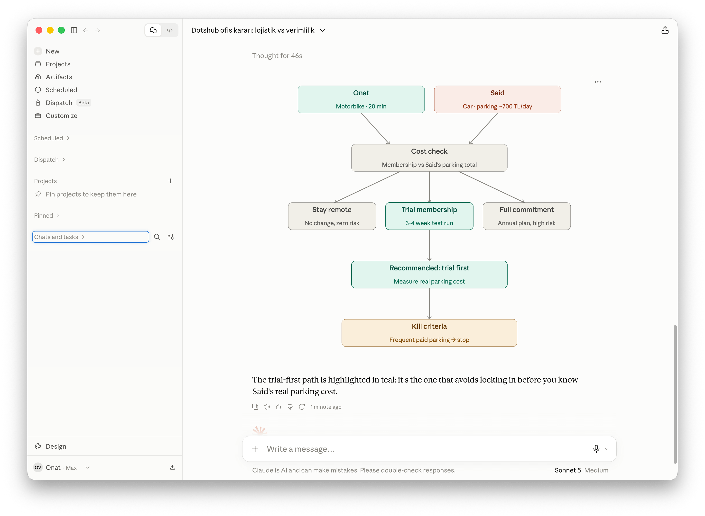

# I made an universal critical thinking skill

> Source: https://www.reddit.com/r/claudeskills/comments/1w32gzj/i_made_an_universal_critical_thinking_skill/
> Author: u/Tricky-Elderberry298
> Posted: 2026-08-31T03:48:59+00:00
> Captured: 2026-10-15T08:55:18+00:00
> Score: 167 · Comments: 17
> Community: r/claudeskills

## Post

We No Longer Decide Alone. We tend to ask our hardest questions to AI and turn it into our thinking buddy.

  
I made this skill to combine all best in the field critical thinking and strategy frameworks into a skill. Depending on your question it matches with the right framework and then step by step help you evaluate on your decision.

  
I tested it with Sonnet - Medium which turned out to be smart questioning model like Fable.

Its free - I uploaded it to my website.  
Here is the [download link](https://www.betaspacestudio.com/en/resources/universal-critical-thinking)

## Media

> Original media URL: https://i.redd.it/f515vakcummh1.png

> Original media URL: https://preview.redd.it/f515vakcummh1.png?auto=webp&s=ed832063008a82aaa3bca181eda41287ffe6f24f

## Thread

> u/Tricky-Elderberry298 · 2026-08-31T04:25:25+00:00 · score 18 · [comment](https://www.reddit.com/r/claudeskills/comments/1w32gzj/i_made_an_universal_critical_thinking_skill/p6x7fa7/)

By the way, for your safety after you download the skills always ask claude code to check if there is any malware inside before adding to your skills. Or you can scan with your eyes too.

> u/Tricky-Elderberry298 · 2026-08-31T18:18:48+00:00 · score 4 · [comment](https://www.reddit.com/r/claudeskills/comments/1w32gzj/i_made_an_universal_critical_thinking_skill/p70zxmj/)

Here is the github link, dont forget to give it a star [https://github.com/onatvural/Claude-Skills](https://github.com/onatvural/Claude-Skills)

> u/Tricky-Elderberry298 · 2026-08-31T18:18:42+00:00 · score 1 · [comment](https://www.reddit.com/r/claudeskills/comments/1w32gzj/i_made_an_universal_critical_thinking_skill/p70zwuk/)

Here is the github link, dont forget to give it a star [https://github.com/onatvural/Claude-Skills](https://github.com/onatvural/Claude-Skills)

> u/Tricky-Elderberry298 · 2026-09-01T16:15:07+00:00 · score 0 · [comment](https://www.reddit.com/r/claudeskills/comments/1w32gzj/i_made_an_universal_critical_thinking_skill/p77cpw1/)

just change the .skills document format name to .zip and unzip

> u/Tricky-Elderberry298 · 2026-09-01T20:17:11+00:00 · score 1 · [comment](https://www.reddit.com/r/claudeskills/comments/1w32gzj/i_made_an_universal_critical_thinking_skill/p78xckl/)

Click the link that i shared on the post and scroll down to bottom you will see skills directory preview ✌️

## Comments

> u/Arnel_Lalic · 2026-08-31T11:01:31+00:00 · score 3 · [comment](https://www.reddit.com/r/claudeskills/comments/1w32gzj/i_made_an_universal_critical_thinking_skill/p6yi8ts/)

Thanks for sharing. Do you have a GitHub for this?

> u/Valaraelis · 2026-08-31T11:53:43+00:00 · score 2 · [comment](https://www.reddit.com/r/claudeskills/comments/1w32gzj/i_made_an_universal_critical_thinking_skill/p6yq266/)

Agree with the GitHub comments :) Thanks

> u/nNaz · 2026-09-01T16:13:23+00:00 · score 2 · [comment](https://www.reddit.com/r/claudeskills/comments/1w32gzj/i_made_an_universal_critical_thinking_skill/p77cbcc/)

Looks like malware

> u/moh3th1 · 2026-08-31T10:41:29+00:00 · score 2 · [comment](https://www.reddit.com/r/claudeskills/comments/1w32gzj/i_made_an_universal_critical_thinking_skill/p6yfhi0/)

Could you upload it to GitHub?

> u/ItzGoTyme · 2026-08-31T11:39:35+00:00 · score 3 · [comment](https://www.reddit.com/r/claudeskills/comments/1w32gzj/i_made_an_universal_critical_thinking_skill/p6ynu23/)

I second this, would much prefer to go through Github.

> u/thatscoolbutno123 · 2026-08-31T15:46:44+00:00 · score 2 · [comment](https://www.reddit.com/r/claudeskills/comments/1w32gzj/i_made_an_universal_critical_thinking_skill/p700lmz/)

[https://github.com/mf450s/cirtical-thinking-skill](https://github.com/mf450s/cirtical-thinking-skill)

> u/mtawarira · 2026-09-01T12:42:17+00:00 · score 1 · [comment](https://www.reddit.com/r/claudeskills/comments/1w32gzj/i_made_an_universal_critical_thinking_skill/p762gmj/)

btw you’ve uploaded it as a .skill instead of a .MD

> u/mtawarira · 2026-09-01T17:37:17+00:00 · score 1 · [comment](https://www.reddit.com/r/claudeskills/comments/1w32gzj/i_made_an_universal_critical_thinking_skill/p77wg0c/)

.skills aren’t viewable on github

people think you’re sharing malware, .md would alleviate that concern

> u/CommunicationOne1157 · 2026-08-31T20:51:42+00:00 · score 1 · [comment](https://www.reddit.com/r/claudeskills/comments/1w32gzj/i_made_an_universal_critical_thinking_skill/p71zncy/)

Buna benzer skilleri yarı proya ekleyecek misiniz 

## Links

- https://www.betaspacestudio.com/en/resources/universal-critical-thinking
