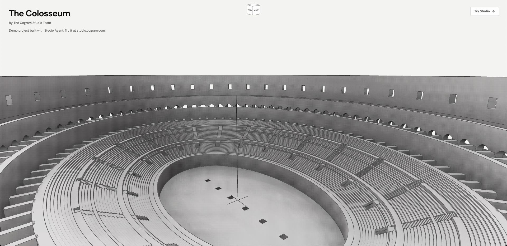
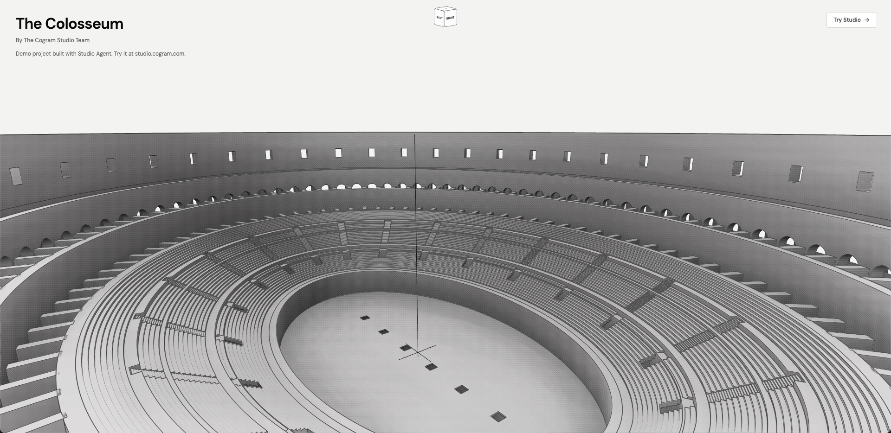

# We built an MCP server for CAD

> Source: https://www.reddit.com/r/mcp/comments/1w37d9y/we_built_an_mcp_server_for_cad/
> Author: u/ricwo
> Posted: 2026-08-31T08:12:24+00:00
> Captured: 2026-10-15T08:55:18+00:00
> Score: 102 · Comments: 18
> Community: r/mcp

## Post

Hi everyone – we’re building Cogram Studio, an MCP server for agents to do 3D modelling for engineering and architecture. An agent can create and modify CAD models, produce dimensioned drawings for fabrication, and import or export files.

You can connect Claude Code, Codex or another MCP-compatible agent and let it work directly in the modelling environment.

To try it, point your agent at [studio.cogram.com/skill.md](http://studio.cogram.com/skill.md) and ask it to follow the instructions. Studio will start a 2-hour modelling session in your browser that stays open while the agent works. You only need an account if you want to save the session.

Here are two models created by agents:

* A simple bookshelf ([https://studio.cogram.com/view/shr\_1agb21nd4](https://studio.cogram.com/view/shr_1agb21nd4)) with two sheets
* The Colosseum ([https://studio.cogram.com/view/shr\_3tm32c64y](https://studio.cogram.com/view/shr_3tm32c64y)) \[large, can take minutes to load\], with two sheets showing dimensioned and annotated views.

  
Studio works best when you break complex tasks down: ask for a bounded operation, inspect the result, then refine it. Asking an agent for a finished, complex design may produce something that looks plausible but falls apart under closer examination.

Right now, we find it most useful for repetitive modelling, quickly testing alternatives, finding and importing standard parts (ask your agent to websearch), producing drawings and exploring how a design might be fabricated.  
  
We’d love any feedback or ideas if you give it a go. You can try it by pointing an agent at [studio.cogram.com/skill.md](http://studio.cogram.com/skill.md).

## Media

> Original media URL: https://i.redd.it/e8eh8nj85omh1.png

> Original media URL: https://preview.redd.it/e8eh8nj85omh1.png?auto=webp&s=89e655216eb69173d35a49df159a381cd5957060

## Comments

> u/RawKangaroo97 · 2026-08-31T08:24:48+00:00 · score 2 · [comment](https://www.reddit.com/r/mcp/comments/1w37d9y/we_built_an_mcp_server_for_cad/p6xzgkq/)

That wireframe looks clean, must be heavy to load though if even the Colosseum example takes minutes

> u/buildbrief · 2026-08-31T08:34:47+00:00 · score 1 · [comment](https://www.reddit.com/r/mcp/comments/1w37d9y/we_built_an_mcp_server_for_cad/p6y0jvc/)

Colosseum is pathological in many ways: large-scale + lots of small details because of curved complex geometry intersecting.  
  
Small- to mid-size scenes load pretty fast.

> u/edrft99 · 2026-08-31T12:21:48+00:00 · score 2 · [comment](https://www.reddit.com/r/mcp/comments/1w37d9y/we_built_an_mcp_server_for_cad/p6yuqk2/)

This looks interesting. How does this differ on the smaller scale to give Claude or Codex access to OpenSCAD? What tools will be available on the MCP?

> u/buildbrief · 2026-08-31T13:33:48+00:00 · score 4 · [comment](https://www.reddit.com/r/mcp/comments/1w37d9y/we_built_an_mcp_server_for_cad/p6z86zq/)

u/edrft99 For small or relatively simple parts, OpenSCAD plus Claude/Codex is a good setup. OpenSCAD uses Constructive Solid Geometry (CSG), rendered as triangle meshes. Studio builds on the OpenCASCADE geometry kernel, which uses Boundary Representation (BREP). That's basically the more advanced, industry-standard method for precise modelling of complex models. Studio also comes with built-in capabilities for dimensioned plans, sections and elevations from the model, and sheet export. So it's a complete platform for going from 3D model to production sheets. Everything can be operated by you or agents.

MCP tools in Studio include 3D modelling / scripting capabilities, drawing creation, annotation, and dimensioning, table creation (schedules, bill of material, etc), import/export tools for files, terrain import, and visual model inspection.

Would love for you to give it a go. If you have any feedback or ideas for Studio, let us know how we can improve it for you.

> u/buildbrief · 2026-08-31T18:30:22+00:00 · score 2 · [comment](https://www.reddit.com/r/mcp/comments/1w37d9y/we_built_an_mcp_server_for_cad/p712ovs/)

If you'd prefer to try Studio via the UI instead of MCP, you can create a free account at https://studio.cogram.com.

> u/StarAppleEdwards494 · 2026-08-31T15:01:47+00:00 · score 1 · [comment](https://www.reddit.com/r/mcp/comments/1w37d9y/we_built_an_mcp_server_for_cad/p6zqp28/)

Most CAD tool posts sell you the finished design. This one names the boundary first: “looks plausible but falls apart under closer examination”, then points at “bounded operation, inspect the result, then refine” as the actual workflow. I’d take a server that says where it fails over one that doesn’t.

> u/bargaindownhill · 2026-08-31T19:37:19+00:00 · score 1 · [comment](https://www.reddit.com/r/mcp/comments/1w37d9y/we_built_an_mcp_server_for_cad/p71iabi/)

what compatibility does this have? autodesk? onshape? 

generating a model is great.. but engineering runs on established platforms. 

> u/buildbrief · 2026-09-01T10:39:56+00:00 · score 1 · [comment](https://www.reddit.com/r/mcp/comments/1w37d9y/we_built_an_mcp_server_for_cad/p75ikiw/)

u/bargaindownhill Studio imports/exports STEP, STL, DXF, IFC, and FCStd, so you can move models to other CAD/BIM tools. Which Autodesk tool is most important for you to have good interoperability?

> u/bargaindownhill · 2026-09-01T13:13:23+00:00 · score 3 · [comment](https://www.reddit.com/r/mcp/comments/1w37d9y/we_built_an_mcp_server_for_cad/p768gxj/)

inventor, solidworks, mastercam

> u/buildbrief · 2026-09-01T22:19:48+00:00 · score 1 · [comment](https://www.reddit.com/r/mcp/comments/1w37d9y/we_built_an_mcp_server_for_cad/p79m0xz/)

u/bargaindownhill 👍 

> u/Plastic_Tap8974 · 2026-09-01T20:40:46+00:00 · score 1 · [comment](https://www.reddit.com/r/mcp/comments/1w37d9y/we_built_an_mcp_server_for_cad/p792imz/)

Solidworks would be huge

> u/buildbrief · 2026-09-01T20:49:41+00:00 · score 1 · [comment](https://www.reddit.com/r/mcp/comments/1w37d9y/we_built_an_mcp_server_for_cad/p794g6w/)

u/Plastic_Tap8974 u/bargaindownhill thanks! We'll share a note here when that's available. 

> u/New-Procedure8239 · 2026-09-01T12:42:07+00:00 · score 1 · [comment](https://www.reddit.com/r/mcp/comments/1w37d9y/we_built_an_mcp_server_for_cad/p762fhj/)

https://github.com/Casys-AI/mcp-build123d

> u/[deleted] · 2026-09-09T16:48:01+00:00 · score 1 · [comment](https://www.reddit.com/r/mcp/comments/1w37d9y/we_built_an_mcp_server_for_cad/p8s0fas/)

[removed]

> u/buildbrief · 2026-09-09T17:00:19+00:00 · score 1 · [comment](https://www.reddit.com/r/mcp/comments/1w37d9y/we_built_an_mcp_server_for_cad/p8s3dbx/)

Thanks for your suggestion - dm'ing you!

> u/Capital_Ad8820 · 2026-09-16T14:43:32+00:00 · score 1 · [comment](https://www.reddit.com/r/mcp/comments/1w37d9y/we_built_an_mcp_server_for_cad/pa67unr/)

this is look cool nice

## Links

- http://studio.cogram.com/skill.md
- https://studio.cogram.com/view/shr\_1agb21nd4
- https://studio.cogram.com/view/shr_1agb21nd4
- https://studio.cogram.com/view/shr\_3tm32c64y
- https://studio.cogram.com/view/shr_3tm32c64y
