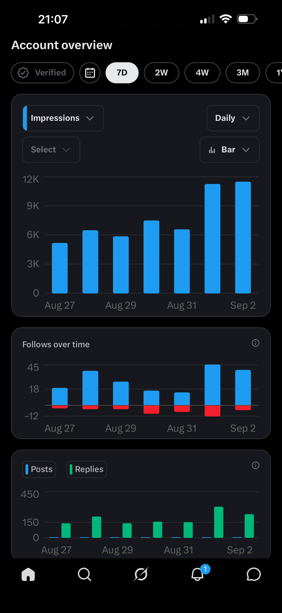

# I left 150+ replies a day on X for 7 days. Here’s what it did to followers and impressions. Proof in post.

> Source: https://www.reddit.com/r/GrowthHacking/comments/1wdk6co/i_left_150_replies_a_day_on_x_for_7_days_heres/
> Author: u/Outrageous_Menu_4536
> Posted: 2026-09-11T15:54:55+00:00
> Captured: 2026-10-15T08:55:18+00:00
> Score: 5 · Comments: 4
> Community: r/GrowthHacking

## Post

**TL;DR:** I spent seven days doing roughly 150+ replies per day on a small X account. Daily impressions went from around 5k to almost 12k, and the account gained roughly 150 net followers across the week.

# What happened

Daily impressions started the week at roughly **5k** and finished at just under **12k**. The last two days were both around the 11–12k mark, which was more than double where I started but that’s also where I done over 200 comments on both days (300 on one).

Follower growth followed a similar pattern, although it was much noisier. Across the week I picked up roughly **200 gross follows**, with unfollows bringing the net gain down to somewhere around **150**.

The best day brought in roughly 45 new followers.

I was also posting during the week, so I can’t say “150 replies caused X followers” with any scientific confidence. But the relationship became pretty obvious from using the account: replies were consistently getting me in front of people who otherwise had no reason to know I existed.

# What seemed to work best

The replies that did well weren’t necessarily the longest. Usually they had one of three things:

* an actual opinion instead of agreeing with the post;
* a specific example or personal experience;
* or a question that moved the conversation somewhere interesting.

Timing also mattered. Getting into a good conversation while the original post was still picking up distribution obviously gave the reply much more room to travel.

The days where I pushed closer to 200–300 replies also produced some of the strongest impression/follower numbers in the screenshot. I wouldn’t claim that proves a linear relationship, but it’s enough for me to keep testing the higher volume.

# The obvious downside

150–300 thoughtful replies is a lot of time. I was spending around 2 - 3 hours a day responding and I’d be lying if I didn’t say at least 10% of these replies were after the 10+ hour mark so my reply probably wasn’t beneficial at all.

Now that my little experiment is done, I’m less interested in how many people follow the account now and more interested in whether those people eventually engage with my longer posts and move into the thing I’m actually building. I won’t mention it here in case self-promotion isn’t allowed.

For now though, as a **zero-budget way to get a small X account discovered**, replying at volume has worked much better than I expected and I recommend this strategy to anyone who’s looking to grow their account.

## Media

> Original media URL: https://i.redd.it/7syi0q6zxwoh1.png

> Original media URL: https://preview.redd.it/7syi0q6zxwoh1.png?auto=webp&s=a7c206ddfc926c4dc0bed606f0f68d23a3978c48

## Comments

> u/mezda_876 · 2026-09-11T20:08:14+00:00 · score 1 · [comment](https://www.reddit.com/r/GrowthHacking/comments/1wdk6co/i_left_150_replies_a_day_on_x_for_7_days_heres/p981urj/)

From personal experience, replying does help with followers, but it's extremely time-consuming.

> u/Tight-Inevitable6908 · 2026-10-07T13:37:55+00:00 · score 1 · [comment](https://www.reddit.com/r/GrowthHacking/comments/1wdk6co/i_left_150_replies_a_day_on_x_for_7_days_heres/pefftbw/)

The 300 reply day really shows in that impressions spike, wild how fast it compounds

> u/Competitive_Tune_590 · 2026-09-12T07:19:42+00:00 · score 1 · [comment](https://www.reddit.com/r/GrowthHacking/comments/1wdk6co/i_left_150_replies_a_day_on_x_for_7_days_heres/p9b5ahy/)

timing and volume really do make a difference, but the time sink is brutal. i've been using replyhey to scan reddit for relevant threads and draft replies instead of doing it all manually, and it cuts that daily time way down while keeping the engagement genuine. worth a look if you're trying to run the same playbook on reddit.

> u/emdmotiur · 2026-09-16T19:24:53+00:00 · score 1 · [comment](https://www.reddit.com/r/GrowthHacking/comments/1wdk6co/i_left_150_replies_a_day_on_x_for_7_days_heres/pa83xjw/)

insane grind but this proves replies are still the fastest way to get seen.

