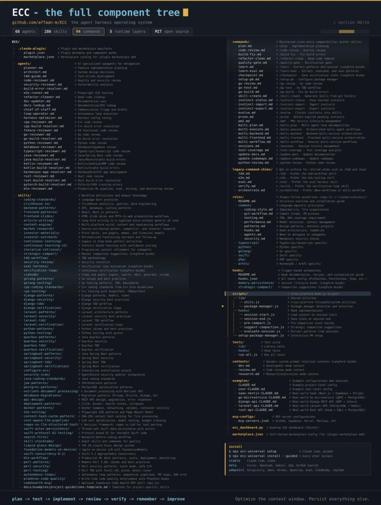

# Anthropic hackathon winner just open-sourced his entire Claude Code setup 🔥

> Source: https://www.reddit.com/r/SATNA_PROJECT/comments/1wgu40p/anthropic_hackathon_winner_just_opensourced_his/
> Author: u/ZookeepergameMost817
> Posted: 2026-09-15T08:06:21+00:00
> Captured: 2026-10-15T08:55:18+00:00
> Score: 2359 · Comments: 101
> Community: r/SATNA_PROJECT

## Post

The creator behind the Anthropic × Forum Ventures hackathon-winning project released his full Claude Code workflow for free.

Agents, skills, hooks, commands, rules, MCP configs — a seriously useful resource if you build with Claude Code, Cursor, Codex, or AI coding agents.

**GitHub:**  
[https://github.com/affaan-m/everything-claude-code](https://github.com/affaan-m/everything-claude-code)

I share more free AI tools, open-source projects, automation resources, and useful dev finds in my Discord:

**Join here:**  
[Click here to join the server ](https://discord.gg/qnzwqxyXFh)

*Tip: Read through the configs before installing anything into your own environment.*

## Media

> Original media URL: https://i.redd.it/tp97rbcz5nph1.jpeg

> Original media URL: https://preview.redd.it/tp97rbcz5nph1.jpeg?auto=webp&s=27ff047f9aef3289ed10a4ad8bde357f59a4b611

## Thread

> u/ZookeepergameMost817 · 2026-09-15T10:41:42+00:00 · score 7 · [comment](https://www.reddit.com/r/SATNA_PROJECT/comments/1wgu40p/anthropic_hackathon_winner_just_opensourced_his/p9xkb9t/)

The repo itself is completely free to download and use.You only pay if you connect it to paid api services like claude api credits or optional mcp tools 

> u/ZookeepergameMost817 · 2026-09-16T11:58:22+00:00 · score 1 · [comment](https://www.reddit.com/r/SATNA_PROJECT/comments/1wgu40p/anthropic_hackathon_winner_just_opensourced_his/pa59nau/)

Absolutely fewer well chosen tools keep the context cleaner and token usage lower.

> u/ZookeepergameMost817 · 2026-09-15T11:26:58+00:00 · score 1 · [comment](https://www.reddit.com/r/SATNA_PROJECT/comments/1wgu40p/anthropic_hackathon_winner_just_opensourced_his/p9xr5xx/)

Most agents,prompts, and workflows can be adapted to other harnesses only native claude codex kimi featurs like hooks or plugins may need custom setup 

> u/ZookeepergameMost817 · 2026-09-16T02:26:20+00:00 · score 1 · [comment](https://www.reddit.com/r/SATNA_PROJECT/comments/1wgu40p/anthropic_hackathon_winner_just_opensourced_his/pa3379s/)

Fair point  I agree. Skills and general workflow ideas are the safest things to port hooks, loops, watchers, and other harness specific behavior should be reviewed and rebuilt for the target tool rather than copied blindly.

> u/ZookeepergameMost817 · 2026-09-16T02:23:08+00:00 · score 1 · [comment](https://www.reddit.com/r/SATNA_PROJECT/comments/1wgu40p/anthropic_hackathon_winner_just_opensourced_his/pa32n24/)

This is not an advertising nobody is paying me anything  i am sharing i find on the internet  

> u/ZookeepergameMost817 · 2026-09-16T08:56:43+00:00 · score 2 · [comment](https://www.reddit.com/r/SATNA_PROJECT/comments/1wgu40p/anthropic_hackathon_winner_just_opensourced_his/pa4k885/)

That makes sense the infrastructure is manageable but API token costs can become the real limitation   
hopefully anthropic provides enough credits or unlimited access for hackathon participants.

> u/ZookeepergameMost817 · 2026-09-16T11:07:32+00:00 · score 2 · [comment](https://www.reddit.com/r/SATNA_PROJECT/comments/1wgu40p/anthropic_hackathon_winner_just_opensourced_his/pa519ks/)

It will increase token consumption, especially if the infrastructure runs continuously or handles many requests.

> u/ZookeepergameMost817 · 2026-09-16T11:57:23+00:00 · score 1 · [comment](https://www.reddit.com/r/SATNA_PROJECT/comments/1wgu40p/anthropic_hackathon_winner_just_opensourced_his/pa59h0c/)

Haha 😜 all hail the markdown tomes where the real magic lives.

> u/ZookeepergameMost817 · 2026-09-15T18:39:58+00:00 · score 1 · [comment](https://www.reddit.com/r/SATNA_PROJECT/comments/1wgu40p/anthropic_hackathon_winner_just_opensourced_his/pa0ekax/)

After installing it, start Claude Code inside your project folder the installed skills, agents, and commands become available there. It won’t do everything automatically check the repo README for the specific commands and agents, then invoke the ones you need for tasks like planning, reviews, or testing.

> u/ZookeepergameMost817 · 2026-09-19T16:36:00+00:00 · score 1 · [comment](https://www.reddit.com/r/SATNA_PROJECT/comments/1wgu40p/anthropic_hackathon_winner_just_opensourced_his/pasmk74/)

You can use it to automate multi-step tasks, like researching, planning, coding, and taking actions across different tools. Instead of giving one prompt at a time, you can assign a goal and let the agent work through the steps.

> u/ZookeepergameMost817 · 2026-09-21T05:08:03+00:00 · score 1 · [comment](https://www.reddit.com/r/SATNA_PROJECT/comments/1wgu40p/anthropic_hackathon_winner_just_opensourced_his/pb3ubof/)

If you want the full set up guide join the discord and dm me 

> u/ZookeepergameMost817 · 2026-09-15T08:35:04+00:00 · score 2 · [comment](https://www.reddit.com/r/SATNA_PROJECT/comments/1wgu40p/anthropic_hackathon_winner_just_opensourced_his/p9x4puq/)

Yes brother its been weeks have u tried it if yes then what are your thoughts 💭 pls share

> u/ZookeepergameMost817 · 2026-09-15T12:49:37+00:00 · score 1 · [comment](https://www.reddit.com/r/SATNA_PROJECT/comments/1wgu40p/anthropic_hackathon_winner_just_opensourced_his/p9y5qad/)

Your welcome 🙏🏻

## Comments

> u/bicentennialman_ · 2026-09-15T15:07:37+00:00 · score 14 · [comment](https://www.reddit.com/r/SATNA_PROJECT/comments/1wgu40p/anthropic_hackathon_winner_just_opensourced_his/p9yzmg9/)

Getting tired of these marketing hoaxes. It's nothing but encouragement to increase token usage.

> u/Pretend_Topic6326 · 2026-09-15T16:54:37+00:00 · score 5 · [comment](https://www.reddit.com/r/SATNA_PROJECT/comments/1wgu40p/anthropic_hackathon_winner_just_opensourced_his/p9zp8q2/)

Just run locally or use cheap models to serve. These harnesses do improve performance for a lot of tasks

> u/Nice_Cellist_7595 · 2026-09-19T23:25:10+00:00 · score 1 · [comment](https://www.reddit.com/r/SATNA_PROJECT/comments/1wgu40p/anthropic_hackathon_winner_just_opensourced_his/pauz7mv/)

Yes indeed, I've found that my Gemma4 is a great model and surprises me with some high quality answers but it needs a lot of guidance and rails to get things done in a usable, system like way.

> u/blob420 · 2026-09-19T20:42:59+00:00 · score 2 · [comment](https://www.reddit.com/r/SATNA_PROJECT/comments/1wgu40p/anthropic_hackathon_winner_just_opensourced_his/pau3za8/)

My token use and response times increased significantly and I had to remove this. May be I was using it wrong and although it showed some promise but for someone with limited plan that wasn’t for me. 

> u/b-dub-d · 2026-09-15T20:11:15+00:00 · score 1 · [comment](https://www.reddit.com/r/SATNA_PROJECT/comments/1wgu40p/anthropic_hackathon_winner_just_opensourced_his/pa1060e/)

Seriously, and yet solutions that actually save context and money don't get any views. Use contextwise folks - literally just stop throwing away money

> u/Advanced_Secret8872 · 2026-09-18T12:31:35+00:00 · score 1 · [comment](https://www.reddit.com/r/SATNA_PROJECT/comments/1wgu40p/anthropic_hackathon_winner_just_opensourced_his/pak6ghg/)

Thanks for the ad I’ll check it out. Context wise?

> u/End2EndEncryption · 2026-09-20T22:40:28+00:00 · score 1 · [comment](https://www.reddit.com/r/SATNA_PROJECT/comments/1wgu40p/anthropic_hackathon_winner_just_opensourced_his/pb1ztu3/)

Lol cheap plug. When did you develop that?

This is getting so lame. If you did it, anyone else can. Good grief.

> u/DoubleNothing · 2026-09-16T11:23:01+00:00 · score 1 · [comment](https://www.reddit.com/r/SATNA_PROJECT/comments/1wgu40p/anthropic_hackathon_winner_just_opensourced_his/pa53pym/)

Not if you are smart about it...

> u/SCCM_1 · 2026-09-16T15:46:56+00:00 · score 1 · [comment](https://www.reddit.com/r/SATNA_PROJECT/comments/1wgu40p/anthropic_hackathon_winner_just_opensourced_his/pa6mwhb/)

You didn’t read through it then, there’s a section on reducing costs…

> u/Pretend_Weight5385 · 2026-09-17T18:40:36+00:00 · score 1 · [comment](https://www.reddit.com/r/SATNA_PROJECT/comments/1wgu40p/anthropic_hackathon_winner_just_opensourced_his/paf7opu/)

This, this is like the first thing I was searching for, looking at how he configured it...

[https://github.com/affaan-m/ECC/blob/main/skills/strategic-compact/SKILL.md](https://github.com/affaan-m/ECC/blob/main/skills/strategic-compact/SKILL.md)

> u/sandunthejana · 2026-09-15T10:32:51+00:00 · score 7 · [comment](https://www.reddit.com/r/SATNA_PROJECT/comments/1wgu40p/anthropic_hackathon_winner_just_opensourced_his/p9xj2tv/)

Does this cost money?

> u/Pretend_Weight5385 · 2026-09-17T18:41:03+00:00 · score 1 · [comment](https://www.reddit.com/r/SATNA_PROJECT/comments/1wgu40p/anthropic_hackathon_winner_just_opensourced_his/paf7smp/)

it actually saves money

[https://github.com/affaan-m/ECC/blob/main/skills/strategic-compact/SKILL.md](https://github.com/affaan-m/ECC/blob/main/skills/strategic-compact/SKILL.md)

> u/rslashmemes · 2026-09-18T02:01:57+00:00 · score 1 · [comment](https://www.reddit.com/r/SATNA_PROJECT/comments/1wgu40p/anthropic_hackathon_winner_just_opensourced_his/pahpv2f/)

That's a pretty clever skill, thanks for calling out. I was about to skip this before looking at it more deeply.

> u/BlankedCanvas · 2026-09-21T01:10:56+00:00 · score 1 · [comment](https://www.reddit.com/r/SATNA_PROJECT/comments/1wgu40p/anthropic_hackathon_winner_just_opensourced_his/pb2rqfv/)

Thanks for sharing

> u/YourNemesis19 · 2026-09-15T15:13:37+00:00 · score 5 · [comment](https://www.reddit.com/r/SATNA_PROJECT/comments/1wgu40p/anthropic_hackathon_winner_just_opensourced_his/p9z10u8/)

"just" open sourced 

I have been hearing this for months now... atleast 6 months... 

Used it and then removed it as well

> u/Dads_Hat · 2026-09-15T17:29:11+00:00 · score 3 · [comment](https://www.reddit.com/r/SATNA_PROJECT/comments/1wgu40p/anthropic_hackathon_winner_just_opensourced_his/p9zxl5q/)

Literally published Jan 18? 

> u/bigppredditguy · 2026-09-17T16:37:41+00:00 · score 2 · [comment](https://www.reddit.com/r/SATNA_PROJECT/comments/1wgu40p/anthropic_hackathon_winner_just_opensourced_his/paee47z/)

7 months ago….

> u/YourNemesis19 · 2026-09-18T02:23:40+00:00 · score 1 · [comment](https://www.reddit.com/r/SATNA_PROJECT/comments/1wgu40p/anthropic_hackathon_winner_just_opensourced_his/pahtrav/)

8 months ago,actually

> u/rslashmemes · 2026-09-18T02:02:26+00:00 · score 2 · [comment](https://www.reddit.com/r/SATNA_PROJECT/comments/1wgu40p/anthropic_hackathon_winner_just_opensourced_his/pahpy91/)

OP gotta click bait somehow

> u/Mutthal8 · 2026-09-19T01:07:04+00:00 · score 1 · [comment](https://www.reddit.com/r/SATNA_PROJECT/comments/1wgu40p/anthropic_hackathon_winner_just_opensourced_his/paon9p2/)

It's a Twitter title , have seen it 10s of time on there tbh

> u/Repulsive_Battle248 · 2026-09-16T11:39:17+00:00 · score 3 · [comment](https://www.reddit.com/r/SATNA_PROJECT/comments/1wgu40p/anthropic_hackathon_winner_just_opensourced_his/pa56dot/)

Remember, less is more in a lot of cases. If you see insane amount of tools it is going to affect your context extremely hard and will just bloat your token usage

> u/AintNoGodsUpHere · 2026-09-19T18:21:58+00:00 · score 1 · [comment](https://www.reddit.com/r/SATNA_PROJECT/comments/1wgu40p/anthropic_hackathon_winner_just_opensourced_his/pata0hx/)

Sure sure

> u/Stml8i · 2026-09-15T11:14:37+00:00 · score 2 · [comment](https://www.reddit.com/r/SATNA_PROJECT/comments/1wgu40p/anthropic_hackathon_winner_just_opensourced_his/p9xp7vz/)

How does this apply to any harness other than Claude/Codex/Kimi?
Would be any native features be unreachable through something like OpenCode or DeepSeek Harness?
Thanks for sharing the repo!

> u/bull_chief · 2026-09-15T14:58:01+00:00 · score 1 · [comment](https://www.reddit.com/r/SATNA_PROJECT/comments/1wgu40p/anthropic_hackathon_winner_just_opensourced_his/p9yxfdo/)

I mean this is the least rude way possible, but you should probably stay away from porting anything other than skills, unless you can answer this yourself. In part because there is a lot of content out there which fails to take the nuances into account as well, which can bite you. Most of the harnesses have certain things they impliment fundamentally different e.g . Loops, hooks, watcher implementation, etc. Claude Code is also a bit more robust out of the box than the others. 

> u/AlmostEasy89 · 2026-09-15T23:56:06+00:00 · score 2 · [comment](https://www.reddit.com/r/SATNA_PROJECT/comments/1wgu40p/anthropic_hackathon_winner_just_opensourced_his/pa2b9ev/)

People blindly installing this stuff globally with 40 hooks per turn is why people think token consumption is only Anthropic/ChatGPTs evil doing. They have no idea what they're doing. How can AI even function with so much filling it's context window? And models change so fast with their own new prompts. None of this makes sense.

> u/Routine_Temporary661 · 2026-09-16T00:14:09+00:00 · score 2 · [comment](https://www.reddit.com/r/SATNA_PROJECT/comments/1wgu40p/anthropic_hackathon_winner_just_opensourced_his/pa2en67/)

One hello then 100% 5hr limit gone... seriously OP this type of marketing is very cringe stop it

> u/FormalAd7367 · 2026-09-16T00:16:58+00:00 · score 2 · [comment](https://www.reddit.com/r/SATNA_PROJECT/comments/1wgu40p/anthropic_hackathon_winner_just_opensourced_his/pa2f5wu/)

just had a look - he didn’t win the hackathon because he had those installed

> u/Mewtewpew · 2026-09-16T00:23:05+00:00 · score 2 · [comment](https://www.reddit.com/r/SATNA_PROJECT/comments/1wgu40p/anthropic_hackathon_winner_just_opensourced_his/pa2gb8j/)

This is that type of advertising you get when you pay the sketchy people emailing you 😭🙏

> u/aersel24 · 2026-09-16T03:15:48+00:00 · score 2 · [comment](https://www.reddit.com/r/SATNA_PROJECT/comments/1wgu40p/anthropic_hackathon_winner_just_opensourced_his/pa3bi5b/)

I feel this would make my local AIs go weeks into “But wait…”

> u/ZorpIt · 2026-09-16T05:41:21+00:00 · score 2 · [comment](https://www.reddit.com/r/SATNA_PROJECT/comments/1wgu40p/anthropic_hackathon_winner_just_opensourced_his/pa3wf4i/)

There's literally nothing special here

> u/Phebe22 · 2026-09-16T06:06:30+00:00 · score 2 · [comment](https://www.reddit.com/r/SATNA_PROJECT/comments/1wgu40p/anthropic_hackathon_winner_just_opensourced_his/pa3zo8j/)

Slop it up!

> u/Effective_Tart_7097 · 2026-09-16T08:02:09+00:00 · score 2 · [comment](https://www.reddit.com/r/SATNA_PROJECT/comments/1wgu40p/anthropic_hackathon_winner_just_opensourced_his/pa4dwgk/)

you dont' need any of those

> u/_C--C_ · 2026-09-16T08:54:24+00:00 · score 2 · [comment](https://www.reddit.com/r/SATNA_PROJECT/comments/1wgu40p/anthropic_hackathon_winner_just_opensourced_his/pa4jyet/)

I could have a whole infrastructure for that, the problem isn’t that.

I can't afford the tokens to run whole infrastructure. I believe they have unlimited api for hackathon participants 

> u/Stml8i · 2026-09-16T11:02:54+00:00 · score 2 · [comment](https://www.reddit.com/r/SATNA_PROJECT/comments/1wgu40p/anthropic_hackathon_winner_just_opensourced_his/pa50ke7/)

How will this affect token consumption?

> u/i-hate-space · 2026-09-16T13:54:17+00:00 · score 1 · [comment](https://www.reddit.com/r/SATNA_PROJECT/comments/1wgu40p/anthropic_hackathon_winner_just_opensourced_his/pa5wrkx/)

If you don't know thst yourself this is of no use for you 

> u/rco8786 · 2026-09-16T11:54:29+00:00 · score 2 · [comment](https://www.reddit.com/r/SATNA_PROJECT/comments/1wgu40p/anthropic_hackathon_winner_just_opensourced_his/pa58ypj/)

The magical markdown tomes. All hail. 

> u/Unlucky-Stable6006 · 2026-09-20T01:35:44+00:00 · score 2 · [comment](https://www.reddit.com/r/SATNA_PROJECT/comments/1wgu40p/anthropic_hackathon_winner_just_opensourced_his/pavm8jv/)

Yea looks similar to my custom one but different direction my harness is for low level c and theorem and math calculations where the model just babysits and my harness does the work 

> u/Superb-Ant3548 · 2026-09-21T04:14:40+00:00 · score 2 · [comment](https://www.reddit.com/r/SATNA_PROJECT/comments/1wgu40p/anthropic_hackathon_winner_just_opensourced_his/pb3mqn3/)

Thanks OP, this is fire. Bunch of mouth breathing vibe coders here in the comments throwing shade need to learn how to use tools, bunch of square peg + round hole noise.

> u/MugenBig · 2026-09-21T15:25:00+00:00 · score 2 · [comment](https://www.reddit.com/r/SATNA_PROJECT/comments/1wgu40p/anthropic_hackathon_winner_just_opensourced_his/pb6hcre/)

Seriously, who is actually using this monstrosity in production?

> u/idiotiesystemique · 2026-09-15T15:15:34+00:00 · score 1 · [comment](https://www.reddit.com/r/SATNA_PROJECT/comments/1wgu40p/anthropic_hackathon_winner_just_opensourced_his/p9z1hb6/)

Enjoy starting every chat with 250k context 

> u/Taco_Reviewer · 2026-09-15T20:30:42+00:00 · score 2 · [comment](https://www.reddit.com/r/SATNA_PROJECT/comments/1wgu40p/anthropic_hackathon_winner_just_opensourced_his/pa14tdq/)

Unfortunately, that's the cost of building quality software with AI.

Not necessarily 250k, but your agent needs to take a large amount of context between tasks to ensure continuity and to avoid it wasting work to try and reinvent processes and skills on the fly.

> u/idiotiesystemique · 2026-09-15T21:25:32+00:00 · score 1 · [comment](https://www.reddit.com/r/SATNA_PROJECT/comments/1wgu40p/anthropic_hackathon_winner_just_opensourced_his/pa1hiyt/)

Link to your prod apps? 

> u/Timely_Lie_8696 · 2026-09-16T04:04:05+00:00 · score 1 · [comment](https://www.reddit.com/r/SATNA_PROJECT/comments/1wgu40p/anthropic_hackathon_winner_just_opensourced_his/pa3ixuk/)

was this supposed to be a burn or humorous?

> u/Background_One_6482 · 2026-09-15T16:01:33+00:00 · score 1 · [comment](https://www.reddit.com/r/SATNA_PROJECT/comments/1wgu40p/anthropic_hackathon_winner_just_opensourced_his/p9zcium/)

lol

> u/gzoomedia · 2026-09-15T19:06:09+00:00 · score 1 · [comment](https://www.reddit.com/r/SATNA_PROJECT/comments/1wgu40p/anthropic_hackathon_winner_just_opensourced_his/pa0kr5m/)

lol that's exactly what I was thinking. I was just about to post the same then read your comment.

> u/Chemical_Magician176 · 2026-09-16T23:20:50+00:00 · score 1 · [comment](https://www.reddit.com/r/SATNA_PROJECT/comments/1wgu40p/anthropic_hackathon_winner_just_opensourced_his/pa9jwbk/)

Buh buh, buhh I hear token maxxxxing is best thing since sourdough 

> u/mVirtuoso21 · 2026-09-15T16:38:07+00:00 · score 1 · [comment](https://www.reddit.com/r/SATNA_PROJECT/comments/1wgu40p/anthropic_hackathon_winner_just_opensourced_his/p9zl96y/)

Mind sharing how to actually use it? I'm using Claude code and did follow the installation guide and installed globally. But then what? Does Claude automatically use it? I'm still new to all of this AI stuff, so I'm genuinely asking.

> u/burningwrobel · 2026-09-16T16:21:27+00:00 · score 1 · [comment](https://www.reddit.com/r/SATNA_PROJECT/comments/1wgu40p/anthropic_hackathon_winner_just_opensourced_his/pa6v981/)

Frag doch Claude?! 

> u/Romus80 · 2026-09-15T18:02:55+00:00 · score 1 · [comment](https://www.reddit.com/r/SATNA_PROJECT/comments/1wgu40p/anthropic_hackathon_winner_just_opensourced_his/pa05rxq/)

Keep on burning those tokens we need all the input in the wooooorld ! Don’t use books !

> u/Careless-Wonder6206 · 2026-09-15T19:29:44+00:00 · score 1 · [comment](https://www.reddit.com/r/SATNA_PROJECT/comments/1wgu40p/anthropic_hackathon_winner_just_opensourced_his/pa0qcdp/)

holy slop

> u/baldbundy · 2026-09-15T20:53:11+00:00 · score 1 · [comment](https://www.reddit.com/r/SATNA_PROJECT/comments/1wgu40p/anthropic_hackathon_winner_just_opensourced_his/pa1a56b/)

As a developer, it has a "Look at what they need to mimic a fraction of our power" vibe.

> u/Better-Struggle9958 · 2026-09-15T21:10:14+00:00 · score 1 · [comment](https://www.reddit.com/r/SATNA_PROJECT/comments/1wgu40p/anthropic_hackathon_winner_just_opensourced_his/pa1e3n2/)

absolutely random list of tools

> u/Fun_Celebration_8842 · 2026-09-15T21:59:13+00:00 · score 1 · [comment](https://www.reddit.com/r/SATNA_PROJECT/comments/1wgu40p/anthropic_hackathon_winner_just_opensourced_his/pa1oq2y/)

chopper like a baby shark the way go tududu

> u/AcanthisittaFuzzy403 · 2026-09-16T00:02:38+00:00 · score 1 · [comment](https://www.reddit.com/r/SATNA_PROJECT/comments/1wgu40p/anthropic_hackathon_winner_just_opensourced_his/pa2choe/)

I'm tool old to understand any of this. I just empty my bank account and let Fable run wild. 

> u/Demien19 · 2026-09-16T14:34:41+00:00 · score 1 · [comment](https://www.reddit.com/r/SATNA_PROJECT/comments/1wgu40p/anthropic_hackathon_winner_just_opensourced_his/pa65t7u/)

markdown hell

> u/Huge_Law4072 · 2026-09-16T15:35:31+00:00 · score 1 · [comment](https://www.reddit.com/r/SATNA_PROJECT/comments/1wgu40p/anthropic_hackathon_winner_just_opensourced_his/pa6k61y/)

Bro this has been out for ages...

> u/ReporterCalm6238 · 2026-09-16T21:23:47+00:00 · score 1 · [comment](https://www.reddit.com/r/SATNA_PROJECT/comments/1wgu40p/anthropic_hackathon_winner_just_opensourced_his/pa8w8fe/)

I'm confused, why this thing has 260k stars? what's so incredibly awesome about it? does it change the claude code experience so radically?

> u/bitpuppet · 2026-09-16T23:12:11+00:00 · score 1 · [comment](https://www.reddit.com/r/SATNA_PROJECT/comments/1wgu40p/anthropic_hackathon_winner_just_opensourced_his/pa9i9jl/)

Lolz this look like all the skills and their mothers are added in this list….wtf this winner was doing

> u/_splug · 2026-09-17T00:19:56+00:00 · score 1 · [comment](https://www.reddit.com/r/SATNA_PROJECT/comments/1wgu40p/anthropic_hackathon_winner_just_opensourced_his/pa9uz0c/)

This is a complete waste imo. If you were good at Google, you can one shot a simple prompt. It’s all about activating the right vectors with the right keywords. Fuck skills, plugins and all that crap. It’s over complicating it unnecessarily for performative reasons, in my opinion.

> u/Sweetdevil144 · 2026-09-17T14:59:51+00:00 · score 1 · [comment](https://www.reddit.com/r/SATNA_PROJECT/comments/1wgu40p/anthropic_hackathon_winner_just_opensourced_his/padqsii/)

Honest review : This is shit and over-engineering + trying to token max by repeatedly reading skill files. Just use prompts, graphs, and learn system design 🤣

> u/National-Objective57 · 2026-09-17T20:42:11+00:00 · score 1 · [comment](https://www.reddit.com/r/SATNA_PROJECT/comments/1wgu40p/anthropic_hackathon_winner_just_opensourced_his/pafzz6i/)

Holy Token burn 

> u/Tbhmaximillian · 2026-09-17T23:35:30+00:00 · score 1 · [comment](https://www.reddit.com/r/SATNA_PROJECT/comments/1wgu40p/anthropic_hackathon_winner_just_opensourced_his/pagyfcj/)

ok well apart from all the hate, i let my hermes run over the git to find stuff to improve his coding skills and planning and it works better now. So i see this more as a library to get information for your setup but would not run all of that

> u/Orlandocollins · 2026-09-18T00:48:22+00:00 · score 1 · [comment](https://www.reddit.com/r/SATNA_PROJECT/comments/1wgu40p/anthropic_hackathon_winner_just_opensourced_his/pahbt9n/)

Holy shit how much context is eaten up just by all those skill descriptions lol

> u/learning-rust · 2026-09-18T02:40:11+00:00 · score 1 · [comment](https://www.reddit.com/r/SATNA_PROJECT/comments/1wgu40p/anthropic_hackathon_winner_just_opensourced_his/pahwp3f/)

Most of it - plain garbage

> u/unethicalangel · 2026-09-18T09:39:50+00:00 · score 1 · [comment](https://www.reddit.com/r/SATNA_PROJECT/comments/1wgu40p/anthropic_hackathon_winner_just_opensourced_his/pajg9cs/)

Holy bloat 

> u/look · 2026-09-18T15:05:09+00:00 · score 1 · [comment](https://www.reddit.com/r/SATNA_PROJECT/comments/1wgu40p/anthropic_hackathon_winner_just_opensourced_his/pal388c/)

Looks like we’re back to 128k context windows with the 872k of system prompt there... 

> u/Ok_Sympathy9261 · 2026-09-19T12:11:52+00:00 · score 1 · [comment](https://www.reddit.com/r/SATNA_PROJECT/comments/1wgu40p/anthropic_hackathon_winner_just_opensourced_his/par4ytt/)

gonna be honest, whenever there's not sufficient screenshots to sell it to me, i bail. you could cure cancer, but with a boring ass github page i'm gonna pass

> u/jonah_omninode · 2026-09-19T15:37:19+00:00 · score 1 · [comment](https://www.reddit.com/r/SATNA_PROJECT/comments/1wgu40p/anthropic_hackathon_winner_just_opensourced_his/pas9jw3/)

I'd try one component against a task that already gives my current setup trouble before importing the whole collection. That makes it possible to tell whether a hook actually helped or just added work to every turn.

Keep the original setup as the comparison and record the result, elapsed time and token use. If the task already passes without the extra machinery, there needs to be another clear reason to keep it. Which individual piece has made the biggest difference for people who've used this for a while?

> u/berlinbrownaus · 2026-09-19T16:31:05+00:00 · score 1 · [comment](https://www.reddit.com/r/SATNA_PROJECT/comments/1wgu40p/anthropic_hackathon_winner_just_opensourced_his/paslhdp/)

Cool

> u/berlinbrownaus · 2026-09-19T16:32:09+00:00 · score 1 · [comment](https://www.reddit.com/r/SATNA_PROJECT/comments/1wgu40p/anthropic_hackathon_winner_just_opensourced_his/paslprr/)

What does he do with it.  I havent really used agents and just prompt

> u/berlinbrownaus · 2026-09-19T17:35:18+00:00 · score 1 · [comment](https://www.reddit.com/r/SATNA_PROJECT/comments/1wgu40p/anthropic_hackathon_winner_just_opensourced_his/paszo37/)

Cool

> u/sudo-maxime · 2026-09-19T19:45:54+00:00 · score 1 · [comment](https://www.reddit.com/r/SATNA_PROJECT/comments/1wgu40p/anthropic_hackathon_winner_just_opensourced_his/patrzsa/)

My agents.md is 3 lines long to tell it to write readable code, and it does the trick.

> u/YearnMar10 · 2026-09-19T20:17:34+00:00 · score 1 · [comment](https://www.reddit.com/r/SATNA_PROJECT/comments/1wgu40p/anthropic_hackathon_winner_just_opensourced_his/patymzh/)

Man, I got this starred already at some point, so it’s definitely not “just” opened. I unstarred again. I don’t believe you anymore.

> u/Oxffff0000 · 2026-09-21T02:19:39+00:00 · score 1 · [comment](https://www.reddit.com/r/SATNA_PROJECT/comments/1wgu40p/anthropic_hackathon_winner_just_opensourced_his/pb33u19/)

Hi all. I am on Claude Pro and I use claude code. However, I don't understand a single thing in the post. Is it something that can help us when we're working on projects? Forgive me as I am not using my pro subscription properly. I don't even know how to use mcp right now. Thank you.

> u/brovaro · 2026-09-15T08:32:12+00:00 · score 0 · [comment](https://www.reddit.com/r/SATNA_PROJECT/comments/1wgu40p/anthropic_hackathon_winner_just_opensourced_his/p9x4e90/)

"Just"? It's been opened for at least weeks now.

> u/waypostmaster · 2026-09-15T12:49:09+00:00 · score 2 · [comment](https://www.reddit.com/r/SATNA_PROJECT/comments/1wgu40p/anthropic_hackathon_winner_just_opensourced_his/p9y5my1/)

Thanks for sharing! I hadn’t seen it. 

> u/silas_br · 2026-09-15T13:14:47+00:00 · score 1 · [comment](https://www.reddit.com/r/SATNA_PROJECT/comments/1wgu40p/anthropic_hackathon_winner_just_opensourced_his/p9yapsg/)

“Just” is relative. So yes, weeks can still mean just.

> u/YourNemesis19 · 2026-09-15T15:14:50+00:00 · score 1 · [comment](https://www.reddit.com/r/SATNA_PROJECT/comments/1wgu40p/anthropic_hackathon_winner_just_opensourced_his/p9z1b1o/)

Not even weeks its been popular since atleast last 6 months

> u/Bright-Celery-4058 · 2026-09-15T16:02:37+00:00 · score 0 · [comment](https://www.reddit.com/r/SATNA_PROJECT/comments/1wgu40p/anthropic_hackathon_winner_just_opensourced_his/p9zcs54/)

bloated slop

> u/lSanik · 2026-09-16T22:04:31+00:00 · score 0 · [comment](https://www.reddit.com/r/SATNA_PROJECT/comments/1wgu40p/anthropic_hackathon_winner_just_opensourced_his/pa950ot/)

i'm using speck kit and happy)

> u/hicham-saddek · 2026-09-16T23:05:20+00:00 · score 0 · [comment](https://www.reddit.com/r/SATNA_PROJECT/comments/1wgu40p/anthropic_hackathon_winner_just_opensourced_his/pa9gyl6/)

Has a lot of technologies inside it dont see how is this specialised nor how it will produce actual running code or architectures, plus it doesnt handle deployments. This is bogus nokus fockus

> u/[deleted] · 2026-09-20T07:40:27+00:00 · score 0 · [comment](https://www.reddit.com/r/SATNA_PROJECT/comments/1wgu40p/anthropic_hackathon_winner_just_opensourced_his/pax3l8z/)

[removed]

> u/Pretend_Weight5385 · 2026-09-20T11:44:56+00:00 · score 1 · [comment](https://www.reddit.com/r/SATNA_PROJECT/comments/1wgu40p/anthropic_hackathon_winner_just_opensourced_his/paxy094/)

any good references?

## Links

- https://github.com/affaan-m/everything-claude-code
- https://discord.gg/qnzwqxyXFh
