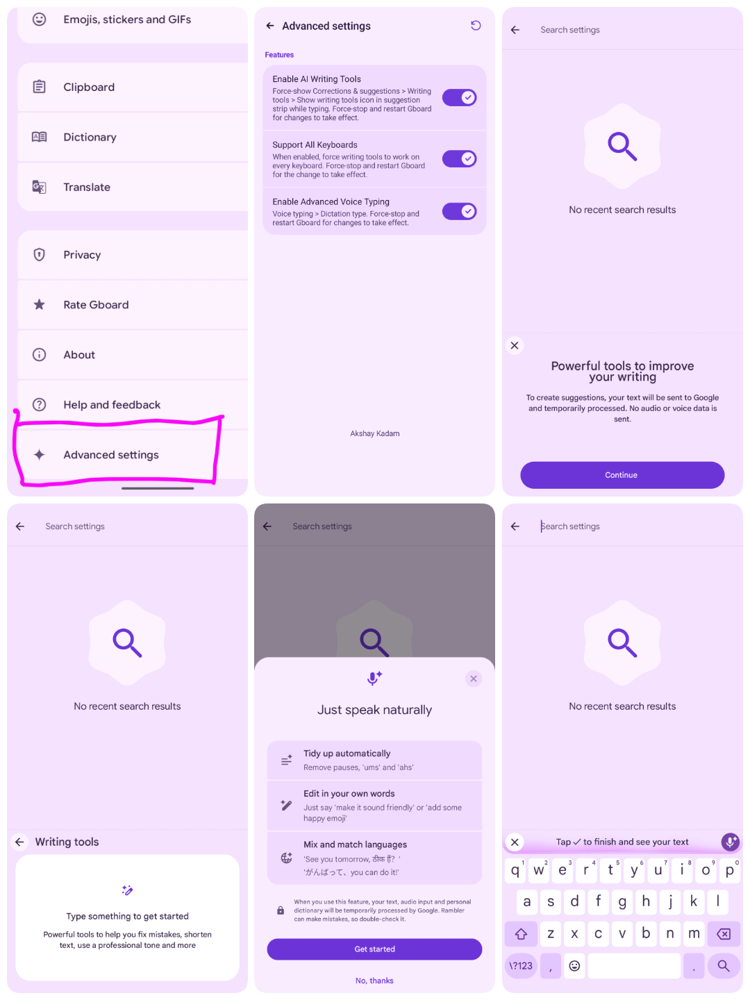

# I unlocked Pixel 11's Gemini Rambler + AI Writing Tools on ANY Android phone — no root

> Source: https://www.reddit.com/r/pixel_phones/comments/1wilp6x/i_unlocked_pixel_11s_gemini_rambler_ai_writing/
> Author: u/akshayysk
> Posted: 2026-09-17T06:06:05+00:00
> Captured: 2026-10-15T08:55:18+00:00
> Score: 349 · Comments: 239
> Community: r/pixel_phones

## Post

I have been experimenting with Pixel 11 Gboard features and got Gemini Rambler Voice Typing and AI Writing Tools working on non-Pixel and Pixel Android devices without root.

This started as a personal project. I came across Jason Wu's work on Gboard, which provided a really useful starting point for experimenting with and modifying Gboard. His project includes an extensive toolkit of tweaks, but I mainly wanted the Pixel-exclusive Rambler natural dictation and Gemini AI Writing suite.

So I built PixelBoard with a dedicated focus: stripping out bloat, introducing a clean native Pixel-style UI, and optimizing stability and battery life. It installs cleanly side-by-side with your existing stock Gboard and requires zero root access.

# 🚀 Update: PixelBoard Stable 18.4.1 (Patch Bundle v1.0.5)

The new Stable release is now live!

It is rebased directly on top of the official Gboard 18.4.1 Release (18.4.1.985164140-release-arm64-v8a) and brings major runtime improvements:

1. ⚡ Automatic Live Activation (Zero Restarts Required — NEW) You no longer need to manually tap the restart button, force-stop Gboard, or reboot your device! Selecting Rambler dictation, toggling AI Writing Tools, or switching inference backends now applies automatically in real time. Everything is synchronized dynamically on the fly.
2. ✨ Writing Tools V2 Gating (NEW) Unlocks Google's modern "Suggested" style chips and freeform "Describe your edit" prompt bar with hardware and model eligibility checks to keep unsupported devices crash-free. Includes a dedicated Material You toggle with a BETA badge in Advanced Settings.
3. 🧠 Device-Gated AI Inference Backend Selector (NEW) On supported hardware (Pixel 8 Pro / Pixel 9 series), choose your preferred inference pipeline directly:
   * GBOARD\_SERVER (Google Cloud Server Inference)
   * PRIVATE\_INFERENCE\_AICORE (On-Device Private Android AICore)
   * PRIVATE\_INFERENCE\_ASTREA (On-Device Astrea Framework) (Automatically hidden on non-supported hardware for a clean, distraction-free experience).
4. 🔋 Battery & ASR Service Lifecycle Fix Cleanly unbinds and releases the background GoogleAsrService (com.google.android.tts) as soon as the keyboard is hidden, eliminating idle screen-off battery drain ([\#3](https://github.com/Akshayykadam/PixelBoard/issues/3)).
5. 🛡️ Offline Language Pack Download Loop Fix Prevents an aggressive 150 req/sec download retry loop for secondary dictation languages, dropping idle CPU usage from \~15% down to 0.02% ([\#5](https://github.com/Akshayykadam/PixelBoard/issues/5)).
6. 🔄 Cold Boot & Direct Boot Persistence Settings now use Device-Protected (DE) storage with auto-migration from CE storage, ensuring Rambler dictation stays active immediately after your phone reboots ([\#4](https://github.com/Akshayykadam/PixelBoard/issues/4)).

# How PixelBoard Differs from Jason Wu's Upstream Patch

While Jason Wu's project provides an extensive general-purpose patch toolkit for Gboard modding, PixelBoard is engineered with a very different design philosophy and user experience:

1. Curated Native Pixel UI & Zero Restarts Rather than overwhelming menus, PixelBoard features a clean, minimalist settings interface modeled directly after native Google Pixel Material You settings. Settings apply automatically without requiring restarts (the toolbar ↻ button is kept purely as an optional manual fallback).
2. Curated Flag Architecture for Rock-Solid Stability Avoids unstable experimental flags (like fragile cloud prompt fetchers and intrusive takeover modes that cause "Could not suggest" errors). Delivers the rock-solid in-line chip layout where proofreading and tone styles render instantly and reliably above your keys across all apps.
3. Battery & Performance Hardening Includes built-in lifecycle management for speech recognition binders, guard rails against runaway download loops, and Device-Protected storage integration.
4. Ready-to-Install Standalone Base Pre-packaged and signed against the official Gboard 18.4.1 Release (com.akshaykadam.pixelboard) with signature verification bypasses already built in for safe side-by-side coexistence without root.

# Key Features

# 1. Gemini Rambler Natural Voice Dictation

* Speech Cleanup: Automatically filters out filler words, hesitation, and stutters ("um", "ah", "like") in real time.
* Natural Self-Correction: Fixes self-revisions on the fly ("let's meet at two no, three PM" → "Let's meet at 3:00 PM").
* Context-Aware Punctuation & Capitalization: Inserts periods, commas, and proper noun capitalization without needing voice commands.
* Multilingual Support: Mix and match languages seamlessly in a single sentence.

# 2. In-Line AI Writing Assistant & Writing Tools V2

* One-Tap Proofread: Fix grammar, spelling, and phrasing instantly.
* Tone & Style Switcher: Rephrase text into Professional, Casual, Concise, or Emotive tones.
* Writing Tools V2: Access suggested prompt chips and custom edit descriptions.
* Universal Support: Works across all text boxes, apps, and language layouts.

# 3. Clean UI & Zero Root Required

* Installs as a separate standalone keyboard alongside your factory Gboard.
* Completely non-root compatible via standard APK installation.
* Bypasses Google signature verification internally.

# How to Install & Set Up

# Option 1: Direct APK Download (Recommended)

Grab the signed standalone APK directly from GitHub:

* GitHub Repository: [https://github.com/Akshayykadam/PixelBoard](https://github.com/Akshayykadam/PixelBoard)
* Latest Release (v18.4.1): [https://github.com/Akshayykadam/PixelBoard/releases/tag/v18.4.1-Stable](https://github.com/Akshayykadam/PixelBoard/releases/tag/v18.4.1-Stable)
* Direct APK Download: [PixelBoard-18.4.1.apk (127 MB)](https://github.com/Akshayykadam/PixelBoard/releases/download/v18.4.1-Stable/PixelBoard-18.4.1.apk)

1. Download and install the APK.
2. Enable PixelBoard under Settings > System > Languages & input > On-screen keyboard.
3. Select PixelBoard as your active keyboard.
4. In PixelBoard Settings, go to Voice typing > Dictation type and select Rambler.
5. Start speaking naturally — it activates automatically without needing to restart!

# Option 2: Patch via Morphe Manager (Custom Source & Auto-Updates)

You can also patch stock Gboard yourself on Android via Morphe Manager:

1. In Morphe Manager, go to Patch Sources (or Settings > Sources).
2. Tap Add (+) and enter: [https://raw.githubusercontent.com/Akshayykadam/PixelBoard/main/patches-bundle.json](https://raw.githubusercontent.com/Akshayykadam/PixelBoard/main/patches-bundle.json) (or enter Akshayykadam/PixelBoard directly).
3. Select your stock Gboard APK (v18.4.1.985164140-release-arm64-v8a or v18.3.1), choose the PixelBoard patch bundle, and tap Patch.

# Acknowledgements & Credits

* Jason Wu: For the foundational reverse-engineering research and patch concepts that made this mod possible.
* Paolo Del Casale ([u/PaoloDelCasale](https://github.com/PaoloDelCasale)): For deep BatteryStats investigations and candidate fixes resolving background GoogleAsrService persistence ([\#3](https://github.com/Akshayykadam/PixelBoard/issues/3)) and the offline language pack download loop ([\#5](https://github.com/Akshayykadam/PixelBoard/issues/5)).
* ReVanced & Morphe Communities: For the open-source decompilation and patching toolchains.

Disclaimer: PixelBoard is an independent, non-commercial open-source modification project and is not affiliated with Google LLC or Alphabet Inc.

## Media

> Original media URL: https://i.redd.it/0h8vg9d4u0qh1.png

> Original media URL: https://preview.redd.it/0h8vg9d4u0qh1.png?auto=webp&s=27e8598125abf66ee5163cd2bf6ce768ea14d3ac

## Thread

> u/akshayysk · 2026-09-17T12:12:32+00:00 · score 15 · [comment](https://www.reddit.com/r/pixel_phones/comments/1wilp6x/i_unlocked_pixel_11s_gemini_rambler_ai_writing/pacr21x/)

Yeah! makes me wonder how much of it is actually hardware related and how much is just software gated. 

> u/akshayysk · 2026-09-17T09:59:05+00:00 · score 15 · [comment](https://www.reddit.com/r/pixel_phones/comments/1wilp6x/i_unlocked_pixel_11s_gemini_rambler_ai_writing/pac6on2/)

Jason’s project is more of an all-in-one toolkit, with features like the FTP server, Web Clipboard sync, calculator, Zhuyin tweaks, etc. PixelBoard takes a more focused approach, mainly targeting **Gemini Rambler Voice Typing** and **AI Writing Tools**, with a clean, minimal Pixel-style UI.

> u/akshayysk · 2026-09-17T06:58:02+00:00 · score 5 · [comment](https://www.reddit.com/r/pixel_phones/comments/1wilp6x/i_unlocked_pixel_11s_gemini_rambler_ai_writing/pabl8az/)

I'm glad you loved it😉

> u/akshayysk · 2026-09-17T08:19:16+00:00 · score 2 · [comment](https://www.reddit.com/r/pixel_phones/comments/1wilp6x/i_unlocked_pixel_11s_gemini_rambler_ai_writing/pabutlp/)

Glad you’re enjoying it!

> u/akshayysk · 2026-09-18T16:26:54+00:00 · score 8 · [comment](https://www.reddit.com/r/pixel_phones/comments/1wilp6x/i_unlocked_pixel_11s_gemini_rambler_ai_writing/palmfi8/)

I’m Also able to unlock the Pixel 11 series camera look on older devices. It’s currently working well on the Pixel 8 Pro. Once it’s fully ready, I’ll publish it as well.

https://preview.redd.it/pa33luf22bqh1.png?width=718&format=png&auto=webp&s=3019e009eee17f697544e3d0189c507c181d0732

> u/akshayysk · 2026-09-17T08:24:42+00:00 · score 2 · [comment](https://www.reddit.com/r/pixel_phones/comments/1wilp6x/i_unlocked_pixel_11s_gemini_rambler_ai_writing/pabvfz0/)

Yeah, hopefully! Maybe GCam Builder will make it happen!

> u/akshayysk · 2026-09-19T03:30:48+00:00 · score 2 · [comment](https://www.reddit.com/r/pixel_phones/comments/1wilp6x/i_unlocked_pixel_11s_gemini_rambler_ai_writing/papafv7/)

Haha merci beaucoup !  😉 Profite bien de PixelBoard !

> u/akshayysk · 2026-09-17T12:22:39+00:00 · score 3 · [comment](https://www.reddit.com/r/pixel_phones/comments/1wilp6x/i_unlocked_pixel_11s_gemini_rambler_ai_writing/pacsx37/)

Haha, glad you’re enjoying it! 😄 Thanks for trying it out!

> u/akshayysk · 2026-09-17T15:50:25+00:00 · score 2 · [comment](https://www.reddit.com/r/pixel_phones/comments/1wilp6x/i_unlocked_pixel_11s_gemini_rambler_ai_writing/pae2pi8/)

Glad you got it working! The enhanced security makes it a bit of a pain to install, but good to hear it’s working flawlessly now. 😉

> u/akshayysk · 2026-09-17T15:48:36+00:00 · score 2 · [comment](https://www.reddit.com/r/pixel_phones/comments/1wilp6x/i_unlocked_pixel_11s_gemini_rambler_ai_writing/pae2a40/)

True! These features aren’t really hardware-dependent either. They work on pretty much any phone. 😅

> u/akshayysk · 2026-09-18T01:39:32+00:00 · score 2 · [comment](https://www.reddit.com/r/pixel_phones/comments/1wilp6x/i_unlocked_pixel_11s_gemini_rambler_ai_writing/pahlna8/)

Thanks!😉 that’s pretty much how Google designed Rambler to work. I didn’t change anything there. I actually get what you mean though seeing the text appear as you speak would feel a lot better.

> u/akshayysk · 2026-09-18T17:25:37+00:00 · score 2 · [comment](https://www.reddit.com/r/pixel_phones/comments/1wilp6x/i_unlocked_pixel_11s_gemini_rambler_ai_writing/pam097b/)

Thanks! And Yes, Rambler supports German and French too. It can also switch between languages while you’re speaking.

> u/akshayysk · 2026-09-23T15:25:11+00:00 · score 2 · [comment](https://www.reddit.com/r/pixel_phones/comments/1wilp6x/i_unlocked_pixel_11s_gemini_rambler_ai_writing/pbkzp29/)

Cheers! 

> u/akshayysk · 2026-10-09T14:28:11+00:00 · score 2 · [comment](https://www.reddit.com/r/pixel_phones/comments/1wilp6x/i_unlocked_pixel_11s_gemini_rambler_ai_writing/peusrxy/)

Thank you! And Yes, it works even if the stock Gboard app is uninstalled. 

> u/akshayysk · 2026-09-17T07:42:21+00:00 · score 2 · [comment](https://www.reddit.com/r/pixel_phones/comments/1wilp6x/i_unlocked_pixel_11s_gemini_rambler_ai_writing/pabqj72/)

Yes! I’m actually using it on my Pixel 8 Pro. 😄

> u/akshayysk · 2026-09-17T08:04:33+00:00 · score 2 · [comment](https://www.reddit.com/r/pixel_phones/comments/1wilp6x/i_unlocked_pixel_11s_gemini_rambler_ai_writing/pabt4e3/)

Try adjusting the keyboard height directly within the keyboard itself.

https://preview.redd.it/vq94x6hkf1qh1.jpeg?width=1008&format=pjpg&auto=webp&s=5bea142585aa5b93939b4c02a5dc39e57e9203f6

> u/akshayysk · 2026-09-17T08:17:38+00:00 · score 2 · [comment](https://www.reddit.com/r/pixel_phones/comments/1wilp6x/i_unlocked_pixel_11s_gemini_rambler_ai_writing/pabumsx/)

Have you tried the **Restart** button after enabling Rambler? It’s in the top-right corner of **Advanced settings**. Give that a try and see if it fixes it!

> u/akshayysk · 2026-09-17T14:39:08+00:00 · score 3 · [comment](https://www.reddit.com/r/pixel_phones/comments/1wilp6x/i_unlocked_pixel_11s_gemini_rambler_ai_writing/padlyo9/)

Yeah! You should be able to add the GitHub repo directly to Obtainium:

[`https://github.com/Akshayykadam/PixelBoard`](https://github.com/Akshayykadam/PixelBoard)

If Obtainium is giving an error with that URL, I’ll check the release setup and make sure future builds can be picked up properly. 👍

> u/akshayysk · 2026-09-17T17:00:32+00:00 · score 2 · [comment](https://www.reddit.com/r/pixel_phones/comments/1wilp6x/i_unlocked_pixel_11s_gemini_rambler_ai_writing/paejod8/)

Thanks! 😉

Here’s a little pro tip: tap the menu button in the top-left corner of the keyboard the icon with 4 boxes. Then you can drag and drop Writing Tools directly into the top bar for quick access while typing.

> u/akshayysk · 2026-09-18T13:18:23+00:00 · score 2 · [comment](https://www.reddit.com/r/pixel_phones/comments/1wilp6x/i_unlocked_pixel_11s_gemini_rambler_ai_writing/pakfp0g/)

You’re welcome! 🧙🏼‍♂️

> u/akshayysk · 2026-09-18T13:11:37+00:00 · score 2 · [comment](https://www.reddit.com/r/pixel_phones/comments/1wilp6x/i_unlocked_pixel_11s_gemini_rambler_ai_writing/pakebfj/)

It’s safe and its open source You can check the repo yourself and even build your own version if you want.

> u/akshayysk · 2026-10-01T14:11:58+00:00 · score 1 · [comment](https://www.reddit.com/r/pixel_phones/comments/1wilp6x/i_unlocked_pixel_11s_gemini_rambler_ai_writing/pd7myiq/)

Glad you’re enjoying it! That’s a completely fair and important question to ask, especially for something as sensitive as a keyboard.

Here is how data privacy and security work under the hood:

1. **No Third-Party Servers or Tracking**: PixelBoard does not have any custom backend, proxy server, telemetry, or analytics. There are zero third-party endpoints injected into the app. None of your keystrokes, clipboard contents, or voice dictations are intercepted or routed to me or anyone else.
2. **How the Mod Actually Works**: PixelBoard is built directly on top of the official, stock Google Gboard APK. The patches simply toggle internal feature flags and bypass signature/device checks so that features Google restricts to newer Pixel devices (like the Gemini "Rambler" voice dictation model and AI Writing Tools) become accessible on any Android device.
3. **Google’s Native Pipeline**: Whatever you type or dictate is handled by Google's native services (on-device processing and official Google Play Services/Google Speech Services), exactly as it would be on an official Pixel phone running stock Gboard.
4. **100% Open Source & Auditable**: The entire patch  (Kotlin, Smali modifications, and extensions) is public on GitHub: [github.com/Akshayykadam/PixelBoard](https://github.com/Akshayykadam/PixelBoard). You don't have to take my word for it anyone can inspect repo.

> u/akshayysk · 2026-10-02T01:08:04+00:00 · score 1 · [comment](https://www.reddit.com/r/pixel_phones/comments/1wilp6x/i_unlocked_pixel_11s_gemini_rambler_ai_writing/pdbmdxo/)

No, just restart the app from advanced settings.

> u/akshayysk · 2026-10-09T12:55:47+00:00 · score 3 · [comment](https://www.reddit.com/r/pixel_phones/comments/1wilp6x/i_unlocked_pixel_11s_gemini_rambler_ai_writing/peu8ht7/)

Use the latest version (1.0.5). This issue has been fixed.

> u/akshayysk · 2026-10-13T12:40:02+00:00 · score 1 · [comment](https://www.reddit.com/r/pixel_phones/comments/1wilp6x/i_unlocked_pixel_11s_gemini_rambler_ai_writing/pggxwtv/)

Thanks for reporting, I'll check into this on my end. Could you tell me what device you use?

> u/akshayysk · 2026-09-17T07:24:12+00:00 · score 1 · [comment](https://www.reddit.com/r/pixel_phones/comments/1wilp6x/i_unlocked_pixel_11s_gemini_rambler_ai_writing/paboecf/)

It will work pretty much like normal Gboard personalization. It doesn’t have any separate system to learn your typing style or spellings.

> u/akshayysk · 2026-09-17T09:49:02+00:00 · score 1 · [comment](https://www.reddit.com/r/pixel_phones/comments/1wilp6x/i_unlocked_pixel_11s_gemini_rambler_ai_writing/pac5exg/)

Have you tried the Restart button after enabling Rambler? It’s in the top-right corner of Advanced settings. Give that a try and see if it fixes it.

> u/akshayysk · 2026-09-17T10:06:11+00:00 · score 1 · [comment](https://www.reddit.com/r/pixel_phones/comments/1wilp6x/i_unlocked_pixel_11s_gemini_rambler_ai_writing/pac7lbj/)

Could you try force-stopping Pixelboard and opening it again? Sometimes that helps.

> u/akshayysk · 2026-09-17T10:05:15+00:00 · score 1 · [comment](https://www.reddit.com/r/pixel_phones/comments/1wilp6x/i_unlocked_pixel_11s_gemini_rambler_ai_writing/pac7h1h/)

Have you tried the Restart button after enabling Rambler? It’s in the top-right corner of Advanced settings. Give that a try and see if it fixes it.

> u/akshayysk · 2026-09-17T10:32:28+00:00 · score 1 · [comment](https://www.reddit.com/r/pixel_phones/comments/1wilp6x/i_unlocked_pixel_11s_gemini_rambler_ai_writing/pacb3wy/)

Did you also turn it on from the **Voice typing** settings?

* Open PixelBoard Settings → Voice typing and make sure Rambler is enabled.
* Then go to Advanced settings → Rambler and enable it there.
* Tap the Restart button in the top-right corner.

> u/akshayysk · 2026-09-17T12:11:19+00:00 · score 1 · [comment](https://www.reddit.com/r/pixel_phones/comments/1wilp6x/i_unlocked_pixel_11s_gemini_rambler_ai_writing/pacqu7p/)

Glad you got it working.

> u/akshayysk · 2026-09-17T13:47:29+00:00 · score 1 · [comment](https://www.reddit.com/r/pixel_phones/comments/1wilp6x/i_unlocked_pixel_11s_gemini_rambler_ai_writing/padaad5/)

Glad it’s working! I haven’t tested it with Android Auto and WhatsApp yet, so not sure about that one.

> u/akshayysk · 2026-09-17T13:48:29+00:00 · score 1 · [comment](https://www.reddit.com/r/pixel_phones/comments/1wilp6x/i_unlocked_pixel_11s_gemini_rambler_ai_writing/padai4e/)

Gracias, bro! Me alegra que te esté funcionando de lujo.

> u/akshayysk · 2026-09-17T14:20:51+00:00 · score 1 · [comment](https://www.reddit.com/r/pixel_phones/comments/1wilp6x/i_unlocked_pixel_11s_gemini_rambler_ai_writing/padhr2i/)

If you’re getting the **“App blocked by Advanced Protection”** message, you can try this:

**Google Play Store → Profile → Play Protect → Settings ⚙️ → turn off “Scan apps with Play Protect” temporarily.**

Install PixelBoard, then **turn Play Protect back on** after the installation.

> u/akshayysk · 2026-09-17T14:33:32+00:00 · score 1 · [comment](https://www.reddit.com/r/pixel_phones/comments/1wilp6x/i_unlocked_pixel_11s_gemini_rambler_ai_writing/padko34/)

Haha, love it! 😂 Glad it’s working well on the Z Fold 8.

> u/akshayysk · 2026-09-17T15:13:07+00:00 · score 1 · [comment](https://www.reddit.com/r/pixel_phones/comments/1wilp6x/i_unlocked_pixel_11s_gemini_rambler_ai_writing/padtvyq/)

Thank you for giving it a try. 🙌

> u/akshayysk · 2026-09-17T16:58:14+00:00 · score 1 · [comment](https://www.reddit.com/r/pixel_phones/comments/1wilp6x/i_unlocked_pixel_11s_gemini_rambler_ai_writing/paej4dr/)

Did you turn it on from the Voice typing settings?

Go to PixelBoard Settings → Voice typing and make sure Rambler is toggled on.
Then, go to Advanced settings → Rambler and enable it.
Finally, tap the Restart button at the top.

> u/akshayysk · 2026-09-18T01:38:13+00:00 · score 1 · [comment](https://www.reddit.com/r/pixel_phones/comments/1wilp6x/i_unlocked_pixel_11s_gemini_rambler_ai_writing/pahle3n/)

😉🙌

> u/akshayysk · 2026-09-18T01:40:55+00:00 · score 1 · [comment](https://www.reddit.com/r/pixel_phones/comments/1wilp6x/i_unlocked_pixel_11s_gemini_rambler_ai_writing/pahlwst/)

🙌😉

> u/akshayysk · 2026-09-18T01:56:05+00:00 · score 1 · [comment](https://www.reddit.com/r/pixel_phones/comments/1wilp6x/i_unlocked_pixel_11s_gemini_rambler_ai_writing/pahorvs/)

Haha, glad you’re enjoying it! Thanks for trying it out!

> u/akshayysk · 2026-09-18T01:58:34+00:00 · score 1 · [comment](https://www.reddit.com/r/pixel_phones/comments/1wilp6x/i_unlocked_pixel_11s_gemini_rambler_ai_writing/pahp8h0/)

Bbrigado amigo! Fico feliz que esteja gostando! Por enquanto vou manter os temas nativos para conseguir atualizar o PixelBoard para as versões mais recentes do Gboard.

> u/akshayysk · 2026-09-18T13:08:33+00:00 · score 1 · [comment](https://www.reddit.com/r/pixel_phones/comments/1wilp6x/i_unlocked_pixel_11s_gemini_rambler_ai_writing/pakdp0r/)

Haha yeah, that typing effect is pretty cool! 

> u/akshayysk · 2026-09-18T13:13:45+00:00 · score 1 · [comment](https://www.reddit.com/r/pixel_phones/comments/1wilp6x/i_unlocked_pixel_11s_gemini_rambler_ai_writing/pakeqwt/)

Yes you need to tap **End Dictation** to insert the text. That’s just how Google designed it. 😅

> u/akshayysk · 2026-09-18T13:16:38+00:00 · score 1 · [comment](https://www.reddit.com/r/pixel_phones/comments/1wilp6x/i_unlocked_pixel_11s_gemini_rambler_ai_writing/pakfc5w/)

Thank you! 😉 I also removed the regional restriction so it should work in all countries now. Honestly, Google should’ve just given these features to older Pixels with android 17 update. 😅

> u/akshayysk · 2026-09-18T13:20:19+00:00 · score 1 · [comment](https://www.reddit.com/r/pixel_phones/comments/1wilp6x/i_unlocked_pixel_11s_gemini_rambler_ai_writing/pakg36e/)

Glad you got Rambler working on your P9 Pro! 😉

> u/akshayysk · 2026-09-18T13:27:01+00:00 · score 1 · [comment](https://www.reddit.com/r/pixel_phones/comments/1wilp6x/i_unlocked_pixel_11s_gemini_rambler_ai_writing/pakhhd9/)

Yep, absolutely! PixelBoard is built on the Morphe framework, and the repo includes the [`PixelBoard.mpp`](https://github.com/Akshayykadam/PixelBoard/raw/main/patches/PixelBoard.mpp) patch bundle. It works with **Gboard 18.3.1 Beta** too.

You can patch it directly on your phone using **Morphe Manager**

1. Install **Morphe Manager**.
2. Download `PixelBoard.mpp` from the repo.
3. Open the `.mpp` with Morphe Manager.
4. Select your stock Gboard APK.
5. Apply the PixelBoard patches and install the generated APK.

That’s it!

https://preview.redd.it/mtbvgw2e6aqh1.png?width=1866&format=png&auto=webp&s=3b517cb8fe1086f05777fd096d7a18403fdb4ae6

> u/akshayysk · 2026-09-18T13:48:45+00:00 · score 1 · [comment](https://www.reddit.com/r/pixel_phones/comments/1wilp6x/i_unlocked_pixel_11s_gemini_rambler_ai_writing/pakm45c/)

Done! You can add it directly as a custom patch source in Morphe Manager with this URL:

    https://raw.githubusercontent.com/Akshayykadam/PixelBoard/main/patches-bundle.json

> u/akshayysk · 2026-09-18T13:28:02+00:00 · score 1 · [comment](https://www.reddit.com/r/pixel_phones/comments/1wilp6x/i_unlocked_pixel_11s_gemini_rambler_ai_writing/pakhp1j/)

Thank you! 🙌

> u/akshayysk · 2026-09-18T15:58:23+00:00 · score 1 · [comment](https://www.reddit.com/r/pixel_phones/comments/1wilp6x/i_unlocked_pixel_11s_gemini_rambler_ai_writing/palfpqi/)

😉🙌🏻

> u/akshayysk · 2026-09-18T18:08:08+00:00 · score 1 · [comment](https://www.reddit.com/r/pixel_phones/comments/1wilp6x/i_unlocked_pixel_11s_gemini_rambler_ai_writing/pama55y/)

😉🙌🏻

> u/akshayysk · 2026-09-18T20:41:10+00:00 · score 1 · [comment](https://www.reddit.com/r/pixel_phones/comments/1wilp6x/i_unlocked_pixel_11s_gemini_rambler_ai_writing/pan8wr4/)

Try this:

1. Open **PixelBoard Settings → Voice typing** and turn on **Rambler**.
2. Go to **Advanced settings → Rambler** and make sure it’s enabled there too.
3. Tap the **Restart** button in the top-right corner.
4. Try voice typing again.

> u/akshayysk · 2026-09-19T03:36:30+00:00 · score 1 · [comment](https://www.reddit.com/r/pixel_phones/comments/1wilp6x/i_unlocked_pixel_11s_gemini_rambler_ai_writing/papbavc/)

Yeah, this does have a personal dictionary where you can add names, but I’m not 100% sure Rambler uses those entries when processing voice input. 

> u/akshayysk · 2026-09-19T09:00:24+00:00 · score 1 · [comment](https://www.reddit.com/r/pixel_phones/comments/1wilp6x/i_unlocked_pixel_11s_gemini_rambler_ai_writing/paqg0hx/)

Haha, glad it’s working perfectly on your Pixel 10 Pro!

> u/akshayysk · 2026-09-20T01:35:31+00:00 · score 1 · [comment](https://www.reddit.com/r/pixel_phones/comments/1wilp6x/i_unlocked_pixel_11s_gemini_rambler_ai_writing/pavm77m/)

Haha thank you! 😄 Really appreciate it!

> u/akshayysk · 2026-10-10T04:37:21+00:00 · score 1 · [comment](https://www.reddit.com/r/pixel_phones/comments/1wilp6x/i_unlocked_pixel_11s_gemini_rambler_ai_writing/pezkyzc/)

Thanks, Mate! ❤️ I’ll look into modern haptics and see if I can get it working. 

> u/akshayysk · 2026-10-11T18:25:14+00:00 · score 1 · [comment](https://www.reddit.com/r/pixel_phones/comments/1wilp6x/i_unlocked_pixel_11s_gemini_rambler_ai_writing/pfajwbs/)

Thanks for the suggestions!  I’ll look into it.   
  
For updates, I could build an in-app updater using Git, but I think keeping the APK stock is better from a privacy perspective. So for now, you’ll need to manually install each new version. 

> u/akshayysk · 2026-10-12T12:48:06+00:00 · score 1 · [comment](https://www.reddit.com/r/pixel_phones/comments/1wilp6x/i_unlocked_pixel_11s_gemini_rambler_ai_writing/pffqxx4/)

Yeah, I’ll add rounded keys in the next build for sure! 

> u/akshayysk · 2026-10-12T15:01:25+00:00 · score 1 · [comment](https://www.reddit.com/r/pixel_phones/comments/1wilp6x/i_unlocked_pixel_11s_gemini_rambler_ai_writing/pfgjpe4/)

Thanks a lot!   
  
Have you tried changing the AI processing backend to Astrea in Advanced Settings? 

> u/akshayysk · 2026-10-12T15:13:28+00:00 · score 1 · [comment](https://www.reddit.com/r/pixel_phones/comments/1wilp6x/i_unlocked_pixel_11s_gemini_rambler_ai_writing/pfgmjeo/)

Haha, glad you found those!  Thanks for trying ! ❤️

> u/akshayysk · 2026-09-17T12:10:41+00:00 · score 2 · [comment](https://www.reddit.com/r/pixel_phones/comments/1wilp6x/i_unlocked_pixel_11s_gemini_rambler_ai_writing/pacqq4c/)

No, not the phone I mean the **Restart** button inside PixelBoard’s Advanced settings.

Try this:

1. Open **PixelBoard Settings → Voice typing** and turn on **Rambler**.
2. Go to **Advanced settings → Rambler** and make sure it’s enabled there too.
3. Tap the **Restart** button in the top-right corner.
4. Try voice typing again.

I’m using it on my Pixel 8 Pro as well, so it should work there. 👍

> u/akshayysk · 2026-09-17T15:12:08+00:00 · score 1 · [comment](https://www.reddit.com/r/pixel_phones/comments/1wilp6x/i_unlocked_pixel_11s_gemini_rambler_ai_writing/padtnnt/)

😉🙌 

> u/akshayysk · 2026-09-17T14:21:49+00:00 · score 1 · [comment](https://www.reddit.com/r/pixel_phones/comments/1wilp6x/i_unlocked_pixel_11s_gemini_rambler_ai_writing/padhz1x/)

Can you share a screenshot in DM? I’ll take a look and help you out. 

> u/akshayysk · 2026-09-17T15:11:36+00:00 · score 2 · [comment](https://www.reddit.com/r/pixel_phones/comments/1wilp6x/i_unlocked_pixel_11s_gemini_rambler_ai_writing/padtj3n/)

Let me check and I'll get back to you in some time.

> u/akshayysk · 2026-09-17T15:42:36+00:00 · score 2 · [comment](https://www.reddit.com/r/pixel_phones/comments/1wilp6x/i_unlocked_pixel_11s_gemini_rambler_ai_writing/pae0uvc/)

I’ve added the build releases in the repo:  
[https://github.com/Akshayykadam/PixelBoard/](https://github.com/Akshayykadam/PixelBoard/releases)  
  
`18.0.1` is the stable build, while `18.3.1` is currently in beta. I created the 18.3.1 release today and it’s working fine on my end, but I’m still testing it myself for stability before marking it as stable.

Could you try adding the Releases page to Obtainium and see if it picks up the versions correctly? Let me know if you still get the “No valid version found” error.

> u/akshayysk · 2026-10-08T04:43:08+00:00 · score 1 · [comment](https://www.reddit.com/r/pixel_phones/comments/1wilp6x/i_unlocked_pixel_11s_gemini_rambler_ai_writing/pekrlwm/)

Yes

> u/akshayysk · 2026-10-08T05:52:26+00:00 · score 1 · [comment](https://www.reddit.com/r/pixel_phones/comments/1wilp6x/i_unlocked_pixel_11s_gemini_rambler_ai_writing/pel1aky/)

🍻

> u/akshayysk · 2026-10-11T18:25:55+00:00 · score 1 · [comment](https://www.reddit.com/r/pixel_phones/comments/1wilp6x/i_unlocked_pixel_11s_gemini_rambler_ai_writing/pfak2i9/)

Thanks for reporting this!  I’ll check the release configuration. In the meantime, you can download v18.4 directly from GitHub.

> u/akshayysk · 2026-09-17T09:52:01+00:00 · score 1 · [comment](https://www.reddit.com/r/pixel_phones/comments/1wilp6x/i_unlocked_pixel_11s_gemini_rambler_ai_writing/pac5s92/)

both are the same spell checker nothing different there.

> u/akshayysk · 2026-09-18T16:30:12+00:00 · score 1 · [comment](https://www.reddit.com/r/pixel_phones/comments/1wilp6x/i_unlocked_pixel_11s_gemini_rambler_ai_writing/paln7k5/)

while looking through the Pixel 11 Camera decompile files, I found that the actual Looks processing seems to have a software fallback. If the HAL doesn't return `RESULT_TOMTE_TYPE`, GCam still passes the selected Look to the native Tomte processing pipeline.

So I'm thinking the core color/tone processing might actually work on older Pixels, while things like the ISP-specific tuning and film grain may not. It might not look 1:1 with Pixel 11, but I think it's worth trying.

> u/akshayysk · 2026-09-19T03:33:55+00:00 · score 2 · [comment](https://www.reddit.com/r/pixel_phones/comments/1wilp6x/i_unlocked_pixel_11s_gemini_rambler_ai_writing/papawvt/)

Thank you!  😉 I’ll share an update in the same community today evening or tomorrow morning and also I’ll leave a comment here as well.

> u/akshayysk · 2026-09-19T06:53:08+00:00 · score 2 · [comment](https://www.reddit.com/r/pixel_phones/comments/1wilp6x/i_unlocked_pixel_11s_gemini_rambler_ai_writing/paq16mx/)

[https://www.reddit.com/r/pixel\_phones/s/iEiuWG7LWt](https://www.reddit.com/r/pixel_phones/s/iEiuWG7LWt)

> u/akshayysk · 2026-09-25T15:02:02+00:00 · score 0 · [comment](https://www.reddit.com/r/pixel_phones/comments/1wilp6x/i_unlocked_pixel_11s_gemini_rambler_ai_writing/pbzgsgq/)

Yes, I’m already working on the next update. I’ll keep maintaining it as Google releases new versions.

I’ll be sharing both the Morphe patch and a standalone APK Tomorrow, based on the latest stable Gboard release (18.3.1).

And yeah, help is always welcome! 🤩

  
Update: Updated the Gboard patch to the latest stable version: `18.3.1.977415014`.

[Gboard Patch v18.3.1 Release](https://github.com/Akshayykadam/PixelBoard/releases/tag/v18.3.1)

Give it a try and let me know how it works! 🙏

## Comments

> u/Mysticwaterfall2 · 2026-09-17T11:03:57+00:00 · score 78 · [comment](https://www.reddit.com/r/pixel_phones/comments/1wilp6x/i_unlocked_pixel_11s_gemini_rambler_ai_writing/pacfnrk/)

Proving once again that Google artificially locks features and that we really don't need Tensor specifically for anything.

> u/x_iNFLiCTiON · 2026-09-18T09:03:46+00:00 · score 4 · [comment](https://www.reddit.com/r/pixel_phones/comments/1wilp6x/i_unlocked_pixel_11s_gemini_rambler_ai_writing/pajbzib/)

Yeah 100%! Happy cake day by the way, let's enjoy it together 😁

> u/Mysticwaterfall2 · 2026-09-18T10:51:27+00:00 · score 2 · [comment](https://www.reddit.com/r/pixel_phones/comments/1wilp6x/i_unlocked_pixel_11s_gemini_rambler_ai_writing/pajpr1w/)

Thanks:)

> u/PandaMan12321 · 2026-09-18T14:46:42+00:00 · score 3 · [comment](https://www.reddit.com/r/pixel_phones/comments/1wilp6x/i_unlocked_pixel_11s_gemini_rambler_ai_writing/pakyzrx/)

There's an offline mode for rambler that probably needs on device ai but yeah it almost always runs on the cloud

> u/Onexegan · 2026-09-17T09:48:34+00:00 · score 20 · [comment](https://www.reddit.com/r/pixel_phones/comments/1wilp6x/i_unlocked_pixel_11s_gemini_rambler_ai_writing/pac5cul/)

Hello, thank you for sharing this APK! The rambler feature works great.

I also noticed this Morphe patch and was wondering how it differs from your version:

[https://github.com/jasonwu1994/Gboard-patches](https://github.com/jasonwu1994/Gboard-patches)

> u/Vulkaan34 · 2026-09-17T06:57:04+00:00 · score 11 · [comment](https://www.reddit.com/r/pixel_phones/comments/1wilp6x/i_unlocked_pixel_11s_gemini_rambler_ai_writing/pabl418/)

Thanks loved it ! 

> u/Majestic_squirrel767 · 2026-09-17T08:13:52+00:00 · score 9 · [comment](https://www.reddit.com/r/pixel_phones/comments/1wilp6x/i_unlocked_pixel_11s_gemini_rambler_ai_writing/pabu774/)

This is the most amazing thing ever 

Thanks for making this

> u/Majestic_squirrel767 · 2026-09-17T08:21:06+00:00 · score 3 · [comment](https://www.reddit.com/r/pixel_phones/comments/1wilp6x/i_unlocked_pixel_11s_gemini_rambler_ai_writing/pabv145/)

I hope now someone bring photographic styles to older pixels as well 

> u/Majestic_squirrel767 · 2026-09-18T17:17:43+00:00 · score 3 · [comment](https://www.reddit.com/r/pixel_phones/comments/1wilp6x/i_unlocked_pixel_11s_gemini_rambler_ai_writing/palyefo/)

Great man you are genius 😀

> u/PrincipleMountain136 · 2026-09-18T21:22:39+00:00 · score 5 · [comment](https://www.reddit.com/r/pixel_phones/comments/1wilp6x/i_unlocked_pixel_11s_gemini_rambler_ai_writing/panhxeq/)

Hello ça fonctionne super. Pour information j'avais la fonctionnalité IA writing tool sur mon 10 pro. Et j'ai acheté le 11 pro cet été et j'ai bien eu Rambler mais j'ai perdu la fonctionnalité IA writing tool .... J'étais assez dégoûté donc j'ai appelé le service Google qui m'ont annoncé que la fonctionnalité avait été retirée pour les pays européens sans aucune explication.
Donc merci pour ton travail ! Well done master !

> u/SireX2106 · 2026-09-17T09:18:32+00:00 · score 3 · [comment](https://www.reddit.com/r/pixel_phones/comments/1wilp6x/i_unlocked_pixel_11s_gemini_rambler_ai_writing/pac1pvc/)

That's so cool! Works great. Thank you so much!

> u/Double-Ad1071 · 2026-09-17T10:11:47+00:00 · score 3 · [comment](https://www.reddit.com/r/pixel_phones/comments/1wilp6x/i_unlocked_pixel_11s_gemini_rambler_ai_writing/pac8by2/)

Many languages are not supported, so...

I think I'll stick to Wispr Flow.

> u/wfondren · 2026-09-17T12:19:00+00:00 · score 3 · [comment](https://www.reddit.com/r/pixel_phones/comments/1wilp6x/i_unlocked_pixel_11s_gemini_rambler_ai_writing/pacs8ob/)

Being able to just transcribe emails and have them sound more polished is fantastic—exactly what I hoped would be possible a year or two ago when I was first drafting emails with Gemini.This is ideal for an extrovert like me. Thanks again for sharing.

> u/mallorcaben · 2026-09-17T15:30:44+00:00 · score 3 · [comment](https://www.reddit.com/r/pixel_phones/comments/1wilp6x/i_unlocked_pixel_11s_gemini_rambler_ai_writing/pady1do/)

I did too. It took (me and Gemini) just over an hour as I have enhanced Google security on my Pixel 8 Pro. I had to use the pc to execute commands but it works flawlessly now.  
  

> u/SubjectOk1553 · 2026-09-18T04:53:51+00:00 · score 3 · [comment](https://www.reddit.com/r/pixel_phones/comments/1wilp6x/i_unlocked_pixel_11s_gemini_rambler_ai_writing/paihsgu/)

This turned out amazing! Well done!

> u/tyrrell1856 · 2026-09-19T22:49:38+00:00 · score 3 · [comment](https://www.reddit.com/r/pixel_phones/comments/1wilp6x/i_unlocked_pixel_11s_gemini_rambler_ai_writing/pauss0o/)

Dude! 👏👏👏 Your the man!

> u/SuitableComputer5921 · 2026-09-17T06:59:39+00:00 · score 5 · [comment](https://www.reddit.com/r/pixel_phones/comments/1wilp6x/i_unlocked_pixel_11s_gemini_rambler_ai_writing/pablfdu/)

Wouldn't it be better to have it be able to be added to the Morphe app?

> u/JakeChambersOy · 2026-09-17T07:32:27+00:00 · score 8 · [comment](https://www.reddit.com/r/pixel_phones/comments/1wilp6x/i_unlocked_pixel_11s_gemini_rambler_ai_writing/pabpdk5/)

There are Morphe patches doing exactly this already... 

> u/zQrrJQrb · 2026-09-17T15:26:03+00:00 · score 4 · [comment](https://www.reddit.com/r/pixel_phones/comments/1wilp6x/i_unlocked_pixel_11s_gemini_rambler_ai_writing/padwxgh/)

Shame on Google for not making this available across the Pixels natively. 

> u/muhammadhilham7317 · 2026-09-17T09:35:32+00:00 · score 2 · [comment](https://www.reddit.com/r/pixel_phones/comments/1wilp6x/i_unlocked_pixel_11s_gemini_rambler_ai_writing/pac3rce/)

It was awesome 🔥

> u/Notorious_jib · 2026-09-17T10:17:10+00:00 · score 2 · [comment](https://www.reddit.com/r/pixel_phones/comments/1wilp6x/i_unlocked_pixel_11s_gemini_rambler_ai_writing/pac91ro/)

Well done! Thank you for sharing your work! 

> u/master-Q14 · 2026-09-17T11:17:39+00:00 · score 2 · [comment](https://www.reddit.com/r/pixel_phones/comments/1wilp6x/i_unlocked_pixel_11s_gemini_rambler_ai_writing/pachsiu/)

Thank you!

> u/Own_Conference688 · 2026-09-17T13:45:25+00:00 · score 2 · [comment](https://www.reddit.com/r/pixel_phones/comments/1wilp6x/i_unlocked_pixel_11s_gemini_rambler_ai_writing/pad9u5j/)

Excelente trabajo bro, funcionando de lujo

> u/michaelsawyerlinus · 2026-09-17T14:30:43+00:00 · score 2 · [comment](https://www.reddit.com/r/pixel_phones/comments/1wilp6x/i_unlocked_pixel_11s_gemini_rambler_ai_writing/padk0x5/)

Thanks for doing this. Works really well on the Galaxy Z Fold 8.
Written with Rambler hehehe

> u/randomdude98 · 2026-09-17T14:39:05+00:00 · score 2 · [comment](https://www.reddit.com/r/pixel_phones/comments/1wilp6x/i_unlocked_pixel_11s_gemini_rambler_ai_writing/padly7g/)

Fantastic work!

> u/Helpful_Glove_9198 · 2026-09-17T14:50:56+00:00 · score 2 · [comment](https://www.reddit.com/r/pixel_phones/comments/1wilp6x/i_unlocked_pixel_11s_gemini_rambler_ai_writing/padop8r/)

It's working great on Pixel 9 Pro XL. Thank you.

> u/Ok-Machine-8217 · 2026-09-17T19:19:05+00:00 · score 2 · [comment](https://www.reddit.com/r/pixel_phones/comments/1wilp6x/i_unlocked_pixel_11s_gemini_rambler_ai_writing/pafgsnt/)

Fantastic 

> u/Testpilot1988 · 2026-09-17T20:05:04+00:00 · score 2 · [comment](https://www.reddit.com/r/pixel_phones/comments/1wilp6x/i_unlocked_pixel_11s_gemini_rambler_ai_writing/pafri85/)

So.. This works. Well done. I've been waiting for something like this for a long time. So long in fact that i ended up making my own keyboard modifications from florisboard to get what i wanted for myself lol. The only thing that sucks about Rambler is that it doesnt transcribe the text as i speak it and instead hords the entire context until i press the end dictation button. I get that this is probably the intention but i don't like trusting such things. Again... this is likely the way google incorporated it intentionally and not a design choice you made..

> u/MrStory · 2026-09-18T01:28:18+00:00 · score 2 · [comment](https://www.reddit.com/r/pixel_phones/comments/1wilp6x/i_unlocked_pixel_11s_gemini_rambler_ai_writing/pahjh9i/)

Thanks man, this is great

> u/blamski · 2026-09-18T01:49:30+00:00 · score 2 · [comment](https://www.reddit.com/r/pixel_phones/comments/1wilp6x/i_unlocked_pixel_11s_gemini_rambler_ai_writing/pahnjd4/)

This is amazing. Thank you!  rambler on my find n6 !! So helpful.

> u/RevolcFael4 · 2026-09-18T06:49:20+00:00 · score 2 · [comment](https://www.reddit.com/r/pixel_phones/comments/1wilp6x/i_unlocked_pixel_11s_gemini_rambler_ai_writing/paiw9is/)

Thank you dude. I wanted rambler on my p9pro. 

What a blessing. Plus someone cracked pixel watch 5 faces to work on the 2. What a good month 😂😂

All that's left now is to get rambler available on windows like how macs have (for now I'll stick to Vowen.ai)

> u/IronSpiderZX · 2026-09-18T11:59:50+00:00 · score 2 · [comment](https://www.reddit.com/r/pixel_phones/comments/1wilp6x/i_unlocked_pixel_11s_gemini_rambler_ai_writing/pak0oxx/)

This looks cool, but the one feature that's holding me back from switching is this cool typing effect on Samsung keyboard with goodlock.

https://reddit.com/link/pak0oxx/video/w7ectw0fq9qh1/player

> u/FanaticSlayer1 · 2026-09-18T15:41:00+00:00 · score 2 · [comment](https://www.reddit.com/r/pixel_phones/comments/1wilp6x/i_unlocked_pixel_11s_gemini_rambler_ai_writing/palbkb6/)

Thanks man

> u/Schlumpfilein · 2026-09-18T17:17:19+00:00 · score 2 · [comment](https://www.reddit.com/r/pixel_phones/comments/1wilp6x/i_unlocked_pixel_11s_gemini_rambler_ai_writing/palyayg/)

Very cool! Does it support other languages than English? Maybe german & French?

> u/DangerousTortuga · 2026-09-18T17:38:40+00:00 · score 2 · [comment](https://www.reddit.com/r/pixel_phones/comments/1wilp6x/i_unlocked_pixel_11s_gemini_rambler_ai_writing/pam3arm/)

Thanks for this!

> u/Extra_Pizza_3853 · 2026-09-20T19:51:24+00:00 · score 2 · [comment](https://www.reddit.com/r/pixel_phones/comments/1wilp6x/i_unlocked_pixel_11s_gemini_rambler_ai_writing/pb0y495/)

amazing, I just installed this on my P10 Pro - dumb question, how do I know voice typing is using Rambler?

> u/ri_hid · 2026-09-23T15:16:15+00:00 · score 2 · [comment](https://www.reddit.com/r/pixel_phones/comments/1wilp6x/i_unlocked_pixel_11s_gemini_rambler_ai_writing/pbkxl62/)

Wow, this is amazing! It's running great on my Pixel 7. It's really cool that it is so much better than the voice dictation on the default Gboard.

I'm a non-native English speaker and this model is understanding and capturing my enunciation much better than the stock one on Gboard.

Thank you so much for sharing.

> u/an0n_helper · 2026-10-05T02:43:57+00:00 · score 2 · [comment](https://www.reddit.com/r/pixel_phones/comments/1wilp6x/i_unlocked_pixel_11s_gemini_rambler_ai_writing/pdxtdu2/)

Amazing work bud.
I wanted to keep my existing gboard and changing the package name doesn't work really well with morphe on some apps.
This is perfect, as I only wanted the Rambler feature.

> u/iamthestigscousin · 2026-10-06T17:02:24+00:00 · score 2 · [comment](https://www.reddit.com/r/pixel_phones/comments/1wilp6x/i_unlocked_pixel_11s_gemini_rambler_ai_writing/pe98875/)

This is fantastic, thank you!

> u/grousey · 2026-10-09T13:55:48+00:00 · score 2 · [comment](https://www.reddit.com/r/pixel_phones/comments/1wilp6x/i_unlocked_pixel_11s_gemini_rambler_ai_writing/peuleey/)

Great work here! and thanks.

Does it work if the stock Gboard app has been uninstalled?

> u/grousey · 2026-10-09T15:51:58+00:00 · score 2 · [comment](https://www.reddit.com/r/pixel_phones/comments/1wilp6x/i_unlocked_pixel_11s_gemini_rambler_ai_writing/pevcnn4/)

Thanks

> u/Sunny_08_ · 2026-10-10T04:32:39+00:00 · score 2 · [comment](https://www.reddit.com/r/pixel_phones/comments/1wilp6x/i_unlocked_pixel_11s_gemini_rambler_ai_writing/pezkbn5/)

Brother if possible can u enable modern haptics too
Btw loved your project ❤️

> u/an0n_helper · 2026-10-11T03:45:38+00:00 · score 2 · [comment](https://www.reddit.com/r/pixel_phones/comments/1wilp6x/i_unlocked_pixel_11s_gemini_rambler_ai_writing/pf6dv9d/)

Can you add the feature of enabling rambler in incognito mode and turning on incognito mode any time.

And is there any way to receive updates within app or do i need to manually overwrite existing apk install?

Thanks!

> u/an0n_helper · 2026-10-11T04:03:20+00:00 · score 2 · [comment](https://www.reddit.com/r/pixel_phones/comments/1wilp6x/i_unlocked_pixel_11s_gemini_rambler_ai_writing/pf6glh6/)

Obtanium is not listing the latest v18.4 rather v18.3

> u/Sahri81 · 2026-10-12T08:46:13+00:00 · score 2 · [comment](https://www.reddit.com/r/pixel_phones/comments/1wilp6x/i_unlocked_pixel_11s_gemini_rambler_ai_writing/pfes9wi/)

I just tried it but it seems there is no option for rounded keys. Please add those 🥺

> u/akuhl77 · 2026-10-12T14:27:01+00:00 · score 2 · [comment](https://www.reddit.com/r/pixel_phones/comments/1wilp6x/i_unlocked_pixel_11s_gemini_rambler_ai_writing/pfgbqka/)

This is truly great work!  
And I think I found a bug: PixelBoard works fine on my Pixel 10 Pro with Rambler and standard AI writing tools. But when using the AI writing tools AI "describe edits" feature and describe my edits, editing fails with "could not load suggestions".  
This happens every time and restarting PixelBoard in advanced menu does not fix this. But I do not have the option to describe my edits on my standard Gboard - maybe it is not working with German?

> u/redNewb · 2026-10-12T15:07:47+00:00 · score 2 · [comment](https://www.reddit.com/r/pixel_phones/comments/1wilp6x/i_unlocked_pixel_11s_gemini_rambler_ai_writing/pfgl6s2/)

OMG this is unbelievable, **thank you so much**! I've also noticed with Rambler you can say "open paren" and "close paren" for ( and ), respectively. Also, by saying 'quote', it automatically knows to place the opening and closing quotes. I seemed to have trouble with that with the non-Rambler version, but that could have been user error.

> u/Wise_Writing_646 · 2026-09-17T07:13:08+00:00 · score 1 · [comment](https://www.reddit.com/r/pixel_phones/comments/1wilp6x/i_unlocked_pixel_11s_gemini_rambler_ai_writing/pabn2q7/)

Will it automatically learn my typing style and spellings?

> u/FlamingoMajestic8855 · 2026-09-17T07:38:15+00:00 · score 1 · [comment](https://www.reddit.com/r/pixel_phones/comments/1wilp6x/i_unlocked_pixel_11s_gemini_rambler_ai_writing/pabq237/)

Will it work on pixel 8?

> u/pfc-anon · 2026-09-17T07:43:40+00:00 · score 1 · [comment](https://www.reddit.com/r/pixel_phones/comments/1wilp6x/i_unlocked_pixel_11s_gemini_rambler_ai_writing/pabqonl/)

Please make this into a morphe patch, I'm unable to customize the height of the keyboard. I like short stubby keyboards.

> u/pfc-anon · 2026-09-17T09:49:09+00:00 · score 2 · [comment](https://www.reddit.com/r/pixel_phones/comments/1wilp6x/i_unlocked_pixel_11s_gemini_rambler_ai_writing/pac5fg1/)

thanks for the quick response turns out I'm just stupid I'm typing this response from the keyboard thanks a lot.

can you please confirm if this spell checker is intentional is the other one the old one?

https://preview.redd.it/pwsxjm58y1qh1.png?width=1008&format=png&auto=webp&s=aeea896d972a4d3dd8e79be9ee18002fe44129e0

> u/Relative-Money115 · 2026-09-17T08:12:23+00:00 · score 1 · [comment](https://www.reddit.com/r/pixel_phones/comments/1wilp6x/i_unlocked_pixel_11s_gemini_rambler_ai_writing/pabu13q/)

Rambler is not working for me. It's just plain voice typing, not even the Pixel 8's advanced voice typing. I enabled Rambler from settings. I'm not sure if I'm doing something wrong.

> u/Dat1Jack · 2026-09-17T09:10:06+00:00 · score 1 · [comment](https://www.reddit.com/r/pixel_phones/comments/1wilp6x/i_unlocked_pixel_11s_gemini_rambler_ai_writing/pac0pxx/)

First of all thanks, I am in an unsupported region and most of those features where off for me . 
Most of them are working now but the new ramber isn't. How can activate it 
I'm on pixel 8
Also could you recommend any link to get the other Ai stuff available,  call screen, call notes etc...

> u/abhishekk_exe · 2026-09-17T10:02:53+00:00 · score 1 · [comment](https://www.reddit.com/r/pixel_phones/comments/1wilp6x/i_unlocked_pixel_11s_gemini_rambler_ai_writing/pac7607/)

Rambler is not working on my 10 pro

> u/pingmenow01 · 2026-09-17T13:44:15+00:00 · score 1 · [comment](https://www.reddit.com/r/pixel_phones/comments/1wilp6x/i_unlocked_pixel_11s_gemini_rambler_ai_writing/pad9l65/)

Works like a charm!! Does anyone know if this also works in Android Auto, in combination with WhatsApp for example?

> u/FlamingoMajestic8855 · 2026-09-17T14:04:48+00:00 · score 1 · [comment](https://www.reddit.com/r/pixel_phones/comments/1wilp6x/i_unlocked_pixel_11s_gemini_rambler_ai_writing/pade4un/)

How do I bypass this to install the app?

https://preview.redd.it/tdh3jh7u73qh1.png?width=1080&format=png&auto=webp&s=a133a724663bcea4026824c949ca85f56b37f0fe

> u/Wendolino1983 · 2026-09-17T14:36:47+00:00 · score 1 · [comment](https://www.reddit.com/r/pixel_phones/comments/1wilp6x/i_unlocked_pixel_11s_gemini_rambler_ai_writing/padlf19/)

Thank you so much!!! Is there any way to add the GitHub page to obtainium For future updates? I'm using the GitHub URL you provided, but it's giving an error...

> u/domrossetti · 2026-09-17T16:49:37+00:00 · score 1 · [comment](https://www.reddit.com/r/pixel_phones/comments/1wilp6x/i_unlocked_pixel_11s_gemini_rambler_ai_writing/paeh0wo/)

I don't get the rambler animation on my 9 pro

> u/Cerber96 · 2026-09-17T16:53:39+00:00 · score 1 · [comment](https://www.reddit.com/r/pixel_phones/comments/1wilp6x/i_unlocked_pixel_11s_gemini_rambler_ai_writing/paei05t/)

It seems like the cool app is working great! Thanks so much!

The only thing I'm not seeing quite right is that I can't seem to get the Writing tools to appear in the suggestion strip right where I can easily access them when I'm typing. While I can see them in the keyboard context menu, I don't have the Writing tools > Corrections & suggestions > Writing tools option available when I'm just typing in a suggestion window.

I hope you can help me out with this!

> u/Serrano1305 · 2026-09-17T17:13:58+00:00 · score 1 · [comment](https://www.reddit.com/r/pixel_phones/comments/1wilp6x/i_unlocked_pixel_11s_gemini_rambler_ai_writing/paemvbl/)

Does anyone know if this works well on the Pixel Tablet? I've installed it, but it won't let me write with the stylus; it just keeps saying “Downloading optical pen model.”
Edit: 0 problem, that was a Graphene thing, the pencil in tablet work perfect

> u/Secret_Lab_3783 · 2026-09-17T17:49:08+00:00 · score 1 · [comment](https://www.reddit.com/r/pixel_phones/comments/1wilp6x/i_unlocked_pixel_11s_gemini_rambler_ai_writing/paeva33/)

Awesome app! Works like a charm on my Pixel 4.

> u/MiloRambaldi481 · 2026-09-17T18:29:37+00:00 · score 1 · [comment](https://www.reddit.com/r/pixel_phones/comments/1wilp6x/i_unlocked_pixel_11s_gemini_rambler_ai_writing/paf51hn/)

I just received my gboard writing tools feature. I had this feature in my Pixel 9 pro and when I upgeaded to pixel 11 pro, this feature was gone. Idk how it arrived yesterday but probably they do A/B testing or staged Rollout some features.

> u/MeasurementIll5786 · 2026-09-17T23:41:24+00:00 · score 1 · [comment](https://www.reddit.com/r/pixel_phones/comments/1wilp6x/i_unlocked_pixel_11s_gemini_rambler_ai_writing/pagzh8q/)

Testando aqui amigo, muito legal saber que podemos ter as funções dos pixels, mas queria dar uma sugestão, kkkk, teria como uma variedade maior de temas, acho a nativa muito fraca

> u/MorgothRB · 2026-09-18T06:05:18+00:00 · score 1 · [comment](https://www.reddit.com/r/pixel_phones/comments/1wilp6x/i_unlocked_pixel_11s_gemini_rambler_ai_writing/pair539/)

Is there any way we could use this as morphe patches and patch it ourselves?

> u/Acceptable_Mine4168 · 2026-09-18T07:06:10+00:00 · score 1 · [comment](https://www.reddit.com/r/pixel_phones/comments/1wilp6x/i_unlocked_pixel_11s_gemini_rambler_ai_writing/paiyaty/)

Thank you, kind computer wizard

> u/Alternate_tab · 2026-09-18T07:27:16+00:00 · score 1 · [comment](https://www.reddit.com/r/pixel_phones/comments/1wilp6x/i_unlocked_pixel_11s_gemini_rambler_ai_writing/paj0tyi/)

Thanks for this man!! I don't know why were they gatekeeping AI features for Google Pixel 8 Pro in India while it works in other countries!! This is epic!

> u/kvothe5688 · 2026-09-18T08:41:34+00:00 · score 1 · [comment](https://www.reddit.com/r/pixel_phones/comments/1wilp6x/i_unlocked_pixel_11s_gemini_rambler_ai_writing/paj9f29/)

This is so cool. Why is it not adding input on the text field? I'm not able to view it. Do I have to tap it to submit text?

> u/dead_addict · 2026-09-18T11:37:03+00:00 · score 1 · [comment](https://www.reddit.com/r/pixel_phones/comments/1wilp6x/i_unlocked_pixel_11s_gemini_rambler_ai_writing/pajwty4/)

How safe/malicious is it? Asking for a friend 

> u/SEIF_ELDEEN_BIRDY · 2026-09-18T18:37:59+00:00 · score 1 · [comment](https://www.reddit.com/r/pixel_phones/comments/1wilp6x/i_unlocked_pixel_11s_gemini_rambler_ai_writing/pamh1fo/)

amazing work! just a quick suggest can you not override the other gboard patches button in settings so we can chnage the main gboard patches settings in app too when dual patching 

> u/slnt_pirate · 2026-09-18T19:44:10+00:00 · score 1 · [comment](https://www.reddit.com/r/pixel_phones/comments/1wilp6x/i_unlocked_pixel_11s_gemini_rambler_ai_writing/pamw65n/)

Just downloaded your app digging from get up and now I see you on the reddit but I have one bug that I don't get the rambler feature on it I downloaded 18.3.1 and enabled everything but the rambler seems not to be activated.

> u/EMcTx · 2026-09-18T23:22:14+00:00 · score 1 · [comment](https://www.reddit.com/r/pixel_phones/comments/1wilp6x/i_unlocked_pixel_11s_gemini_rambler_ai_writing/pao530k/)

Does it have a dictionary where you can put in spellings of someone's name, for example? I couldn't get it to write my sister's name, as it isn't the most common spelling but not unusual either. The other patched version of Rambler doesn't seem to have that feature.

 I've been using Typeless because it allows me to put names in a dictionary, but I'd try yours if it had that.

> u/ODB_photography · 2026-09-19T08:38:56+00:00 · score 1 · [comment](https://www.reddit.com/r/pixel_phones/comments/1wilp6x/i_unlocked_pixel_11s_gemini_rambler_ai_writing/paqdl33/)

A Christmas gift 🎁 in September. What more can I ask for. Works perfectly on my Pixel 10 Pro 🙏🏾🙏🏾🙏🏾

> u/Infinite-Ad2362 · 2026-09-19T18:49:17+00:00 · score 1 · [comment](https://www.reddit.com/r/pixel_phones/comments/1wilp6x/i_unlocked_pixel_11s_gemini_rambler_ai_writing/patfwvf/)

where can i download it? 

> u/Signal-Technology-95 · 2026-09-21T19:29:05+00:00 · score 1 · [comment](https://www.reddit.com/r/pixel_phones/comments/1wilp6x/i_unlocked_pixel_11s_gemini_rambler_ai_writing/pb8431g/)

Is there a method to enable Rambler even when mobile data and internet connectivity are disabled? Really good job Bro btw

> u/ri_hid · 2026-09-23T16:11:21+00:00 · score 1 · [comment](https://www.reddit.com/r/pixel_phones/comments/1wilp6x/i_unlocked_pixel_11s_gemini_rambler_ai_writing/pblaou6/)

Side note: You can also install **Obtainium** and add Pixel board GitHub link inside Obtainium to easily get future apk updates without needing to open GitHub and check manually. 
https://github.com/ImranR98/Obtainium

I have also included this regex text if you want to only get the stable version of PixelBoard, omitting the beta. 

When you add the link, under _filter release title by regular expression_ , add this:
`^((?!Beta).)*$`

> u/Schlumpfilein · 2026-09-24T21:24:44+00:00 · score 1 · [comment](https://www.reddit.com/r/pixel_phones/comments/1wilp6x/i_unlocked_pixel_11s_gemini_rambler_ai_writing/pbul1tz/)

Hey, one question about the project: will you maintain and update it, when google updates it original software? And do you need people to help? (So, technically two questions 😁)

> u/PrincipleMountain136 · 2026-09-25T19:15:26+00:00 · score 1 · [comment](https://www.reddit.com/r/pixel_phones/comments/1wilp6x/i_unlocked_pixel_11s_gemini_rambler_ai_writing/pc14l51/)

Pour information, mise à jour ce jour de Gboard qui a réintégré la fonction outil d'écriture, YOUHOU ! ✍️🎉🥳

> u/Hyena_roar · 2026-09-30T16:15:01+00:00 · score 1 · [comment](https://www.reddit.com/r/pixel_phones/comments/1wilp6x/i_unlocked_pixel_11s_gemini_rambler_ai_writing/pd139bg/)

One question - you cannot see the dictation as you are "rambling" until the input is completed?

> u/Basic-Wallaby-7032 · 2026-10-01T12:35:25+00:00 · score 1 · [comment](https://www.reddit.com/r/pixel_phones/comments/1wilp6x/i_unlocked_pixel_11s_gemini_rambler_ai_writing/pd73gyx/)

OP what an incredible app, very useful and seemless experience. Thanks for the hard work Google won't do for us. 

Quick question about data privacy, as it's a mod, is it safe to input personal information here? How does that work?

> u/Basic-Wallaby-7032 · 2026-10-01T14:38:32+00:00 · score 2 · [comment](https://www.reddit.com/r/pixel_phones/comments/1wilp6x/i_unlocked_pixel_11s_gemini_rambler_ai_writing/pd7sqd5/)

You rock. Thank you for taking the time to explain all of this.
This was dictated on Rambler thanks to you.

> u/Rahshaka · 2026-10-01T14:41:20+00:00 · score 1 · [comment](https://www.reddit.com/r/pixel_phones/comments/1wilp6x/i_unlocked_pixel_11s_gemini_rambler_ai_writing/pd7tct5/)

Why do I have to reinstall the app after every reboot?

> u/Ferrelicious · 2026-10-07T17:40:28+00:00 · score 1 · [comment](https://www.reddit.com/r/pixel_phones/comments/1wilp6x/i_unlocked_pixel_11s_gemini_rambler_ai_writing/peh1tju/)

I'm testing it now 

> u/NougamiNeuro · 2026-10-09T12:13:26+00:00 · score 1 · [comment](https://www.reddit.com/r/pixel_phones/comments/1wilp6x/i_unlocked_pixel_11s_gemini_rambler_ai_writing/peu0a2n/)

anyone know why rambler feature sometimes deactivates? i had to press restart in the settings to get it running again.

> u/NougamiNeuro · 2026-10-10T05:20:44+00:00 · score 2 · [comment](https://www.reddit.com/r/pixel_phones/comments/1wilp6x/i_unlocked_pixel_11s_gemini_rambler_ai_writing/pezqszu/)

thanks!

> u/Asterisiko · 2026-10-12T15:47:26+00:00 · score 1 · [comment](https://www.reddit.com/r/pixel_phones/comments/1wilp6x/i_unlocked_pixel_11s_gemini_rambler_ai_writing/pfgur3g/)

Solo a me succede questo con pixel 8pro?

https://preview.redd.it/rs1poqzx42vh1.png?width=1344&format=png&auto=webp&s=3302c25632b68f7a36af8779cf6bfc23a21e99f3

> u/Asterisiko · 2026-10-12T20:27:34+00:00 · score 1 · [comment](https://www.reddit.com/r/pixel_phones/comments/1wilp6x/i_unlocked_pixel_11s_gemini_rambler_ai_writing/pfiqzny/)

"Processing Backend"  è settato su "Google Cloud (Server)", se metto "Private Inference (Astrea)" o "Private Inference (AlCore)", il tasto "Strumenti di scrittura" non appare.

> u/Asterisiko · 2026-10-13T13:14:08+00:00 · score 2 · [comment](https://www.reddit.com/r/pixel_phones/comments/1wilp6x/i_unlocked_pixel_11s_gemini_rambler_ai_writing/pgh4oog/)

Grazie a te! Pixel 8 pro

> u/Asterisiko · 2026-10-13T13:16:23+00:00 · score 1 · [comment](https://www.reddit.com/r/pixel_phones/comments/1wilp6x/i_unlocked_pixel_11s_gemini_rambler_ai_writing/pgh55dy/)

Inoltre con Cloud Google il tasto appare ma dà questo errore

https://preview.redd.it/azwsb5lvi8vh1.png?width=1344&format=png&auto=webp&s=ecff0dd1c7df754c3bee20a6e1b0b24d90955423

> u/Wise_Writing_646 · 2026-09-17T07:27:44+00:00 · score 2 · [comment](https://www.reddit.com/r/pixel_phones/comments/1wilp6x/i_unlocked_pixel_11s_gemini_rambler_ai_writing/pabotgb/)

Installed it. Let me see how it goes

> u/Majestic_squirrel767 · 2026-09-17T08:18:47+00:00 · score 1 · [comment](https://www.reddit.com/r/pixel_phones/comments/1wilp6x/i_unlocked_pixel_11s_gemini_rambler_ai_writing/paburk3/)

I was facing the same issue.

Disable and enable setting under advance settings and also disablr and enable voice typing 

> u/leroyswa · 2026-09-17T10:02:02+00:00 · score 2 · [comment](https://www.reddit.com/r/pixel_phones/comments/1wilp6x/i_unlocked_pixel_11s_gemini_rambler_ai_writing/pac723n/)

Doesn't work here either. But I appreciate the effort in this app! 

> u/abhishekk_exe · 2026-09-17T10:18:06+00:00 · score 1 · [comment](https://www.reddit.com/r/pixel_phones/comments/1wilp6x/i_unlocked_pixel_11s_gemini_rambler_ai_writing/pac96a0/)

Yes, I attempted to press the restart button, but it's still not functioning :(

> u/abhishekk_exe · 2026-09-17T11:19:28+00:00 · score 2 · [comment](https://www.reddit.com/r/pixel_phones/comments/1wilp6x/i_unlocked_pixel_11s_gemini_rambler_ai_writing/paci2w1/)

Ohh my bad it was turned off in voice typing, now it's working fine, thanks mannnnn :)

> u/FlamingoMajestic8855 · 2026-09-17T14:22:51+00:00 · score 1 · [comment](https://www.reddit.com/r/pixel_phones/comments/1wilp6x/i_unlocked_pixel_11s_gemini_rambler_ai_writing/padi7i2/)

I've done that but still same problem 

> u/Testpilot1988 · 2026-09-17T19:50:17+00:00 · score 2 · [comment](https://www.reddit.com/r/pixel_phones/comments/1wilp6x/i_unlocked_pixel_11s_gemini_rambler_ai_writing/pafo3ik/)

Disable play store. install apk. re-enable play store

> u/FlamingoMajestic8855 · 2026-09-17T19:56:24+00:00 · score 2 · [comment](https://www.reddit.com/r/pixel_phones/comments/1wilp6x/i_unlocked_pixel_11s_gemini_rambler_ai_writing/pafpilu/)

It worked..thanks so much 

> u/Testpilot1988 · 2026-09-17T19:56:53+00:00 · score 2 · [comment](https://www.reddit.com/r/pixel_phones/comments/1wilp6x/i_unlocked_pixel_11s_gemini_rambler_ai_writing/pafpmjq/)

Happy to help

> u/domrossetti · 2026-09-17T18:00:46+00:00 · score 2 · [comment](https://www.reddit.com/r/pixel_phones/comments/1wilp6x/i_unlocked_pixel_11s_gemini_rambler_ai_writing/paey3nm/)

Thanks it worked, and oh my Rambler is sooo good damn

> u/blamski · 2026-09-18T02:10:40+00:00 · score 2 · [comment](https://www.reddit.com/r/pixel_phones/comments/1wilp6x/i_unlocked_pixel_11s_gemini_rambler_ai_writing/pahrfj9/)

Seriously, thank you for making it! 

> u/MorgothRB · 2026-09-18T13:35:37+00:00 · score 2 · [comment](https://www.reddit.com/r/pixel_phones/comments/1wilp6x/i_unlocked_pixel_11s_gemini_rambler_ai_writing/pakjaks/)

Thank you. It would be great if you could release a JSON file to include it as a custom repository directly into Morphe so it's possible to dowNload updated patches automatically.

https://preview.redd.it/wvjlrasj7aqh1.png?width=1024&format=png&auto=webp&s=832cd6a1ea51e402c2b5595ab35a3432bb71af48

> u/MorgothRB · 2026-09-18T14:02:36+00:00 · score 2 · [comment](https://www.reddit.com/r/pixel_phones/comments/1wilp6x/i_unlocked_pixel_11s_gemini_rambler_ai_writing/pakp54m/)

I already had it added but now it's finally working, 😄
Thank you!

> u/Infinite-Ad2362 · 2026-09-19T18:50:16+00:00 · score 1 · [comment](https://www.reddit.com/r/pixel_phones/comments/1wilp6x/i_unlocked_pixel_11s_gemini_rambler_ai_writing/patg4et/)

where do i download it? 

> u/Tasandmnm · 2026-10-12T04:06:31+00:00 · score 1 · [comment](https://www.reddit.com/r/pixel_phones/comments/1wilp6x/i_unlocked_pixel_11s_gemini_rambler_ai_writing/pfdsfb3/)

Shame on Google for lots of stuff lately. I was just basically told to kick rocks to drop $400+ to replace main board (they don't know that's what it is, but it is) at a repair place locally. Me and many others cannot use WiFi or Bluetooth at all on our 3 year old Pixel 8 or 8Pros which have 7 years of software support but sadly also a year out of warranty. What a joke. 

There are lots of people affected by this that I've found just on Reddit. The vast majority that have shared their support experience had the same experience as me. I ran across only 1 person who said they stayed on support about it for a couple weeks and got a replacement but I don't know how true it is since so many others got nowhere. 

Real smart to push away what isikelt your most loyal users. Smarter people than me are saying it is almost certainly hardware issues that no update can fix. If Google continues to not address their faulty hardware and keeps suggesting that those affected should pay $400+ at a repair shop I will completely de-google my life. Something I should do anyway. 

I guess there have been articles about it on some tech blogs but until I followed a link some shared here I had never seen it mentioned anywhere so I really hope this gets a light shown on it 

> u/Sahri81 · 2026-10-12T16:25:57+00:00 · score 2 · [comment](https://www.reddit.com/r/pixel_phones/comments/1wilp6x/i_unlocked_pixel_11s_gemini_rambler_ai_writing/pfh4415/)

Sweet! Thanks in advance! 😄

> u/Deceased-Prince · 2026-09-17T08:00:28+00:00 · score 1 · [comment](https://www.reddit.com/r/pixel_phones/comments/1wilp6x/i_unlocked_pixel_11s_gemini_rambler_ai_writing/pabsnjl/)

Can I find this on urv manager?

> u/honey_rainbow · 2026-09-17T11:54:55+00:00 · score 1 · [comment](https://www.reddit.com/r/pixel_phones/comments/1wilp6x/i_unlocked_pixel_11s_gemini_rambler_ai_writing/pacnxeg/)

I I stalled on my 8 Pro. I don't see his option. When you say restart, you mean restarting the phone? 

Thanks 

> u/Melodic_Ad_9618 · 2026-09-17T15:08:09+00:00 · score 3 · [comment](https://www.reddit.com/r/pixel_phones/comments/1wilp6x/i_unlocked_pixel_11s_gemini_rambler_ai_writing/padspzr/)

THANK YOU VERY MUCH!!!!
All I had to do was click the restart button. Had Wu's app and haven't gotten it to work for the past 4 days

> u/honey_rainbow · 2026-09-17T13:57:43+00:00 · score 1 · [comment](https://www.reddit.com/r/pixel_phones/comments/1wilp6x/i_unlocked_pixel_11s_gemini_rambler_ai_writing/padckab/)

Tried that. Don't see anything about Rambler and don't see a Restart button 

> u/honey_rainbow · 2026-09-17T16:04:23+00:00 · score 1 · [comment](https://www.reddit.com/r/pixel_phones/comments/1wilp6x/i_unlocked_pixel_11s_gemini_rambler_ai_writing/pae625w/)

https://preview.redd.it/fyg48ee6t3qh1.png?width=1344&format=png&auto=webp&s=c2099a030c975ab2400be0be8b1e1d34e8bb5666

> u/Wendolino1983 · 2026-09-17T14:45:21+00:00 · score 1 · [comment](https://www.reddit.com/r/pixel_phones/comments/1wilp6x/i_unlocked_pixel_11s_gemini_rambler_ai_writing/padnen9/)

Thank you very much, that URL is still giving an error (No valid version found)

> u/Wendolino1983 · 2026-09-17T19:46:39+00:00 · score 3 · [comment](https://www.reddit.com/r/pixel_phones/comments/1wilp6x/i_unlocked_pixel_11s_gemini_rambler_ai_writing/pafn8pv/)

Thanks a lot!!!

> u/[deleted] · 2026-10-08T04:42:25+00:00 · score 2 · [comment](https://www.reddit.com/r/pixel_phones/comments/1wilp6x/i_unlocked_pixel_11s_gemini_rambler_ai_writing/pekri58/)

[removed]

> u/[deleted] · 2026-10-08T05:12:37+00:00 · score 1 · [comment](https://www.reddit.com/r/pixel_phones/comments/1wilp6x/i_unlocked_pixel_11s_gemini_rambler_ai_writing/pekvw0w/)

[removed]

> u/Cover2-Dev · 2026-09-17T21:17:28+00:00 · score 1 · [comment](https://www.reddit.com/r/pixel_phones/comments/1wilp6x/i_unlocked_pixel_11s_gemini_rambler_ai_writing/pag7plf/)

That'd be trickier as those aren't post-processing effects being added, those are pre-processing tuners to the actual sensors, which differ on older Pixels.

It's certainly possible, but might not work as expected.

> u/Maxitay · 2026-09-18T21:46:36+00:00 · score 1 · [comment](https://www.reddit.com/r/pixel_phones/comments/1wilp6x/i_unlocked_pixel_11s_gemini_rambler_ai_writing/panmvgl/)

How to be informed when it's available?! You are amazing! 🤩

> u/AdWhole2304 · 2026-09-21T15:37:22+00:00 · score 1 · [comment](https://www.reddit.com/r/pixel_phones/comments/1wilp6x/i_unlocked_pixel_11s_gemini_rambler_ai_writing/pb6kart/)

The photos doesn't seem to be saved on my device. Running it on 10 Pro. Am I missing anything here?

> u/honey_rainbow · 2026-09-17T16:04:35+00:00 · score 1 · [comment](https://www.reddit.com/r/pixel_phones/comments/1wilp6x/i_unlocked_pixel_11s_gemini_rambler_ai_writing/pae63y9/)

https://preview.redd.it/6bssbnq7t3qh1.png?width=1344&format=png&auto=webp&s=cde0f4c6e7d38af93e0a4e287a9014122d3c308f

> u/Schlumpfilein · 2026-09-25T20:09:33+00:00 · score 1 · [comment](https://www.reddit.com/r/pixel_phones/comments/1wilp6x/i_unlocked_pixel_11s_gemini_rambler_ai_writing/pc1gtag/)

Amazing, thank you so much! People like you are pillars of the  (open source) community, thank you for your service to all of us!

## Links

- https://github.com/Akshayykadam/PixelBoard/issues/3
- https://github.com/Akshayykadam/PixelBoard/issues/5
- https://github.com/Akshayykadam/PixelBoard/issues/4
- https://github.com/Akshayykadam/PixelBoard
- https://github.com/Akshayykadam/PixelBoard/releases/tag/v18.4.1-Stable
- https://github.com/Akshayykadam/PixelBoard/releases/download/v18.4.1-Stable/PixelBoard-18.4.1.apk
- https://raw.githubusercontent.com/Akshayykadam/PixelBoard/main/patches-bundle.json
- https://github.com/PaoloDelCasale
