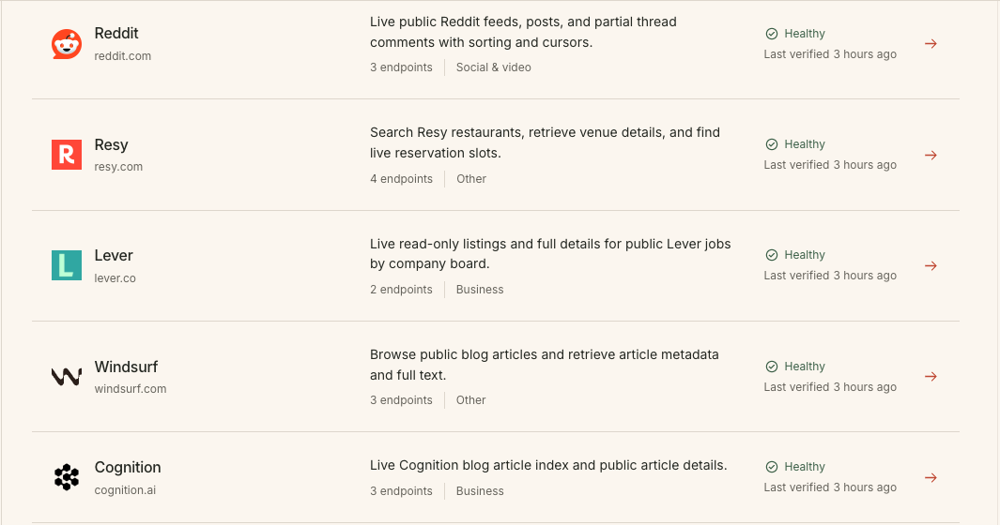
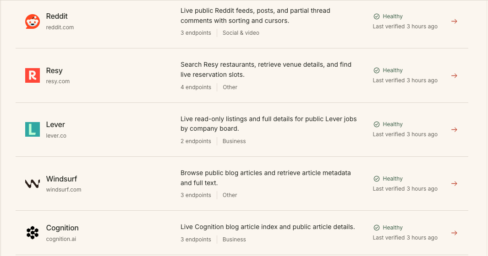

# I built a way for Hermes to use any website as an API WITHOUT browser automation

> Source: https://www.reddit.com/r/hermesagent/comments/1wp4i6k/i_built_a_way_for_hermes_to_use_any_website_as_an/
> Author: u/orthogonal-ghost
> Posted: 2026-09-24T15:19:34+00:00
> Captured: 2026-10-15T08:55:18+00:00
> Score: 168 · Comments: 43
> Community: r/hermesagent

## Post

I've been building agent workflows for a while, and I think browser automation is the wrong interface for a lot of recurring web tasks.

For example, if I want an agent to check flight prices every morning, monitor new job postings, or search YouTube, I don't really want it to:

1. Open a website
2. Figure out what's on the page
3. Click -> screenshot -> type -> screenshot -> scroll -> screenshot…
4. Then repeat that process again anytime I need to revisit the site

For some tasks, a browser is definitely useful. But if the underlying operation is basically "search \[insert-website\] with some parameters and return some results," I'd much rather have the agent make an API call and get structured JSON back.

So I built [**agent-data.dev**](https://agent-data.dev) around that idea.

It gives agents API access to data and operations from public websites. There’s a catalog of ready-to-use APIs (including X, Reddit, Zillow, and many others), and if the one you need doesn't exist, you can give it a URL + describe the data or operation you want and it will build and maintain the API for you.

You can also use the APIs through HTTP, MCP, or a CLI, so the agent gets something closer to a normal tool/function call rather than having to navigate the corresponding website.

I plan to run a few evals measuring exactly how much faster, more reliable, and more token efficient APIs are vs browser automation. I’ll follow up with the results. 

For anyone interested in some of the technical details:

* agent-data builds endpoints using the underlying network requests that sites use to load their data rather than relying on HTML selectors. That avoids a lot of layout-related breakage. 
* agent-data APIs are regularly tested so failures are auto-detected and queued for repair.
* agent-data handles proxy/CAPTCHA infrastructure

I'm especially interested in any recurring web tasks people are currently handling with browsers or ad-hoc scraping.

**If there’s a website you’ve been struggling to automate with Hermes and wish it could just call it as an API, please let me know. I'd be happy to add it!**

## Media

> Original media URL: https://i.redd.it/hxi5pshcfhrh1.png

> Original media URL: https://preview.redd.it/hxi5pshcfhrh1.png?auto=webp&s=2a99d2108bc4fc10ee88e15de1631be5864e3925

## Thread

> u/orthogonal-ghost · 2026-09-24T16:34:47+00:00 · score 8 · [comment](https://www.reddit.com/r/hermesagent/comments/1wp4i6k/i_built_a_way_for_hermes_to_use_any_website_as_an/pbspbxb/)

Great question! There’s definitely overlap, and I wouldn’t say agent-data is universally "better" than those tools.

**The main distinction I’d make** is whether you’re trying to find/read information on the web, or perform a known operation against a specific website repeatedly.

If I have a question and don’t know where the answer lives, Exa or Tavily are much more natural fits. If I know the page/site and want to scrape, crawl, or extract its contents, Firecrawl is probably the closest comparison (and is very good at that).

**agent-data is optimized for a slightly different case**: making repeated interactions with the same website cheaper, more reliable, and easier to build into workflows or apps.

**For example**, say you want an agent to monitor every new Zillow listing in 20 neighborhoods, several times a day. You *could* repeatedly scrape/search Zillow and extract the same fields on every run. However, with agent-data, that search becomes a reusable API operation, e.g. `search-homes(location, price_max, beds, listed_since)`, returning the same structured fields each time.

For a one-off lookup, the difference may not matter much. But when you're making hundreds or thousands of essentially identical queries over time, I'd rather have the agent repeatedly call a purpose-built endpoint than repeatedly fetch and interpret the website.

My rough mental model is:

* Exa / Tavily: find relevant information across the web, with extraction/research capabilities on top
* Firecrawl: scrape, crawl, extract, and interact with arbitrary web pages
* agent-data: turn specific website operations into APIs you can *repeatedly* call or build workflows/apps around
* Monid: a higher-level discovery/router layer that lets an agent access many different tool providers, including things like Exa and Firecrawl

> u/orthogonal-ghost · 2026-09-24T17:50:04+00:00 · score 2 · [comment](https://www.reddit.com/r/hermesagent/comments/1wp4i6k/i_built_a_way_for_hermes_to_use_any_website_as_an/pbt7emy/)

Good question, if the goal is just "only return listings that are 1-2 days old," then something like `listed_on < 1 day` / a `listed_since` timestamp would make sense and could be added pretty easily. Also, agreed that querying every day was just an example; you could run it Tuesdays/Fridays, around open-house windows, or on whatever cadence makes sense for the market you're interested in.

If the goal is "show me listings I haven’t already seen," I’d probably have your agent or script handle that state rather than baking it into the Zillow API. For example, Hermes could keep a small list of the listing IDs it has already surfaced, query the API using whatever filters/window you want, then ignore anything it has already shown you.

You could also combine the two and use `listed_since` to keep the result set small, then dedupe against the listings the agent has already surfaced.

> u/orthogonal-ghost · 2026-09-24T16:41:53+00:00 · score -9 · [comment](https://www.reddit.com/r/hermesagent/comments/1wp4i6k/i_built_a_way_for_hermes_to_use_any_website_as_an/pbsr1n9/)

Hi! There isn’t a self-hostable / open source version at the moment.

I’m still figuring out what parts of agent-data would make sense to open source vs. keep as hosted infrastructure, so I don’t want to promise a repo before I know what that would actually look like.

That said, I’m definitely interested in the self-hosting use case. Out of curiosity, what’s the main reason you’d want to run it locally? Privacy/control, being able to modify it, avoiding a specific hosted dependency, something else?

> u/orthogonal-ghost · 2026-09-24T17:27:29+00:00 · score 0 · [comment](https://www.reddit.com/r/hermesagent/comments/1wp4i6k/i_built_a_way_for_hermes_to_use_any_website_as_an/pbt1yxj/)

Ah, that makes sense :)

FWIW, two of those should be covered without needing to self-host: building + extending public APIs is free, and I’m planning to add a private mode where APIs you create can stay private to you instead of being added to the public catalog.

And quickly adding your own custom websites is basically the core use case I’m trying to make as easy as possible.

Privacy is the interesting one though. "Private" as in not publishing your API to the catalog is on the roadmap, but that's pretty different from "nothing goes through someone else’s infrastructure," which I assume is closer to what you mean?

> u/orthogonal-ghost · 2026-09-24T17:44:26+00:00 · score 1 · [comment](https://www.reddit.com/r/hermesagent/comments/1wp4i6k/i_built_a_way_for_hermes_to_use_any_website_as_an/pbt61tj/)

I think we may actually agree on most of this.

Re: your two years from now point, yes, maintenance is definitely a real issue. agent-data isn't assuming that the website never changes.

The endpoints are built from the underlying network requests the site uses rather than DOM selectors, so a visual/layout change doesn't necessarily break them. But if the site's underlying request changes, then yes, the endpoint can break. That's why the APIs are continuously probed, and when a probe fails, it's detected and queued for repair.

So I wouldn't claim that maintenance disappears. The idea is more to actively monitor it and repair at the API layer rather than having every agent rediscover/repair the same interaction every time it runs.

And agreed on browser automation. I probably made the screenshot loop sound more universal than it is. Some browser tools inspect the DOM/accessibility tree and infer from that, but in those cases I'd argue the operations are still token-heavy compared to "just getting the answer," and there's still more surface area for things to go wrong when you run the same workflow repeatedly.

My point isn't that browsers don't work. It's that if your agent is performing the same known operation 100 or 1000 times, repeatedly searching the DOM, identifying the controls, executing the interaction, and parsing the result is extra work compared with something like `search_homes(params) -> JSON`.

Re: X, also agreed. If xurl exposes what you need, I'd use xurl. The value is more for websites that either don't expose an API at all, or where the available API is limited or prohibitively expensive.

So I think the distinction I'm trying to make is basically:

* one-off / exploratory interaction -> browser often makes sense
* repeated, known operation -> API becomes a more attractive interface
* website changes -> neither approach is maintenance-free, but agent-data takes on that maintenance on your behalf

If you have a recurring DOM-based browser workflow that's been working reliably for you, I'd genuinely be interested in benchmarking the same task both ways. Mind sharing what browser tool/setup are you using?

> u/orthogonal-ghost · 2026-09-24T21:04:04+00:00 · score 1 · [comment](https://www.reddit.com/r/hermesagent/comments/1wp4i6k/i_built_a_way_for_hermes_to_use_any_website_as_an/pbuglm3/)

Authenticated/login-required sites are running in beta right now, and the goal is for it to work across both public and authenticated sites.

I totally appreciate the question, though. I meant "any website" in terms of the underlying approach, not that authenticated sites were all generally available at launch. I should have made that distinction clearer.

If you're comfortable sharing the site you had in mind (e.g. via DM), I'd be happy to see whether it's something the beta can already handle.

> u/orthogonal-ghost · 2026-09-24T22:47:46+00:00 · score 1 · [comment](https://www.reddit.com/r/hermesagent/comments/1wp4i6k/i_built_a_way_for_hermes_to_use_any_website_as_an/pbv1n9d/)

Here you go! [https://agent-data.dev/catalog/api/?id=propublica-org](https://agent-data.dev/catalog/api/?id=propublica-org)

Let me know how it works for you!

## Comments

> u/positiveconstraint · 2026-09-24T15:32:34+00:00 · score 39 · [comment](https://www.reddit.com/r/hermesagent/comments/1wp4i6k/i_built_a_way_for_hermes_to_use_any_website_as_an/pbsagvl/)

Looks interesting, thanks for sharing. 

Excuse me for my ignorance, but how is your solution better than my agents using Firecrawl, Exa, Tavily, or Monid to fetch web data without spending (much) tokens?

> u/PixelDu5t · 2026-09-24T15:41:42+00:00 · score 47 · [comment](https://www.reddit.com/r/hermesagent/comments/1wp4i6k/i_built_a_way_for_hermes_to_use_any_website_as_an/pbscmr0/)

Silly, none of those make OP money!

> u/Skibxskatic · 2026-09-24T17:02:11+00:00 · score 5 · [comment](https://www.reddit.com/r/hermesagent/comments/1wp4i6k/i_built_a_way_for_hermes_to_use_any_website_as_an/pbsvxu8/)

using the same zillow example, how do you get the agent/script to ignore already surfaced listings? do you set a parameter of “listed\_on” < 1 day? 

realistically, real estate in hot markets will list on tuesdays, drive up marketing and hype for open houses on the weekend. so i wouldn’t expect that example to query every day. just curious how to think about the solution. 

> u/Skibxskatic · 2026-09-24T18:37:08+00:00 · score 2 · [comment](https://www.reddit.com/r/hermesagent/comments/1wp4i6k/i_built_a_way_for_hermes_to_use_any_website_as_an/pbtikvi/)

hm. interesting. thanks for the idea. 

> u/Top-Divide-1207 · 2026-09-28T00:06:35+00:00 · score 2 · [comment](https://www.reddit.com/r/hermesagent/comments/1wp4i6k/i_built_a_way_for_hermes_to_use_any_website_as_an/pch7j9y/)

Lol you could've just asked an ai yourself, that's pretty much what op was doing. I suspect they aren't even too familiar with their own product 

> u/OyaAI · 2026-09-25T20:38:45+00:00 · score 2 · [comment](https://www.reddit.com/r/hermesagent/comments/1wp4i6k/i_built_a_way_for_hermes_to_use_any_website_as_an/pc1nd12/)

the real tradeoff here isnt api vs browser... its determinism vs flexibility... browser automation breaks on every layout change and captcha rotation... but apis break on schema changes... pick your poison... what i like about the hermes approach is that its leaning into the "extract the data not the page" philosophy which is where things should go... the question is always how reliable is the extraction layer when the site inevitably changes... bc site changes are the one constant in this whole game... anyone whos maintained a scraping pipeline for 6+ months knows the pain

> u/tengtengvn · 2026-09-24T17:53:42+00:00 · score 12 · [comment](https://www.reddit.com/r/hermesagent/comments/1wp4i6k/i_built_a_way_for_hermes_to_use_any_website_as_an/pbt8a8x/)

Bro cloned composio.dev

> u/_P_R_I_M_E · 2026-09-25T02:52:00+00:00 · score 1 · [comment](https://www.reddit.com/r/hermesagent/comments/1wp4i6k/i_built_a_way_for_hermes_to_use_any_website_as_an/pbwbggl/)

Fr

> u/Purple-Profit · 2026-09-24T16:14:12+00:00 · score 10 · [comment](https://www.reddit.com/r/hermesagent/comments/1wp4i6k/i_built_a_way_for_hermes_to_use_any_website_as_an/pbskdbh/)

can I please get the open source code for this, so I can host it locally? 

> u/HotPaper7308 · 2026-09-24T16:21:04+00:00 · score 2 · [comment](https://www.reddit.com/r/hermesagent/comments/1wp4i6k/i_built_a_way_for_hermes_to_use_any_website_as_an/pbsm0nr/)

OP is charging for it, why would he make it open source… 

> u/Purple-Profit · 2026-09-24T16:44:27+00:00 · score 10 · [comment](https://www.reddit.com/r/hermesagent/comments/1wp4i6k/i_built_a_way_for_hermes_to_use_any_website_as_an/pbsrnyn/)

privacy, and it being free :) and ability to quickly add my own custom websites. 

> u/Purple-Profit · 2026-09-24T17:57:44+00:00 · score 4 · [comment](https://www.reddit.com/r/hermesagent/comments/1wp4i6k/i_built_a_way_for_hermes_to_use_any_website_as_an/pbt9903/)

yes, I understand wanting to make some money from your idea and work. 

but for hermes type plugins etc, I would prefer stuff hosted locally. with source code I can inspect for my own security standards, etc 

> u/Jolly-Handle-8261 · 2026-09-24T17:15:32+00:00 · score 7 · [comment](https://www.reddit.com/r/hermesagent/comments/1wp4i6k/i_built_a_way_for_hermes_to_use_any_website_as_an/pbsz3in/)

Advertisement.....

> u/Master-Barracuda-777 · 2026-09-24T16:39:48+00:00 · score 6 · [comment](https://www.reddit.com/r/hermesagent/comments/1wp4i6k/i_built_a_way_for_hermes_to_use_any_website_as_an/pbsqjoc/)

I beg to differ  
The problem is you are building api endpoints based on the current configuration of the website?

What if two years from now they change their endpoints?  
How will you maintain  all of this?  
X already provides xurl to interact with  post programmatically

And now, most of the browser automation tools do search DOM elements and infer from them, screenshots are used as fallbacks

> u/Master-Barracuda-777 · 2026-09-24T18:52:04+00:00 · score 4 · [comment](https://www.reddit.com/r/hermesagent/comments/1wp4i6k/i_built_a_way_for_hermes_to_use_any_website_as_an/pbtm3xc/)

OP, if your code is closed  why should i share mine ? to make you more money ? XD

  
I agree with you that if there is a an action which the agent performs 1000x times, yes making that action slim and reliable is important. 

But i miss to understand how that generalization statment traslates to "lets keep building more and more mcp tools for each site"

The problem is right, your direction for generalizing is wrong. 

My solutions works has the same general idea as yours: any coding harness should be able to take over any of chrome profile, any window, any tab, open or closed, perform the action and get back, *all in 18 tools which work across any site.* 

The problem with accessbility trees or DOM is the time and tokens consumed to intrepret what the actions mean. I fixed it by using a  local faster model ( now replaced with JEV). 

> u/ilanxya · 2026-09-24T18:54:28+00:00 · score 2 · [comment](https://www.reddit.com/r/hermesagent/comments/1wp4i6k/i_built_a_way_for_hermes_to_use_any_website_as_an/pbtmojd/)

Not the other guy answering here. 

  All browser automation in Hermes latest run by DOM by default I believe, and then playwright for actions. As first user said, screenshots are seldom needed. Maybe I configured that somewhere, but it integrated into hermes

> u/Silly-Fall-393 · 2026-09-24T18:26:26+00:00 · score 4 · [comment](https://www.reddit.com/r/hermesagent/comments/1wp4i6k/i_built_a_way_for_hermes_to_use_any_website_as_an/pbtg2df/)

if it aint free, fuck it. 

> u/Opening_Library9560 · 2026-09-25T00:55:56+00:00 · score 2 · [comment](https://www.reddit.com/r/hermesagent/comments/1wp4i6k/i_built_a_way_for_hermes_to_use_any_website_as_an/pbvplcb/)

bladebro? [https://github.com/dondai44423/bladebro](https://github.com/dondai44423/bladebro) 👀👀

Not the same philosophy, but do check it out if you want to, its free

> u/Silly-Fall-393 · 2026-09-25T11:10:49+00:00 · score 2 · [comment](https://www.reddit.com/r/hermesagent/comments/1wp4i6k/i_built_a_way_for_hermes_to_use_any_website_as_an/pby6dsl/)

this looks great thanks!

> u/kiwipaul17 · 2026-09-24T19:44:06+00:00 · score 2 · [comment](https://www.reddit.com/r/hermesagent/comments/1wp4i6k/i_built_a_way_for_hermes_to_use_any_website_as_an/pbty6zg/)

Will try

> u/SirComprehensive3255 · 2026-09-24T20:41:20+00:00 · score 2 · [comment](https://www.reddit.com/r/hermesagent/comments/1wp4i6k/i_built_a_way_for_hermes_to_use_any_website_as_an/pbubfyx/)

So is your headline "I built a way for Hermes to use any website as an API WITHOUT browser automation" wrong? In it you say "any website." You later say public websites.  Will your solution work on private websites without API access? I am not trying to screw with you. But your headline drew me in and it appears that a website I would like to use it on is not one it will work on.

> u/SirComprehensive3255 · 2026-09-24T21:31:30+00:00 · score 2 · [comment](https://www.reddit.com/r/hermesagent/comments/1wp4i6k/i_built_a_way_for_hermes_to_use_any_website_as_an/pbumhnd/)

I sent a DM, but not sure you'll get it. Reddit didn't like my stating the name of the site.

> u/lbdesign · 2026-09-24T21:46:39+00:00 · score 2 · [comment](https://www.reddit.com/r/hermesagent/comments/1wp4i6k/i_built_a_way_for_hermes_to_use_any_website_as_an/pbupnd7/)

I can suggest propublica.org. I'd use that. 

> u/lbdesign · 2026-09-24T22:26:32+00:00 · score 1 · [comment](https://www.reddit.com/r/hermesagent/comments/1wp4i6k/i_built_a_way_for_hermes_to_use_any_website_as_an/pbuxlzf/)

more specifically, these three: 

\- the full-text search page (projects.propublica.org/nonprofits/full\_text\_search)

\- [Grantmakers.io](http://Grantmakers.io)

\- IRS Tax Exempt Organization Search (apps.irs.gov/eo)

> u/fligglymcgee · 2026-09-24T21:49:40+00:00 · score 2 · [comment](https://www.reddit.com/r/hermesagent/comments/1wp4i6k/i_built_a_way_for_hermes_to_use_any_website_as_an/pbuq9l0/)

I straight up *dare you* to take this to any of the web scraping subs.

Unless you are prepared to explain (in great technical detail) how this isn’t just a few prompts slapping browserless on the ass… You’re going to have a hard time convincing anyone your agent came up with an idea that countless net req scrapers haven’t.

> u/sixteenpoundblanket · 2026-09-25T00:37:59+00:00 · score 2 · [comment](https://www.reddit.com/r/hermesagent/comments/1wp4i6k/i_built_a_way_for_hermes_to_use_any_website_as_an/pbvm6tn/)

hannaford.com

It's a grocery store. They really, really do not want any automated stuff touching their site. 

I want two things:
 - the detailed list of all items in my orders for the past month
 - the price and aisle number of some product, say WASA rye crackers

> u/TryingHonestly · 2026-09-25T23:08:08+00:00 · score 2 · [comment](https://www.reddit.com/r/hermesagent/comments/1wp4i6k/i_built_a_way_for_hermes_to_use_any_website_as_an/pc2i0qe/)

Looks like just what I need for scraping online retailers.

> u/EaseThen3459 · 2026-09-24T17:03:39+00:00 · score 3 · [comment](https://www.reddit.com/r/hermesagent/comments/1wp4i6k/i_built_a_way_for_hermes_to_use_any_website_as_an/pbswa49/)

This seems like a really naive way to approach this problem, especially if it’s not open source

> u/trashacct383 · 2026-09-24T19:20:30+00:00 · score 1 · [comment](https://www.reddit.com/r/hermesagent/comments/1wp4i6k/i_built_a_way_for_hermes_to_use_any_website_as_an/pbtsrge/)

If I can’t self host it I have zero interest. And if I can’t inspect the code, I don’t trust it. This is just a big ad for a service that compromises the privacy and security of my 100% local stack. 

> u/JJOrdaz · 2026-09-25T11:15:35+00:00 · score 1 · [comment](https://www.reddit.com/r/hermesagent/comments/1wp4i6k/i_built_a_way_for_hermes_to_use_any_website_as_an/pby745s/)

Por que se enredan tanto??? Usen Obscura.sh  es un navegador especializado para los agentes, sea el que sea.

> u/Brianiac69 · 2026-09-25T13:32:28+00:00 · score 1 · [comment](https://www.reddit.com/r/hermesagent/comments/1wp4i6k/i_built_a_way_for_hermes_to_use_any_website_as_an/pbywl4b/)

Reinventing the wheel.   

> u/paca-vaca · 2026-09-25T18:00:59+00:00 · score 1 · [comment](https://www.reddit.com/r/hermesagent/comments/1wp4i6k/i_built_a_way_for_hermes_to_use_any_website_as_an/pc0nf7d/)

I just ask Claude to make me a script for particular website with expected output and wrap it in the skill. That's probably what you do on backend as well..

> u/CapMonster1 · 2026-09-26T07:41:26+00:00 · score 1 · [comment](https://www.reddit.com/r/hermesagent/comments/1wp4i6k/i_built_a_way_for_hermes_to_use_any_website_as_an/pc4pki7/)

would be interested in an eval that runs the same tasks daily for a week or two, including expired sessions and captcha interruptions. speed on the first successful call is useful, but the “maintain it for you” part is what i’d really want to test. when something breaks upstream, does the endpoint return an explicit error while it’s being repaired?

> u/MorningFew1574 · 2026-09-27T08:03:22+00:00 · score 1 · [comment](https://www.reddit.com/r/hermesagent/comments/1wp4i6k/i_built_a_way_for_hermes_to_use_any_website_as_an/pcbtclo/)

Is it possible to also possible to auto post on twitter through this api?  I am struggling to do repeated web tasks like social media posting...

> u/SyrupInternational48 · 2026-09-29T19:21:20+00:00 · score 1 · [comment](https://www.reddit.com/r/hermesagent/comments/1wp4i6k/i_built_a_way_for_hermes_to_use_any_website_as_an/pcuob9c/)

Isn't camoufox enough?

## Links

- https://agent-data.dev
