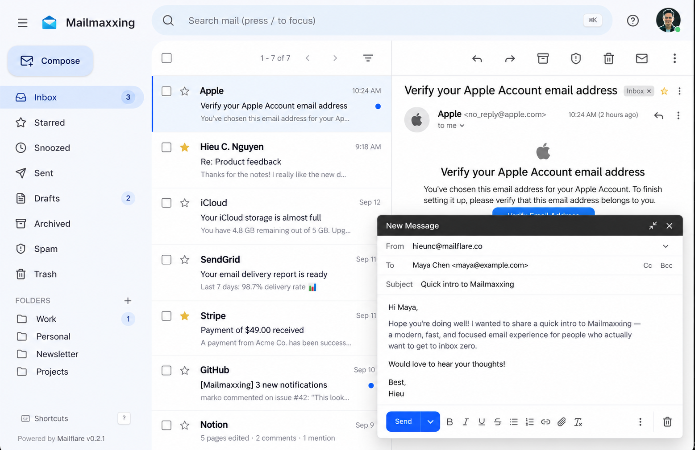
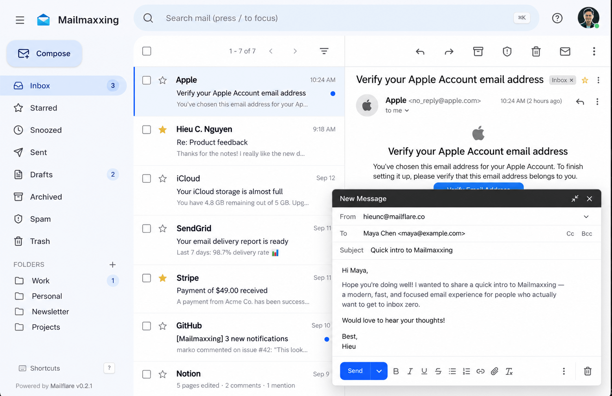

# You can now host unlimited custom domain emails for free

> Source: https://www.reddit.com/r/CloudFlare/comments/1wwi9uz/you_can_now_host_unlimited_custom_domain_emails/
> Author: u/hieunc
> Posted: 2026-10-03T08:42:40+00:00
> Captured: 2026-10-15T08:55:18+00:00
> Score: 1376 · Comments: 177
> Community: r/CloudFlare

## Post

Hi everyone, I'm the developer of Mailflare - Gmail-like mailbox with custom domain emails on Cloudflare

Mailflare now supports Resend and AWS SES, which mean you don't have to subscribe to Clodflare Paid Worker for sending emails

It's is open-source and you can deploy with 1-click to Cloudflare worker  
👉 [https://github.com/hieunc229/mailflare](https://github.com/hieunc229/mailflare)

Feel free to let me know if you have any feedback or questions

## Media

> Original media URL: https://i.redd.it/5l4fhc1ts7th1.png

> Original media URL: https://preview.redd.it/5l4fhc1ts7th1.png?auto=webp&s=b5276519ccab93d439b00e1f73c9190911741535

## Thread

> u/AutoModerator · 2026-10-03T08:42:41+00:00 · score 1 · [comment](https://www.reddit.com/r/CloudFlare/comments/1wwi9uz/you_can_now_host_unlimited_custom_domain_emails/pdkqmvv/)

For faster advice with technical questions, we'd recommend asking in the Orange Cloud Discord server; the unofficial Cloudflare Discord server by the community, for the community. https://discord.gg/TrPNVKaagR

*I am a bot, and this action was performed automatically. Please [contact the moderators of this subreddit](/message/compose/?to=/r/CloudFlare) if you have any questions or concerns.*

> u/hieunc · 2026-10-04T15:14:19+00:00 · score 5 · [comment](https://www.reddit.com/r/CloudFlare/comments/1wwi9uz/you_can_now_host_unlimited_custom_domain_emails/pdtlmej/)

I never use purelymail before, looks like a good choice if you need a simple email.  
  
Mailflare UI is pretty close to Gmail, which I think is simple / elegant / modern. Besides email, there are Calendar / Booking (like calendly) available. Drive is also coming very soon

> u/hieunc · 2026-10-03T11:58:45+00:00 · score 3 · [comment](https://www.reddit.com/r/CloudFlare/comments/1wwi9uz/you_can_now_host_unlimited_custom_domain_emails/pdlg184/)

some people switched to mailflare and they like it

> u/hieunc · 2026-10-03T09:00:33+00:00 · score 16 · [comment](https://www.reddit.com/r/CloudFlare/comments/1wwi9uz/you_can_now_host_unlimited_custom_domain_emails/pdkss3z/)

Yes, it started with Cloudflare email sending / receiving. Really nice if you already have the $5/m Paid Worker plan. Otherwise, Resend / AWS SES has free tier for sending emails

> u/hieunc · 2026-10-04T03:41:01+00:00 · score 3 · [comment](https://www.reddit.com/r/CloudFlare/comments/1wwi9uz/you_can_now_host_unlimited_custom_domain_emails/pdqol0b/)

3 custom domains but you're right, I forgot about this

> u/hieunc · 2026-10-03T13:57:15+00:00 · score 3 · [comment](https://www.reddit.com/r/CloudFlare/comments/1wwi9uz/you_can_now_host_unlimited_custom_domain_emails/pdm1grq/)

I'll look more into it. JMAP is already available btw

> u/hieunc · 2026-10-03T12:04:21+00:00 · score 4 · [comment](https://www.reddit.com/r/CloudFlare/comments/1wwi9uz/you_can_now_host_unlimited_custom_domain_emails/pdlgx7e/)

Yes, aliases / separate inboxes / accounts / shared inboxes, you name it

> u/hieunc · 2026-10-03T16:00:20+00:00 · score 3 · [comment](https://www.reddit.com/r/CloudFlare/comments/1wwi9uz/you_can_now_host_unlimited_custom_domain_emails/pdmrx4t/)

Did you DM me on X?

If anyone ran into 401 issue, your domain has some existing records that need to be removed first. I made an update that should remove it for you too

> u/hieunc · 2026-10-03T13:59:12+00:00 · score 4 · [comment](https://www.reddit.com/r/CloudFlare/comments/1wwi9uz/you_can_now_host_unlimited_custom_domain_emails/pdm1us5/)

Atm, it gives a score based on a few things  
[https://github.com/hieunc229/mailflare/blob/main/docs/spam-protection.md](https://github.com/hieunc229/mailflare/blob/main/docs/spam-protection.md)

> u/hieunc · 2026-10-03T17:56:09+00:00 · score 1 · [comment](https://www.reddit.com/r/CloudFlare/comments/1wwi9uz/you_can_now_host_unlimited_custom_domain_emails/pdni8dn/)

ha

> u/hieunc · 2026-10-04T14:01:07+00:00 · score 3 · [comment](https://www.reddit.com/r/CloudFlare/comments/1wwi9uz/you_can_now_host_unlimited_custom_domain_emails/pdt5ij6/)

I have a bunch of domains and inboxes. Mailflare is JMAP + SMTP btw

> u/hieunc · 2026-10-09T12:12:53+00:00 · score 2 · [comment](https://www.reddit.com/r/CloudFlare/comments/1wwi9uz/you_can_now_host_unlimited_custom_domain_emails/peu06g3/)

Guess what? it's 1 click too (it'll check the changes, show an update button if a new version available)

> u/hieunc · 2026-10-03T09:22:13+00:00 · score 3 · [comment](https://www.reddit.com/r/CloudFlare/comments/1wwi9uz/you_can_now_host_unlimited_custom_domain_emails/pdkvdyy/)

You'll love mailflare UI

> u/hieunc · 2026-10-03T13:16:49+00:00 · score 2 · [comment](https://www.reddit.com/r/CloudFlare/comments/1wwi9uz/you_can_now_host_unlimited_custom_domain_emails/pdltlfx/)

Not yet. I didn't know Oracle offer this, will look into it

> u/hieunc · 2026-10-03T14:55:31+00:00 · score 3 · [comment](https://www.reddit.com/r/CloudFlare/comments/1wwi9uz/you_can_now_host_unlimited_custom_domain_emails/pdmdlpc/)

Open-source with AGPL 3.0 license. You can folk / modify it, but must open-source it too

> u/hieunc · 2026-10-03T14:59:45+00:00 · score 3 · [comment](https://www.reddit.com/r/CloudFlare/comments/1wwi9uz/you_can_now_host_unlimited_custom_domain_emails/pdmeiqv/)

Some details on Spam Protection for Mailflare here (good thing we can improve it too)

[https://github.com/hieunc229/mailflare/blob/main/docs/spam-protection.md](https://github.com/hieunc229/mailflare/blob/main/docs/spam-protection.md)

> u/hieunc · 2026-10-04T02:45:57+00:00 · score 1 · [comment](https://www.reddit.com/r/CloudFlare/comments/1wwi9uz/you_can_now_host_unlimited_custom_domain_emails/pdqfss6/)

Have you config the token with proper permission https://github.com/hieunc229/mailflare/blob/main/docs/deployment.md?

> u/hieunc · 2026-10-05T02:15:00+00:00 · score 2 · [comment](https://www.reddit.com/r/CloudFlare/comments/1wwi9uz/you_can_now_host_unlimited_custom_domain_emails/pdxo1m7/)

It's in the [README.md](http://README.md), deployment.md. People just don't read

> u/hieunc · 2026-10-04T02:48:08+00:00 · score 1 · [comment](https://www.reddit.com/r/CloudFlare/comments/1wwi9uz/you_can_now_host_unlimited_custom_domain_emails/pdqg5ue/)

Good option, but they have no actual free tier. Any advantage over other providers?

> u/hieunc · 2026-10-04T13:58:46+00:00 · score 1 · [comment](https://www.reddit.com/r/CloudFlare/comments/1wwi9uz/you_can_now_host_unlimited_custom_domain_emails/pdt50sd/)

Not something we can do. But Mailfare use Drizzle as ORM, it supports other SQL database too. I do hope / think Cloudflare will increase that limit

> u/hieunc · 2026-10-05T09:41:50+00:00 · score 2 · [comment](https://www.reddit.com/r/CloudFlare/comments/1wwi9uz/you_can_now_host_unlimited_custom_domain_emails/pdzdj04/)

For navigating, have you check the location of the worker and DB?

For sending, it is slow. I think can improve the UX of it

> u/hieunc · 2026-10-05T11:12:06+00:00 · score 2 · [comment](https://www.reddit.com/r/CloudFlare/comments/1wwi9uz/you_can_now_host_unlimited_custom_domain_emails/pdzppto/)

I'll dig more into it

> u/hieunc · 2026-10-04T16:44:43+00:00 · score 1 · [comment](https://www.reddit.com/r/CloudFlare/comments/1wwi9uz/you_can_now_host_unlimited_custom_domain_emails/pdu6mp3/)

they haven't updated in 6 months, guess that was an example project

> u/hieunc · 2026-10-05T12:47:34+00:00 · score 1 · [comment](https://www.reddit.com/r/CloudFlare/comments/1wwi9uz/you_can_now_host_unlimited_custom_domain_emails/pe064rt/)

Not supporting custom SMTP or Gmail API atm. 

Curious what case do you think using Gmail API with this?

> u/hieunc · 2026-10-05T15:35:24+00:00 · score 2 · [comment](https://www.reddit.com/r/CloudFlare/comments/1wwi9uz/you_can_now_host_unlimited_custom_domain_emails/pe174aa/)

Ah, I got it

> u/hieunc · 2026-10-07T02:37:41+00:00 · score 1 · [comment](https://www.reddit.com/r/CloudFlare/comments/1wwi9uz/you_can_now_host_unlimited_custom_domain_emails/pecpb30/)

A few things I have in mind

Cons:  
\- 10GB D1 limit (can use with other DB too)  
\- IMAP not available yet (JMAP is supported)

Pros:  
\- open-sourced and regularly updated  
\- supported multiple email providers (cloudflare, resend, aws ses)  
\- more than email (calendar and booking is available, drive is being added)

> u/hieunc · 2026-10-07T02:39:10+00:00 · score 1 · [comment](https://www.reddit.com/r/CloudFlare/comments/1wwi9uz/you_can_now_host_unlimited_custom_domain_emails/pecpkmm/)

A giant pricing section on the homepage. You can folk it and remove the paywall, it's open-sourced

> u/hieunc · 2026-10-07T02:41:08+00:00 · score 1 · [comment](https://www.reddit.com/r/CloudFlare/comments/1wwi9uz/you_can_now_host_unlimited_custom_domain_emails/pecpx9h/)

For naming, do you mean mailflare?

I'm not sure where is the parentheses folders, can you have a screenshot or point me to it?

> u/hieunc · 2026-10-07T17:44:52+00:00 · score 1 · [comment](https://www.reddit.com/r/CloudFlare/comments/1wwi9uz/you_can_now_host_unlimited_custom_domain_emails/peh2wmc/)

Only multiple accounts and white label are behind the paywall. And it's open-source (change as you like)  
  
You don't have these features with Google Workspace anyway

> u/hieunc · 2026-10-08T04:47:51+00:00 · score 1 · [comment](https://www.reddit.com/r/CloudFlare/comments/1wwi9uz/you_can_now_host_unlimited_custom_domain_emails/peksaq5/)

Never heard any of them

> u/hieunc · 2026-10-08T07:46:28+00:00 · score 1 · [comment](https://www.reddit.com/r/CloudFlare/comments/1wwi9uz/you_can_now_host_unlimited_custom_domain_emails/pelfkye/)

Thank you u/brenebon, indeed Team license doesn't designed for this

I'm updating it with additional seats for some amount. Changes should be available later today (with new Drive feature as well)

> u/hieunc · 2026-10-08T16:25:18+00:00 · score 1 · [comment](https://www.reddit.com/r/CloudFlare/comments/1wwi9uz/you_can_now_host_unlimited_custom_domain_emails/peo0ygs/)

Yes. If you don't have Cloudflare Paid Worker, you can use Resend or AWS SES for sending emails (their free tier is good for personal use)

> u/hieunc · 2026-10-03T16:06:37+00:00 · score 1 · [comment](https://www.reddit.com/r/CloudFlare/comments/1wwi9uz/you_can_now_host_unlimited_custom_domain_emails/pdmtb82/)

Just push the update, but yeah, you can look for the existing records and remove them too

> u/hieunc · 2026-10-04T13:55:32+00:00 · score 1 · [comment](https://www.reddit.com/r/CloudFlare/comments/1wwi9uz/you_can_now_host_unlimited_custom_domain_emails/pdt4cg6/)

I'm not sure what you mean. Do you mean OTP verification / marketing mails with mailflare, and for who? 

> u/hieunc · 2026-10-05T02:55:39+00:00 · score 1 · [comment](https://www.reddit.com/r/CloudFlare/comments/1wwi9uz/you_can_now_host_unlimited_custom_domain_emails/pdxvhyf/)

lol

> u/hieunc · 2026-10-03T17:50:47+00:00 · score 1 · [comment](https://www.reddit.com/r/CloudFlare/comments/1wwi9uz/you_can_now_host_unlimited_custom_domain_emails/pdnh01e/)

that's custom branding, lol

> u/hieunc · 2026-10-03T09:21:05+00:00 · score 2 · [comment](https://www.reddit.com/r/CloudFlare/comments/1wwi9uz/you_can_now_host_unlimited_custom_domain_emails/pdkv93u/)

I haven't get to supporting multilingual, will work on it

> u/hieunc · 2026-10-10T00:53:08+00:00 · score 1 · [comment](https://www.reddit.com/r/CloudFlare/comments/1wwi9uz/you_can_now_host_unlimited_custom_domain_emails/peylnib/)

Yesss

> u/hieunc · 2026-10-03T13:40:06+00:00 · score 2 · [comment](https://www.reddit.com/r/CloudFlare/comments/1wwi9uz/you_can_now_host_unlimited_custom_domain_emails/pdly2a6/)

I've never use HQBase

> u/hieunc · 2026-10-03T15:22:19+00:00 · score 2 · [comment](https://www.reddit.com/r/CloudFlare/comments/1wwi9uz/you_can_now_host_unlimited_custom_domain_emails/pdmjgl0/)

never heard of it but ok

> u/hieunc · 2026-10-04T15:12:38+00:00 · score 1 · [comment](https://www.reddit.com/r/CloudFlare/comments/1wwi9uz/you_can_now_host_unlimited_custom_domain_emails/pdtl8k1/)

I never use purelymail before, looks like a good choice if you need a simple email.   
  
Mailflare UI is pretty close to Gmail, which I think is simple / elegant / modern. Besides email, there are Calendar / Booking (like calendly) available. Drive is also coming very soon

> u/hieunc · 2026-10-03T09:21:24+00:00 · score 5 · [comment](https://www.reddit.com/r/CloudFlare/comments/1wwi9uz/you_can_now_host_unlimited_custom_domain_emails/pdkvaha/)

What do you like about Zoho?

> u/hieunc · 2026-10-03T09:41:50+00:00 · score 2 · [comment](https://www.reddit.com/r/CloudFlare/comments/1wwi9uz/you_can_now_host_unlimited_custom_domain_emails/pdkxq9y/)

Thanks, I just try to understand

> u/hieunc · 2026-10-04T00:50:23+00:00 · score 1 · [comment](https://www.reddit.com/r/CloudFlare/comments/1wwi9uz/you_can_now_host_unlimited_custom_domain_emails/pdpvmsu/)

**Lorem ipsum dolor sit amet**, consectetur adipiscing elit

> u/hieunc · 2026-10-03T14:58:48+00:00 · score 1 · [comment](https://www.reddit.com/r/CloudFlare/comments/1wwi9uz/you_can_now_host_unlimited_custom_domain_emails/pdmebak/)

Yeah, Resend or AWS SES should be good. I used AWS SES a lot in the past, works great, need to keep an eye on health-score. Never use Resend before except testing for this project

Not any gotchas I know of, besides limitations (free tier / sending limits / Cloudflare D1 has 10GB limit but can use other DB as well)

> u/hieunc · 2026-10-04T02:49:04+00:00 · score 1 · [comment](https://www.reddit.com/r/CloudFlare/comments/1wwi9uz/you_can_now_host_unlimited_custom_domain_emails/pdqgbhx/)

Thanks Joej!

> u/hieunc · 2026-10-08T04:44:37+00:00 · score 1 · [comment](https://www.reddit.com/r/CloudFlare/comments/1wwi9uz/you_can_now_host_unlimited_custom_domain_emails/pekrtqf/)

It's open-sourced, you can clone it in 30s

> u/hieunc · 2026-10-03T12:03:18+00:00 · score 0 · [comment](https://www.reddit.com/r/CloudFlare/comments/1wwi9uz/you_can_now_host_unlimited_custom_domain_emails/pdlgr8g/)

I think it's plenty, but yeah, doesn't mean there is no limit. 

It uses Drizzle as ORM, which supports a lot of other database too. I also think cloudflare will upgrade D1 at some point

> u/hieunc · 2026-10-04T00:44:56+00:00 · score 1 · [comment](https://www.reddit.com/r/CloudFlare/comments/1wwi9uz/you_can_now_host_unlimited_custom_domain_emails/pdpumr3/)

Yes

> u/hieunc · 2026-10-08T04:43:04+00:00 · score 1 · [comment](https://www.reddit.com/r/CloudFlare/comments/1wwi9uz/you_can_now_host_unlimited_custom_domain_emails/pekrlia/)

I figured some people don't have Cloudflare Paid Worker (which for sending email), while others have free tier with email sending that fit their needs

> u/hieunc · 2026-10-08T06:25:08+00:00 · score 1 · [comment](https://www.reddit.com/r/CloudFlare/comments/1wwi9uz/you_can_now_host_unlimited_custom_domain_emails/pel5i9t/)

Since you already have the paid worker, you can send emails too (no other services needed). You can deploy mailflare to cloudflare worker, go through the onboarding to setup your domain and account

## Comments

> u/qadhi79 · 2026-10-03T11:14:07+00:00 · score 60 · [comment](https://www.reddit.com/r/CloudFlare/comments/1wwi9uz/you_can_now_host_unlimited_custom_domain_emails/pdl9iq8/)

Im currently using Purelymail which is not free but $10 or something for 1 year with support for multiple domains and aliases without the need for configuring AWS SES or Cloudflare Worker

> u/vedmaka · 2026-10-03T11:53:40+00:00 · score 21 · [comment](https://www.reddit.com/r/CloudFlare/comments/1wwi9uz/you_can_now_host_unlimited_custom_domain_emails/pdlf99o/)

\+1 for Purelymail, they are absolutely awesome

> u/redstonermoves · 2026-10-03T15:45:28+00:00 · score 11 · [comment](https://www.reddit.com/r/CloudFlare/comments/1wwi9uz/you_can_now_host_unlimited_custom_domain_emails/pdmolso/)

Purelymail is such an incredible deal, +1 billion

> u/especialbird · 2026-10-04T02:28:31+00:00 · score 2 · [comment](https://www.reddit.com/r/CloudFlare/comments/1wwi9uz/you_can_now_host_unlimited_custom_domain_emails/pdqcvtx/)

+1... I use Purelymail too.

I thought I was a rare person. Didn't expect it to be a famous service now 😯

> u/elpuffru · 2026-10-04T14:16:42+00:00 · score 2 · [comment](https://www.reddit.com/r/CloudFlare/comments/1wwi9uz/you_can_now_host_unlimited_custom_domain_emails/pdt8t1o/)

Their spam filters are awful

> u/toasterqc · 2026-10-05T13:20:56+00:00 · score 2 · [comment](https://www.reddit.com/r/CloudFlare/comments/1wwi9uz/you_can_now_host_unlimited_custom_domain_emails/pe0cv5y/)

Purely mail mail is USA , no way in hell 

> u/ACAdamski17 · 2026-10-05T19:27:09+00:00 · score 2 · [comment](https://www.reddit.com/r/CloudFlare/comments/1wwi9uz/you_can_now_host_unlimited_custom_domain_emails/pe2rgjy/)

Yeah Purelymail is great! But honestly so is OP’s software, from what I can see. 

> u/CaptainCodeKe · 2026-10-05T05:17:09+00:00 · score 6 · [comment](https://www.reddit.com/r/CloudFlare/comments/1wwi9uz/you_can_now_host_unlimited_custom_domain_emails/pdyhe1y/)

Why is he being downvoted? There is nothing wrong with people switching and liking mailflare.

> u/rohepey · 2026-10-05T20:57:26+00:00 · score 2 · [comment](https://www.reddit.com/r/CloudFlare/comments/1wwi9uz/you_can_now_host_unlimited_custom_domain_emails/pe3cwgu/)

Because it's Reddit. Votes don't follow logic.

> u/WreeperTH · 2026-10-04T10:44:19+00:00 · score 1 · [comment](https://www.reddit.com/r/CloudFlare/comments/1wwi9uz/you_can_now_host_unlimited_custom_domain_emails/pds8o0v/)

It's purely mail!

> u/Sad-Ad3956 · 2026-10-04T21:32:48+00:00 · score 1 · [comment](https://www.reddit.com/r/CloudFlare/comments/1wwi9uz/you_can_now_host_unlimited_custom_domain_emails/pdw4pyp/)

Another Purelymail user here :)

> u/vvrider · 2026-10-04T22:33:31+00:00 · score 1 · [comment](https://www.reddit.com/r/CloudFlare/comments/1wwi9uz/you_can_now_host_unlimited_custom_domain_emails/pdwhld5/)

\+1 for Purelymail. They are the best

> u/rezkarimarif · 2026-10-05T05:24:06+00:00 · score 1 · [comment](https://www.reddit.com/r/CloudFlare/comments/1wwi9uz/you_can_now_host_unlimited_custom_domain_emails/pdyibuq/)

+1000 for Purelymail email. Using them for last 3 years I guess no issue, I think once there was a downtime and it got fixed in few hours. As far as I know they are a small team, their current UI is much better. Not gonna lie old UI of the website was pretty ass. But solid service 

> u/WaleedSyr · 2026-10-03T08:56:34+00:00 · score 37 · [comment](https://www.reddit.com/r/CloudFlare/comments/1wwi9uz/you_can_now_host_unlimited_custom_domain_emails/pdksb0n/)

Nice project, did you add support for cloudflare email sending? I don't wanna rely on AWS ses or resend, but anyways I will git clone it and let you know my experience

> u/WaleedSyr · 2026-10-03T09:00:58+00:00 · score 3 · [comment](https://www.reddit.com/r/CloudFlare/comments/1wwi9uz/you_can_now_host_unlimited_custom_domain_emails/pdkstwx/)

Have the workers paid, I will test it out then 

> u/Round_Ad_5832 · 2026-10-03T13:03:35+00:00 · score 3 · [comment](https://www.reddit.com/r/CloudFlare/comments/1wwi9uz/you_can_now_host_unlimited_custom_domain_emails/pdlr42r/)

but resend only allows 1 custom domain, right?

> u/bennyb0y · 2026-10-03T11:37:53+00:00 · score 8 · [comment](https://www.reddit.com/r/CloudFlare/comments/1wwi9uz/you_can_now_host_unlimited_custom_domain_emails/pdlcw2e/)

Would love IMAP support for this project. Or a standalone IOS app. Thanks for building it !

> u/vaibhav-kaushal · 2026-10-04T01:16:39+00:00 · score 2 · [comment](https://www.reddit.com/r/CloudFlare/comments/1wwi9uz/you_can_now_host_unlimited_custom_domain_emails/pdq0b50/)

IMAP + 1000 == JMAP

> u/north7 · 2026-10-03T17:15:12+00:00 · score 10 · [comment](https://www.reddit.com/r/CloudFlare/comments/1wwi9uz/you_can_now_host_unlimited_custom_domain_emails/pdn8rwi/)

Upvoted, but "mailmaxxing"?  
dude.

> u/NotMyUsualLogin · 2026-10-03T10:03:25+00:00 · score 4 · [comment](https://www.reddit.com/r/CloudFlare/comments/1wwi9uz/you_can_now_host_unlimited_custom_domain_emails/pdl0cfk/)

Does it handle email aliases?

> u/ducksoup_18 · 2026-10-03T13:31:25+00:00 · score 3 · [comment](https://www.reddit.com/r/CloudFlare/comments/1wwi9uz/you_can_now_host_unlimited_custom_domain_emails/pdlwdry/)

I set it up, added the token to the env, went through the setup, when i added an email address it says this.

Cloudflare API 409 on /zones/\[redacted\]/email/routing/rules: code 2014: Duplicated Zone rule. I had an email routing rule that was just sending emails to my gmail account that i disabled. This was the email i was trying to add. Any ideas?

https://preview.redd.it/0h3zdqlb89th1.png?width=1278&format=png&auto=webp&s=89c06c4452e1135d2aefa05ae738cbecb8bcd2c7

Also seeing this:

Cloudflare API 401 on /zones/\[redacted\]/email/sending/subdomains: code 2036: Unauthorized Verify CF\_TOKEN with \`curl [https://api.cloudflare.com/client/v4/user/tokens/verify](https://api.cloudflare.com/client/v4/user/tokens/verify) \-H "Authorization: Bearer <token>"\`. Use the token secret value without \`Bearer\`, or use CF\_API\_KEY plus CF\_EMAIL for a Global API Key.

I set a CF\_EMAIL env var as well to the email i was trying to set up. unsure if that was correct or not.

\`{"result":{"id":"\[redacted\]","status":"active"},"success":true,"errors":\[\],"messages":\[{"code":10000,"message":"This API Token is valid and active","type":null}\]}**%\`**

> u/mr_sudo · 2026-10-04T15:33:10+00:00 · score 3 · [comment](https://www.reddit.com/r/CloudFlare/comments/1wwi9uz/you_can_now_host_unlimited_custom_domain_emails/pdtpzda/)

Great, I will look into it. Thanks op

> u/amcco1 · 2026-10-06T23:17:43+00:00 · score 3 · [comment](https://www.reddit.com/r/CloudFlare/comments/1wwi9uz/you_can_now_host_unlimited_custom_domain_emails/pebmnc1/)

I just set this up, was really excited for it, setup was quick and painless. 

As soon as I got it setup I see there is a giant "UPGRADE" button in the UI all the time... no where in the readme did it say that some features are pay walled. 

Immediately deleted the instance and db. 

I really wanted to like this and use it, but hiding that there is a paywall, and asking for sponsors in the readme is just not something I will support.

> u/olivebits · 2026-10-03T11:15:55+00:00 · score 2 · [comment](https://www.reddit.com/r/CloudFlare/comments/1wwi9uz/you_can_now_host_unlimited_custom_domain_emails/pdl9rpq/)

Those is very Cool up! I'm going to try it in my VPS. Hopefully I don't need to install anything else besides this

> u/dogchow01 · 2026-10-03T12:22:06+00:00 · score 2 · [comment](https://www.reddit.com/r/CloudFlare/comments/1wwi9uz/you_can_now_host_unlimited_custom_domain_emails/pdljtdf/)

How does is handle spam/phishing, etc

> u/Infinite-Pop306 · 2026-10-03T12:50:20+00:00 · score 2 · [comment](https://www.reddit.com/r/CloudFlare/comments/1wwi9uz/you_can_now_host_unlimited_custom_domain_emails/pdlop97/)

I want to doing this on last month since Gmail want to rip off thrid party email client, good job, mate

But can you support maileroo? there have a bit free email quoter

> u/TrashkenHK · 2026-10-03T13:05:33+00:00 · score 2 · [comment](https://www.reddit.com/r/CloudFlare/comments/1wwi9uz/you_can_now_host_unlimited_custom_domain_emails/pdlrhei/)

I just link Resend to Workers. What's the point of this?

> u/allomaitresimonard · 2026-10-03T17:05:12+00:00 · score 2 · [comment](https://www.reddit.com/r/CloudFlare/comments/1wwi9uz/you_can_now_host_unlimited_custom_domain_emails/pdn6hv6/)

Good step for acquisition 

> u/grrgrrr · 2026-10-03T18:20:44+00:00 · score 2 · [comment](https://www.reddit.com/r/CloudFlare/comments/1wwi9uz/you_can_now_host_unlimited_custom_domain_emails/pdnnw9g/)

I like this - good job. I think it's a very good tool to keep all domain emails organized. I have so many scattered around multiple services or multiple accounts, for me this is great 

> u/phoenix_73 · 2026-10-03T20:07:50+00:00 · score 2 · [comment](https://www.reddit.com/r/CloudFlare/comments/1wwi9uz/you_can_now_host_unlimited_custom_domain_emails/pdoburr/)

Looks good, will have to look into this. Thank you. 

> u/holdenk · 2026-10-04T00:51:28+00:00 · score 2 · [comment](https://www.reddit.com/r/CloudFlare/comments/1wwi9uz/you_can_now_host_unlimited_custom_domain_emails/pdpvtwx/)

This is very cool 😎 

> u/twin-hoodlum3 · 2026-10-04T12:07:30+00:00 · score 2 · [comment](https://www.reddit.com/r/CloudFlare/comments/1wwi9uz/you_can_now_host_unlimited_custom_domain_emails/pdskoma/)

Or you just pay 3 bucks in sum for real IMAP+SMTP. 

> u/abid_patel · 2026-10-05T00:19:56+00:00 · score 2 · [comment](https://www.reddit.com/r/CloudFlare/comments/1wwi9uz/you_can_now_host_unlimited_custom_domain_emails/pdx2jit/)

This looks really interesting. Might give it a go!

> u/RelativeClock5775 · 2026-10-05T15:12:27+00:00 · score 2 · [comment](https://www.reddit.com/r/CloudFlare/comments/1wwi9uz/you_can_now_host_unlimited_custom_domain_emails/pe11n11/)

I like it. I am using Cloudflare for a bunch of stuff already. Nice to have this in there too.

> u/Realjhh · 2026-10-07T06:18:47+00:00 · score 2 · [comment](https://www.reddit.com/r/CloudFlare/comments/1wwi9uz/you_can_now_host_unlimited_custom_domain_emails/pedmrgw/)

i was gonna try this out till i found people saying there’s paywall features, im just gonna stick with google workspace for now then. 

> u/shaiilendra · 2026-10-09T11:17:12+00:00 · score 2 · [comment](https://www.reddit.com/r/CloudFlare/comments/1wwi9uz/you_can_now_host_unlimited_custom_domain_emails/petqnqu/)

Look great, thanks for sharing.

If you push updates, how to get the updates.

Hope you can integrate with 1click option too.

> u/Admin_istrator · 2026-10-03T08:52:50+00:00 · score 3 · [comment](https://www.reddit.com/r/CloudFlare/comments/1wwi9uz/you_can_now_host_unlimited_custom_domain_emails/pdkruud/)

It was already free with Zoho Mail free plan, but nice project.

> u/MicroscopicStonework · 2026-10-03T18:15:51+00:00 · score 3 · [comment](https://www.reddit.com/r/CloudFlare/comments/1wwi9uz/you_can_now_host_unlimited_custom_domain_emails/pdnmrxj/)

I don't think the free plan comes with an IMAP, does it?

> u/vedmaka · 2026-10-03T11:54:20+00:00 · score 1 · [comment](https://www.reddit.com/r/CloudFlare/comments/1wwi9uz/you_can_now_host_unlimited_custom_domain_emails/pdlfcz0/)

How do you solve D1 size limitations?

> u/mindbosss · 2026-10-03T13:08:49+00:00 · score 1 · [comment](https://www.reddit.com/r/CloudFlare/comments/1wwi9uz/you_can_now_host_unlimited_custom_domain_emails/pdls3hc/)

Can I use OCI (Oracle Cloud Infrastructure) Email Delivery?

> u/rohepey · 2026-10-05T02:31:10+00:00 · score 2 · [comment](https://www.reddit.com/r/CloudFlare/comments/1wwi9uz/you_can_now_host_unlimited_custom_domain_emails/pdxr1a4/)

Who trusts Oracle these days?

> u/Potential_Leader_466 · 2026-10-03T14:37:10+00:00 · score 1 · [comment](https://www.reddit.com/r/CloudFlare/comments/1wwi9uz/you_can_now_host_unlimited_custom_domain_emails/pdm9omw/)

Is this open source? Can commercial it? 

> u/stevedrz · 2026-10-03T14:41:33+00:00 · score 1 · [comment](https://www.reddit.com/r/CloudFlare/comments/1wwi9uz/you_can_now_host_unlimited_custom_domain_emails/pdmam7j/)

How's spam protection on the platform? DKIM/DMARC/SPF all good to go?

> u/blissofbeing · 2026-10-03T15:45:42+00:00 · score 1 · [comment](https://www.reddit.com/r/CloudFlare/comments/1wwi9uz/you_can_now_host_unlimited_custom_domain_emails/pdmonoq/)

https://mailfully.com/ support would be nice too

> u/SINdicate · 2026-10-03T16:07:21+00:00 · score 1 · [comment](https://www.reddit.com/r/CloudFlare/comments/1wwi9uz/you_can_now_host_unlimited_custom_domain_emails/pdmth2r/)

Would be cool to have it integrated with melody auth

> u/arnabnogoswami · 2026-10-03T19:12:13+00:00 · score 1 · [comment](https://www.reddit.com/r/CloudFlare/comments/1wwi9uz/you_can_now_host_unlimited_custom_domain_emails/pdnzlrg/)

Thank you. I created a PR a couple days ago.

> u/thefarixz · 2026-10-03T19:39:23+00:00 · score 1 · [comment](https://www.reddit.com/r/CloudFlare/comments/1wwi9uz/you_can_now_host_unlimited_custom_domain_emails/pdo5ln4/)

i have an issue

https://preview.redd.it/9fnh7b142bth1.png?width=545&format=png&auto=webp&s=7e3cba9a744dd2bd6604b9797e531fd6112bfb45

> u/FreaKyBoi · 2026-10-04T00:41:01+00:00 · score 2 · [comment](https://www.reddit.com/r/CloudFlare/comments/1wwi9uz/you_can_now_host_unlimited_custom_domain_emails/pdptxfe/)

So fix it?

> u/thefarixz · 2026-10-04T16:45:47+00:00 · score 2 · [comment](https://www.reddit.com/r/CloudFlare/comments/1wwi9uz/you_can_now_host_unlimited_custom_domain_emails/pdu6vs4/)

why these perms are not mentioned in "troubleshooting.md", i didn't find it at first but anyway i managed to fix it but then deleted the whole thing because i found that i still have to pay for cloudflare workers.. 

> u/anvil-14 · 2026-10-03T21:20:49+00:00 · score 1 · [comment](https://www.reddit.com/r/CloudFlare/comments/1wwi9uz/you_can_now_host_unlimited_custom_domain_emails/pdorur8/)

you should add sendgrid support as well 

> u/kiwipaul17 · 2026-10-04T01:01:25+00:00 · score 1 · [comment](https://www.reddit.com/r/CloudFlare/comments/1wwi9uz/you_can_now_host_unlimited_custom_domain_emails/pdpxkp5/)

Will try

> u/spottiesvirus · 2026-10-04T10:49:13+00:00 · score 1 · [comment](https://www.reddit.com/r/CloudFlare/comments/1wwi9uz/you_can_now_host_unlimited_custom_domain_emails/pds9bzk/)

one question, D1 limits max database size to 10GB

do you have any plan to overcome this limit?

great project anyway!

> u/literallyCrevice · 2026-10-04T16:01:06+00:00 · score 1 · [comment](https://www.reddit.com/r/CloudFlare/comments/1wwi9uz/you_can_now_host_unlimited_custom_domain_emails/pdtwhji/)

Nice project! How would you say it compares to their agentic-inbox (outside of support for SES and Resend)?

> u/jimmyfoo10 · 2026-10-04T16:02:05+00:00 · score 1 · [comment](https://www.reddit.com/r/CloudFlare/comments/1wwi9uz/you_can_now_host_unlimited_custom_domain_emails/pdtwpoy/)

Using forwardemail.net and I’m super happy 

> u/ilbert_luca · 2026-10-05T09:02:37+00:00 · score 1 · [comment](https://www.reddit.com/r/CloudFlare/comments/1wwi9uz/you_can_now_host_unlimited_custom_domain_emails/pdz8vo6/)

I love it!

Just one question: why is it so slow to load, navigate and send emails? I have really a few emails there and it still takes many seconds to navigate from one page to the other or to send a new email

> u/ilbert_luca · 2026-10-05T10:17:01+00:00 · score 3 · [comment](https://www.reddit.com/r/CloudFlare/comments/1wwi9uz/you_can_now_host_unlimited_custom_domain_emails/pdzhy2a/)

I checked `/cdn-cgi/trace` and it reports a city close to me.

I suspect this instead has to do with Next.js being slow with server-side rendering no? I wish it was a Tanstack Router SPA instead haha

> u/rohepey · 2026-10-05T12:11:01+00:00 · score 1 · [comment](https://www.reddit.com/r/CloudFlare/comments/1wwi9uz/you_can_now_host_unlimited_custom_domain_emails/pdzzbfq/)

Wow, looks amazing! Any chance it could support custom SMTP servers and/or Gmail API?

> u/Consistent_Recipe_41 · 2026-10-05T13:36:09+00:00 · score 1 · [comment](https://www.reddit.com/r/CloudFlare/comments/1wwi9uz/you_can_now_host_unlimited_custom_domain_emails/pe0g1gl/)

ELI5?

> u/mkroshana · 2026-10-05T13:44:17+00:00 · score 1 · [comment](https://www.reddit.com/r/CloudFlare/comments/1wwi9uz/you_can_now_host_unlimited_custom_domain_emails/pe0hrdz/)

Does this support azure email service as well?

> u/flexrc · 2026-10-05T17:33:55+00:00 · score 1 · [comment](https://www.reddit.com/r/CloudFlare/comments/1wwi9uz/you_can_now_host_unlimited_custom_domain_emails/pe20200/)

Great job, looks very good. 

I wonder what was the reason to build it? Can't you already use any domain with Gmail? 

> u/Mobile_Recipe4503 · 2026-10-06T05:05:26+00:00 · score 1 · [comment](https://www.reddit.com/r/CloudFlare/comments/1wwi9uz/you_can_now_host_unlimited_custom_domain_emails/pe5upsd/)

I think low budget vps and relay can also be option

> u/donatobhr · 2026-10-06T22:20:40+00:00 · score 1 · [comment](https://www.reddit.com/r/CloudFlare/comments/1wwi9uz/you_can_now_host_unlimited_custom_domain_emails/pebbep9/)

Nice, I'm curious about the naming convention, though. Why did you use parentheses for some of the folders?

> u/marvrue · 2026-10-07T01:01:08+00:00 · score 1 · [comment](https://www.reddit.com/r/CloudFlare/comments/1wwi9uz/you_can_now_host_unlimited_custom_domain_emails/pec709r/)

I was looking for exact this and then went with the Fastmail trial. After trial it’ll be \~5€ per month. Are there major pros or cons ?

> u/digitaldreamsvibes · 2026-10-07T15:20:13+00:00 · score 1 · [comment](https://www.reddit.com/r/CloudFlare/comments/1wwi9uz/you_can_now_host_unlimited_custom_domain_emails/peg3hsa/)

Seems nice tool will try it

> u/jamesjosephfinn · 2026-10-07T18:08:06+00:00 · score 1 · [comment](https://www.reddit.com/r/CloudFlare/comments/1wwi9uz/you_can_now_host_unlimited_custom_domain_emails/peh8l8a/)

Currently in the process of deploying Stalwart + Bulwark. Seems to be the emerging gold standard.

> u/brenebon · 2026-10-08T07:19:15+00:00 · score 1 · [comment](https://www.reddit.com/r/CloudFlare/comments/1wwi9uz/you_can_now_host_unlimited_custom_domain_emails/pelcamt/)

This is an interesting project!

u/hieunc, if I and my wife want to use the same domain but different account, i.e. [me@ourdomain.com](mailto:me@ourdomain.com) and [wife@ourdomain.com](mailto:wife@ourdomain.com), does it mean I have to buy the TEAM license? thank you

$249 is a high price for just me and my wife's usage. still this is an interesting project!

> u/Juniwawa · 2026-10-08T15:19:08+00:00 · score 1 · [comment](https://www.reddit.com/r/CloudFlare/comments/1wwi9uz/you_can_now_host_unlimited_custom_domain_emails/penksyk/)

So I can send email with my custom domain totally free with Mailflare? Actually, I'm receiving emails with Email Routing Cloudflare 

> u/Thalesbros · 2026-10-08T23:21:55+00:00 · score 1 · [comment](https://www.reddit.com/r/CloudFlare/comments/1wwi9uz/you_can_now_host_unlimited_custom_domain_emails/peqpgzy/)

Can you import old email history so it' has past emails/threads?

> u/gedw99 · 2026-10-11T02:05:34+00:00 · score 1 · [comment](https://www.reddit.com/r/CloudFlare/comments/1wwi9uz/you_can_now_host_unlimited_custom_domain_emails/pf5x6pd/)

Great work ! 

> u/gedw99 · 2026-10-11T02:10:32+00:00 · score 1 · [comment](https://www.reddit.com/r/CloudFlare/comments/1wwi9uz/you_can_now_host_unlimited_custom_domain_emails/pf5y18f/)

They is also a Cloudflare project called Bye.

Bye is an open source e version of Hey.

Mailflare sort of has some of the building blocks of Bye / Hey , and looks like a great code base that will really go places .

I think the Authourisation layer using RBAC / Rebac patterns is what will really make it fly, so I worked out the bits needed into a simplified Issue:

https://github.com/hieunc229/mailflare/issues/108

> u/rohepey · 2026-10-05T13:09:08+00:00 · score 1 · [comment](https://www.reddit.com/r/CloudFlare/comments/1wwi9uz/you_can_now_host_unlimited_custom_domain_emails/pe0afii/)

Google Workspace is quite costly per user, especially in higher tiers, whereas some users in the domain (e.g., frontline workers, or mailing accounts) don't need a full Google suite. Add to that the fact that Google doesn't really allow split licensing for accounts with fewer than 300 users but allows split routing (routing messages for custom groups to an external MX host).

So, with the Gmail API server available anyway, I guess there may be significant interest from Workspace users.

> u/Even_Ear_125 · 2026-10-06T18:47:41+00:00 · score 1 · [comment](https://www.reddit.com/r/CloudFlare/comments/1wwi9uz/you_can_now_host_unlimited_custom_domain_emails/pe9y4ws/)

5 USD/month per mailbox.  

> u/flexrc · 2026-10-06T19:18:51+00:00 · score 1 · [comment](https://www.reddit.com/r/CloudFlare/comments/1wwi9uz/you_can_now_host_unlimited_custom_domain_emails/pea5pty/)

Can you just setup free forwarding?
 
Most of the domains come with an email as well. 

> u/xd1936 · 2026-10-06T20:42:55+00:00 · score 2 · [comment](https://www.reddit.com/r/CloudFlare/comments/1wwi9uz/you_can_now_host_unlimited_custom_domain_emails/peapx1b/)

You can *receive* email with Gmail + Cloudflare Mail Routing for forwarding, but starting in January 2027, you [won't be able to send email from your domain with Gmail](https://support.google.com/mail/answer/17101213?hl=en).

> u/raiseCatError · 2026-10-07T10:09:12+00:00 · score 1 · [comment](https://www.reddit.com/r/CloudFlare/comments/1wwi9uz/you_can_now_host_unlimited_custom_domain_emails/peef1gn/)

Dudeee, I use gmail and smtp2go, now I find out you can’t use Gmail to just send as anymore from next year? Bruh, I’m goanna have to find something to switch to. Thanks for the heads up 😭

> u/Hank3rd · 2026-10-07T12:17:26+00:00 · score 1 · [comment](https://www.reddit.com/r/CloudFlare/comments/1wwi9uz/you_can_now_host_unlimited_custom_domain_emails/peezcl3/)

I would also highly recommend using a provider like smtp2go, Anypost, or Resend. It is bad practice to use Gmail as sending infrastructure anyway. If you have a domain and you just want to send emails from Gmail as a one-off email, it's probably best to have a workspace account. 

> u/jamesjosephfinn · 2026-10-09T02:20:00+00:00 · score 1 · [comment](https://www.reddit.com/r/CloudFlare/comments/1wwi9uz/you_can_now_host_unlimited_custom_domain_emails/pernceu/)

Well, now you have. Mozilla Foundation [has built](https://support.tb.pro/hc/en-us/articles/43937477830547-What-is-Thundermail) their new Proton Mail competitor, Thunderbird Pro, [on top of Stalwart](https://blog.thunderbird.net/2026/04/thunderbird-pro-april-2026-update/). Edit: I'm not intending to discourage you, but it behooves you to stay apprised of the activity of leading innovators in your market.

> u/brenebon · 2026-10-08T08:11:45+00:00 · score 2 · [comment](https://www.reddit.com/r/CloudFlare/comments/1wwi9uz/you_can_now_host_unlimited_custom_domain_emails/pelileh/)

OMG dude, thanks! appreciate it! this could be one of the solutions to the problem with Gmail stopping "send as" service, especially for a very small team or family (like my situation). 

> u/ducksoup_18 · 2026-10-03T16:02:26+00:00 · score 1 · [comment](https://www.reddit.com/r/CloudFlare/comments/1wwi9uz/you_can_now_host_unlimited_custom_domain_emails/pdmsdtz/)

Nope. So is the assumption that the update will clean this up for me? 

> u/Admin_istrator · 2026-10-03T18:18:05+00:00 · score 1 · [comment](https://www.reddit.com/r/CloudFlare/comments/1wwi9uz/you_can_now_host_unlimited_custom_domain_emails/pdnna8z/)

No, that's the only limitation I found

> u/spottiesvirus · 2026-10-04T07:42:02+00:00 · score 1 · [comment](https://www.reddit.com/r/CloudFlare/comments/1wwi9uz/you_can_now_host_unlimited_custom_domain_emails/pdrlbim/)

this answer should be way higher 

having a way to recive notifications on mobile/third party clients is incredible for a "function based" mail server

I'll look at the implementation but this is great news and I'm likely to try it

> u/OGxGunner · 2026-10-04T11:26:58+00:00 · score 1 · [comment](https://www.reddit.com/r/CloudFlare/comments/1wwi9uz/you_can_now_host_unlimited_custom_domain_emails/pdsel5m/)

Do you support otp verification. Marketing mails? Will that count as spam/ better to use aws ses?

> u/rohepey · 2026-10-05T02:30:00+00:00 · score 1 · [comment](https://www.reddit.com/r/CloudFlare/comments/1wwi9uz/you_can_now_host_unlimited_custom_domain_emails/pdxqttt/)

Zoho isn't a particularly high bar...

> u/shaiilendra · 2026-10-09T16:43:23+00:00 · score 1 · [comment](https://www.reddit.com/r/CloudFlare/comments/1wwi9uz/you_can_now_host_unlimited_custom_domain_emails/pevp6v8/)

Great 

i saw, but not conneced. Can you help/explain how to setup the update in your githuh page?

  
GITHUB\_UPDATE\_TOKEN - missing

GITHUB\_UPDATE\_REPO - missing  
  

> u/iNoels · 2026-10-03T09:10:12+00:00 · score 1 · [comment](https://www.reddit.com/r/CloudFlare/comments/1wwi9uz/you_can_now_host_unlimited_custom_domain_emails/pdktykk/)

Hi, how about a multilingual user interface? I’d love to see one. Maybe I could help with the German translation.

> u/iNoels · 2026-10-09T15:33:07+00:00 · score 2 · [comment](https://www.reddit.com/r/CloudFlare/comments/1wwi9uz/you_can_now_host_unlimited_custom_domain_emails/pev822q/)

Did I see that right? You've added multilingual support? That's awesome, love it!

> u/addiktion · 2026-10-03T13:37:48+00:00 · score 1 · [comment](https://www.reddit.com/r/CloudFlare/comments/1wwi9uz/you_can_now_host_unlimited_custom_domain_emails/pdlxm7a/)

How do you feel this compares to HQBase which uses a similar concept which has agent MCP support?

> u/deadneon4 · 2026-10-03T15:09:23+00:00 · score 0 · [comment](https://www.reddit.com/r/CloudFlare/comments/1wwi9uz/you_can_now_host_unlimited_custom_domain_emails/pdmgml4/)

It’s the exact same concept/idea

> u/elosogrande7076 · 2026-10-04T13:55:41+00:00 · score 1 · [comment](https://www.reddit.com/r/CloudFlare/comments/1wwi9uz/you_can_now_host_unlimited_custom_domain_emails/pdt4dns/)

I'm also using purelymail.  What's the difference between the two and any benefits using your app?

> u/Far_Smell6757 · 2026-10-03T12:23:21+00:00 · score 0 · [comment](https://www.reddit.com/r/CloudFlare/comments/1wwi9uz/you_can_now_host_unlimited_custom_domain_emails/pdlk0tn/)

I have to ask, and I don't mean any offence by this, was AI used in this? And if so to what degree?

> u/CF-Tim · 2026-10-03T12:34:20+00:00 · score 2 · [comment](https://www.reddit.com/r/CloudFlare/comments/1wwi9uz/you_can_now_host_unlimited_custom_domain_emails/pdllvxd/)

Most public repos have Ai reviewing. And I’d argue if you aren’t, lots of vulnerabilities just waiting. It’s a pretty new world 

> u/Far_Smell6757 · 2026-10-03T12:52:23+00:00 · score 3 · [comment](https://www.reddit.com/r/CloudFlare/comments/1wwi9uz/you_can_now_host_unlimited_custom_domain_emails/pdlp2nk/)

That's what I meant by "to what degree", nothing against this OP in particular, but especially on Reddit I've seen a lot of these "I built..." posts, and they're fully vibe coded, and the person doing it has no understanding of code, in one example the server accepted raw SQL queries on a REST endpoint. Within a few hours of them posting it someone on Reddit looked through the repo, found it and nuked the whole db. 

I think there's a huge difference between using AI to audit code or generate small snippets of boilerplate (that the developer can actually understand), and giving an LLM a prompt "Built me an app that..." And letting it do it's thing.

It just makes me a bit cautious about anything like this on Reddit, especially anything sensitive like emails.

> u/CF-Tim · 2026-10-03T14:44:37+00:00 · score 1 · [comment](https://www.reddit.com/r/CloudFlare/comments/1wwi9uz/you_can_now_host_unlimited_custom_domain_emails/pdmb9s7/)

Yeah that’s a fair explanation. I can see your point 

> u/_komocode · 2026-10-03T13:38:40+00:00 · score 0 · [comment](https://www.reddit.com/r/CloudFlare/comments/1wwi9uz/you_can_now_host_unlimited_custom_domain_emails/pdlxs90/)

any human written code will be a vulnerability by the middle of next year.

> u/Far_Smell6757 · 2026-10-03T14:51:37+00:00 · score 1 · [comment](https://www.reddit.com/r/CloudFlare/comments/1wwi9uz/you_can_now_host_unlimited_custom_domain_emails/pdmcrf5/)

I think a mixed approach is better than fully vibe coding it. I just gave a clear example why vibe coding is NOT a vulnerability free solution. Had the person understood anything the code actually did or at least read it and guessed what it meant, it probably wouldn't have happened.

AI code is already a vulnerability right now, and the difference is there's no one responsible for it. By all means, use AI to audit your code, but likewise, if you cannot audit AI generated code, it's probably best now to use it. 

I'd imagine this too will get downvoted because people get really up in arms about AI being amazing, but in practice, it has proven itself to be limited, this isn't just hypothetical, I've seen a case of it just a week or two ago. 

[Slopsquatting](https://en.wikipedia.org/wiki/Slopsquatting) is another example of a limitations. If you want to use vibecoded apps, by all means ago ahead. But personally I'd rather it be vetted by another human. I can vet the code myself before running it, but that's not true for everyone, so I believe there is a responsibility on the developer to do so.

Once again, I'm not accusing OP of using it, this may well have been fully human written, I just have to ask because I've seen a lot of people on Reddit post their new shiny vulnerable app and not even disclosing it was fully vibe coded until asked. 

> u/_komocode · 2026-10-03T17:34:51+00:00 · score 0 · [comment](https://www.reddit.com/r/CloudFlare/comments/1wwi9uz/you_can_now_host_unlimited_custom_domain_emails/pdndb5x/)

" just gave a clear example why vibe coding is NOT a vulnerability free solution" i specifically said "middle of next year" for a reason. the rate of AI progress is accelerating to the point where any human input puts more risk onto your app than it benefits.

> u/FeedbackNo7852 · 2026-10-03T09:13:58+00:00 · score -1 · [comment](https://www.reddit.com/r/CloudFlare/comments/1wwi9uz/you_can_now_host_unlimited_custom_domain_emails/pdkuexc/)

Good project, but conventional services like Zoho does also offers some conveniences

> u/FeedbackNo7852 · 2026-10-03T09:31:40+00:00 · score 1 · [comment](https://www.reddit.com/r/CloudFlare/comments/1wwi9uz/you_can_now_host_unlimited_custom_domain_emails/pdkwibo/)

It integrates to most of their services, just like Google, but this one offer free custom domain, even an organization admin like Google Workspace for free.

Yours are good man, keep it up. If only I could create one.

> u/radiogen · 2026-10-03T21:36:11+00:00 · score 0 · [comment](https://www.reddit.com/r/CloudFlare/comments/1wwi9uz/you_can_now_host_unlimited_custom_domain_emails/pdov2hr/)

Biggest Zoho Mail win is searching inside attachments — same as Zimbra.    
There are tons of mail server projects out there, but if you can’t find what you need when you need it, the product is basically useless.

> u/eddified · 2026-10-03T14:03:33+00:00 · score 0 · [comment](https://www.reddit.com/r/CloudFlare/comments/1wwi9uz/you_can_now_host_unlimited_custom_domain_emails/pdm2qgd/)

I'm interested in this, but it sounds complex. As far as cost (free tier), would you recommend Resend or AWS SES for personal, non-business use?

What are the gotchas? Will I run into issues with providers not wanting to deliver my emails or deliver emails to me?

> u/allomaitresimonard · 2026-10-03T17:05:46+00:00 · score 0 · [comment](https://www.reddit.com/r/CloudFlare/comments/1wwi9uz/you_can_now_host_unlimited_custom_domain_emails/pdn6med/)

Difference with migadu ?

> u/joej · 2026-10-03T18:56:41+00:00 · score 3 · [comment](https://www.reddit.com/r/CloudFlare/comments/1wwi9uz/you_can_now_host_unlimited_custom_domain_emails/pdnw31w/)

> Difference with migadu ?

... or any other, paid service providing email or "email for domains" specifically?   Well the main difference is -- self hosted, user control, control of pricing.

$99/month? Wow - there is a difference.

Yes the codebase needs some security tweaks to improve it. 
But, your paid service Saas is completely unrelated to a github repo that assembled pieces into a working self-hosted solution

> u/Interesting_Cup_6221 · 2026-10-03T18:48:42+00:00 · score 0 · [comment](https://www.reddit.com/r/CloudFlare/comments/1wwi9uz/you_can_now_host_unlimited_custom_domain_emails/pdnu9yh/)

Differences between this and ForwardEmail, which is going strong for 10 years I guess?

> u/electro042 · 2026-10-04T07:15:03+00:00 · score 0 · [comment](https://www.reddit.com/r/CloudFlare/comments/1wwi9uz/you_can_now_host_unlimited_custom_domain_emails/pdrhxsi/)

how are you handling outbound though? cloudflare email routing is great for inbound forwarding, but sending from the custom domain usually needs a separate smtp service like resend or brevo.

> u/rubn-g · 2026-10-04T07:18:50+00:00 · score 2 · [comment](https://www.reddit.com/r/CloudFlare/comments/1wwi9uz/you_can_now_host_unlimited_custom_domain_emails/pdrif60/)

If you read the OP post, it’s mentioned it supports Resend and AWS SES, besides cloudflare email sending

> u/RoxxonONE · 2026-10-04T10:02:05+00:00 · score 1 · [comment](https://www.reddit.com/r/CloudFlare/comments/1wwi9uz/you_can_now_host_unlimited_custom_domain_emails/pds2z37/)

You can use Cloudflare Email Sending. 

> u/papakojo · 2026-10-07T20:06:20+00:00 · score 0 · [comment](https://www.reddit.com/r/CloudFlare/comments/1wwi9uz/you_can_now_host_unlimited_custom_domain_emails/pei0e17/)

claude built me one 2 days ago

> u/T3CH_ROC · 2026-10-07T21:23:51+00:00 · score 1 · [comment](https://www.reddit.com/r/CloudFlare/comments/1wwi9uz/you_can_now_host_unlimited_custom_domain_emails/peii8qv/)

Lol and probably hackable as heck 🤣
Just love these newbies that think they're now coders.. 🤣🤣🤣

> u/ufvvrayane · 2026-10-03T12:35:28+00:00 · score 1 · [comment](https://www.reddit.com/r/CloudFlare/comments/1wwi9uz/you_can_now_host_unlimited_custom_domain_emails/pdlm2yv/)

Turso?

> u/matrixino · 2026-10-03T11:05:14+00:00 · score -8 · [comment](https://www.reddit.com/r/CloudFlare/comments/1wwi9uz/you_can_now_host_unlimited_custom_domain_emails/pdl89wo/)

Not really. Gmail clone. Zoho is better and free. With a lot of ecosystem free apps.

> u/ys-grouse · 2026-10-03T11:07:25+00:00 · score 6 · [comment](https://www.reddit.com/r/CloudFlare/comments/1wwi9uz/you_can_now_host_unlimited_custom_domain_emails/pdl8l22/)

i thought zoho is up to 5 users

> u/matrixino · 2026-10-03T11:12:22+00:00 · score -2 · [comment](https://www.reddit.com/r/CloudFlare/comments/1wwi9uz/you_can_now_host_unlimited_custom_domain_emails/pdl99wi/)

I mean the custom domain hosting, not sure about user limits as I'm only one and I use aliases + filters for additional mails 

> u/[deleted] · 2026-10-08T02:15:07+00:00 · score 0 · [comment](https://www.reddit.com/r/CloudFlare/comments/1wwi9uz/you_can_now_host_unlimited_custom_domain_emails/pek3aa0/)

[removed]

> u/[deleted] · 2026-10-08T05:00:44+00:00 · score 0 · [comment](https://www.reddit.com/r/CloudFlare/comments/1wwi9uz/you_can_now_host_unlimited_custom_domain_emails/peku6xf/)

[removed]

## Links

- https://github.com/hieunc229/mailflare
