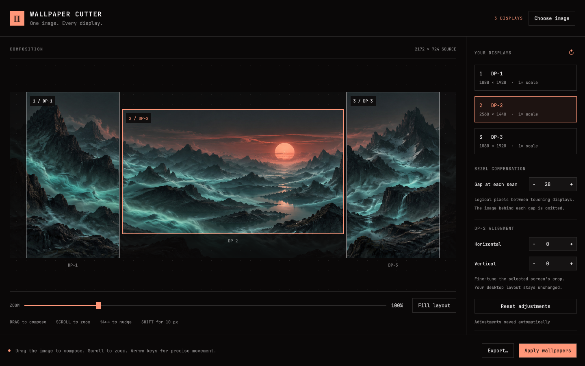

# Wallpaper Cutter: one image across all your monitors

> Source: https://www.reddit.com/r/omarchy/comments/1wydtmj/wallpaper_cutter_one_image_across_all_your/
> Author: u/lomboagridoce
> Posted: 2026-10-05T16:57:16+00:00
> Captured: 2026-10-15T08:55:18+00:00
> Score: 104 · Comments: 15
> Community: r/omarchy

## Post

I made Wallpaper Cutter, a native Omarchy plugin for stretching one wallpaper across multiple monitors.

It has live crop previews, bezel compensation, per-monitor adjustments, and saved layouts you can export and import. Open it from Installed Apps—no extra bar widget or tray icon.

Install on Omarchy Quattro:

    omarchy plugin add https://github.com/renanmt/omarchy-wallpaper-cutter --enable
    

Code: [https://github.com/renanmt/omarchy-wallpaper-cutter](https://github.com/renanmt/omarchy-wallpaper-cutter)

Would love feedback from anyone with a multi-monitor setup!  

## Media

> Original media URL: https://i.redd.it/fo7pub8jioth1.png

> Original media URL: https://preview.redd.it/fo7pub8jioth1.png?auto=webp&s=f8ee6850fdc10004432525f7ce819679c3570062

## Thread

> u/lomboagridoce · 2026-10-05T21:00:21+00:00 · score 2 · [comment](https://www.reddit.com/r/omarchy/comments/1wydtmj/wallpaper_cutter_one_image_across_all_your/pe3dko0/)

You can search for good WQHD wallpapers and if it's still not big enough you can use Omascayl.

[https://www.reddit.com/r/omarchy/comments/1ww5073/omascayl\_upscayl\_ai\_image\_upscaler\_in\_native/](https://www.reddit.com/r/omarchy/comments/1ww5073/omascayl_upscayl_ai_image_upscaler_in_native/)

the work our friend [u/nobledoodle](https://www.reddit.com/user/nobledoodle/) did is amazing!

> u/lomboagridoce · 2026-10-06T04:30:47+00:00 · score 1 · [comment](https://www.reddit.com/r/omarchy/comments/1wydtmj/wallpaper_cutter_one_image_across_all_your/pe5pvxj/)

Enjoy!

> u/lomboagridoce · 2026-10-05T20:56:42+00:00 · score 1 · [comment](https://www.reddit.com/r/omarchy/comments/1wydtmj/wallpaper_cutter_one_image_across_all_your/pe3cqfu/)

Hey thanks! The effort of making it part of Omarchy is actually cool, specially if we allow themes to have per monitor wallpaper. At the same time, a theme made by one is most of times very unique due to monitor arrangement, resolution, etc.

> u/lomboagridoce · 2026-10-05T21:00:32+00:00 · score 1 · [comment](https://www.reddit.com/r/omarchy/comments/1wydtmj/wallpaper_cutter_one_image_across_all_your/pe3dm5r/)

Thank you!

> u/lomboagridoce · 2026-10-06T18:19:58+00:00 · score 2 · [comment](https://www.reddit.com/r/omarchy/comments/1wydtmj/wallpaper_cutter_one_image_across_all_your/pe9rbuk/)

This was a great idea! Thank you! I'm pushing this update to the plugin marketplace.

## Comments

> u/GuruX1337 · 2026-10-05T20:29:37+00:00 · score 7 · [comment](https://www.reddit.com/r/omarchy/comments/1wydtmj/wallpaper_cutter_one_image_across_all_your/pe36d6v/)

This looks really nice. My main issue is however finding a wallpaper that can stretch 3 x 4k screens. 

> u/nobledoodle · 2026-10-06T00:04:34+00:00 · score 1 · [comment](https://www.reddit.com/r/omarchy/comments/1wydtmj/wallpaper_cutter_one_image_across_all_your/pe4epln/)

Thanks for the shoutout! Also, shameless plug(in) - if you need more consistent colors across all your apps feel free to check out Omarchroma! 

https://www.reddit.com/r/omarchy/s/P5aw9PBMAG

> u/NoPulitzerPrize · 2026-10-06T03:42:20+00:00 · score 3 · [comment](https://www.reddit.com/r/omarchy/comments/1wydtmj/wallpaper_cutter_one_image_across_all_your/pe5ilg0/)

This has driven me insane for years. I don't know how I never thought of this. Thank you, thank you, thank you! 

> u/kevinrav · 2026-10-05T19:16:45+00:00 · score 2 · [comment](https://www.reddit.com/r/omarchy/comments/1wydtmj/wallpaper_cutter_one_image_across_all_your/pe2oz2p/)

Very nice! I was working on a portrait/landscape combi of wallpapers: [https://github.com/omacom/omarchy/pull/11534](https://github.com/omacom/omarchy/pull/11534)  
But this might be a better solution for most people!

> u/McBonderson · 2026-10-05T20:18:55+00:00 · score 2 · [comment](https://www.reddit.com/r/omarchy/comments/1wydtmj/wallpaper_cutter_one_image_across_all_your/pe33t4r/)

very cool. 

> u/jccgrid · 2026-10-06T17:43:41+00:00 · score 2 · [comment](https://www.reddit.com/r/omarchy/comments/1wydtmj/wallpaper_cutter_one_image_across_all_your/pe9icdc/)

cool app. thanks. made a couple changes on it. made it open with the applied wp by default, cut or not, and apply the cut wp to the lock screen too. 

> u/jccgrid · 2026-10-06T21:18:50+00:00 · score 2 · [comment](https://www.reddit.com/r/omarchy/comments/1wydtmj/wallpaper_cutter_one_image_across_all_your/peay7o5/)

Nice!

> u/librasteve · 2026-10-11T19:44:47+00:00 · score 2 · [comment](https://www.reddit.com/r/omarchy/comments/1wydtmj/wallpaper_cutter_one_image_across_all_your/pfb3le5/)

this is such an awesome idea - thanks!

> u/Wunderlust1980 · 2026-10-06T10:39:40+00:00 · score 1 · [comment](https://www.reddit.com/r/omarchy/comments/1wydtmj/wallpaper_cutter_one_image_across_all_your/pe7042v/)

i took the opposite approach and went single high res monitor.   Was tired of the cables/complexity.  Much happier.  I know I know....

## Links

- https://github.com/renanmt/omarchy-wallpaper-cutter
