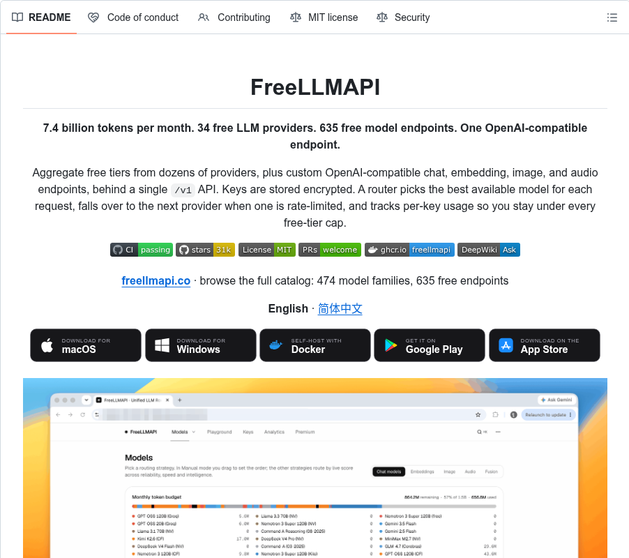

# FreeLLMAPI: 34 free LLM providers. 635 free model endpoints. One OpenAI-compatible endpoint. (31k stars)

> Source: https://www.reddit.com/r/BestGitHubRepos/comments/1x03yw4/freellmapi_34_free_llm_providers_635_free_model/
> Author: u/company_url_finder
> Posted: 2026-10-07T18:16:39+00:00
> Captured: 2026-10-15T08:55:18+00:00
> Score: 582 · Comments: 19
> Community: r/BestGitHubRepos

## Post

# What it does

*All text below is quoted directly from the project README.*

>**7.4 billion tokens per month. 34 free LLM providers. 635 free model endpoints. One OpenAI-compatible endpoint.**

Aggregate free tiers from dozens of providers, plus custom OpenAI-compatible chat, embedding, image, and audio endpoints, behind a single `/v1` API. Keys are stored encrypted. A router picks the best available model for each request, falls over to the next provider when one is rate-limited, and tracks per-key usage so you stay under every free-tier cap.

**Why this exists**

The problem is that stacking them by hand is painful: thirty-four different SDKs, thirty-four different rate limits, thirty-four places a request can fail. FreeLLMAPI collapses that into one OpenAI-compatible endpoint. Point any OpenAI client library at your local server, and it routes transparently across whichever providers you've added keys for.

**Features**

* **Anthropic Messages API** — `/v1/messages` speaks Anthropic's wire format over the same router, so **Claude Code** and the official Anthropic SDKs run against your free pool.
* **Fusion (multi-model synthesis)** — request the virtual `fusion` model and the router fans your prompt out to a panel of diverse free models in parallel, then a judge model synthesizes one answer from the drafts.
* **Smart routing, six strategies** — live per-model speed/capability/reliability scores rank your chain; automatic fallover retries the next model on 429/5xx with cooldowns and key rotation.
* **Per-key rate tracking** — RPM/RPD/TPM/TPD counters per `(platform, model, key)` that learn providers' reported ceilings, so routing always stays under every cap.
* **Sticky sessions & context handoff** — conversations stay on one model for 30 minutes; an optional compact handoff note keeps the thread coherent when a mid-chat switch does happen.
* **Encrypted keys, one token out** — provider keys are AES-256-GCM encrypted in SQLite and decrypted in-memory per request; your apps only ever see a single unified `freellmapi-…` bearer token.
* **Runs anywhere Node 20+ runs** — Windows, macOS, Linux servers, or a small ARM SBC (Raspberry Pi included). \~40 MB RSS at idle behind PM2 / systemd / whatever supervisor you prefer.

>Open http://localhost:3001, add your provider keys on the **Keys** page, reorder the **Fallback Chain** to taste, and grab your unified API key from the **Keys** page header. That unified key is what you point your OpenAI SDK at.

*(GitHub repo description: "Personal experimentation only.")*

# Repository

[https://github.com/tashfeenahmed/freellmapi](https://github.com/tashfeenahmed/freellmapi)

# Repository stats

|Metric|Value|
|:-|:-|
|Stars|31,399|
|Forks|4,395|
|Last release|v0.13.6 (2026-10-07)|
|Languages|TypeScript 98.8%, JavaScript 0.7%, HTML 0.2%|
|Contributors|83|
|AI contributor accounts (Claude / Codex / Cursor / Copilot)|Claude: 259, Cursor: 1|
|AI co-authored commits|Claude: 261, Cursor: 1|

# Main contributor

|Field|Value|
|:-|:-|
|Name|Tashfeen|
|GitHub|[@tashfeenahmed](https://github.com/tashfeenahmed)|
|Commits to this repo|535 (top contributor)|
|Bio|Making useful things with Design + AI ⚡️|
|Company / Location|Microsoft / Dublin|
|Website|[https://tashfeen.me](https://tashfeen.me)|
|X / Twitter|@tashfene|
|Followers|1,042|
|Public repos|39|
|On GitHub since|2014-10-19|

# --------------------------------------------------------

**Discover the best GitHub repos without the endless scrolling.**

Get top repos organized by category (AI, DevOps, Databases & more), plus key takeaways from developers' most useful comments - all in one free, twice-weekly newsletter.

👉 [Get the best repos & community insights - Free](https://best-github-repos.beehiiv.com/subscribe)

## Media

> Original media URL: https://i.redd.it/u3ygt4dy63uh1.png

> Original media URL: https://preview.redd.it/u3ygt4dy63uh1.png?auto=webp&s=2b29bcc73e8b0634a0b2df7e9e107921783b9ed2

## Comments

> u/LoneWolf_2106 · 2026-10-07T18:30:55+00:00 · score 4 · [comment](https://www.reddit.com/r/BestGitHubRepos/comments/1x03yw4/freellmapi_34_free_llm_providers_635_free_model/pehe6b5/)

Thank you so much 

> u/Acourgintier1413 · 2026-10-07T19:32:41+00:00 · score 3 · [comment](https://www.reddit.com/r/BestGitHubRepos/comments/1x03yw4/freellmapi_34_free_llm_providers_635_free_model/pehszpx/)

Nice

> u/Mason6211 · 2026-10-07T19:50:04+00:00 · score 1 · [comment](https://www.reddit.com/r/BestGitHubRepos/comments/1x03yw4/freellmapi_34_free_llm_providers_635_free_model/pehwu4l/)

Is this like a provider such as Literouter? sorry its that I'm new to this kind of stuff

> u/PermanentHuSir · 2026-10-08T03:24:58+00:00 · score 2 · [comment](https://www.reddit.com/r/BestGitHubRepos/comments/1x03yw4/freellmapi_34_free_llm_providers_635_free_model/pekfj87/)

Nah. You install this and it runs in the background. Then you go to each of the providers, make an account, login, create an API key, come back to here and paste the API key, repeat the process for all the providers you want. Then you go into your harness and configure them to use this as your provider. Then it helps automatically route your request from your harness (OpenClaw, Hermes, Pi etc etc) among the API keys you pasted.

> u/INKARZ_YT · 2026-10-07T22:21:08+00:00 · score 1 · [comment](https://www.reddit.com/r/BestGitHubRepos/comments/1x03yw4/freellmapi_34_free_llm_providers_635_free_model/peiuhuq/)

Better than OmniRoute? 

> u/PermanentHuSir · 2026-10-08T03:20:51+00:00 · score 2 · [comment](https://www.reddit.com/r/BestGitHubRepos/comments/1x03yw4/freellmapi_34_free_llm_providers_635_free_model/pekeukt/)

OmniRoute has more stars. I'm using this one since a month because I learnt about this before OmniRoute.

> u/INKARZ_YT · 2026-10-08T07:41:02+00:00 · score 1 · [comment](https://www.reddit.com/r/BestGitHubRepos/comments/1x03yw4/freellmapi_34_free_llm_providers_635_free_model/pelexiz/)

Stars just for better look 🙅

> u/aarz03 · 2026-10-09T06:44:36+00:00 · score 1 · [comment](https://www.reddit.com/r/BestGitHubRepos/comments/1x03yw4/freellmapi_34_free_llm_providers_635_free_model/pesrf93/)

can you compare? give you have been using it for a long time u might notice the differences better 

> u/PermanentHuSir · 2026-10-09T06:51:06+00:00 · score 1 · [comment](https://www.reddit.com/r/BestGitHubRepos/comments/1x03yw4/freellmapi_34_free_llm_providers_635_free_model/pess8wi/)

Oh I wouldn't wanna do that. For the sole reason that I have only used FreeLLMAPI. One thing I want to point out is that I really don't think about it. I have added maybe 7 providers and I have not run out of tokens yet. A few failures happen when you run out of limits with one provider and the router shifts you to another. Then there's a real struggle to continue what you were doing. But that might be my harness (OhMyPi) messing up rather than the model or the router. But yeah. To sum up the experience: I installed it and did the API key thing once and haven't bothered with it ever since. I click a button and the inference starts in the background. Then I open my harness and focus on what needs to be done. The quality of work is sometimes a bit lacking. But then, you're only using free models with free limits. So, yeah. You get what you pay for.

> u/aarz03 · 2026-10-09T06:53:14+00:00 · score 1 · [comment](https://www.reddit.com/r/BestGitHubRepos/comments/1x03yw4/freellmapi_34_free_llm_providers_635_free_model/pessifc/)

that makes sense. ill give it a try, thanks for sharing your experience :)

> u/PermanentHuSir · 2026-10-10T08:28:16+00:00 · score 1 · [comment](https://www.reddit.com/r/BestGitHubRepos/comments/1x03yw4/freellmapi_34_free_llm_providers_635_free_model/pf0e1wd/)

I tried OmniRoute. Or rather still trying to set it up. I thought the hard part would be getting the API keys from all those providers I want. It seems to me, setting up OmniRoute is a bit of a pain. You have to start it in the terminal and kill it from there. Installation is through the npm command line. The dashboard UI is a bit more chaotic and confusing that FreeLLMAPI's desktop app. I think ease of just clicking on something and have it running in the background with a menu icon was a great plus in FreeLLMAPI. I will keep trying and get OmniRoute to run. I am very comfortable with the terminal but this is just a tool in my workflow. I shouldn't be spending time on this.

> u/Afraid-Score3601 · 2026-10-10T17:09:31+00:00 · score 1 · [comment](https://www.reddit.com/r/BestGitHubRepos/comments/1x03yw4/freellmapi_34_free_llm_providers_635_free_model/pf2wji7/)

Isn't this just like 9router?

> u/RevolutionaryCard208 · 2026-10-11T03:00:08+00:00 · score 1 · [comment](https://www.reddit.com/r/BestGitHubRepos/comments/1x03yw4/freellmapi_34_free_llm_providers_635_free_model/pf66et0/)

I used different model providers, but this open source thing is new to me, like this, omniroute etc, can anyone explain me is this same like model providers api etc and is free model provided are good like ther limit is generous in billion but is the model are good like even it is Chinese are they latest one ,
Sorry for bad English 
Thanks in advance 

> u/Haunting-Meaning-103 · 2026-10-11T18:03:27+00:00 · score 1 · [comment](https://www.reddit.com/r/BestGitHubRepos/comments/1x03yw4/freellmapi_34_free_llm_providers_635_free_model/pfaefma/)

Ah man I just finished making one of this for myself. well done thanks.

> u/Ti_Sbunno · 2026-10-12T15:14:08+00:00 · score 1 · [comment](https://www.reddit.com/r/BestGitHubRepos/comments/1x03yw4/freellmapi_34_free_llm_providers_635_free_model/pfgmp56/)

How can i add it to Hermes Agent?

> u/suede247 · 2026-10-12T09:20:51+00:00 · score 0 · [comment](https://www.reddit.com/r/BestGitHubRepos/comments/1x03yw4/freellmapi_34_free_llm_providers_635_free_model/pfewd71/)

Sorry if this seems like a stupid question but I’m somewhat new to this. So I downloaded this to my laptop lastnight and I’m realizing it needs the API keys in order to work properly. My thing is I wasn’t expecting to have to create so many accounts to get the keys. I currently have my google AI studio key connected and that’s it. I want to have as many as I can but I wanted to ask if I have to connect all of the keys to really take advantage of the 7billion tokens?

Also, will I have to make a new account with all of these platforms in order to use this tool properly?

## Links

- http://localhost:3001
- https://github.com/tashfeenahmed/freellmapi
- https://github.com/tashfeenahmed
- https://tashfeen.me
- https://best-github-repos.beehiiv.com/subscribe
