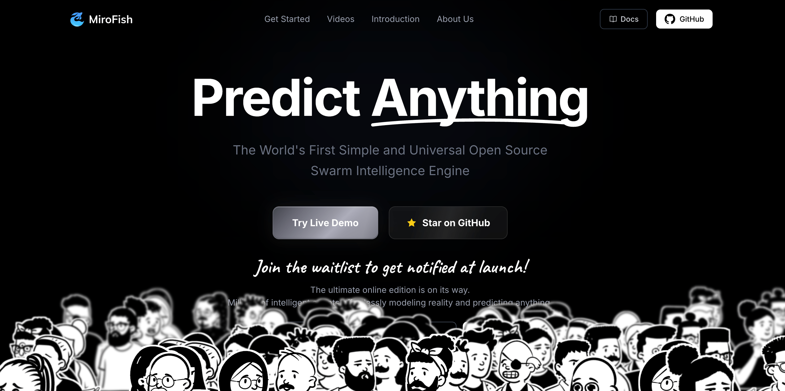

# What if you could test an idea on thousands of AI agents before trying it in the real world?

> Source: https://www.reddit.com/r/SATNA_PROJECT/comments/1x1imcb/what_if_you_could_test_an_idea_on_thousands_of_ai/
> Author: u/ZookeepergameMost817
> Posted: 2026-10-09T11:13:33+00:00
> Captured: 2026-10-15T08:55:18+00:00
> Score: 72 · Comments: 3
> Community: r/SATNA_PROJECT

## Post

Most AI tools give you one answer.

MiroFish takes a different approach: it builds a simulated world where thousands of AI agents—with their own personalities, memory, and behavior—interact to explore possible outcomes.

The workflow is surprisingly simple:

→ Upload source material, such as a report, news story, or policy draft.  
→ Describe what you want to explore in plain language.  
→ Let the agents interact in the simulated environment.  
→ Get a detailed report and an interactive world you can investigate.  
  
Think questions like:

>“How might different groups react to this policy change?”

Instead of asking one chatbot to imagine every perspective, the idea is to simulate interactions between many different agents. You can also introduce new variables to explore how the scenario changes.

The important distinction: a convincing simulation isn’t proof of what will happen. Treat the output as a scenario to investigate, not a crystal ball.

That’s the interesting part—not “AI predicts everything,” but “AI gives you a sandbox to explore what might happen.”

Repo: [https://github.com/666ghj/MiroFish](https://github.com/666ghj/MiroFish)

[Join Discord ](https://discord.gg/hSA8Ur6GRH)

## Media

> Original media URL: https://i.redd.it/xeol6s35dfuh1.png

> Original media URL: https://preview.redd.it/xeol6s35dfuh1.png?auto=webp&s=b95831a5b591aff2609a16f6dfb4d65fd5af87cc

## Comments

> u/topgoysilky · 2026-10-10T02:19:01+00:00 · score 1 · [comment](https://www.reddit.com/r/SATNA_PROJECT/comments/1x1imcb/what_if_you_could_test_an_idea_on_thousands_of_ai/pez04ct/)

anything?

> u/benfinklea · 2026-10-11T01:34:40+00:00 · score 1 · [comment](https://www.reddit.com/r/SATNA_PROJECT/comments/1x1imcb/what_if_you_could_test_an_idea_on_thousands_of_ai/pf5rw4v/)

Oh my

> u/Evening_Detective363 · 2026-10-15T08:42:06+00:00 · score 1 · [comment](https://www.reddit.com/r/SATNA_PROJECT/comments/1x1imcb/what_if_you_could_test_an_idea_on_thousands_of_ai/pgv0hav/)

Help me here. Is this "SaaS that could have been a claude skill?" or how is this advanced?

## Links

- https://github.com/666ghj/MiroFish
- https://discord.gg/hSA8Ur6GRH
