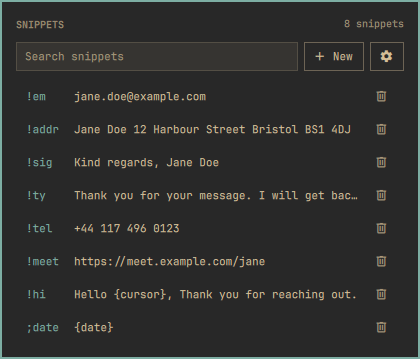
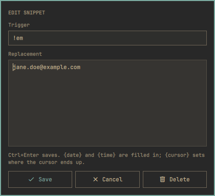
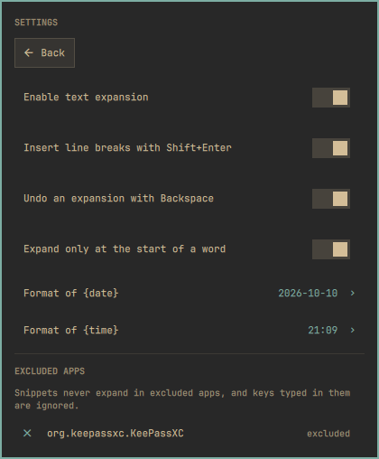

# I made a plugin that expands text snippets as you type, in any app

> Source: https://www.reddit.com/r/omarchy/comments/1x3g6f8/i_made_a_plugin_that_expands_text_snippets_as_you/
> Author: u/Disastrous-Lobster-4
> Posted: 2026-10-11T18:51:11+00:00
> Captured: 2026-10-15T08:55:18+00:00
> Score: 5 · Comments: 7
> Community: r/omarchy

## Post

Tired of typing your email address for the hundredth time? Type \`!em\` and it's replaced with the full address, in any app, wherever the cursor is.

Instant Snippets is an Omarchy plugin for text expansion. You save a short trigger and the text it stands for, and the trigger is replaced as soon as you type it. You manage snippets from a panel in the bar.

**What it does**

* Works in any app, with replacements of up to 1000 characters on as many lines as you need
* `{date}` and `{time}` are filled in when the snippet is inserted, and `{cursor}` marks where the cursor is left
* No daemon and no extra package. Hyprland passes key presses to a small Lua script the plugin loads into Hyprland itself, and no other program reads your keyboard

**What you can change in the settings**

* Undo: Backspace right after an expansion removes the text and puts the trigger back. On by default
* Word-start only: triggers expand only at the start of a word, not in the middle of one. On by default
* Line breaks: multi-line snippets use Shift+Enter, so chat apps don't send them line by line. On by default, turn it off for shell commands
* Excluded apps: pick apps where snippets never expand, such as your password manager. Keys typed there are ignored completely
* Date and time format used by `{date}` and `{time}`

**Install** (requires Omarchy 4)

    omarchy plugin add https://github.com/MaNi4/omarchy-instant-snippets.git --enable

**Limitations**

* A trigger that is a normal word gets in the way. If you save \`adr\` for your address, it also expands when you start typing "adrenaline". Start triggers with \`!\` or \`;\`, like \`!adr\`
* A trigger can only use characters your layout types with one key press. Dead keys and Compose don't work in triggers
* Snippets are stored as plain text, so don't put passwords in them

Repo: [https://github.com/MaNi4/omarchy-instant-snippets](https://github.com/MaNi4/omarchy-instant-snippets)

Plugin page: [https://plugins.omarchy.org/plugin.html?id=mani4.instant-snippets](https://plugins.omarchy.org/plugin.html?id=mani4.instant-snippets)

Since the plugin sees your key presses, the README has a section on exactly what it keeps and for how long.

It's v1.0.0 and MIT licensed. I'd like to hear which layouts and apps work for you and which don't.

## Media

> Original media URL: https://preview.redd.it/9lg1hbh9vvuh1.png?width=420&format=png&auto=webp&s=05285d8f826a563d5cdc30d8d4adc000a8f0b545

> Original media URL: https://preview.redd.it/vqjqrzv9vvuh1.png?width=420&format=png&auto=webp&s=f07be890ee7cd0b952305bc8edc276918c60e5bc

> Original media URL: https://preview.redd.it/f9i5we4avvuh1.png?width=420&format=png&auto=webp&s=e05fc7739dcc5908a7538996defc8ac9f133a0e1

## Thread

> u/Disastrous-Lobster-4 · 2026-10-11T19:50:45+00:00 · score 0 · [comment](https://www.reddit.com/r/omarchy/comments/1x3g6f8/i_made_a_plugin_that_expands_text_snippets_as_you/pfb536y/)

It's not meant to replace espanso, and I haven't used espanso myself. Espanso has far more features: regex triggers, forms, script output, packages. If you use those, stick with it.

This is a lightweight snippet tool for people who just want `!em` to turn into their email address. It's one `omarchy plugin add`, with no extra software to install and no separate background process. You add snippets and exclude apps from a panel in the bar.

Many people only need simple snippets, and for them this may be the easier option.

> u/Disastrous-Lobster-4 · 2026-10-12T07:28:13+00:00 · score 1 · [comment](https://www.reddit.com/r/omarchy/comments/1x3g6f8/i_made_a_plugin_that_expands_text_snippets_as_you/pfeiz4x/)

Yes, by window class. You don't have to type apps yourself. The settings show two kinds of entries: the apps you've already excluded, which are saved in the config file, and the apps that are running when you open the settings. Click a running one and it's excluded and saved right away; click an excluded one to remove it. The app that had focus when you opened the panel is offered first.

Good catch on the About box, I'll fix that.

## Comments

> u/desfibrilator · 2026-10-14T09:50:19+00:00 · score 2 · [comment](https://www.reddit.com/r/omarchy/comments/1x3g6f8/i_made_a_plugin_that_expands_text_snippets_as_you/pgnphaf/)

I really like this, I have previosly used Espanso and SnipExpander, mainly to type accent characters in a US keyboard ('a for á, 'n for ñ, etc.) and this is the fastest, the other two almost always mistype the next character after the expansion when I type fast, and it also has a nice UI. Good job!

> u/Balthazzah · 2026-10-11T18:55:58+00:00 · score 1 · [comment](https://www.reddit.com/r/omarchy/comments/1x3g6f8/i_made_a_plugin_that_expands_text_snippets_as_you/pfari56/)

How is there any better than espanso?

> u/Balthazzah · 2026-10-11T20:14:06+00:00 · score 2 · [comment](https://www.reddit.com/r/omarchy/comments/1x3g6f8/i_made_a_plugin_that_expands_text_snippets_as_you/pfbapx9/)

The fact you haven’t used espanso is obvious. It is crazy lightweight. 

Also. Don’t let your chatbot reply for you. 

> u/librasteve · 2026-10-11T19:24:55+00:00 · score 1 · [comment](https://www.reddit.com/r/omarchy/comments/1x3g6f8/i_made_a_plugin_that_expands_text_snippets_as_you/pfaynq2/)

looks cool - I will give it a try

> u/investigatormaker · 2026-10-12T02:50:01+00:00 · score 1 · [comment](https://www.reddit.com/r/omarchy/comments/1x3g6f8/i_made_a_plugin_that_expands_text_snippets_as_you/pfdfzu0/)

u/Balthazzah's espanso question is answered in your own post: no daemon, no extra package, and the Lua script runs inside Hyprland so no other program reads your keyboard. That belongs in the README's opening lines, since it's the comparison most people will make. When I opened the repo, the About box says "No description, website, or topics provided.", so link previews fall back to GitHub's generic line; the README's first sentence plus topics like omarchy and hyprland would fix that.

I make ThreadFox. I went through Instant Snippets as a first-time visitor and wrote up what I found; the full check is free and comes in the plan for Reddit: https://threadfox.vip/p/omarchy-instant-snippets-git

Does the excluded-apps setting match by window class?

## Links

- https://github.com/MaNi4/omarchy-instant-snippets.git
- https://github.com/MaNi4/omarchy-instant-snippets
- https://plugins.omarchy.org/plugin.html?id=mani4.instant-snippets
- https://www.reddit.com/gallery/1x3g6f8
