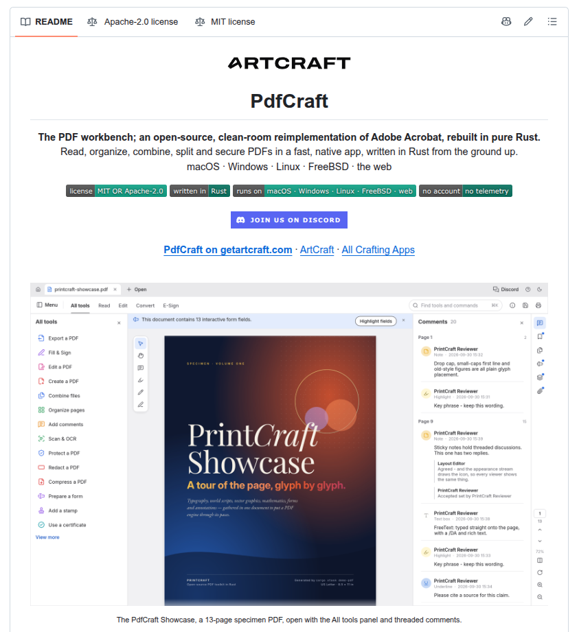

# PdfCraft: The PDF workbench; an open-source, clean-room reimplementation of Adobe Acrobat, rebuilt in pure Rust (10.1k stars)

> Source: https://www.reddit.com/r/BestGitHubRepos/comments/1x48dxc/pdfcraft_the_pdf_workbench_an_opensource/
> Author: u/company_url_finder
> Posted: 2026-10-12T17:37:55+00:00
> Captured: 2026-10-15T08:55:18+00:00
> Score: 2522 · Comments: 221
> Community: r/BestGitHubRepos

## Post

# What it does

*All text below is quoted directly from the project README.*

>The PDF workbench; an open-source, clean-room reimplementation of Adobe Acrobat, rebuilt in pure Rust. Read, organize, combine, split and secure PDFs in a fast, native app, written in Rust from the ground up.

**Highlights:**

* **Faithful:** Real-world typography: world scripts, vertical Japanese, colour emoji, gradients, soft masks and transparency. All of it renders the way the author intended.
* **Fearless:** Every save appends your changes and leaves the original bytes untouched. Writes are atomic, undo runs deep, and nothing is lost if you close by mistake.
* **Yours:** No account, no telemetry, no cloud. It works offline and opens instantly. The engine, CLI and app are all open source.

**Read anything, beautifully:**

* **Deep zoom stays sharp.** Large pages render in tiles, so text stays crisp at any magnification.
* **Built to survive bad files.** Every page renders in isolation and damaged documents are repaired. Across the 983-file pdf.js test corpus the result is 0 crashes.
* **Layouts for every task:** continuous, single page, two-up, view rotation, full screen and a distraction-free Read mode.
* **Light and dark themes**, both designed to be easy on the eyes for long sessions.

**Runs everywhere, stays yours:**

* **Native on macOS, Windows, Linux and FreeBSD**, and **in the browser** through WebAssembly, from the same Rust codebase.
* **Private by design.** Documents never leave your machine. There's no account, no telemetry and no cloud processing.
* **Engine first.** Parsing, rendering and editing live in reusable library crates. The interface is one swappable layer on top.

# Repository

[https://github.com/storytold/pdfcraft](https://github.com/storytold/pdfcraft)

# Repository stats

|Metric|Value|
|:-|:-|
|Stars|10,097|
|Forks|3,832|
|Last release|v0.6.0 (2026-10-11)|
|Languages|Rust 98.6%|
|Contributors|155|
|AI contributor accounts (Claude / Codex / Cursor / Copilot)|claude (563 commits), codex (64), Copilot (1)|
|AI co-authored commits|Claude: 563, Codex: 48, Copilot: 2, Cursor: 1|

# Main contributor

|Field|Value|
|:-|:-|
|Name|Brandon Thomas|
|GitHub|[@echelon](https://github.com/echelon)|
|Commits to this repo|599 (top contributor)|
|Bio|Founder: ArtCraft, Storyteller.ai, FakeYou. Engineer, filmmaker. Rust.|
|Company / Location|ArtCraft / Atlanta, Georgia, US|
|Website|[http://brand.io](http://brand.io)|
|X / Twitter|@echelon|
|Followers|1,701|
|Public repos|94|
|On GitHub since|2008-12-09|

\-------------------------------------------------------------------------------------------

**Discover the best GitHub repos without the endless scrolling.**

Get top repos organized by category (AI, DevOps, Databases & more), plus key takeaways from developers' most useful comments - all in one free, twice-weekly newsletter.

👉 [Get the best repos & community insights - Free](https://best-github-repos.beehiiv.com/subscribe)

## Media

> Original media URL: https://i.redd.it/f6lvoielo2vh1.png

> Original media URL: https://preview.redd.it/f6lvoielo2vh1.png?auto=webp&s=9cf4e88a89d6c3127b83e07e622ce2762a45b26c

## Comments

> u/McBonderson · 2026-10-12T18:29:09+00:00 · score 161 · [comment](https://www.reddit.com/r/BestGitHubRepos/comments/1x48dxc/pdfcraft_the_pdf_workbench_an_opensource/pfhyjgx/)

I've heard people talk about how the new vibe coded rewrites of adobe software are all buggy and what not. 

let me tell you, it is IMPOSSIBLE to be more buggy or slower than adobe acrobat. 

I've already made my own rewrite of the features I need for work with AI so I don't need this project. however I can tell you already it is better than adobe acrobat. 

it could kick you in the balls everytime you safe a pdf and it would still be better than adobe acrobat. 

> u/jax_cooper · 2026-10-12T18:41:41+00:00 · score 17 · [comment](https://www.reddit.com/r/BestGitHubRepos/comments/1x48dxc/pdfcraft_the_pdf_workbench_an_opensource/pfi1mec/)

it's really fast but also really unstable, crashes and stuff. I will wait until v1.0 until I use these but then I will

> u/Prior_Ad_4379 · 2026-10-12T19:37:43+00:00 · score 4 · [comment](https://www.reddit.com/r/BestGitHubRepos/comments/1x48dxc/pdfcraft_the_pdf_workbench_an_opensource/pfif7aq/)

That’s interesting, I thought rust can’t crash, because of it’s memory safety? You can have logic bugs, but no crashes. So the ai is using unsafe in its implementation?

> u/Emetros · 2026-10-12T19:53:35+00:00 · score 8 · [comment](https://www.reddit.com/r/BestGitHubRepos/comments/1x48dxc/pdfcraft_the_pdf_workbench_an_opensource/pfiiy2f/)

Rust is not perfectly memory safe at all. You can still have race conditions, memory leaks, double mutable borrow  error (trying to access and edit a data already used/edited somewhere else) which can cause panic at runtime… even without unsafe exceptions. It is way safer, but if it was able to prevent every type of crash then I think nobody would use most of the other existing languages.

> u/Nextil · 2026-10-13T06:31:41+00:00 · score 3 · [comment](https://www.reddit.com/r/BestGitHubRepos/comments/1x48dxc/pdfcraft_the_pdf_workbench_an_opensource/pgfjo61/)

Rust is memory safe. Those are concurrency issues, not memory safety issues. It *does* prevent simultaneous mutable borrows. You simply cannot do it (without `unsafe`) due to Sync/Send. There are numerous primitives you need to use to share data between threads (channels, mutexes, atomics, etc.). None of them just straight up crash in the case of memory contention. The methods that do crash, do so to *prevent* memory unsafety.

Crashing is usually just the result of the code calling `unwrap` instead of gracefully handling an error pathway. But as the other comment points out, Rust doesn't inherently prevent cycles like deadlocks/livelocks, or just infinitely adding to a data structure without cleaning it up. You have to make sure to use weak references or channels. None of that has anything to do with memory safety though.

> u/jax_cooper · 2026-10-12T19:47:44+00:00 · score 3 · [comment](https://www.reddit.com/r/BestGitHubRepos/comments/1x48dxc/pdfcraft_the_pdf_workbench_an_opensource/pfihk7h/)

a simple example for this is infinite loop

or just a live/dead lock

that's a freeze that registers as a crash in my brain. It happens really often with these vibe coded apps (not in general, but the adobe and office365 vibe coded apps) But yeah, it cannot have a segfault but it can still crash in MANY ways. There's still error handling in rust that you have to do, otherwise...

> u/penisslayer24 · 2026-10-13T15:24:08+00:00 · score 2 · [comment](https://www.reddit.com/r/BestGitHubRepos/comments/1x48dxc/pdfcraft_the_pdf_workbench_an_opensource/pghxrjn/)

I wouldn't really wait for a v1.0, the dev seems to be recreating one software and then going on to the next 

> u/StatementDramatic354 · 2026-10-13T07:25:35+00:00 · score 2 · [comment](https://www.reddit.com/r/BestGitHubRepos/comments/1x48dxc/pdfcraft_the_pdf_workbench_an_opensource/pgfqe1z/)

Do you know why it's fast? Because it doesn't have Features and Crashes constantly. If it had the same features and wouldn't crash you can for sure as hell bet that it's going to be super slow.
Look at the PRs and hygiene of the project. AI does not  particularly have to create slop, it's all about the creator... And this project is as sloppy as it is.
There are like 12 clones of this person from office to Photoshop, Premiere and no more. All of them are ultimately very bad with no clean plan, structure and vision. It's only get worse and more buggy from here on out.

> u/joefresco2 · 2026-10-12T22:37:28+00:00 · score 3 · [comment](https://www.reddit.com/r/BestGitHubRepos/comments/1x48dxc/pdfcraft_the_pdf_workbench_an_opensource/pgdalcn/)

Use it.  I regularly do super minor PDF editing so I've been looking for a free option.  I was happy to see this out there and gave it a try.

There goes 15 minutes of my life I can't have back.

Maybe 30 versions from now it will be useful, but it's nowhere near a replacement for Acrobat's most basic functions (insert/edit/remove text).  It's clear that the approach of development has been breadth with 0 depth.

> u/Dramatic-Yam8320 · 2026-10-13T00:31:42+00:00 · score 2 · [comment](https://www.reddit.com/r/BestGitHubRepos/comments/1x48dxc/pdfcraft_the_pdf_workbench_an_opensource/pgdwjte/)

I loled 

> u/PsychologicalUnit22 · 2026-10-13T11:18:58+00:00 · score 1 · [comment](https://www.reddit.com/r/BestGitHubRepos/comments/1x48dxc/pdfcraft_the_pdf_workbench_an_opensource/pggjy7x/)

what really? i was able to use it in my test runs...to edit some text, it maintained the font..however, to flatten the pdf so no more edits can be done, it didn't work using the redact funciton

> u/Zestyclose-Click-953 · 2026-10-14T12:20:18+00:00 · score 1 · [comment](https://www.reddit.com/r/BestGitHubRepos/comments/1x48dxc/pdfcraft_the_pdf_workbench_an_opensource/pgoc8kk/)

give it a year or less and then we'll see

> u/hdksnskxn · 2026-10-12T19:51:58+00:00 · score 2 · [comment](https://www.reddit.com/r/BestGitHubRepos/comments/1x48dxc/pdfcraft_the_pdf_workbench_an_opensource/pfiikcv/)

Today I needed to clean 250gb of orphaned update files created by Adobe Acrobat reader on Windows 11. Fucking joke

> u/MidnightHacker · 2026-10-12T20:56:03+00:00 · score 1 · [comment](https://www.reddit.com/r/BestGitHubRepos/comments/1x48dxc/pdfcraft_the_pdf_workbench_an_opensource/pfixjxg/)

I did the same for Lightroom. I’ve been working on a project like this for over a year now, with no intention of polishing it enough to be released someday. But file support on my app has been much better than this one, it crashes frequently trying to open more complex files

> u/Nice-Phone3931 · 2026-10-13T04:55:01+00:00 · score 1 · [comment](https://www.reddit.com/r/BestGitHubRepos/comments/1x48dxc/pdfcraft_the_pdf_workbench_an_opensource/pgf6w1l/)

can you share your own ? i am struggling to find one that works on linux, or can at least be used with proton.

> u/McBonderson · 2026-10-13T12:45:51+00:00 · score 1 · [comment](https://www.reddit.com/r/BestGitHubRepos/comments/1x48dxc/pdfcraft_the_pdf_workbench_an_opensource/pggz13h/)

I've embeded the features I need into my jobs custom CRM software so we no longer have to edit things in adobe and can just do it from our software. so it cant really be shared elsewhere. 

> u/ParticularCod6 · 2026-10-12T18:14:12+00:00 · score 63 · [comment](https://www.reddit.com/r/BestGitHubRepos/comments/1x48dxc/pdfcraft_the_pdf_workbench_an_opensource/pfhuv9g/)

how is the editing text pdf capability?

> u/HappyImagineer · 2026-10-12T18:33:06+00:00 · score 56 · [comment](https://www.reddit.com/r/BestGitHubRepos/comments/1x48dxc/pdfcraft_the_pdf_workbench_an_opensource/pfhzijp/)

So far I can’t complain but I’m not a heavy user (editing a couple PDFs a day max), I’m ditching Acrobat for sure. 

> u/ParticularCod6 · 2026-10-12T19:49:48+00:00 · score 16 · [comment](https://www.reddit.com/r/BestGitHubRepos/comments/1x48dxc/pdfcraft_the_pdf_workbench_an_opensource/pfii1rg/)

Just tried it and text editing is not that great. It did not recognise the text itself

> u/HappyImagineer · 2026-10-12T20:05:47+00:00 · score 5 · [comment](https://www.reddit.com/r/BestGitHubRepos/comments/1x48dxc/pdfcraft_the_pdf_workbench_an_opensource/pfiluhr/)

Are you on the latest version? The updates released in the past 48 hours have fixed a lot of issues. 

> u/ParticularCod6 · 2026-10-12T20:06:38+00:00 · score 3 · [comment](https://www.reddit.com/r/BestGitHubRepos/comments/1x48dxc/pdfcraft_the_pdf_workbench_an_opensource/pfim1te/)

Yes 0.7.1

> u/HappyImagineer · 2026-10-12T20:07:25+00:00 · score 9 · [comment](https://www.reddit.com/r/BestGitHubRepos/comments/1x48dxc/pdfcraft_the_pdf_workbench_an_opensource/pfim8f1/)

Odd I had this problem on 0.3 but it’s working well for me now on 0.7.1; maybe it’s an OS specific issue. 

> u/8-BitRedStone · 2026-10-12T20:02:36+00:00 · score 4 · [comment](https://www.reddit.com/r/BestGitHubRepos/comments/1x48dxc/pdfcraft_the_pdf_workbench_an_opensource/pfil3kp/)

It's alpha software, so some stuff works, other stuff doesn't. I tried editing some text on a lab PDF and for some reason like half the characters of the alphabet weren't rendering. However, these aren't structural issues (unlike the issues with Adobe) so I'm hopeful for the future of the software

> u/ParticularCod6 · 2026-10-12T20:04:05+00:00 · score 2 · [comment](https://www.reddit.com/r/BestGitHubRepos/comments/1x48dxc/pdfcraft_the_pdf_workbench_an_opensource/pfilg2z/)

Yep it took Adobe decades to "perfect" it, can't expect it to be done in days. No other editor comes close to Adobe for text editing unfortunately 

> u/VicemanPro · 2026-10-12T19:47:58+00:00 · score 2 · [comment](https://www.reddit.com/r/BestGitHubRepos/comments/1x48dxc/pdfcraft_the_pdf_workbench_an_opensource/pfihm5q/)

As of yesterday, it wasn't recognizing text on the contracts I deal with (tested on ~5 documents) that work in Acrobat. They are releasing updates constantly, so it may have a new update now.

> u/duboispourlhiver · 2026-10-13T07:49:38+00:00 · score 1 · [comment](https://www.reddit.com/r/BestGitHubRepos/comments/1x48dxc/pdfcraft_the_pdf_workbench_an_opensource/pgft820/)

Been able to modify invoice text here. Quite simple edit, added a ligne, flow was right.

> u/_LEVEL_SIX_ · 2026-10-12T18:08:44+00:00 · score 53 · [comment](https://www.reddit.com/r/BestGitHubRepos/comments/1x48dxc/pdfcraft_the_pdf_workbench_an_opensource/pfhtiki/)

i have tried it and acrobat side by side with a same file, PDFcraft was so fast, smooth opens instantly on a potato work pc and on the other side acrobat was dogshit, slowfuck, hangs the pc,  never opened that shit before this comparison.

> u/LoadZealousideal7778 · 2026-10-12T18:41:09+00:00 · score 11 · [comment](https://www.reddit.com/r/BestGitHubRepos/comments/1x48dxc/pdfcraft_the_pdf_workbench_an_opensource/pfi1hs2/)

Same. The fuck you mean Acrobat needs 20 seconds to search across 60 pages of PDF? 

> u/2zeroseven · 2026-10-12T20:33:52+00:00 · score 7 · [comment](https://www.reddit.com/r/BestGitHubRepos/comments/1x48dxc/pdfcraft_the_pdf_workbench_an_opensource/pfisgqe/)

It's so bad, Adobe must think no one should search 

> u/StatementDramatic354 · 2026-10-13T07:27:30+00:00 · score 5 · [comment](https://www.reddit.com/r/BestGitHubRepos/comments/1x48dxc/pdfcraft_the_pdf_workbench_an_opensource/pgfqmfg/)

Do you know why it's fast? Because it doesn't have Features and Crashes constantly.
If it had the same features and wouldn't crash you can for sure as hell bet that it's going to be super slow.

Look at the PRs and hygiene of the project. AI does not  particularly have to create slop, it's all about the creator... And this project is as sloppy as it is.

There are like 12 clones of this person from office to Photoshop, Premiere and no more.
All of them are ultimately very bad with no clean plan, structure and vision.
It's only get worse and more buggy from here on out.

> u/AdInteresting5874 · 2026-10-13T12:11:03+00:00 · score 2 · [comment](https://www.reddit.com/r/BestGitHubRepos/comments/1x48dxc/pdfcraft_the_pdf_workbench_an_opensource/pggsk3j/)

That's true. Was looking at the repo, everything is all over the place. Especially the markdown files, they look like they were generated by AI, using weird technobabble that have no explanation and probably no real world counterpart.

> u/M1chaelSc4rn · 2026-10-13T09:48:52+00:00 · score 1 · [comment](https://www.reddit.com/r/BestGitHubRepos/comments/1x48dxc/pdfcraft_the_pdf_workbench_an_opensource/pgg7dsy/)

We are entering a new world in this sense for sure!

> u/Nice-Phone3931 · 2026-10-12T19:15:30+00:00 · score 19 · [comment](https://www.reddit.com/r/BestGitHubRepos/comments/1x48dxc/pdfcraft_the_pdf_workbench_an_opensource/pfi9v7e/)

it's time boys, for me to shift to linux. all i need is adobe acrobat in linux.

> u/xerman-5 · 2026-10-12T18:32:32+00:00 · score 11 · [comment](https://www.reddit.com/r/BestGitHubRepos/comments/1x48dxc/pdfcraft_the_pdf_workbench_an_opensource/pfhzdfq/)

Opensource alternative, can't be bad. And it will get better over time if people contribute or fork it in case it's abandoned.

> u/DavethegraveHunter · 2026-10-12T19:04:27+00:00 · score 7 · [comment](https://www.reddit.com/r/BestGitHubRepos/comments/1x48dxc/pdfcraft_the_pdf_workbench_an_opensource/pfi77k8/)

If you want something along these lines, consider BentoPDF. It’s well-supported and has pretty much every feature I could think of. 

> u/paranoidzone · 2026-10-12T20:52:50+00:00 · score 5 · [comment](https://www.reddit.com/r/BestGitHubRepos/comments/1x48dxc/pdfcraft_the_pdf_workbench_an_opensource/pfiwtlh/)

Isn't Adobe Acrobat copyrighted? How is it possible that a blatant copy of it, that in fact states this very clearly in the repo description, allowed to stay live? I guess Adobe just doesn't care? Or do they not have the legal means to take it down?

To be clear, I hate Adobe and think they deserve to fail as a company. I'm just curious how the hell a repo that is essentially piracy is able to stay public and get so much attention without it being taken down immediately.

> u/lordvoltano · 2026-10-13T04:59:43+00:00 · score 2 · [comment](https://www.reddit.com/r/BestGitHubRepos/comments/1x48dxc/pdfcraft_the_pdf_workbench_an_opensource/pgf7kcy/)

You can ask chatgpt this

> u/duboispourlhiver · 2026-10-13T07:50:56+00:00 · score 1 · [comment](https://www.reddit.com/r/BestGitHubRepos/comments/1x48dxc/pdfcraft_the_pdf_workbench_an_opensource/pgftdn4/)

Are you trying to shut down Reddit?

> u/paranoidzone · 2026-10-13T10:46:01+00:00 · score 1 · [comment](https://www.reddit.com/r/BestGitHubRepos/comments/1x48dxc/pdfcraft_the_pdf_workbench_an_opensource/pggeyxz/)

Technically that's true for 80% of questions on reddit, but I like the human perspective and interaction. (Assuming people posting are not bots themselves.)

> u/TheNotSoEvilEngineer · 2026-10-13T21:53:39+00:00 · score 2 · [comment](https://www.reddit.com/r/BestGitHubRepos/comments/1x48dxc/pdfcraft_the_pdf_workbench_an_opensource/pgkk4mm/)

Basically it's a clean room design.  One agent looks at the product and code and builds a design document.  It then hands off the document to another agent who writes the code.  The 2nd agent never saw the source code, so it didn't copy anything specifically.

Now the problem comes in other issues like patents, as it doesn't need to be the same code but methods or how something appears.   Nintendo is notorious for this in gaming.  

> u/EthosLabFan92 · 2026-10-12T20:58:43+00:00 · score 1 · [comment](https://www.reddit.com/r/BestGitHubRepos/comments/1x48dxc/pdfcraft_the_pdf_workbench_an_opensource/pfiy5kb/)

It makes sense if you understand copyright law

> u/WhyPartyPizza · 2026-10-13T00:57:54+00:00 · score 3 · [comment](https://www.reddit.com/r/BestGitHubRepos/comments/1x48dxc/pdfcraft_the_pdf_workbench_an_opensource/pge1jya/)

It also makes sense if you understand bird law.

> u/Connect_Quit_1293 · 2026-10-13T21:56:38+00:00 · score 1 · [comment](https://www.reddit.com/r/BestGitHubRepos/comments/1x48dxc/pdfcraft_the_pdf_workbench_an_opensource/pgkkrd6/)

Im genuinely shocked this has upvotes. Please Google what piracy is.

Adobe does not own the rights to the concept of modifying a PDF. These projects are not stealing Adobe code so there is nothing for them to do.

> u/_the_B_ · 2026-10-13T01:21:00+00:00 · score 4 · [comment](https://www.reddit.com/r/BestGitHubRepos/comments/1x48dxc/pdfcraft_the_pdf_workbench_an_opensource/pge5wsd/)

I tried it and it’s text editing capability wasn’t that great , like it would recognize a single line of text with multiple different text bubbles ,especially for non English texts. It also lacks some certain features like cropping tool , which im hoping they will fix soon . Overall its a finer software than the Sh*dobe

> u/Soggy_Perspective776 · 2026-10-14T14:01:42+00:00 · score 3 · [comment](https://www.reddit.com/r/BestGitHubRepos/comments/1x48dxc/pdfcraft_the_pdf_workbench_an_opensource/pgowxeg/)

I tried it and it was really really good tool , will help me alot, thanks for this !!

> u/friedlich_krieger · 2026-10-12T19:02:36+00:00 · score 8 · [comment](https://www.reddit.com/r/BestGitHubRepos/comments/1x48dxc/pdfcraft_the_pdf_workbench_an_opensource/pfi6ra9/)

None of these "clean room" implementations are "clean room" lol...

> u/mechkbfan · 2026-10-12T19:40:50+00:00 · score 4 · [comment](https://www.reddit.com/r/BestGitHubRepos/comments/1x48dxc/pdfcraft_the_pdf_workbench_an_opensource/pfifxj5/)

I'm guessing they're claiming that one agent sees the code, writes a spec is the dirty one

Then it's an entirely different agent that reads the spec and writes the code as clean one. 

Without seeing the spec or work flow, it's hard to trust

> u/friedlich_krieger · 2026-10-12T20:40:33+00:00 · score 1 · [comment](https://www.reddit.com/r/BestGitHubRepos/comments/1x48dxc/pdfcraft_the_pdf_workbench_an_opensource/pfiu0gw/)

Right the point being it won't hold up in court - so why even call it that?

> u/sTiKyt · 2026-10-12T21:52:04+00:00 · score 4 · [comment](https://www.reddit.com/r/BestGitHubRepos/comments/1x48dxc/pdfcraft_the_pdf_workbench_an_opensource/pgd1f4z/)

If you can't copyright ai generated content how can said AI generated content violate copyright?

> u/mechkbfan · 2026-10-12T20:45:11+00:00 · score 3 · [comment](https://www.reddit.com/r/BestGitHubRepos/comments/1x48dxc/pdfcraft_the_pdf_workbench_an_opensource/pfiv2tq/)

Technically they can be doing it legally, so innocent until proven guilty I guess.

They'll just need to be sued to find out. Risky game to play and certainly one I wouldn't unless I was confident in my workflow

> u/OkAssociation6720 · 2026-10-13T04:58:47+00:00 · score 2 · [comment](https://www.reddit.com/r/BestGitHubRepos/comments/1x48dxc/pdfcraft_the_pdf_workbench_an_opensource/pgf7fj8/)

People who change the world take risks, those who don’t seldom make any impact. I can think of at least a dozen different legal structures to ensure no matter what it kept operating despite any adobe lawsuit. Combine that with pitting different archetypes of people against each other for media narratives in order to increase mindshare…. yeah there is now stopping it.

Re: archetypes, the guy selling bootleg photoshop in Karachi Pakistan, would they be for or against the adobe lawsuit? What about their customers? What about the folks selling legit licenses on eBay much like windows licenses from old discarded office machines? What about the students who have bought adobe before, have now graduated, and now have $200 Claude subscriptions a forked version of the code and have a bone to pick? 5 minutes to upload to a torrent site, 5 post on Reddit and other places, and 5 hours of seeding and BAM, no stopping it if it’s worth it.

Essentially, adobe has extremely limited options and their marketshare of users only declines from here because of both what this team has done exactly with their suite AND because they just showed a large swath of devs what is possible. It will be interesting to see what comes “next”.

> u/NotReallyJohnDoe · 2026-10-12T19:48:02+00:00 · score 2 · [comment](https://www.reddit.com/r/BestGitHubRepos/comments/1x48dxc/pdfcraft_the_pdf_workbench_an_opensource/pfihmmq/)

It’s the same issue with old school clean room.  

“You’ve never seen the source code?  Ok!”

> u/ByronScottJones · 2026-10-12T20:52:09+00:00 · score 2 · [comment](https://www.reddit.com/r/BestGitHubRepos/comments/1x48dxc/pdfcraft_the_pdf_workbench_an_opensource/pfiwo01/)

The PDF specification is fully open. That gets you a large way towards a clean room development. The rest is functional specifications that aren't proprietary. 

> u/NotReallyJohnDoe · 2026-10-12T19:47:23+00:00 · score 1 · [comment](https://www.reddit.com/r/BestGitHubRepos/comments/1x48dxc/pdfcraft_the_pdf_workbench_an_opensource/pfihh9p/)

It’s the same issue with old school clean room.  

“You’ve never seen the source code?  Ok!”

> u/AccordingNeat3689 · 2026-10-12T21:36:14+00:00 · score 1 · [comment](https://www.reddit.com/r/BestGitHubRepos/comments/1x48dxc/pdfcraft_the_pdf_workbench_an_opensource/pfj6emi/)

What does it mean

> u/friedlich_krieger · 2026-10-12T22:11:37+00:00 · score 2 · [comment](https://www.reddit.com/r/BestGitHubRepos/comments/1x48dxc/pdfcraft_the_pdf_workbench_an_opensource/pgd5fx9/)

It's how Apple and other early software companies "copied" code (also applies to hardware). They'd have one team study the code (or reverse engineer and study) and document it as detailed as possible and then they'd hand off that spec to a completely new team to implement it themselves but the two teams weren't allowed to speak to one another. It was like a legal loophole that likely never worked or never should have worked.

People think having one AI agent literally read all of the source code and describe the functionality and then having another agent look at that doc and write the app means it isn't illegal. It's definitely illegal and most of them probably are just calling it "clean room" when in reality they just have it copy it 1:1.

> u/InitiateIt · 2026-10-13T00:01:14+00:00 · score 1 · [comment](https://www.reddit.com/r/BestGitHubRepos/comments/1x48dxc/pdfcraft_the_pdf_workbench_an_opensource/pgdqn6q/)

None of the source exists for one, so no chance in copying.

Secondly, if you think any legislative body is going to rule that AI built software is infringement on copyright then the world is set for the biggest crash ever.

That's whats so satisfying about this. You reap what you fucking sow.

> u/friedlich_krieger · 2026-10-13T13:47:34+00:00 · score 1 · [comment](https://www.reddit.com/r/BestGitHubRepos/comments/1x48dxc/pdfcraft_the_pdf_workbench_an_opensource/pghbqym/)

Huh?

The source is being recompiled by LLMs - people could do this since the dawn of software but mostly haven't because its extremely time consuming. Now it's not. So yes it's copying... its literally copying. How do you think people are putting games like Skate and Call of Duty together? You think they are just guessing at the code thats there and somehow end up with physics and tricks that look and feel identical??

And yes AI built software THAT IS LITERALLY MARKETED AS A CLEAN ROOM COPY OF A PAID SOFTWARE will absolutely infringe on laws and if they don't they will change the laws because what the fuck else would make sense?! And also yes - biggest crash ever - absolutely.

Who is reaping what they sow? You're making now sense

> u/Ueli-Maurer-123 · 2026-10-13T04:13:37+00:00 · score 1 · [comment](https://www.reddit.com/r/BestGitHubRepos/comments/1x48dxc/pdfcraft_the_pdf_workbench_an_opensource/pgf0tp8/)

All these "cleanroom" declarations do heavy lifting lol. Let's see if the lawyers are convinced by this.

> u/EffectiveHeavy3031 · 2026-10-12T18:31:57+00:00 · score 2 · [comment](https://www.reddit.com/r/BestGitHubRepos/comments/1x48dxc/pdfcraft_the_pdf_workbench_an_opensource/pfhz8b8/)

Its windows installer doesn't download 

> u/Huge-Nefariousness71 · 2026-10-12T18:57:09+00:00 · score 3 · [comment](https://www.reddit.com/r/BestGitHubRepos/comments/1x48dxc/pdfcraft_the_pdf_workbench_an_opensource/pfi5fay/)

I had no issues

> u/EffectiveHeavy3031 · 2026-10-12T18:58:38+00:00 · score 1 · [comment](https://www.reddit.com/r/BestGitHubRepos/comments/1x48dxc/pdfcraft_the_pdf_workbench_an_opensource/pfi5scj/)

My bad, some issue with pc. Was working on my mobile. Its very good. But will adobe take this down as patent or some other infringement. 

> u/DoBRenkiY · 2026-10-12T19:50:40+00:00 · score 2 · [comment](https://www.reddit.com/r/BestGitHubRepos/comments/1x48dxc/pdfcraft_the_pdf_workbench_an_opensource/pfii97b/)

sign and certificates?

> u/cristake007 · 2026-10-13T07:56:19+00:00 · score 2 · [comment](https://www.reddit.com/r/BestGitHubRepos/comments/1x48dxc/pdfcraft_the_pdf_workbench_an_opensource/pgfu07g/)

As soon as they have a stable product…bang…get subscription to use it

> u/True-Highlight1791 · 2026-10-14T11:26:27+00:00 · score 1 · [comment](https://www.reddit.com/r/BestGitHubRepos/comments/1x48dxc/pdfcraft_the_pdf_workbench_an_opensource/pgo33fj/)

Es ist open source

> u/yoldaki · 2026-10-13T13:56:06+00:00 · score 2 · [comment](https://www.reddit.com/r/BestGitHubRepos/comments/1x48dxc/pdfcraft_the_pdf_workbench_an_opensource/pghdkno/)

Just installed and loved it! Thank you!

> u/joefresco2 · 2026-10-12T22:38:32+00:00 · score 2 · [comment](https://www.reddit.com/r/BestGitHubRepos/comments/1x48dxc/pdfcraft_the_pdf_workbench_an_opensource/pgdast9/)

Marketing far exceeding reality.  At the moment, this is worthless software.  Maybe 30 versions from now, something decent will emerge, but it's trying to do everything while simultaneously being useless for anything.

> u/Virtual_King_2335 · 2026-10-12T17:40:14+00:00 · score 1 · [comment](https://www.reddit.com/r/BestGitHubRepos/comments/1x48dxc/pdfcraft_the_pdf_workbench_an_opensource/pfhmfpw/)

lets goooooooo !!!!!!

> u/Soft-Lie-434 · 2026-10-12T19:25:29+00:00 · score 1 · [comment](https://www.reddit.com/r/BestGitHubRepos/comments/1x48dxc/pdfcraft_the_pdf_workbench_an_opensource/pfic9py/)

Http://brand.io?

> u/VisibleAirport2996 · 2026-10-12T19:34:38+00:00 · score 1 · [comment](https://www.reddit.com/r/BestGitHubRepos/comments/1x48dxc/pdfcraft_the_pdf_workbench_an_opensource/pfieguc/)

Clean room my ass lol 

> u/mitchins-au · 2026-10-12T21:07:45+00:00 · score 1 · [comment](https://www.reddit.com/r/BestGitHubRepos/comments/1x48dxc/pdfcraft_the_pdf_workbench_an_opensource/pfj06bo/)

Does it support clear scan? Where you create your own font from OCR of the document?

> u/Late_Photograph6102 · 2026-10-12T21:24:57+00:00 · score 1 · [comment](https://www.reddit.com/r/BestGitHubRepos/comments/1x48dxc/pdfcraft_the_pdf_workbench_an_opensource/pfj3zls/)

Has anyone tested Arabic support? Its absolutely terrible on acrobat and just mashes everything together in acrobat as soon as I edit a single letter.

> u/kidsil · 2026-10-12T22:23:55+00:00 · score 1 · [comment](https://www.reddit.com/r/BestGitHubRepos/comments/1x48dxc/pdfcraft_the_pdf_workbench_an_opensource/pgd7xdq/)

Any XFA Forms support?

> u/Baaoh · 2026-10-13T00:05:47+00:00 · score 1 · [comment](https://www.reddit.com/r/BestGitHubRepos/comments/1x48dxc/pdfcraft_the_pdf_workbench_an_opensource/pgdriiq/)

Fucking finally

> u/PeterC18st · 2026-10-13T01:20:40+00:00 · score 1 · [comment](https://www.reddit.com/r/BestGitHubRepos/comments/1x48dxc/pdfcraft_the_pdf_workbench_an_opensource/pge5uhh/)

All I need from this is if it can compare two pdf files for changes between them. If it can do that, I’ll be golden.

> u/CodeMonkeyX · 2026-10-13T04:14:16+00:00 · score 1 · [comment](https://www.reddit.com/r/BestGitHubRepos/comments/1x48dxc/pdfcraft_the_pdf_workbench_an_opensource/pgf0x62/)

If it has Separations Preview I might be interested. I have had good luck with Acrobat alternatives for what I do, but I can not find anything else that does separations previews for plates.

> u/RealisticAdvise · 2026-10-13T05:41:03+00:00 · score 1 · [comment](https://www.reddit.com/r/BestGitHubRepos/comments/1x48dxc/pdfcraft_the_pdf_workbench_an_opensource/pgfd6h5/)

Are these apps actually usable or just mock ups?

> u/Racoonie · 2026-10-13T07:16:51+00:00 · score 1 · [comment](https://www.reddit.com/r/BestGitHubRepos/comments/1x48dxc/pdfcraft_the_pdf_workbench_an_opensource/pgfpbow/)

[https://github.com/storytold/pdfcraft/blob/main/docs/target-app-parity.md](https://github.com/storytold/pdfcraft/blob/main/docs/target-app-parity.md)

> u/hemps36 · 2026-10-13T07:24:04+00:00 · score 1 · [comment](https://www.reddit.com/r/BestGitHubRepos/comments/1x48dxc/pdfcraft_the_pdf_workbench_an_opensource/pgfq7i4/)

Still very early, there are daily updates with numerous bug fixes, I think too many people are looking at as a finished project.

> u/MichalDobak · 2026-10-13T09:21:28+00:00 · score 1 · [comment](https://www.reddit.com/r/BestGitHubRepos/comments/1x48dxc/pdfcraft_the_pdf_workbench_an_opensource/pgg409b/)

They are not as bad as people claim. The basic functionality required for most tasks works fine.

> u/Abject-Bridge-4073 · 2026-10-14T22:50:18+00:00 · score 1 · [comment](https://www.reddit.com/r/BestGitHubRepos/comments/1x48dxc/pdfcraft_the_pdf_workbench_an_opensource/pgsdxbx/)

Using it now. Uninstalled Adobe Acrobat right after. And yes this is for work. Rip Adobe. 

> u/Safe_Butterscotch838 · 2026-10-13T07:31:49+00:00 · score 1 · [comment](https://www.reddit.com/r/BestGitHubRepos/comments/1x48dxc/pdfcraft_the_pdf_workbench_an_opensource/pgfr4v1/)

My hope with this ArtCraft project is that the maintainers of projects like Papers, GIMP, FreeCAD, LibreOffice, etc can study the code and implement those features in their projects. I don't believe ArtCraft will maintain these projects indefinitely 

> u/pzdera · 2026-10-13T09:07:06+00:00 · score 1 · [comment](https://www.reddit.com/r/BestGitHubRepos/comments/1x48dxc/pdfcraft_the_pdf_workbench_an_opensource/pgg2awc/)

I am actively monitoring that project and all adobe like projects that include the ability to run on Linux. Like Photo Craft or any other that inlcude wine and can run adobe on linux. 

> u/icalloutredards · 2026-10-13T10:37:17+00:00 · score 1 · [comment](https://www.reddit.com/r/BestGitHubRepos/comments/1x48dxc/pdfcraft_the_pdf_workbench_an_opensource/pggdqm3/)

Can someone make a bluebeam opensource? its way better than adobe

> u/Undisputed_asad · 2026-10-13T11:31:42+00:00 · score 1 · [comment](https://www.reddit.com/r/BestGitHubRepos/comments/1x48dxc/pdfcraft_the_pdf_workbench_an_opensource/pgglygl/)

I'm using it mostly for **Reading** and **Highlighting and commenting**. I have issues with shortcut keys, and the workflow is slow, but the program is really fast. _I'm patiently waiting for its update when it has all functionality of **adobe acrobat**. I really like how the things are being playing out. 

> u/loh-purush · 2026-10-13T11:48:27+00:00 · score 1 · [comment](https://www.reddit.com/r/BestGitHubRepos/comments/1x48dxc/pdfcraft_the_pdf_workbench_an_opensource/pggoohk/)

How is it for printing usecase?

> u/koex · 2026-10-13T12:01:53+00:00 · score 1 · [comment](https://www.reddit.com/r/BestGitHubRepos/comments/1x48dxc/pdfcraft_the_pdf_workbench_an_opensource/pggqygo/)

What about an Android ecosystem reimplementation?

> u/NoBowler3504 · 2026-10-13T12:20:19+00:00 · score 1 · [comment](https://www.reddit.com/r/BestGitHubRepos/comments/1x48dxc/pdfcraft_the_pdf_workbench_an_opensource/pggu82j/)

How is the OCR capability?

> u/dotbat · 2026-10-13T14:33:28+00:00 · score 1 · [comment](https://www.reddit.com/r/BestGitHubRepos/comments/1x48dxc/pdfcraft_the_pdf_workbench_an_opensource/pghlwgn/)

If this is good I'll be happy. I have so many users that just need to rearrange PDF pages but I don't want to buy Acrobat for that... plus Acrobat is so slow.

> u/EbbTraditional5823 · 2026-10-13T17:27:20+00:00 · score 1 · [comment](https://www.reddit.com/r/BestGitHubRepos/comments/1x48dxc/pdfcraft_the_pdf_workbench_an_opensource/pgirtqx/)

does it work on android?

> u/AlwaysDoItYourself · 2026-10-13T18:04:33+00:00 · score 1 · [comment](https://www.reddit.com/r/BestGitHubRepos/comments/1x48dxc/pdfcraft_the_pdf_workbench_an_opensource/pgj12db/)

I don't use Acrobat, but I love the idea of getting the money and power away from Adobe.

> u/chris081522 · 2026-10-13T20:16:12+00:00 · score 1 · [comment](https://www.reddit.com/r/BestGitHubRepos/comments/1x48dxc/pdfcraft_the_pdf_workbench_an_opensource/pgjxl5q/)

Thank you so much, after 30 years of getting terrorized by adobe on every platform with bugs, nagging popups, numerous useless processes,  numerous useless bullshit features, shitloads of network connections etc.. This journey of pain and hate has finally come to an end!!!   
I love you :)

> u/wyonutrition · 2026-10-13T21:12:27+00:00 · score 1 · [comment](https://www.reddit.com/r/BestGitHubRepos/comments/1x48dxc/pdfcraft_the_pdf_workbench_an_opensource/pgkb2bg/)

Bluebeam next pls 

> u/GoldenCyn · 2026-10-13T22:13:37+00:00 · score 1 · [comment](https://www.reddit.com/r/BestGitHubRepos/comments/1x48dxc/pdfcraft_the_pdf_workbench_an_opensource/pgko9tx/)

I used it to fill out a DMV document and every field to enter text worked fine, including the check-boxes. 

> u/Tricky_Season9096 · 2026-10-15T06:15:55+00:00 · score 1 · [comment](https://www.reddit.com/r/BestGitHubRepos/comments/1x48dxc/pdfcraft_the_pdf_workbench_an_opensource/pguigvr/)

Many thanks to whoever made this. But i see that it can't find the printer of the system when trying to print the pdf. Any workaround?

> u/Huge-Nefariousness71 · 2026-10-12T19:11:03+00:00 · score 1 · [comment](https://www.reddit.com/r/BestGitHubRepos/comments/1x48dxc/pdfcraft_the_pdf_workbench_an_opensource/pfi8spz/)

They will definetly try, but they don't have much legal ground for it. It was all made from the ground up, not a single line of code or asset from Adobe were used.

> u/lordvoltano · 2026-10-13T04:55:47+00:00 · score 1 · [comment](https://www.reddit.com/r/BestGitHubRepos/comments/1x48dxc/pdfcraft_the_pdf_workbench_an_opensource/pgf704v/)

No it's legal. 

> u/friedlich_krieger · 2026-10-13T13:41:55+00:00 · score 1 · [comment](https://www.reddit.com/r/BestGitHubRepos/comments/1x48dxc/pdfcraft_the_pdf_workbench_an_opensource/pghajbu/)

lol and lets see how that plays out then

> u/lordvoltano · 2026-10-13T16:13:13+00:00 · score 1 · [comment](https://www.reddit.com/r/BestGitHubRepos/comments/1x48dxc/pdfcraft_the_pdf_workbench_an_opensource/pgi9lhf/)

We will

> u/xeramon · 2026-10-13T06:28:04+00:00 · score 1 · [comment](https://www.reddit.com/r/BestGitHubRepos/comments/1x48dxc/pdfcraft_the_pdf_workbench_an_opensource/pgfj7pm/)

You can totally have crashes through logic bugs. 

> u/lordvoltano · 2026-10-13T10:47:20+00:00 · score 1 · [comment](https://www.reddit.com/r/BestGitHubRepos/comments/1x48dxc/pdfcraft_the_pdf_workbench_an_opensource/pggf5rn/)

The question is basic knowledge that doesn't need a human perspective. 

> u/joefresco2 · 2026-10-13T13:45:21+00:00 · score 1 · [comment](https://www.reddit.com/r/BestGitHubRepos/comments/1x48dxc/pdfcraft_the_pdf_workbench_an_opensource/pghb9s5/)

The two I tried could edit text... Each word and punctuation in separate text boxes.  Beyond useless 

> u/PsychologicalUnit22 · 2026-10-13T13:54:54+00:00 · score 1 · [comment](https://www.reddit.com/r/BestGitHubRepos/comments/1x48dxc/pdfcraft_the_pdf_workbench_an_opensource/pghdb8h/)

I was able to manage the issue with seperate boxes, but i think for a alpha app, it is good enough, maybe the authors will fix eventually these issues

> u/jax_cooper · 2026-10-13T15:42:18+00:00 · score 1 · [comment](https://www.reddit.com/r/BestGitHubRepos/comments/1x48dxc/pdfcraft_the_pdf_workbench_an_opensource/pgi23hb/)

that is a horrible sign, I want something reliable and I dont want to stress over unsaved changes. For example, running word (that doesnt crash) on my Linux would be sooo awesome though.

I made the same mistake waiting for v1.0 with Zig and I shouldnt have, lol

> u/HarryHuch · 2026-10-14T04:54:27+00:00 · score 1 · [comment](https://www.reddit.com/r/BestGitHubRepos/comments/1x48dxc/pdfcraft_the_pdf_workbench_an_opensource/pgmouu7/)

The project is based on the original UI and the knowledge of the AI for the original software and not on any decomiling. That's the reason most features are not implemented, yet. Look in the github repo to see how they work.

> u/friedlich_krieger · 2026-10-14T13:49:34+00:00 · score 1 · [comment](https://www.reddit.com/r/BestGitHubRepos/comments/1x48dxc/pdfcraft_the_pdf_workbench_an_opensource/pgou98y/)

There's zero chance that's true. We believe that? Of course he's going to say that... this just happens to be the exact same time people are reverse engineering and rebuilding video games and mashing them together?

> u/HarryHuch · 2026-10-14T17:40:01+00:00 · score 1 · [comment](https://www.reddit.com/r/BestGitHubRepos/comments/1x48dxc/pdfcraft_the_pdf_workbench_an_opensource/pgqdbgd/)

it's a whole, small team organizing everything and now around 200 aktive collaborators and much more whose work is not merged in git, already.  
Of course I trust the skripts and what I see. The whole process is absolutly public and transparent.

> u/InitiateIt · 2026-10-14T05:11:05+00:00 · score 1 · [comment](https://www.reddit.com/r/BestGitHubRepos/comments/1x48dxc/pdfcraft_the_pdf_workbench_an_opensource/pgmr5w2/)

You think the source code of Adobe software exists?

> u/friedlich_krieger · 2026-10-14T13:45:05+00:00 · score 1 · [comment](https://www.reddit.com/r/BestGitHubRepos/comments/1x48dxc/pdfcraft_the_pdf_workbench_an_opensource/pgota2u/)

What? RECOMPILING VIA REVERSE ENGINEERING. Where is the disconnect here? Genuinely have no idea what you're not understanding.

> u/InitiateIt · 2026-10-15T04:18:14+00:00 · score 1 · [comment](https://www.reddit.com/r/BestGitHubRepos/comments/1x48dxc/pdfcraft_the_pdf_workbench_an_opensource/pgu29jy/)

Reverse engineering is not recompiling. For petes sake even beginner programmers know this. You also absolutely 100% cannot get the original source from a compiled binary. You can estimate, thats it.

> u/StatementDramatic354 · 2026-10-13T07:33:32+00:00 · score 1 · [comment](https://www.reddit.com/r/BestGitHubRepos/comments/1x48dxc/pdfcraft_the_pdf_workbench_an_opensource/pgfrc4p/)

You got this wrong.
If an AI created something with 0 human Insight from the very start to the very finish (without prompting it to do so at all, also not indirectly), then there would be no Copyright.
If there is a human involved at all at any point it is regarded as created by a human.

> u/Emetros · 2026-10-13T06:45:08+00:00 · score 1 · [comment](https://www.reddit.com/r/BestGitHubRepos/comments/1x48dxc/pdfcraft_the_pdf_workbench_an_opensource/pgflcpo/)

Thanks for the clarification. I did face some issues with refcells and borrowing the same variable twice in some specific context but there was probably more to it that I haven’t understood. I think there is a frequent misunderstanding from non-dev (and I’m included since Im just coding as a hobbyist and it’s been only like 4 months on rust) about the memory safety term, assuming that things like memory leaks can’t happen.

> u/johnyb115 · 2026-10-12T19:08:44+00:00 · score 1 · [comment](https://www.reddit.com/r/BestGitHubRepos/comments/1x48dxc/pdfcraft_the_pdf_workbench_an_opensource/pfi88lk/)

Why can't it export a pdf from word tho 

> u/Remake911 · 2026-10-12T19:15:21+00:00 · score 2 · [comment](https://www.reddit.com/r/BestGitHubRepos/comments/1x48dxc/pdfcraft_the_pdf_workbench_an_opensource/pfi9u0m/)

Why wouldn’t you just save your word doc as a PDF??

> u/Olbas_Oil · 2026-10-12T20:34:28+00:00 · score 1 · [comment](https://www.reddit.com/r/BestGitHubRepos/comments/1x48dxc/pdfcraft_the_pdf_workbench_an_opensource/pfisloq/)

☝️😂

> u/Gi-Robot_2025 · 2026-10-12T21:40:18+00:00 · score 1 · [comment](https://www.reddit.com/r/BestGitHubRepos/comments/1x48dxc/pdfcraft_the_pdf_workbench_an_opensource/pfj79iu/)

I’m not a fan of them requiring you to make an account if they want to open source it 

> u/egoisticalanteater · 2026-10-12T23:11:50+00:00 · score 1 · [comment](https://www.reddit.com/r/BestGitHubRepos/comments/1x48dxc/pdfcraft_the_pdf_workbench_an_opensource/pgdh6rd/)

it does not require you to make an account 

> u/Gi-Robot_2025 · 2026-10-12T23:30:04+00:00 · score 1 · [comment](https://www.reddit.com/r/BestGitHubRepos/comments/1x48dxc/pdfcraft_the_pdf_workbench_an_opensource/pgdkobt/)

Have you even tried to install it?  This is directly from their page.  

https://getartcraft.com/download

STEP 1  
**Download**  
Grab the installer for your platform.

STEP 2  
**Install & sign in**  
Create a free account or log in.

STEP 3  
**Create**  
Start generating artwork immediately.

> u/PuttsMoBilesiCit · 2026-10-12T23:41:25+00:00 · score 1 · [comment](https://www.reddit.com/r/BestGitHubRepos/comments/1x48dxc/pdfcraft_the_pdf_workbench_an_opensource/pgdmv1c/)

Download from their GitHub. https://github.com/storytold/pdfcraft/releases/tag/v0.7.1

> u/ikashanrat · 2026-10-13T00:27:13+00:00 · score 1 · [comment](https://www.reddit.com/r/BestGitHubRepos/comments/1x48dxc/pdfcraft_the_pdf_workbench_an_opensource/pgdvodg/)

that is something else entirely. those are not the new apps

> u/egoisticalanteater · 2026-10-13T00:34:34+00:00 · score 1 · [comment](https://www.reddit.com/r/BestGitHubRepos/comments/1x48dxc/pdfcraft_the_pdf_workbench_an_opensource/pgdx45l/)

you're confusing 2 different apps

> u/dontworrymijo · 2026-10-12T20:02:28+00:00 · score 1 · [comment](https://www.reddit.com/r/BestGitHubRepos/comments/1x48dxc/pdfcraft_the_pdf_workbench_an_opensource/pfil2dj/)

dogshit right now.

> u/steve91945 · 2026-10-12T21:34:02+00:00 · score 1 · [comment](https://www.reddit.com/r/BestGitHubRepos/comments/1x48dxc/pdfcraft_the_pdf_workbench_an_opensource/pfj5xy0/)

I tried it today and it worked well for the edits I needed. 

> u/ParticularCod6 · 2026-10-12T22:05:46+00:00 · score 1 · [comment](https://www.reddit.com/r/BestGitHubRepos/comments/1x48dxc/pdfcraft_the_pdf_workbench_an_opensource/pgd49qu/)

What kinda edits?

> u/steve91945 · 2026-10-12T22:12:03+00:00 · score 2 · [comment](https://www.reddit.com/r/BestGitHubRepos/comments/1x48dxc/pdfcraft_the_pdf_workbench_an_opensource/pgd5j0t/)

Crop, edited text.

> u/ParticularCod6 · 2026-10-12T19:48:53+00:00 · score 1 · [comment](https://www.reddit.com/r/BestGitHubRepos/comments/1x48dxc/pdfcraft_the_pdf_workbench_an_opensource/pfihtvt/)

Yep just tried it and got the same, wasn't able to edit the text itself

> u/BogdanPradatu · 2026-10-12T18:11:30+00:00 · score -2 · [comment](https://www.reddit.com/r/BestGitHubRepos/comments/1x48dxc/pdfcraft_the_pdf_workbench_an_opensource/pfhu6zw/)

Why do people always feel the need to advertise it is written in rust? Why should I care?

The new Adobe Acrobat, written in purse Haskell. Who the fuck cares? Does it work? Is it good? That's what I care.

> u/32b1b46b6befce6ab149 · 2026-10-12T18:20:53+00:00 · score 14 · [comment](https://www.reddit.com/r/BestGitHubRepos/comments/1x48dxc/pdfcraft_the_pdf_workbench_an_opensource/pfhwibp/)

Because Rust is fast and memory safe by design. Stupid shit has less chance to compile and if it compiles it has higher chance of not being stupid shit.

> u/friedlich_krieger · 2026-10-12T19:05:29+00:00 · score 1 · [comment](https://www.reddit.com/r/BestGitHubRepos/comments/1x48dxc/pdfcraft_the_pdf_workbench_an_opensource/pfi7gjr/)

Speed isnt a real thing though... what about C++? Zig? Odin? They are all in the same tier... Rust can also be written unsafe so whats the point? Its just a buzz language that everyone has an association with "speed" and its not really accurate.

> u/32b1b46b6befce6ab149 · 2026-10-12T19:11:56+00:00 · score 1 · [comment](https://www.reddit.com/r/BestGitHubRepos/comments/1x48dxc/pdfcraft_the_pdf_workbench_an_opensource/pfi90de/)

Well, you do you. I've benchmarked a couple of implementations and Rust beats high level languages like Go, C# while not being as much of a pain to write as C++.

> u/friedlich_krieger · 2026-10-12T20:39:41+00:00 · score 1 · [comment](https://www.reddit.com/r/BestGitHubRepos/comments/1x48dxc/pdfcraft_the_pdf_workbench_an_opensource/pfitt28/)

Great now what about the languages I mentioned?

> u/32b1b46b6befce6ab149 · 2026-10-12T20:53:45+00:00 · score 2 · [comment](https://www.reddit.com/r/BestGitHubRepos/comments/1x48dxc/pdfcraft_the_pdf_workbench_an_opensource/pfix12w/)

Why should I care? Are you trying to make an argument that I should use Zig or Odin? Why would I?

Much smaller ecosystem. I need HTTP/2 and HTTP/3 libraries for my project. Neither is (or was) available when I was starting. Not mature enough, clearly.

> u/SYNTHENTICA · 2026-10-12T18:50:09+00:00 · score 0 · [comment](https://www.reddit.com/r/BestGitHubRepos/comments/1x48dxc/pdfcraft_the_pdf_workbench_an_opensource/pfi3pei/)

developers, despite often thinking of themselves as iconoclasts and freethinkers, are usually just sheeple like everyone else

Smart sheeple sure, but still ultimately sheeple who want to feel included and part of something bigger than themselves, whether that's collecting funko pops, or in this case, soyjaking over everyone's favourite programming language

> u/32b1b46b6befce6ab149 · 2026-10-12T19:05:20+00:00 · score 1 · [comment](https://www.reddit.com/r/BestGitHubRepos/comments/1x48dxc/pdfcraft_the_pdf_workbench_an_opensource/pfi7f98/)

For what it's worth I don't actually like Rust. I use it because of memory safety and speed. If I could pick I'd be writing Go or C#.

> u/mik3lang3l0 · 2026-10-12T17:38:42+00:00 · score -5 · [comment](https://www.reddit.com/r/BestGitHubRepos/comments/1x48dxc/pdfcraft_the_pdf_workbench_an_opensource/pfhm22j/)

> u/HardeQBR · 2026-10-12T18:15:18+00:00 · score 27 · [comment](https://www.reddit.com/r/BestGitHubRepos/comments/1x48dxc/pdfcraft_the_pdf_workbench_an_opensource/pfhv4ys/)

I'd rather take AI Slop over adobe.

> u/ExpensiveStudy8416 · 2026-10-12T17:52:01+00:00 · score 9 · [comment](https://www.reddit.com/r/BestGitHubRepos/comments/1x48dxc/pdfcraft_the_pdf_workbench_an_opensource/pfhpe4u/)

u will eat the ai slop and u will like it!!!

> u/Miclo8 · 2026-10-12T18:19:52+00:00 · score 1 · [comment](https://www.reddit.com/r/BestGitHubRepos/comments/1x48dxc/pdfcraft_the_pdf_workbench_an_opensource/pfhw9fz/)

You don’t have to use it really, there are other non ai alternatives. It’s also not going away anytime soon. 

> u/zenmatrix83 · 2026-10-12T18:24:55+00:00 · score 1 · [comment](https://www.reddit.com/r/BestGitHubRepos/comments/1x48dxc/pdfcraft_the_pdf_workbench_an_opensource/pfhxi3e/)

I'll take this over the lazy ai slop response I guess, at least its funny

> u/[deleted] · 2026-10-12T18:35:58+00:00 · score 0 · [comment](https://www.reddit.com/r/BestGitHubRepos/comments/1x48dxc/pdfcraft_the_pdf_workbench_an_opensource/pfi07uv/)

[removed]

> u/StandardDesign3966 · 2026-10-12T19:06:22+00:00 · score 1 · [comment](https://www.reddit.com/r/BestGitHubRepos/comments/1x48dxc/pdfcraft_the_pdf_workbench_an_opensource/pfi7o3e/)

where?

> u/ParticularCod6 · 2026-10-12T22:06:04+00:00 · score 0 · [comment](https://www.reddit.com/r/BestGitHubRepos/comments/1x48dxc/pdfcraft_the_pdf_workbench_an_opensource/pgd4bu1/)

It recognises it as a picture and can't be edited

> u/AreWeNotDoinPhrasing · 2026-10-12T23:00:42+00:00 · score 7 · [comment](https://www.reddit.com/r/BestGitHubRepos/comments/1x48dxc/pdfcraft_the_pdf_workbench_an_opensource/pgdf1vv/)

That could mean it’s not actually text? Maybe it needs OCR instead, which might not be implement yet as it’s a much larger task than just text editing. 

> u/Aggressive_Dream_294 · 2026-10-13T04:52:20+00:00 · score 5 · [comment](https://www.reddit.com/r/BestGitHubRepos/comments/1x48dxc/pdfcraft_the_pdf_workbench_an_opensource/pgf6i0x/)

No like its not working with pdf compiled via latex either for me. It just sees the whole page as in image. But for being so early it is working pretty well. Its opening so fast as well. These features just need to mature a bit and it can easily become better than adobe. 

> u/Laicbeias · 2026-10-12T19:06:17+00:00 · score 0 · [comment](https://www.reddit.com/r/BestGitHubRepos/comments/1x48dxc/pdfcraft_the_pdf_workbench_an_opensource/pfi7nct/)

fine but dont call it clean room, or do you have any knowledge of claude is trained on.

llms are literally compressed information, to restore their training data as wide and as accurately as possible. in the process they "learn" principals of restoration. and the better they are at that, the better they work after fine tuning.  
they are still software and most of their training data was illegally obtained without any consent of any of the authors. this will go through courts for a very long time.

so calling this clean room, is .. how to say this.. like peeing into the swimming bath while everyone is watching and screaming "this is clean drinking water". sure you cant see the piss once its diluted enough.   
but its in there, and everyone is pissing into it while marketing yellow piss free water.

dont be that guy holding yellow piss water up screaming clean drinking water.

call it yellow piss water, but better than brown adobe colored drinking water.

> u/Nick88v2 · 2026-10-12T19:39:12+00:00 · score 3 · [comment](https://www.reddit.com/r/BestGitHubRepos/comments/1x48dxc/pdfcraft_the_pdf_workbench_an_opensource/pfifjp4/)

I mean, yes they are trained on illegal data. Are those technologies only reproducing training data at this point? In all fairness i would say no. Is adobe hyper proprietary code in the dataset? Also very unlikely.

> u/InitiateIt · 2026-10-13T00:05:16+00:00 · score 1 · [comment](https://www.reddit.com/r/BestGitHubRepos/comments/1x48dxc/pdfcraft_the_pdf_workbench_an_opensource/pgdreyz/)

Adobe Vs Anthropic fight fight fight.

> u/Laicbeias · 2026-10-12T20:11:23+00:00 · score 0 · [comment](https://www.reddit.com/r/BestGitHubRepos/comments/1x48dxc/pdfcraft_the_pdf_workbench_an_opensource/pfin6bu/)

its a transformer, looking at the output you receive is like judging a person with beauty filters on. obviously they are fine tuned not to reproduce their training data in verbatim. obviously if you ask llms, they will tell you they are next token predictors, but avoid the fact that they are technically lossy compression algorithm, that scale with parameters.

because that would read differently legally.

im fine with llms, but call things for what they are.  why would you think they aint trained on that?   
its literally obvious that this seems what's going on, that's their whole business model.  
  
if courts&laws lag behind and copyright issues are delayed, they can steal and obfuscate the source. if id be them, id hire large teams with talented people to decompile more and more software to make these models get as many good blueprints of any source as possible. plus pushing social media towards sentiment control. then its cooking, obfuscation & big remixing time. 

they can just show whats in the training data. but they will pay billions to avoid that. because once you pull down these pants. it means lawsuit party and world economy doing a faceplant. thats why they cuddle with trump & lawmakers. its going to go down in history as grand theft ip. we get even that before gta6

> u/Nick88v2 · 2026-10-12T20:27:40+00:00 · score 2 · [comment](https://www.reddit.com/r/BestGitHubRepos/comments/1x48dxc/pdfcraft_the_pdf_workbench_an_opensource/pfir0ho/)

So i literally research in the field. What we call emergent behavior is exactly the capabilities that emerge from models that are not present in the dataset. The stochastic parrot thing is surpassed at this point imo. There are plenty of papers on the topic if you are interested.

Edit: i also want to add this because i think it's very interesting. A lot of the training is also being done on synthetically generated data made by the previous gen model and this is allowing to use even bigger datasets. Another thing that emerged from Chinese labs is the detachment of the "knowledge" part of an l lm from it's "logic and reasoning" part thus further demonstrating that they can "reason" and they don't only reproduce training data (in this case the detachment is done for efficiency reasons but i think it still proves an interesting point)

> u/Laicbeias · 2026-10-12T21:17:48+00:00 · score 0 · [comment](https://www.reddit.com/r/BestGitHubRepos/comments/1x48dxc/pdfcraft_the_pdf_workbench_an_opensource/pfj2exn/)

im not saying its not a good technology, im currently writing my own coding harness for faster iteration on larger codebases (game dev 500k loc and i want the right, minimal context for a task found as fast as possible, max iteration speeds)  
  
but you prove the point you call it synthetic data. again framing.   
if you have a transformer that produces training data.. is that really synthetic data. isnt it really remix of the original data cherry picked and pressed through yet another transformer? its this kind of false framing that pisses me off. because it shifts away the view of what is really happening.   
  
for training specific workflows and problem solving capabilities. sure do it. but its still software development. and most of the original data was not obtained legally. reasoning is an algorithm that comes from brute forcing the self organization of the attention mechanism. its still based on copyright data that it took from other peoples work, without their consent, with the explicit training goal of the pretraining to restore the original data as closely and widely as possible. if that data isn't in the training data their skills fall apart in usefulness very quickly. 

you may argue that its transformative, and fair use by american law. id argue its software development and you have to obtain a proper license for the data, with a use case that was not yet understand in its ramifications. especially since that software is competing in the same economical sphere as the copyright holders that it was taken from. the argument of fair use is also luke warm. its intent was never to cover this. its like arguing from horse laws for space travel.

Otherwise yes llms are great and i want them to become smarter and better. but not at the costs of everyone else.

> u/Nick88v2 · 2026-10-12T21:57:08+00:00 · score 2 · [comment](https://www.reddit.com/r/BestGitHubRepos/comments/1x48dxc/pdfcraft_the_pdf_workbench_an_opensource/pgd2hsq/)

So, I'm as pissed as you regarding all the theft they perform and as an european in general i really dislike the accelerationism that usa and china are pushing with 0 regards for any sort of ethics (in fact my research mainly focuses in ethics, explainability and interpretability, Mistral for the win❤️).
regarding your point i can sort of agree with you but it all comes down to the distinction between what llms produce and the behaviors they exhibit. Given the advancements in the field i think that what is being reproduced from the data are the generalized behavioral patterns (eg approach to software design, information retrieval, research prototyping etc) but it's clear that the product of their operations is not only what they saw in the training data. The synthetic data is becoming better than the human data in some aspects and some companies are actually using the infamous RSI (recursive self improvement) with real success (look what they are doing with Qwen 4, kinda crazy). The behaviour is what really matters at this point. Yes it's still (probably) a kind of reproduction of what these machines see in the training data but i guess its much more broad and abstract than what a lot of the stochastic parrot people state. Thats why i find these kind of arguments without this distinction a bit disingenuous or uninformed even if they are in a way correct. Also it is important to note that the behaviour that characterizes rational thinking, the scientific method etc. (all shared and learned behaviours in humans too in a way) still allows to push the boundaries of science and tech, that's what really fascinates and at the same time scares me. 

> u/Laicbeias · 2026-10-12T22:38:06+00:00 · score 2 · [comment](https://www.reddit.com/r/BestGitHubRepos/comments/1x48dxc/pdfcraft_the_pdf_workbench_an_opensource/pgdaps5/)

yeah i understand. same boat. im writing a framework from scratch and...  i use llms probably daily since gpt2. i see what they can do and what the current models excel at.

and i do understand your point of view, i agree with it. my critique is social, especially with how they are affecting tons of people going forward. what we made is a close to perfect copyright laundry machine. that devalues human work and turns what's rare into endless replicate able noise. i see it from a game dev lense. and there its just doing more damage, not making games better. its not that great at iterative workflows. its great at copying, its based on copying and transformation. ive seen the early models and they would replicate codebases pretty close, but then the labs focused on .. hiding that by transformation.  
  
so the stochastic parrot, is also true. backprob and self attention, laid the groundwork, for dynamic self learned compression and decompression algorithm or intelligence. as a side effect of a lossy compression.   
models match and restore from existing shapes and blueprints and developed intelligence as a requirement of compression. there usefulness is really coupled to the training data. at least for the current front tier models. and as long as its not auditable by a third neutral party, one has to assume: sticky fingers.

with where its going in the scientific part. yes there its just amazing

> u/capt_goose_ · 2026-10-12T19:13:09+00:00 · score 0 · [comment](https://www.reddit.com/r/BestGitHubRepos/comments/1x48dxc/pdfcraft_the_pdf_workbench_an_opensource/pfi9aw3/)

BentoPDF 

> u/Annip009 · 2026-10-12T20:26:39+00:00 · score 0 · [comment](https://www.reddit.com/r/BestGitHubRepos/comments/1x48dxc/pdfcraft_the_pdf_workbench_an_opensource/pfiqrx2/)

I never liked Adobe acrobat. SumatraPDF is much better. 

> u/huracancun · 2026-10-12T20:59:05+00:00 · score 3 · [comment](https://www.reddit.com/r/BestGitHubRepos/comments/1x48dxc/pdfcraft_the_pdf_workbench_an_opensource/pfiy8p2/)

sumatra its a visor, not an editor.

> u/AreWeNotDoinPhrasing · 2026-10-12T23:06:25+00:00 · score 1 · [comment](https://www.reddit.com/r/BestGitHubRepos/comments/1x48dxc/pdfcraft_the_pdf_workbench_an_opensource/pgdg5c7/)

What all does a pdf visor do that an editor doesn’t?

> u/WreckSun · 2026-10-15T08:58:05+00:00 · score 1 · [comment](https://www.reddit.com/r/BestGitHubRepos/comments/1x48dxc/pdfcraft_the_pdf_workbench_an_opensource/pgv2f74/)

SumatraPDF can't edit pdfs as far as I know ... 

> u/dbaxter1304 · 2026-10-13T02:21:08+00:00 · score 0 · [comment](https://www.reddit.com/r/BestGitHubRepos/comments/1x48dxc/pdfcraft_the_pdf_workbench_an_opensource/pgeh5wp/)

Isn’t ArtCraft pay to use?

> u/rdmc10 · 2026-10-13T09:18:25+00:00 · score 0 · [comment](https://www.reddit.com/r/BestGitHubRepos/comments/1x48dxc/pdfcraft_the_pdf_workbench_an_opensource/pgg3n0b/)

since it's made by AI, it will be usable only after 100 more AI generated PRs which push 50k lines of code each, so it will be a mess and I personally wouldn't be confortable using such a slop. Not that adobe's product is any better

> u/ActuallyFullOfShit · 2026-10-13T00:44:43+00:00 · score 0 · [comment](https://www.reddit.com/r/BestGitHubRepos/comments/1x48dxc/pdfcraft_the_pdf_workbench_an_opensource/pgdz2ow/)

Dude what are you even talking about. Tell me specifically how you think they had an AI agent read the SOURCE CODE of ADOBE ACROBAT?

> u/roleohibachi · 2026-10-13T01:30:00+00:00 · score 3 · [comment](https://www.reddit.com/r/BestGitHubRepos/comments/1x48dxc/pdfcraft_the_pdf_workbench_an_opensource/pge7mgi/)

Not the source - the disassembly. 

> u/ActuallyFullOfShit · 2026-10-13T18:11:45+00:00 · score 1 · [comment](https://www.reddit.com/r/BestGitHubRepos/comments/1x48dxc/pdfcraft_the_pdf_workbench_an_opensource/pgj2uuu/)

Yeah but the dude said source code. 

> u/Novero95 · 2026-10-13T09:26:09+00:00 · score 1 · [comment](https://www.reddit.com/r/BestGitHubRepos/comments/1x48dxc/pdfcraft_the_pdf_workbench_an_opensource/pgg4ktt/)

Decompilers exist.

> u/ActuallyFullOfShit · 2026-10-13T18:13:42+00:00 · score 1 · [comment](https://www.reddit.com/r/BestGitHubRepos/comments/1x48dxc/pdfcraft_the_pdf_workbench_an_opensource/pgj3cft/)

That's not the source code.....not really anyway. It's maybe a possible source code? Among the infinite space of codes that produced a binary. But not the source.

> u/friedlich_krieger · 2026-10-13T13:43:12+00:00 · score 1 · [comment](https://www.reddit.com/r/BestGitHubRepos/comments/1x48dxc/pdfcraft_the_pdf_workbench_an_opensource/pghat9d/)

Um look into reverse engineering. It's always been possible but now you just click a button and walk away. Its called decompiling. It's just time consuming and not worth the effort until our friends LLMs came along and did it all for you.

How do you talk so confidently about something you don't know anything about?

> u/ActuallyFullOfShit · 2026-10-13T18:14:58+00:00 · score 1 · [comment](https://www.reddit.com/r/BestGitHubRepos/comments/1x48dxc/pdfcraft_the_pdf_workbench_an_opensource/pgj3nw5/)

Decomplication generates a source code that compiles to the same binary. It does not give you the actual source code. You clearly are not literate.

> u/friedlich_krieger · 2026-10-13T18:58:05+00:00 · score 1 · [comment](https://www.reddit.com/r/BestGitHubRepos/comments/1x48dxc/pdfcraft_the_pdf_workbench_an_opensource/pgjealr/)

Yeah no I've only been a software engineer for 20+ years and work on reverse engineering in my free time. Yeah I definitely don't get it. It's me and not you. You're right about everything.

Correct its not literally character for character the same code. You got me. Its definitely not that I can figure out your proprietary file type or algorithm with almost no effort. Yes that should be legal because technically I dont know the name of the function they used just what the function was doing.

> u/ActuallyFullOfShit · 2026-10-14T12:19:01+00:00 · score 1 · [comment](https://www.reddit.com/r/BestGitHubRepos/comments/1x48dxc/pdfcraft_the_pdf_workbench_an_opensource/pgobzu9/)

Yes dummy, that is right. Because you are no longer breaking copyright when you are not using their original, character for chatacter source code.

You are also understating the difference between actual source and decompiled shit code. You lose most or all useful abstractions and end up with a technically correct but not maintainable or understandable mess. But it IS NOT any longer subject to copyright. That's the part that matters. And having an AI refractor that decompiled garbage back to an organized implementation doesn't change that.

> u/friedlich_krieger · 2026-10-14T15:36:29+00:00 · score 1 · [comment](https://www.reddit.com/r/BestGitHubRepos/comments/1x48dxc/pdfcraft_the_pdf_workbench_an_opensource/pgpivay/)

Name checks out

> u/friedlich_krieger · 2026-10-12T20:48:02+00:00 · score 0 · [comment](https://www.reddit.com/r/BestGitHubRepos/comments/1x48dxc/pdfcraft_the_pdf_workbench_an_opensource/pfivq6f/)

Except they can't be doing it legally lol... "hey agent - copy this software" doesn't hold up well

> u/mechkbfan · 2026-10-12T20:57:12+00:00 · score 3 · [comment](https://www.reddit.com/r/BestGitHubRepos/comments/1x48dxc/pdfcraft_the_pdf_workbench_an_opensource/pfixt5u/)

How can't they? 

Microsoft achieved it with WSL (using people) so they didn't infringe on Linux licenses

If you used the same technique but with agents, why not? 

I'm sceptical but I'm not dismissing the idea it can be done legally.

Ideally they'd publish their clean room spec and then it'd be interesting to repeat the process to see what's achieved 

I've only done a small amount of reverse engineering, but even then with how far things come, if someone said "can you clean room spec Adobe Acrobat within a year using as much Claude as you want, could you do it?" I would say yes.

The cynical part of me is how many they've achieved

> u/friedlich_krieger · 2026-10-12T22:14:47+00:00 · score 2 · [comment](https://www.reddit.com/r/BestGitHubRepos/comments/1x48dxc/pdfcraft_the_pdf_workbench_an_opensource/pgd62pw/)

Linux - you mean the open source operating system?

> u/mechkbfan · 2026-10-12T23:01:41+00:00 · score 3 · [comment](https://www.reddit.com/r/BestGitHubRepos/comments/1x48dxc/pdfcraft_the_pdf_workbench_an_opensource/pgdf8xx/)

Yes

For first version of Windows Subsystem for Linux

My understanding from a ex-workmate who works there: if Microsoft had copied Linux kernel code into those drivers, it could have triggered GPL obligations for proprietary Windows components. The team wrote its own implementation of the syscall behavior based on documentation and observed behavior, so it contains no Linux code

WSL2 they ditched that and just run Linux containers.

Happy to be corrected there.

There's a whole host of techniques you can use to observe behaviour. e.g. I've vibe coded games before, and if there's an aesthetic I want, I give it a bunch of screenshots of references games, and then get an auditor agent to give it a score out of 10, what needs to change, and feed it back to the spec writer agent, to then be reimplemented, code reviewed and ranked again.

You can get shockingly good results like this. Don't get me wrong, the codes still shit. I'm not saying they used that technique for replicating Adobe, but you certainly could.

Also pending what license you're using, could look at existing code bases that you're legally allowed to accelerate implementation.

And as a safety net from all this, you can always have an "dirty" AI agent compare your implemented code vs original decompiled code for how much overlap there is

No doubt you'll find common stuff like formatting helpers, or drawing a square, etc. but either way it'll bring red flags up the spec writing has been too explicit.

> u/Lazy_Cattle3149 · 2026-10-12T18:18:46+00:00 · score -5 · [comment](https://www.reddit.com/r/BestGitHubRepos/comments/1x48dxc/pdfcraft_the_pdf_workbench_an_opensource/pfhvzsr/)

Someone is putting efford into spreading the word on reddit about this... annoys me.

> u/Unsharded1 · 2026-10-12T18:31:49+00:00 · score 4 · [comment](https://www.reddit.com/r/BestGitHubRepos/comments/1x48dxc/pdfcraft_the_pdf_workbench_an_opensource/pfhz746/)

Yeah its called marketing genius

> u/Lazy_Cattle3149 · 2026-10-13T17:57:27+00:00 · score 1 · [comment](https://www.reddit.com/r/BestGitHubRepos/comments/1x48dxc/pdfcraft_the_pdf_workbench_an_opensource/pgizb1g/)

Spamming all over reddit like...? 

> u/Unsharded1 · 2026-10-13T19:11:46+00:00 · score 1 · [comment](https://www.reddit.com/r/BestGitHubRepos/comments/1x48dxc/pdfcraft_the_pdf_workbench_an_opensource/pgjhnrn/)

Yeah! when you engage with posts like these you tend to see more posts on the topic! Genius right? Its almost like your algorithm is tailored towards what you engage with.

> u/Particular-Level-727 · 2026-10-13T12:36:59+00:00 · score -1 · [comment](https://www.reddit.com/r/BestGitHubRepos/comments/1x48dxc/pdfcraft_the_pdf_workbench_an_opensource/pggxbub/)

I am having a moral conflict with using such software because they feel like pirated to me. Should I be worried or start using it. Does anyone have any povs.

> u/Connect_Quit_1293 · 2026-10-13T21:36:57+00:00 · score 1 · [comment](https://www.reddit.com/r/BestGitHubRepos/comments/1x48dxc/pdfcraft_the_pdf_workbench_an_opensource/pgkgjey/)

Google what piracy means for god's sake.

> u/LeMisiaque · 2026-10-13T14:08:15+00:00 · score 0 · [comment](https://www.reddit.com/r/BestGitHubRepos/comments/1x48dxc/pdfcraft_the_pdf_workbench_an_opensource/pghg7zu/)

These projects rub me the wrong way. Wanna develop software, sure, please do, but producing copies of other people's works with the use of an automaton - that's not right. Even if the software is expensive. 

> u/Strange-Classic-3437 · 2026-10-13T21:07:33+00:00 · score 3 · [comment](https://www.reddit.com/r/BestGitHubRepos/comments/1x48dxc/pdfcraft_the_pdf_workbench_an_opensource/pgk9yes/)

Won't someone please think of the poor, defenseless multinationals? Imagine having your endless subscription fees and closed ecosystems being disrupted 😥 how will they ever survive without completely locking consumers in? 🥺

> u/Connect_Quit_1293 · 2026-10-13T21:36:16+00:00 · score 2 · [comment](https://www.reddit.com/r/BestGitHubRepos/comments/1x48dxc/pdfcraft_the_pdf_workbench_an_opensource/pgkgdzj/)

PLEASE NOT MY FAVORITE BILLIONAIRES 😥 HOW WILL THEY BUY THEIR 97TH YACHT?

> u/friedlich_krieger · 2026-10-12T22:16:36+00:00 · score -1 · [comment](https://www.reddit.com/r/BestGitHubRepos/comments/1x48dxc/pdfcraft_the_pdf_workbench_an_opensource/pgd6fp0/)

Sure then why did this person copy Acrobat Reader then? There are already a zillion open source pdf readers because the spec is open... we're talking about copying a non open source product... Acrobat...

> u/ByronScottJones · 2026-10-13T00:15:42+00:00 · score 3 · [comment](https://www.reddit.com/r/BestGitHubRepos/comments/1x48dxc/pdfcraft_the_pdf_workbench_an_opensource/pgdtfrm/)

If you bothered to read, you would see this is not a copy of Adobe Reader. It is an EDITOR. Maybe focus more on your reading comprehension before criticizing others who create. 

> u/friedlich_krieger · 2026-10-13T13:44:42+00:00 · score 0 · [comment](https://www.reddit.com/r/BestGitHubRepos/comments/1x48dxc/pdfcraft_the_pdf_workbench_an_opensource/pghb4rt/)

My brother in Christ - the title of the post AND the description/title of the github repo literally tell you its a copy of Acrobat. Can you read?

> u/ByronScottJones · 2026-10-13T16:40:36+00:00 · score 1 · [comment](https://www.reddit.com/r/BestGitHubRepos/comments/1x48dxc/pdfcraft_the_pdf_workbench_an_opensource/pgigbfp/)

Acrobat comes in multiple forms. Reader is the base application. There's also the Acrobat Pro which has editing abilities. As this application has editing ability, it's copying the Professional version, NOT the Reader. 

> u/lordvoltano · 2026-10-13T04:51:18+00:00 · score 2 · [comment](https://www.reddit.com/r/BestGitHubRepos/comments/1x48dxc/pdfcraft_the_pdf_workbench_an_opensource/pgf6ct0/)

Copy the layout? It's still clean room. Do you know what clean room means?

> u/friedlich_krieger · 2026-10-13T13:41:36+00:00 · score 0 · [comment](https://www.reddit.com/r/BestGitHubRepos/comments/1x48dxc/pdfcraft_the_pdf_workbench_an_opensource/pghagw6/)

The question is... do you? Because I'm certain of what it means and all of these people "clean room" implementing paid software ARE NOT using a "clean room" and if you think they are then you have no idea what it means.

> u/workend · 2026-10-14T04:24:07+00:00 · score 2 · [comment](https://www.reddit.com/r/BestGitHubRepos/comments/1x48dxc/pdfcraft_the_pdf_workbench_an_opensource/pgmkhko/)

Depends how they implemented it. You are assuming they copied the source code with nothing to back it up but some stuff you saw online of people doing it to video games. This is not that 

> u/friedlich_krieger · 2026-10-14T13:51:02+00:00 · score 1 · [comment](https://www.reddit.com/r/BestGitHubRepos/comments/1x48dxc/pdfcraft_the_pdf_workbench_an_opensource/pgoukna/)

This is not that according to the person who is "building" these apps and doesn't want legal action taken against him? Do we honestly believe that? Legit question. At the exact same time the entire world is trying to reverse engineer every single piece of software and successfully doing so I might add - this guy who recreated all of the adobe products in a week definitely didn't do that? Come on lol... I understand these apps still suck but how long until they dont?

> u/workend · 2026-10-14T14:26:19+00:00 · score 1 · [comment](https://www.reddit.com/r/BestGitHubRepos/comments/1x48dxc/pdfcraft_the_pdf_workbench_an_opensource/pgp2fof/)

There is not a lot of secret sauce here, these are pretty basic apps that use open standards. It has come out that these apps are extremely unpolished and inconsistent, they are not direct replacements. The creator was on HN and said he is needing the community to actually fix these apps. 

I can’t think of a single thing in these apps that an AI wouldn’t be able to replicate without looking at source code. The training data already includes so many examples of similar concepts 

> u/friedlich_krieger · 2026-10-14T15:38:01+00:00 · score 1 · [comment](https://www.reddit.com/r/BestGitHubRepos/comments/1x48dxc/pdfcraft_the_pdf_workbench_an_opensource/pgpj8ex/)

\> I can’t think of a single thing in these apps that an AI wouldn’t be able to replicate without looking at source code. The training data already includes so many examples of similar concepts

lol... what?

> u/workend · 2026-10-14T16:33:32+00:00 · score 1 · [comment](https://www.reddit.com/r/BestGitHubRepos/comments/1x48dxc/pdfcraft_the_pdf_workbench_an_opensource/pgpwtra/)

I have used AI to make similar desktop apps. You don’t need to see source code to do that. All the features are thoroughly described online that you don’t need to decompile the original software to replicate it. I don’t know why that is hard for you to believe 

> u/ReasonableDefault · 2026-10-12T19:07:23+00:00 · score -4 · [comment](https://www.reddit.com/r/BestGitHubRepos/comments/1x48dxc/pdfcraft_the_pdf_workbench_an_opensource/pfi7wy0/)

The creator of these apps has specifically said, he's using users as guinea pigs for unfinished buggy software. Essentially offloading PR's so he burns less tokens.

So "Here's some software that doesn't really work, help me fix it with own your tokens and submit PRs"

[https://news.ycombinator.com/item?id=49958850](https://news.ycombinator.com/item?id=49958850)

Everyone is lapping it up like it's the second coming of Jesus, because someone is pushing out partial functionality in apps, that have already had alternatives for years.

It's more Robbing tokens, than Robin Hood.

https://preview.redd.it/q4zjk16a43vh1.png?width=1770&format=png&auto=webp&s=790d8c2171cb8292ff2af44bff74dd01c61aa2f8

> u/Unsharded1 · 2026-10-12T19:09:08+00:00 · score 2 · [comment](https://www.reddit.com/r/BestGitHubRepos/comments/1x48dxc/pdfcraft_the_pdf_workbench_an_opensource/pfi8c4n/)

Yeah its called user feedback genius.

> u/ReasonableDefault · 2026-10-12T19:10:01+00:00 · score 0 · [comment](https://www.reddit.com/r/BestGitHubRepos/comments/1x48dxc/pdfcraft_the_pdf_workbench_an_opensource/pfi8jrt/)

Just keep deluding yourself. I don't care.

> u/Unsharded1 · 2026-10-13T13:43:46+00:00 · score 1 · [comment](https://www.reddit.com/r/BestGitHubRepos/comments/1x48dxc/pdfcraft_the_pdf_workbench_an_opensource/pghaxof/)

Huh?

> u/vague-eros · 2026-10-12T19:13:11+00:00 · score 1 · [comment](https://www.reddit.com/r/BestGitHubRepos/comments/1x48dxc/pdfcraft_the_pdf_workbench_an_opensource/pfi9b5k/)

That's open source software...?

> u/ReasonableDefault · 2026-10-12T19:16:39+00:00 · score -2 · [comment](https://www.reddit.com/r/BestGitHubRepos/comments/1x48dxc/pdfcraft_the_pdf_workbench_an_opensource/pfia5b0/)

It's not in the same spirit as Open Source, but you can pretend it is.

What about his premium cloud versions that he profits from? That uses the same "Open Source" code base that others are essentially pay rolling?

Where is that money going?

https://preview.redd.it/shxp5yd463vh1.png?width=1770&format=png&auto=webp&s=adcf71987179ac984f3fc433b84c42e9d2d79dfb

> u/InitiateIt · 2026-10-13T00:06:11+00:00 · score 1 · [comment](https://www.reddit.com/r/BestGitHubRepos/comments/1x48dxc/pdfcraft_the_pdf_workbench_an_opensource/pgdrl7t/)

Do you also expect generative credits for free? That's why this is. 

> u/ReasonableDefault · 2026-10-13T00:07:05+00:00 · score 1 · [comment](https://www.reddit.com/r/BestGitHubRepos/comments/1x48dxc/pdfcraft_the_pdf_workbench_an_opensource/pgdrre3/)

I just pay for real software instead. 

> u/InitiateIt · 2026-10-13T00:08:27+00:00 · score 1 · [comment](https://www.reddit.com/r/BestGitHubRepos/comments/1x48dxc/pdfcraft_the_pdf_workbench_an_opensource/pgds0vz/)

Good for you. I buy real software too.

> u/Dramatic-Yam8320 · 2026-10-13T00:41:54+00:00 · score 1 · [comment](https://www.reddit.com/r/BestGitHubRepos/comments/1x48dxc/pdfcraft_the_pdf_workbench_an_opensource/pgdyiyf/)

I don’t understand why you are so negative? If you look at the PhotoCraft repo you can see how incredibly fast it is moving with contributions. 

> u/ReasonableDefault · 2026-10-13T00:43:33+00:00 · score 1 · [comment](https://www.reddit.com/r/BestGitHubRepos/comments/1x48dxc/pdfcraft_the_pdf_workbench_an_opensource/pgdyugc/)

I'm not negative of the project or the idea over all. I'm negative of people acting like it's something it isn't.

## Links

- https://github.com/storytold/pdfcraft
- https://github.com/echelon
- http://brand.io
- https://best-github-repos.beehiiv.com/subscribe
