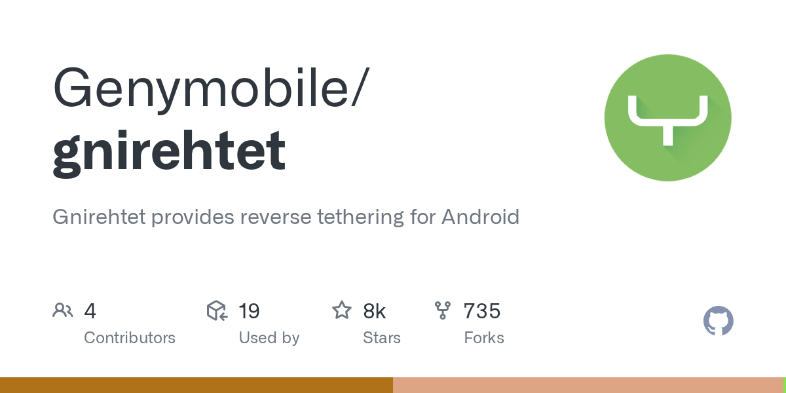

# OmaNet - Share your Computer's internet connection with an Android phone over USB.

> Source: https://www.reddit.com/r/omarchy/comments/1x49qoz/omanet_share_your_computers_internet_connection/
> Author: u/Working_Answer_3132
> Posted: 2026-10-12T18:27:37+00:00
> Captured: 2026-10-15T08:55:18+00:00
> Score: 3 · Comments: 0
> Community: r/omarchy

## Post

I built **OmaNet**, an Omarchy plugin that makes it easier to share your computer's internet connection with an Android phone over USB.

It uses [GNirehtet](https://github.com/Genymobile/gnirehtet) to establish the connection and integrates with Omarchy through a Quickshell bar widget.

# Features

* **USB internet sharing:** Share your computer's internet connection with your Android phone over USB.
* **Quick controls:** Start and stop the connection directly from the bar widget instead of managing everything manually in the terminal.
* **No Wi-Fi hotspot required:** The connection runs over USB rather than relying on a wireless hotspot.

The goal is to make connecting an Android phone to an Omarchy computer straightforward and convenient. Connection performance depends on your USB connection, device, and network setup.

**Omarchy marketplace:** [https://plugins.omarchy.org/plugin.html?id=mehir.usb-internet-share](https://plugins.omarchy.org/plugin.html?id=mehir.usb-internet-share)

**GitHub repository:** [https://github.com/MrUranium1/Omanet](https://github.com/MrUranium1/Omanet)

## Media

> Original media URL: https://external-preview.redd.it/afq59_bexeqLeAfuCNHBbCxBhJQybmRwCBc5CjZgDiE.png?auto=webp&s=9a0ff07e734e864778e80703390ec0df04de70a1

## Links

- https://github.com/Genymobile/gnirehtet
- https://plugins.omarchy.org/plugin.html?id=mehir.usb-internet-share
- https://github.com/MrUranium1/Omanet
