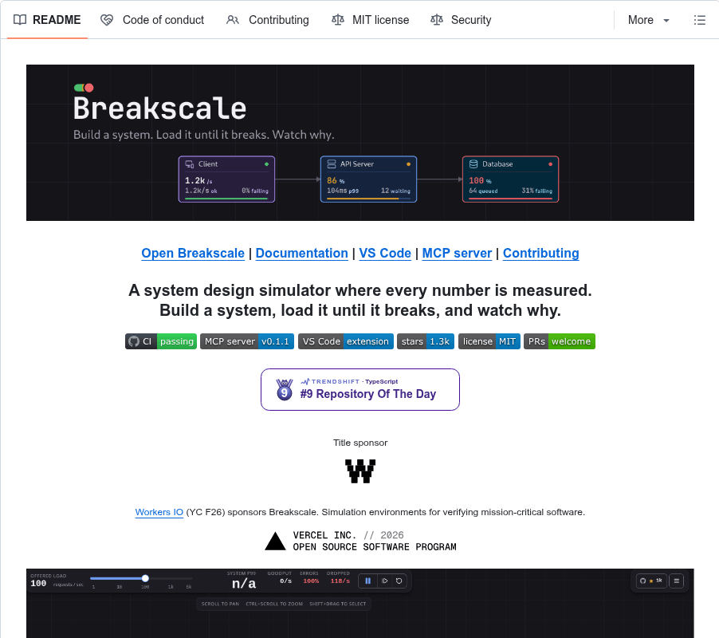

# Breakscale: Build a system, load it until it breaks, and watch why (1.3k stars)

> Source: https://www.reddit.com/r/BestGitHubRepos/comments/1x49yi0/breakscale_build_a_system_load_it_until_it_breaks/
> Author: u/company_url_finder
> Posted: 2026-10-12T18:35:24+00:00
> Captured: 2026-10-15T08:55:18+00:00
> Score: 130 · Comments: 0
> Community: r/BestGitHubRepos

## Post

# What it does

*All text below is quoted directly from the project README.*

>A system design simulator where every number is measured. Build a system, load it until it breaks, and watch why.

>Breakscale lets you put load balancers, caches, databases, queues and 29 other components on a canvas, wire them into a system, and drag the traffic up until something gives.

>It runs in your browser, inside VS Code, and inside your AI assistant, which can read your code, draw your architecture, and tell you where it breaks.

**Features:**

* **33 components.** Load balancers, caches, databases, queues and workers, plus CDNs, rate limiters, circuit breakers, read replicas, shards, autoscalers, stream brokers, WebSocket gateways, serverless functions, bulkheads and more.
* **23 worked examples.** Sixteen teaching scenarios that each isolate one failure mode, and seven reconstructions of real architectures.
* **A real discrete-event engine.** Finite server slots, gamma-distributed service times and measured percentiles, with no formula standing in for the simulation.
* **Chaos controls.** Crash a node, slow it down, force an error rate, or cut a single link, then watch the failure travel.
* **Deterministic runs.** The same seed and topology replay identically, every time.
* **Explanations built in.** Every metric and unit has a plain-language definition one hover away.
* **Share links and design files.** Send a design as an encrypted link, or save it as a `.breakscale` file that opens on the website and in VS Code.
* **Private by design.** No account, and your designs never leave your machine unless you share them.

>Breakscale is also an MCP server, so Claude, Copilot, Cursor, Codex and other assistants can use it for you.

# Repository

[https://github.com/xevrion/breakscale](https://github.com/xevrion/breakscale)

# Repository stats

|Metric|Value|
|:-|:-|
|Stars|1,289|
|Forks|119|
|Last release|None|
|Languages|TypeScript 85%, CSS 14.6%|
|Contributors|15|
|AI contributor accounts (Claude / Codex / Cursor / Copilot)|claude (3 commits), cursoragent (1)|
|AI co-authored commits|Claude: 3, Cursor: 1|

# Main contributor

|Field|Value|
|:-|:-|
|Name|Yash Bavadiya|
|GitHub|[@xevrion](https://github.com/xevrion)|
|Commits to this repo|182 (top contributor)|
|Bio|DevRel @ Workers IO · building breakscale · CS @ IIT Jodhpur · xevrion.dev|
|Company / Location|Workers IO / Jodhpur, India|
|Website|[https://xevrion.dev](https://xevrion.dev)|
|X / Twitter|@xevrion\_the1|
|Followers|316|
|Public repos|201|
|On GitHub since|2021-01-05|

\-------------------------------------------------------------------------------------------

**Discover the best GitHub repos without the endless scrolling.**

Get top repos organized by category (AI, DevOps, Databases & more), plus key takeaways from developers' most useful comments - all in one free, twice-weekly newsletter.

👉 [Get the best repos & community insights - Free](https://best-github-repos.beehiiv.com/subscribe)

## Media

> Original media URL: https://i.redd.it/9c1dhwlty2vh1.png

> Original media URL: https://preview.redd.it/9c1dhwlty2vh1.png?auto=webp&s=1b1d4c38f965cf5a12bab34375d44647252a6e7a

## Links

- https://github.com/xevrion/breakscale
- https://github.com/xevrion
- https://xevrion.dev
- https://best-github-repos.beehiiv.com/subscribe
