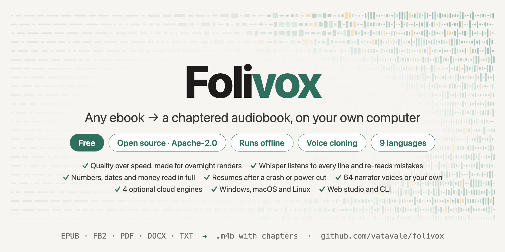

# Folivox: a free, open-source app that turns EPUB/FB2/PDF books into chaptered audiobooks, built for quality

> Source: https://www.reddit.com/r/TextToSpeech/comments/1x4ab4r/folivox_a_free_opensource_app_that_turns/
> Author: u/vatavale
> Posted: 2026-10-12T18:47:57+00:00
> Captured: 2026-10-15T08:55:18+00:00
> Score: 128 · Comments: 10
> Community: r/TextToSpeech

## Post

I built Folivox because the free text-to-speech tools I tried sounded like screen readers, with flat delivery, struggling with numbers, or skipping lines entirely. I wanted to listen to books without glitches.

Folivox is open source (Apache-2.0) and runs locally on Windows, macOS, and Linux. You drop in a book in FB2, EPUB, DOCX, PDF, or TXT format, choose a voice, and render it. The output is either an .m4b file with metadata, covers, and chapter markers, or individual MP3s for each chapter.

The app is slow by design. I usually start rendering a long book in the evening to have it ready by morning. That time is used to ensure audio quality:

* It uses CosyVoice 3, an open model that clones a narrator from a 6–15 second sample. Everything happens offline with no accounts or per-character fees; your books never leave your machine.
* Whisper audits every generated fragment. If the audio doesn't match the text, the system re-reads it and keeps the best of three attempts.
* The app prepares text for speech before rendering. It expands numbers, dates, currency, units, and Roman numerals into full words, handling case and gender agreement across 9 languages: English, Russian, German, French, Spanish, Italian, Chinese, Japanese, and Korean.
* To handle overnight crashes or power cuts, every finished fragment is journalled. If the process stops, it resumes where it left off. If you edit the text, only the modified fragments are re-rendered.

The narrator voice can come from several places:

* the bundled library of 64 public-domain LibriVox narrators;
* your own recording, made in the app or uploaded;
* a voice generated right inside the app. Paste your ElevenLabs, OpenAI, Gemini or Cartesia key in the studio, pick one of their voices or describe the narrator you want (or let an LLM write the description from the book), and press *Generate a voice sample.* Folivox makes a few short takes, Whisper ranks them, and the best one is saved to your voice library. Without a key, a built-in local voice-design model (Qwen3) does the same.

The software supports NVIDIA GPUs, Apple Silicon, and CPUs, though CPUs are significantly slower, and you can run `folivox doctor` to check your hardware and see expected performance.

My personal workflow is a hybrid: I use Gemini to generate a 10-second narrator sample for less than a cent, then render the rest of the book locally using CosyVoice to clone that voice.

If you prefer speed over waiting, you can use your own API keys for ElevenLabs, OpenAI, Gemini, or Cartesia. The app provides cost estimates and spending caps. For example, Gemini 3.8 Flash TTS costs roughly $8 for a ten-hour book. 

The project includes a CLI and a web studio (`folivox ui`) translated into 9 languages. Installation takes one command and requires no admin rights; it downloads approximately 7.6 GB of models.

GitHub: [https://github.com/vatavale/folivox](https://github.com/vatavale/folivox)

If you encounter crashes, books that won't open, or mispronounced words, please open an issue on GitHub.

## Media

> Original media URL: https://i.redd.it/ec0d9eutz2vh1.png

> Original media URL: https://preview.redd.it/ec0d9eutz2vh1.png?auto=webp&s=c1afde06b6122ae6f03daf4ecdaa693833e9e016

## Thread

> u/vatavale · 2026-10-13T15:12:04+00:00 · score 1 · [comment](https://www.reddit.com/r/TextToSpeech/comments/1x4ab4r/folivox_a_free_opensource_app_that_turns/pghuwos/)

Thanks! No hard cap on length or chapter count. 200+ chapters or 500k words is fine: each chapter becomes a chapter marker in the .m4b. The only limit is a 200 MB upload size in the web studio, and a text e-book is nowhere near that.

The real constraint is time. 500k words is roughly 50+ hours of audio, and the local engine renders it on your own machine, so expect a long run on CPU and a much shorter one on a decent GPU or Apple Silicon. Progress is saved per fragment, so you can stop and resume any time without losing work. You can also render a selection of chapters first to check the voice before committing to the whole book.

## Comments

> u/Successful_Funny_115 · 2026-10-12T22:29:13+00:00 · score 4 · [comment](https://www.reddit.com/r/TextToSpeech/comments/1x4ab4r/folivox_a_free_opensource_app_that_turns/pgd8zfe/)

Interesting, i built something similar as an app for Android using Claude. Mine supports Kokoro in English and German, as well as Thorsten Voice. I'm thinking about maybe publishing it on GitHub, too.

> u/Wimmi29 · 2026-10-12T19:57:53+00:00 · score 3 · [comment](https://www.reddit.com/r/TextToSpeech/comments/1x4ab4r/folivox_a_free_opensource_app_that_turns/pfijze0/)

Ist deutsch auch dabei? 😍

> u/Wimmi29 · 2026-10-12T20:03:12+00:00 · score 2 · [comment](https://www.reddit.com/r/TextToSpeech/comments/1x4ab4r/folivox_a_free_opensource_app_that_turns/pfil8mj/)

Hab’s gesehen…Deutsch ist dabei. Ich hab Sorge, dass ich zu blöd bin um das auf meinem PC zu installieren. Aber ich denke, ich werde es testen. Großartige Arbeit 🙏🫶

> u/EfficientExplorer829 · 2026-10-12T19:56:12+00:00 · score 2 · [comment](https://www.reddit.com/r/TextToSpeech/comments/1x4ab4r/folivox_a_free_opensource_app_that_turns/pfijkrh/)

Very cool

> u/huydoesstuff · 2026-10-13T05:29:37+00:00 · score 2 · [comment](https://www.reddit.com/r/TextToSpeech/comments/1x4ab4r/folivox_a_free_opensource_app_that_turns/pgfbntt/)

Nice work! I'll give it a try!

> u/hyclonia · 2026-10-13T06:26:16+00:00 · score 2 · [comment](https://www.reddit.com/r/TextToSpeech/comments/1x4ab4r/folivox_a_free_opensource_app_that_turns/pgfizgg/)

Very cool! Is there a maximum on novel size? Eg 200 chapters plus? Or 100-500k words? 

> u/Thought_Crash · 2026-10-14T12:44:41+00:00 · score 1 · [comment](https://www.reddit.com/r/TextToSpeech/comments/1x4ab4r/folivox_a_free_opensource_app_that_turns/pgogv5o/)

Thanks. It's very professional looking. My only complaint is that CosyVoice was running about 1x speed using a RTX 4080, i.e. 30 min of audio took about 30 min to process. 

> u/BrightPineapple_ · 2026-10-15T02:44:41+00:00 · score 1 · [comment](https://www.reddit.com/r/TextToSpeech/comments/1x4ab4r/folivox_a_free_opensource_app_that_turns/pgtmr00/)

I tried your program and liked it a lot. It was dead-simple to set up and use (really intuitive (and beautiful) UI).

The results were good to great. As mentioned in the OP, this program isn't made with speed in mind. 1hr of text takes 1 hour to process but again, the results satisfied me, so THANKYOU for the work you put into this.

Do you know if it would be simple enough to change out the voice model? Or is CosyVoice3 0.5B  the best model you found? Do you have any recommendations for the 'max fragments (chars)' setting? The default of 300 made the sentences sound a little bit choppy with some custom voices.

## Links

- https://github.com/vatavale/folivox
