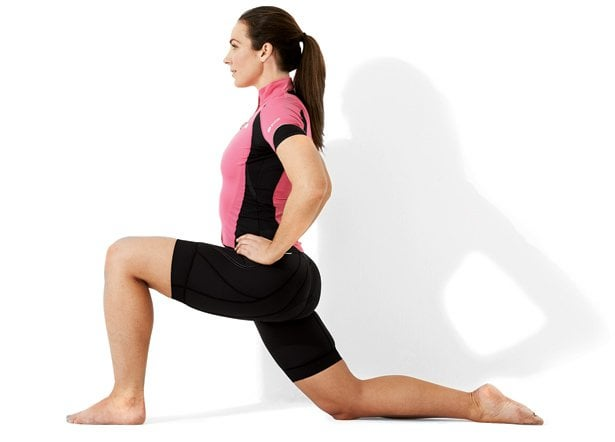

# If you sit at a desk a lot, you likely have some forward head/shoulders and APT. Here's how you can start to work on it! Everything you need to know to get started including some exercise suggestions, plus discussion if you want to understand what's going on.

> Source: https://www.reddit.com/r/Posture/comments/dhj1z1/if_you_sit_at_a_desk_a_lot_you_likely_have_some/
> Author: u/stickysweetastytreat
> Posted: 2019-10-14T00:36:52+00:00
> Captured: 2026-10-15T08:55:18+00:00
> Score: 2159 · Comments: 78
> Community: r/Posture

## Post

Here's a list of exercises if you just want to know what to start working on! Forward head/shoulders and/or anterior pelvic tilt (increased low back arch, belly & butt stick out) is very common in people who sit at a desk a lot and don't do much else. I'm posting the first decent video that I come across for each one but I'm sure there are a lot of other great ones. Most of these are easy to do wrong, difficult to do right, so prioritize FORM:

1. [upper traps](https://youtu.be/pMnGCP4luzk?t=11) Stretch the tops of your shoulders
2. [SCM](https://youtu.be/DVebkG8aDG4?t=38) Stretch the front corners of your neck
3. Stretch pecs. - [wall stretch](https://www.youtube.com/watch?v=BZgBr3gdV8E) or [doorway stretch](https://www.youtube.com/watch?v=_wqrLjCm4HQ&feature=youtu.be&t=13)
4. [chin tuck](https://www.youtube.com/watch?v=1v9e8PdmqEI) or [laying down](https://www.instagram.com/p/BTXzdhfAMSX/) or sitting upright [isometrics](https://www.instagram.com/p/BaXw3LSAzYo/): Keep the back of your neck long, as if someone is pulling your head up (which is why I think the laying down one is useful, you can feel for the surface; if you physically can't reach, you can roll up a towel under your neck and try again). *\*loud music warning for the last 2* (yes you look weird doing these!)
5. [wall angels](https://www.youtube.com/watch?v=ywYi4rBhRBQ): Go only as far as you can while keeping your back pressed into the wall, and keep your wrists closer to the wall than your elbows.
6. [face pulls](https://www.youtube.com/watch?v=V8dZ3pyiCBo&feature=youtu.be&t=16) ([better but longer version](https://www.youtube.com/watch?v=eIq5CB9JfKE&feature=youtu.be) thanks to u/Sith_ari) and/or [YTA](https://www.youtube.com/watch?v=z7G0fZ7W9Rs): For face pulls, do NOT jut your head forward (keep it long and high), do NOT let your shoulders pop forward. You can use resistance bands or even no equipment to start with. For YTA, the hand position is important because it directly influences what your shoulder is doing.
7. [dead bug](https://youtu.be/I5xbsA71v1A): Do NOT let your hips move or get pulled by your legs, only go as far as you can while maintaining the stable pelvis (to make it easier, leave arms by your sides on floor and/or keep knees bent as you lower; to make it harder, straighten legs throughout the whole movement) \**If you're struggling with dead bug and your hips are getting pulled along or you feel your low back shifting off the floor, learn* [*how to engage your deep core*](https://www.youtube.com/watch?v=aqwx6uCwhUQ)*.*
8. [hip flexor lunge stretch:](https://www.saratogahealthandwellness.com/wp-content/uploads/2016/06/kneeling-lunge.jpg) I personally like the one where both knees are at 90deg, and really try to tuck your butt under so the stretch is focused in the hip flexors. Or play around with both versions!
9. [glute bridge](https://youtu.be/8bbE64NuDTU?t=71) Make sure you keep your pelvis tucked.

For all of these, only go as far as you can before it gets too tiring to perform them correctly. Rest and repeat. If it's way too difficult, look up regressions.

If you have a foam roller, massage ball, or peanut, it can be helpful to work on your thoracic spine (your back, at the bottom of your ribcage to your neck), lats, hip flexors, glutes, hamstrings, quads. You would work the area with your tool before you stretch the area.

*If you experience pain, tingling, numbness, pulsing, STOP and go see a physio!*

**If you're trying to improve your posture (or are worried that you're too far gone), here are some things I want you to know:**

* "Posture" is the sum of all of the frequent movements that you do. It is a constantly changing, adapting thing which means it's usually fixable. This is your body doing what it does best-- adapting to better suit the tasks of your body! However, because posture is the sum of your movements, you have to KEEP reminding your body that you need it for more than just sitting at a desk. Consistency is key.
* "Good posture" isn't tiring. Since posture is just a result of the things you do, that means you just have "good posture" or you don't. You don't force yourself to sit upright with your shoulders pulled back (in fact, that's counterproductive-- though there are ways you can sit to mitigate). These exercises aren't meant for you to STAY in these positions throughout the day.

# Now, if you want to dig into things, read on!

&#x200B;

**"Is my posture ruined forever?" "What makes posture bad?"**

What we call "good posture" is just neutral while standing ([dude in red](https://i0.wp.com/chirohealing.com/wp-content/uploads/2015/11/posture-las-vegas-main20151113.jpg)). Basically, your ears and shoulders should be stacked over your hips all in one line perpendicular to the pull of gravity, with natural (not excessive!) curves in your spine. Keep in mind that our bodies are supposed to MOVE, so it doesn't always mean that your shoulders must always stay under your ears in every movement.

When you spend most of your waking life at a desk, the message that you're sending to your body is that this *is* your life, this is what you've been doing with your body, so this is what you're probably going to continue doing. Your body responds by adapting to make this specific job easier for you. It's more efficient from a brain/muscle processing perspective, like how you don't have to think about how to walk every time you get up.

What happens to your body when you sit at a desk? Your hips bend, you're reaching forward and towards the center of your body so your arms and shoulders are reaching forward and internally rotated (towards your midline). Your body is **supposed** to be doing these things when you're at your desk-- none of these positions are objectively bad! Having "good" or "bad" posture doesn't mean as much as the movement and the range that is available to your body. Think of it like you've "reprogrammed" your default position to better suit your lifestyle, but in doing so, you've lost some other movement.

The problem is that you're taking it everywhere you go. So you've adapted and are now residing somewhere a bit away from neutral. Now you have to *work* to get back to neutral. If you want to do something with your shoulders back (the opposite of where you're stuck), it's going to take more work for you than someone who is starting with shoulders in neutral; you're starting behind the start line. (Don't feel bad though, most people have tight shoulders!)

**How do you "fix" posture?**

You fix it by doing the things that move you away from position you're stuck in. For a lot of people, these movements are easy to do wrong, and hard to do right. That makes sense, because you're basically trying to swim against the current here. But this *is* the work. You're doing these exercises to tell your body that you want it to do other things besides being a better fit for deskwork. You teach your body new ways of movement; you get rid of a movement pattern by installing something better, and you do this by helping those weakened/lengthened muscles catch up. Remember, your body WANTS to be efficient. Once those muscles are caught up and your brain knows it can use these muscles, you will!

**These exercises are not the positions you're supposed to stay in throughout the day.**

No, you don't stay with your chest sticking out or walk around with your chin smushed in. They're just ways to program different movement patterns to your brain. It's the *sum* of all of your frequent movements that your posture comes from. This also means that "good posture" won't feel like you're working. It also means that it can be changed, and that consistent training is important!

&#x200B;

**Exercises: forward head, forward & internally rotated shoulders** *(aka upper crossed syndrome or nerd neck!)*

**Head/neck:**  Where is your keyboard/phone relative to your body? The adaptation is to curl your upper body and head over the area you're manipulating. Imagine your skull is like a (heavy) ball on top of a small-ish platform, and that this ball can spin in place. The most energy efficient position is for the ball to be stacked directly on top of the platform right? However, at your desk, the platform (your upper body) is tipped forward which in turn moves your head forward. Then when you want to face directly ahead (like looking up to see where you're walking), the ball spins upward while the platform *stays* tipped forward. Think about how much more work your body has to do to keep your head up!

**Shoulders:**  Your shoulders are like a ball in a cup. The ball is the end of your arm bone (humerus) and the cup is actually the corner of your shoulder blade. This whole cup/ball unit sits on the back of your ribcage; your arms, shoulders, and upper/mid back all work with each other very closely. These exercises work the muscles that move your shoulder blades in those directions that are limited by your posture, the main muscles being mid/low trapezius, rhomboids, serratus anterior, and rotator cuff external rotators.

Stretching is nice, but by itself it's not enough. It temporarily lengthens muscles that are chronically shortened, so you can stretch those muscles before you perform these exercises. Here they are again:

1. Stretch pecs. - [wall stretch](https://www.youtube.com/watch?v=BZgBr3gdV8E) or [doorway stretch](https://www.youtube.com/watch?v=_wqrLjCm4HQ&feature=youtu.be&t=13)
2. Stretch [upper traps](https://youtu.be/pMnGCP4luzk?t=11) (the tops of your shoulders) and [SCM](https://youtu.be/DVebkG8aDG4?t=38) (the front corners of your neck)
3. Neck: [chin tucks, laying down](https://www.instagram.com/p/BTXzdhfAMSX/) or [chin tuck isometrics](https://www.instagram.com/p/BaXw3LSAzYo/) *\*loud music warning*
4. Upper body: [wall angels](https://www.youtube.com/watch?v=ywYi4rBhRBQ) (keep closer to wall than elbows), plus [face pulls](https://www.youtube.com/watch?v=V8dZ3pyiCBo&feature=youtu.be&t=16) (don't jut head forward) ([better but longer version](https://www.youtube.com/watch?v=eIq5CB9JfKE&feature=youtu.be) thanks to u/Sith_ari), and/or [YTA](https://www.youtube.com/watch?v=z7G0fZ7W9Rs) (watch position of hands)

&#x200B;

**Anterior Pelvic Tilt (APT)**

Common signs are if your tummy pooches out, your low back is really arched, or your butt sticks out.

**(Pelvic tilt:**  Think of your pelvis like a bucket full of water. In anterior pelvic tilt, your pelvis tips forward, dumping water down the front of your pants. In posterior pelvic tilt, your pelvis tips backward, water going down the back.)

Having furniture is nice because it supports us, cradling the back, the spine, etc. It does such a good job of supporting that your brain, in its never-ending quest for efficiency, will think "*Why do I have to use all this energy stabilizing and supporting our spine and pelvis if we have furniture to do it for us?*" APT usually happens when your core doesn't counter the pull of gravity or tightened hip flexors on your pelvis. Hip flexors are chronically shortened when you sit a lot, because your hips have to bend to sit.

The [transversus abdominus](https://en.wikipedia.org/wiki/Transverse_abdominal_muscle) and [internal obliques](https://en.wikipedia.org/wiki/Abdominal_internal_oblique_muscle) are the deepest muscles in your core. It's hard to feel these muscles working (also why you shouldn't use "muscle burn" to gauge how hard you're working), but you can watch what your hips are doing. There are TONS of deep core exercises; dead bug is just one of them. Here, you're isolating the movement of your legs from your pelvis. You're holding your pelvis and spine in place, while your legs move. This works your deep core because it's getting challenged with the weight and movement of your legs.

If you're struggling with dead bug, you might want to play around with engaging your deep core by itself. Since the TvA wraps all the way around your midsection, it'll look like your belly is drawn in when you engage it. Again:

1. [Deep core activation](https://www.youtube.com/watch?v=aqwx6uCwhUQ) with quadruped position at 1:05, [another version](https://youtu.be/p8O04WLXFt8?t=28)
2. [Dead bug](https://www.youtube.com/watch?v=I5xbsA71v1A) also, careful how you get into the starting position! It's essentially doing the exercise already. Play around with doing this here, or somewhere between the next two.
3. Stretch hip flexors: [lunge](https://www.saratogahealthandwellness.com/wp-content/uploads/2016/06/kneeling-lunge.jpg) (I personally like the one where both knees are at 90deg, and really try to tuck your butt under so the stretch is focused in the hip flexors. Or play around with both versions!)
4. The glutes are the muscle group that opposes your hip flexors: [glute bridge](https://youtu.be/8bbE64NuDTU?t=71) make sure you keep your pelvis tucked.

You know what else is closely linked to your core? Breathing! This is because the diaphragm (and your pelvic floor!) are considered part of your core! If you have a habit of chest breathing, try out some belly breathing.

&#x200B;

I hope this was helpful and insightful to people. If this was of interest to you, I have an [in-depth post](https://www.reddit.com/r/bodyweightfitness/comments/9uavqo/some_information_on_how_to_use_your_core_to/) on the deep core (including discussion on toes-to-bar and hollow body hold, which is a great core exercise if dead bug is easy).

Questions, comments, confusion?

&#x200B;

*Gold! Silver! That's so sweet of you guys, thank you! I'm glad this post adds value to you <3*

## Media

> Original media URL: https://external-preview.redd.it/TkV_4ooPfyxBUT-E8HL81mhjfrUSojFLz8BvknbjlmY.jpg?auto=webp&s=5cc0d2be964d379c8da1daac65405eb3ad7998ba

## Thread

> u/stickysweetastytreat · 2019-10-14T01:47:45+00:00 · score 12 · [comment](https://www.reddit.com/r/Posture/comments/dhj1z1/if_you_sit_at_a_desk_a_lot_you_likely_have_some/f3ogzhq/)

Aww! :D

> u/stickysweetastytreat · 2019-10-14T01:57:01+00:00 · score 8 · [comment](https://www.reddit.com/r/Posture/comments/dhj1z1/if_you_sit_at_a_desk_a_lot_you_likely_have_some/f3ohp1z/)

Glad you enjoyed it! Standing 12hrs/day is rough!! Being in any position for so long will take its toll on your system :( My post is focused on people who sit for long periods of time, but everyone can benefit from deep core work if it's a lacking area. These muscles are meant to stabilize and protect your hips/pelvis; it can't solve it all though. Would you be able to get access to one of those padded mats to stand on, or good shoes/insoles? Maybe even a foam roller that you can gently release your back at the end of the day. How are your feet? If they're a little caved in or out, then you might have an opportunity there to improve that-- improving the base of your support will improve how the rest of your body sits on it.

Good luck! I hope you find a solution that helps!!

> u/stickysweetastytreat · 2019-10-14T02:35:46+00:00 · score 5 · [comment](https://www.reddit.com/r/Posture/comments/dhj1z1/if_you_sit_at_a_desk_a_lot_you_likely_have_some/f3okprv/)

Ah gotcha! Flat feet can cause the weight of your body to go more towards the midline instead of distributing it over your two feet. Not that this is a terrible thing, but if you're looking for something to try and play around with, I'd recommend you look up "tripod exercise for flat feet", and maybe some hip stabilization exercises, like clamshell. Our arches play a pretty big role!

> u/stickysweetastytreat · 2019-10-14T03:00:56+00:00 · score 2 · [comment](https://www.reddit.com/r/Posture/comments/dhj1z1/if_you_sit_at_a_desk_a_lot_you_likely_have_some/f3omno7/)

Sure thing!

> u/stickysweetastytreat · 2019-10-14T03:35:37+00:00 · score 2 · [comment](https://www.reddit.com/r/Posture/comments/dhj1z1/if_you_sit_at_a_desk_a_lot_you_likely_have_some/f3op6fe/)

Thanks! :D

Does the pop hurt? If so, it won't cause immediate harm but it's not a good idea to push through pain. Where in your back is this pop? Does this happen when you follow the cues I provided? (only going so far as you can before your back lifts off the wall, and to keep your wrists closer to the wall than your elbows)

Are you keeping your shoulders back the whole time? You should consider posting a form check video, if that's something you're comfortable with doing! Also, face pulls and YTA work similar muscles, have you tried those?

> u/stickysweetastytreat · 2019-10-14T16:07:32+00:00 · score 1 · [comment](https://www.reddit.com/r/Posture/comments/dhj1z1/if_you_sit_at_a_desk_a_lot_you_likely_have_some/f3q3uvg/)

Since there's still some pain, I'd take a closer look at what's going on. It's definitely worth bringing up to a physical therapist. If you ever want to start a physical activity that involves bringing your arms up overhead, this will probably come up again. Better to nip it in the bud!

> u/stickysweetastytreat · 2019-10-14T16:56:25+00:00 · score 1 · [comment](https://www.reddit.com/r/Posture/comments/dhj1z1/if_you_sit_at_a_desk_a_lot_you_likely_have_some/f3qb1or/)

Good luck!

> u/stickysweetastytreat · 2019-10-14T02:07:34+00:00 · score 3 · [comment](https://www.reddit.com/r/Posture/comments/dhj1z1/if_you_sit_at_a_desk_a_lot_you_likely_have_some/f3oiivk/)

Thanks! I was thinking of adding a bit on foam rolling but I wanted to start with a bare-bones approach. But hmm maybe I will add some notes on foam rolling, thanks!

> u/stickysweetastytreat · 2019-10-14T14:26:00+00:00 · score 2 · [comment](https://www.reddit.com/r/Posture/comments/dhj1z1/if_you_sit_at_a_desk_a_lot_you_likely_have_some/f3ppyp2/)

Do you have an underlying medical condition? What are you doing in fitness that you fear is going to put you in the hospital?

> u/stickysweetastytreat · 2019-10-14T18:30:50+00:00 · score 4 · [comment](https://www.reddit.com/r/Posture/comments/dhj1z1/if_you_sit_at_a_desk_a_lot_you_likely_have_some/f3qnv60/)

Our bodies are so, so, so resilient. I don't like how some providers talk like our spines are like glass or discs are like jelly-filled donuts, it's kind of fearmonger-y to me. It's not like performing an exercise "wrong" will automatically BAM call the ambulance! Injury happens when your form AND workload are exceeded, and I know you're probably not doing something extreme like trying to deadlift 500lbs. You know that saying, how you do one thing is how you do everything? Well, if you have tight, forward shoulders and you only know the one way of moving them, then every time you move your shoulders that one way, it's "bad form". But reaching for that cup high on that shelf or whatever is a very light movement, and even though you performed it "wrong", you're not any worse off. Injury can mean something as small as a mild sprain that you can ice and treat at home for 2 days and bounce back. 

The idea of form being good or bad is relative to your needs. Yes people talk about general things being "good" and "bad", but that's simplifying it for the sake of being able to talk about it. I can say that your form is good enough for your current needs, which is reaching for that cup in the top shelf, but if I know you have loftier goals than that, then I can sum it all up as "your form could be improved" or "your form is bad". All better form does is give you a bigger buffer in terms of workload before your system breaks down. If I trained 10hrs/day everyday for 5 weeks, my body would be a wreck no matter how clean my movement is. If your shoulder mechanics are a certain way ("bad"), you could still reach for that cup on the top shelf, but maybe you could only do that continuously for a few hrs. On the other hand someone with "better form" could reach for that cup continuously for a few more hrs than you, but it's still tiring af, no muscle can run forever, things will inevitably break down.. no one can continuously reach for that cup with no issues.

So going back to your original point:

>For most hobbies if I do it wrong worst case scenario I waste my time  and also materials. For fitness if I do it wrong I can put myself in the  hospital,  

Worst case scenario for your hobby, you also could end up in the hospital. Say you cut yourself with a hobby knife or whatever. Now THAT is on the level of ending up in a hospital with a workout injury. A fitness equivalent to the (not)worst-case scenario of wasting time/materials in a hobby, is that if you do it wrong, you missed out on an opportunity to use the correct muscles with one rep. That's it.

Yes, we can still be injured. In general, it's not a good idea to mindlessly follow a list of exercises. Anyone can tell you to do 100 jumping jacks, 10 pull-ups, 50 burpees, 50 mountain climbers. Sure, you could probably just keep pushing yourself and get the numbers at all cost, but a value in exercises is QUALITY. THat's why I said in my OP to only do as many as you can while you can still maintain good form. Once you tire out the specific muscles, those muscles won't perform until they've recouped. That automatically means you won't be pushing into a higher injury zone. Most injuries are not acute. Most are chronic, developing over time because they were training too much for how their bodies currently work.

FWIW, the exercises I listed above are HIGHLY unlikely to cause injury. If something hurts, then stop, re-analyze and/or regress. The "engaging your deep core" link is especially safe to perform so if you're really worried, I'd say to start there. You could also start baby motions of the shoulder/neck stretches and the wall angel and see how those go.

Was this helpful?

> u/stickysweetastytreat · 2019-10-14T19:42:39+00:00 · score 3 · [comment](https://www.reddit.com/r/Posture/comments/dhj1z1/if_you_sit_at_a_desk_a_lot_you_likely_have_some/f3qx1uf/)

Great! I'm guessing you sit at your desk daily, so something every day would be nice. Do it today and see how you feel tonight. Re-assess tomorrow. It's totally ok if you can't jump into a daily practice right off the bat!

> u/stickysweetastytreat · 2019-10-14T21:19:53+00:00 · score 3 · [comment](https://www.reddit.com/r/Posture/comments/dhj1z1/if_you_sit_at_a_desk_a_lot_you_likely_have_some/f3rgtow/)

Yup!

> u/stickysweetastytreat · 2019-10-14T16:06:03+00:00 · score 1 · [comment](https://www.reddit.com/r/Posture/comments/dhj1z1/if_you_sit_at_a_desk_a_lot_you_likely_have_some/f3q3n3w/)

You're welcome! Do as many as you can with good form so you can ensure that you're using the right muscles. If 10, 15ish reps breezes by, look into a more difficult version (or look into what else may be contributing to your issue that you're trying to fix, maybe there's a better exercise out there)

> u/stickysweetastytreat · 2019-10-14T02:29:47+00:00 · score 1 · [comment](https://www.reddit.com/r/Posture/comments/dhj1z1/if_you_sit_at_a_desk_a_lot_you_likely_have_some/f3ok97f/)

Awesome! Good luck!

> u/stickysweetastytreat · 2019-10-14T05:40:40+00:00 · score 3 · [comment](https://www.reddit.com/r/Posture/comments/dhj1z1/if_you_sit_at_a_desk_a_lot_you_likely_have_some/f3owrjt/)

Thanks! 

It can help temporarily but won’t resolve if that’s the only thing you’re doing for it.

> u/stickysweetastytreat · 2019-10-14T16:07:48+00:00 · score 2 · [comment](https://www.reddit.com/r/Posture/comments/dhj1z1/if_you_sit_at_a_desk_a_lot_you_likely_have_some/f3q3wcn/)

You're welcome! :)

> u/stickysweetastytreat · 2019-10-14T14:24:46+00:00 · score 1 · [comment](https://www.reddit.com/r/Posture/comments/dhj1z1/if_you_sit_at_a_desk_a_lot_you_likely_have_some/f3ppt10/)

Yeah hip thrust is similar to glute bridge but make sure you’re keeping your butt tucked under at the top. 

Technically yes because it’s like straightening out a curve makes it longer but I think the more noticeable thing would be a better posture!

> u/stickysweetastytreat · 2019-10-14T16:08:12+00:00 · score 2 · [comment](https://www.reddit.com/r/Posture/comments/dhj1z1/if_you_sit_at_a_desk_a_lot_you_likely_have_some/f3q3yix/)

Haha you're welcome!!!

> u/stickysweetastytreat · 2019-10-14T16:08:48+00:00 · score 4 · [comment](https://www.reddit.com/r/Posture/comments/dhj1z1/if_you_sit_at_a_desk_a_lot_you_likely_have_some/f3q41gy/)

You're welcome! I think this is information that everyone should have and understand! It's like basic self-care.

> u/stickysweetastytreat · 2019-10-14T18:39:53+00:00 · score 1 · [comment](https://www.reddit.com/r/Posture/comments/dhj1z1/if_you_sit_at_a_desk_a_lot_you_likely_have_some/f3qozpj/)

Haha thanks. I've included some notes but got tired looking for one lol if you have a better one, I'd be happy to swap the links.

> u/stickysweetastytreat · 2019-10-14T19:36:03+00:00 · score 1 · [comment](https://www.reddit.com/r/Posture/comments/dhj1z1/if_you_sit_at_a_desk_a_lot_you_likely_have_some/f3qw5hn/)

Thanks! This is a long video but will add it in.

> u/stickysweetastytreat · 2019-10-15T07:38:57+00:00 · score 1 · [comment](https://www.reddit.com/r/Posture/comments/dhj1z1/if_you_sit_at_a_desk_a_lot_you_likely_have_some/f3tak8y/)

“Pump” usually just refers to the muscle being pumped up after working it out, it goes away shortly after. 

My best guess is what you said, you may be overworking it. You said it’s not pain; what is getting so bad that you have to lay down? You physically can’t bend anymore because something is preventing you, or that you would be in pain if you continued to bend? Regardless, this should not be happening after feeding your dogs and doing a few light squats; these sound like everyday functions which this issue is getting in the way of. It’s grounds for seeing a physio. It’s an opportunity to look over your movement mechanics, you’ll thank yourself in a few decades!

> u/stickysweetastytreat · 2019-10-15T08:06:26+00:00 · score 1 · [comment](https://www.reddit.com/r/Posture/comments/dhj1z1/if_you_sit_at_a_desk_a_lot_you_likely_have_some/f3tbsk8/)

Your low back may be compensating for something that it’s not well-positioned to do. X-rays won’t pick up issues in the WAY you move. See how the deep core work goes, paying attention to your form. Good luck!

> u/stickysweetastytreat · 2019-10-15T07:41:04+00:00 · score 1 · [comment](https://www.reddit.com/r/Posture/comments/dhj1z1/if_you_sit_at_a_desk_a_lot_you_likely_have_some/f3tanq7/)

Depends!

> u/stickysweetastytreat · 2019-10-23T03:31:23+00:00 · score 1 · [comment](https://www.reddit.com/r/Posture/comments/dhj1z1/if_you_sit_at_a_desk_a_lot_you_likely_have_some/f4u7uqf/)

You're welcome! :D

> u/stickysweetastytreat · 2019-10-24T13:26:32+00:00 · score 1 · [comment](https://www.reddit.com/r/Posture/comments/dhj1z1/if_you_sit_at_a_desk_a_lot_you_likely_have_some/f508mow/)

Hahaha I love this!! Yes do it do it do it!! There are no downsides to this! Looking forward to seeing your progress post!! :D

> u/stickysweetastytreat · 2019-11-09T07:37:15+00:00 · score 1 · [comment](https://www.reddit.com/r/Posture/comments/dhj1z1/if_you_sit_at_a_desk_a_lot_you_likely_have_some/f6ykuc6/)

You're welcome!

You should ask your doctor for a referral to physical therapy. The physio will be able to assess the movement of your shoulder! It's a complicated joint because of how many structures there are, and having to coordinate moving them out of the way. Good luck!

> u/stickysweetastytreat · 2019-12-21T02:12:22+00:00 · score 1 · [comment](https://www.reddit.com/r/Posture/comments/dhj1z1/if_you_sit_at_a_desk_a_lot_you_likely_have_some/fbi963k/)

You’re welcome!

> u/stickysweetastytreat · 2019-12-24T17:27:19+00:00 · score 2 · [comment](https://www.reddit.com/r/Posture/comments/dhj1z1/if_you_sit_at_a_desk_a_lot_you_likely_have_some/fby5ao9/)

I just responded to a similar question here - https://www.reddit.com/r/Posture/comments/ef0ocx/how_do_i_fix_rounded_shoulders_when_it_feels_like/fby51t7?utm_source=share&utm_medium=web2x

Ball with no back would be good if it is actively keeping you sitting upright & shifting around on it.

> u/stickysweetastytreat · 2019-12-29T21:57:18+00:00 · score 1 · [comment](https://www.reddit.com/r/Posture/comments/dhj1z1/if_you_sit_at_a_desk_a_lot_you_likely_have_some/fci1k2m/)

Aw thanks! :) Let's see.... the ones in the list for mid/low traps: face pull, YTA, wall angel

I literally JUST posted an ig story focusing on the shoulders (it kind of evolved from the last story i did on shoulder impingement). It might be of interest to you! [link to the direct story](https://www.instagram.com/s/aGlnaGxpZ2h0OjE4MDQzOTA0MDgzMjIyMzU0?igshid=718qkww75g2e&story_media_id=2209841624027069417)

## Comments

> u/kophiphi · 2019-10-14T00:59:43+00:00 · score 72 · [comment](https://www.reddit.com/r/Posture/comments/dhj1z1/if_you_sit_at_a_desk_a_lot_you_likely_have_some/f3od8vh/)

You are a god sent

> u/D_M-ack · 2019-10-17T00:40:59+00:00 · score 35 · [comment](https://www.reddit.com/r/Posture/comments/dhj1z1/if_you_sit_at_a_desk_a_lot_you_likely_have_some/f3zn7lb/)

r/boneappletea

> u/sneakpeekbot · 2019-10-17T00:41:07+00:00 · score 1 · [comment](https://www.reddit.com/r/Posture/comments/dhj1z1/if_you_sit_at_a_desk_a_lot_you_likely_have_some/f3zn81l/)

Here's a sneak peek of /r/BoneAppleTea using the [top posts](https://np.reddit.com/r/BoneAppleTea/top/?sort=top&t=year) of the year!

\#1: [Full proof alarm clock](https://i.redd.it/2iu6er4nzx231.jpg) | [426 comments](https://np.reddit.com/r/BoneAppleTea/comments/bxv2i2/full_proof_alarm_clock/)  
\#2: [Your pigs dammit!](https://i.redd.it/1bf39yt31hq21.jpg) | [357 comments](https://np.reddit.com/r/BoneAppleTea/comments/b9t83d/your_pigs_dammit/)  
\#3: [“Bone jaw”](https://i.redd.it/hd25hy5trln21.jpg) | [828 comments](https://np.reddit.com/r/BoneAppleTea/comments/b40xsa/bone_jaw/)

----
^^I'm ^^a ^^bot, ^^beep ^^boop ^^| ^^Downvote ^^to ^^remove ^^| [^^Contact ^^me](https://www.reddit.com/message/compose/?to=sneakpeekbot) ^^| [^^Info](https://np.reddit.com/r/sneakpeekbot/) ^^| [^^Opt-out](https://np.reddit.com/r/sneakpeekbot/comments/ciakte/blacklist_vi/)

> u/sunny_day0460 · 2019-10-14T01:14:50+00:00 · score 17 · [comment](https://www.reddit.com/r/Posture/comments/dhj1z1/if_you_sit_at_a_desk_a_lot_you_likely_have_some/f3oeffc/)

I enjoyed reading through this - very thorough and I plan on following the exercises listed above. But what about standing jobs? I stand 12 hours a day for my job with only a 30 min break, and while it may be 2-3 days a week I definitely feel the strain the next day.

> u/sunny_day0460 · 2019-10-14T02:12:37+00:00 · score 2 · [comment](https://www.reddit.com/r/Posture/comments/dhj1z1/if_you_sit_at_a_desk_a_lot_you_likely_have_some/f3oix5d/)

I sit a lot on my days off 😅, but when standing I feel my shoulders pulling forward that they crack/pop whenever I stretch my arms backward. We also do have the padded mats, and as for shoes, I’m flat footed and I’d say my ankles are probably rotating more inward than they should. I’m always on a shoe rotation because some are more comfortable than others and my job has shoe dress code requirements. I’m still a bit new to ask for a doctors note to wear sneakers I think. I also try to wear compression socks to work as well.

> u/sunny_day0460 · 2019-10-14T02:40:48+00:00 · score 1 · [comment](https://www.reddit.com/r/Posture/comments/dhj1z1/if_you_sit_at_a_desk_a_lot_you_likely_have_some/f3ol47r/)

Thank you!! I really appreciate your recommendations

> u/repspls · 2019-10-14T03:14:25+00:00 · score 5 · [comment](https://www.reddit.com/r/Posture/comments/dhj1z1/if_you_sit_at_a_desk_a_lot_you_likely_have_some/f3onnwm/)

Absolutely incredible mate!

One issue I have when I do the wall angels is that a muscle in the left side of my back kinda pops when I bring my arms back down and I’m not sure if it’ll stop if I do them more or if I should stop doing them because it might actually cause harm

> u/repspls · 2019-10-14T10:16:07+00:00 · score 1 · [comment](https://www.reddit.com/r/Posture/comments/dhj1z1/if_you_sit_at_a_desk_a_lot_you_likely_have_some/f3p7le1/)

The pop is painful but not incredibly painful. Just an uncomfortable pain. Maybe I’m going too far up with my arms, I haven’t tried again since reading the guide. The pain is on the left side just below my shoulder blade. I guess I’ll try again following the guide and see if the pain stops.

> u/ArtfulAusten · 2019-10-14T15:35:25+00:00 · score 1 · [comment](https://www.reddit.com/r/Posture/comments/dhj1z1/if_you_sit_at_a_desk_a_lot_you_likely_have_some/f3pzfdt/)

I experience the same exact thing. I’ve been working on fixing it but it’s very uncomfortable. Do you sleep on your stomach or favor one side more than the other? If so, you might want to consider sleeping on your back for a while. I find putting a pillow on my chest helps keep me from rolling over. Good luck!

> u/repspls · 2019-10-14T16:41:47+00:00 · score 1 · [comment](https://www.reddit.com/r/Posture/comments/dhj1z1/if_you_sit_at_a_desk_a_lot_you_likely_have_some/f3q8sme/)

I often sleep on my side but I can’t seem to get comfortable enough to sleep if I’m on my back. Maybe I just need to be persistent

> u/repspls · 2019-10-14T16:42:37+00:00 · score 1 · [comment](https://www.reddit.com/r/Posture/comments/dhj1z1/if_you_sit_at_a_desk_a_lot_you_likely_have_some/f3q8xc7/)

It only seems to happen when I’m against the wall bringing my arms down. I do Muay Thai which requires me to hold my hands in front of my face and it’s never been an issue

Thanks for the advice tho, maybe I’ll see my GP and see what they have to say about it

> u/[deleted] · 2023-03-17T23:10:20+00:00 · score 3 · [comment](https://www.reddit.com/r/Posture/comments/dhj1z1/if_you_sit_at_a_desk_a_lot_you_likely_have_some/jcmp6ld/)

So amazing !
Did someone fix their posture thanks to those exercises ?

> u/bigluki1 · 2019-10-20T01:43:15+00:00 · score 3 · [comment](https://www.reddit.com/r/Posture/comments/dhj1z1/if_you_sit_at_a_desk_a_lot_you_likely_have_some/f4cyz5v/)

Just leaving a comment to remind myself, thanks.

> u/Fechugian · 2024-11-03T20:00:32+00:00 · score 3 · [comment](https://www.reddit.com/r/Posture/comments/dhj1z1/if_you_sit_at_a_desk_a_lot_you_likely_have_some/lv8dbwt/)

I have a 6 year left rhomboid pain that started while doing pull-ups. I found that I have right shoulder above left and asymmetrical face probably due to asymmetrical palate. In the last year I got left sciatica probably due to same reason of my unbalance. Any tip or suggestion for my case?

> u/meatlamma · 2019-10-14T01:47:37+00:00 · score 2 · [comment](https://www.reddit.com/r/Posture/comments/dhj1z1/if_you_sit_at_a_desk_a_lot_you_likely_have_some/f3ogz4t/)

Great read, thanks! I would also add, thoracic foam rolling.

> u/SpoonResistance · 2019-10-14T12:18:08+00:00 · score 2 · [comment](https://www.reddit.com/r/Posture/comments/dhj1z1/if_you_sit_at_a_desk_a_lot_you_likely_have_some/f3pd6ah/)

Form is a big mental hurdle for me. For most hobbies if I do it wrong worst case scenario I waste my time and also materials. For fitness if I do it wrong I can put myself in the hospital, something I really can't afford. How do I get past this mental block?

> u/SpoonResistance · 2019-10-14T17:39:49+00:00 · score 2 · [comment](https://www.reddit.com/r/Posture/comments/dhj1z1/if_you_sit_at_a_desk_a_lot_you_likely_have_some/f3qhhdi/)

Having bad form, apparently. I've been told poor form can increase the chance of injury.

> u/SpoonResistance · 2019-10-14T19:23:38+00:00 · score 1 · [comment](https://www.reddit.com/r/Posture/comments/dhj1z1/if_you_sit_at_a_desk_a_lot_you_likely_have_some/f3qujjv/)

Yes, very. How often should I do these, by the way?

> u/SpoonResistance · 2019-10-14T20:46:04+00:00 · score 1 · [comment](https://www.reddit.com/r/Posture/comments/dhj1z1/if_you_sit_at_a_desk_a_lot_you_likely_have_some/f3ra7ly/)

How many reps of each? Just until I can't maintain form?

Also yes I spend a lot of time at a desk.

> u/[deleted] · 2019-10-14T13:50:46+00:00 · score 2 · [comment](https://www.reddit.com/r/Posture/comments/dhj1z1/if_you_sit_at_a_desk_a_lot_you_likely_have_some/f3plbl8/)

[deleted]

> u/behappy1002 · 2019-10-14T02:08:58+00:00 · score 1 · [comment](https://www.reddit.com/r/Posture/comments/dhj1z1/if_you_sit_at_a_desk_a_lot_you_likely_have_some/f3oimsu/)

Thanks! Starting on a plan today.

> u/chainsmoker377 · 2019-10-14T05:32:38+00:00 · score 1 · [comment](https://www.reddit.com/r/Posture/comments/dhj1z1/if_you_sit_at_a_desk_a_lot_you_likely_have_some/f3owd3v/)

This is a great post. On a side note, do you think massage therapy (deep tissue etc.) helps posture?

> u/Camel-toeR · 2019-10-14T08:04:26+00:00 · score 1 · [comment](https://www.reddit.com/r/Posture/comments/dhj1z1/if_you_sit_at_a_desk_a_lot_you_likely_have_some/f3p2tnl/)

Thank you so much!

> u/[deleted] · 2019-10-14T08:09:02+00:00 · score 1 · [comment](https://www.reddit.com/r/Posture/comments/dhj1z1/if_you_sit_at_a_desk_a_lot_you_likely_have_some/f3p2zo1/)

[deleted]

> u/lelz_mma · 2019-10-14T09:19:20+00:00 · score 1 · [comment](https://www.reddit.com/r/Posture/comments/dhj1z1/if_you_sit_at_a_desk_a_lot_you_likely_have_some/f3p5ik7/)

Awesome write-up!

> u/incognitodream · 2019-10-14T13:33:43+00:00 · score 1 · [comment](https://www.reddit.com/r/Posture/comments/dhj1z1/if_you_sit_at_a_desk_a_lot_you_likely_have_some/f3pj5mj/)

THANK YOU SO, SO MUCH!

> u/aadil7 · 2019-10-14T14:31:26+00:00 · score 1 · [comment](https://www.reddit.com/r/Posture/comments/dhj1z1/if_you_sit_at_a_desk_a_lot_you_likely_have_some/f3pqo50/)

This is what people learn over a number of years.. thank you!

> u/Korben89 · 2019-10-14T17:07:27+00:00 · score 1 · [comment](https://www.reddit.com/r/Posture/comments/dhj1z1/if_you_sit_at_a_desk_a_lot_you_likely_have_some/f3qcqma/)

Part of my job is drawing mostly all day everyday, I started to suffer from scapula issues … so I bought a bed/sofa and continued drawing while laying back on it every time I felt the pain,  now I’m healthy again and the pain stopped and even my drawings improved ! Hope this helps u guys #Peace !

> u/Sith_ari · 2019-10-14T18:37:02+00:00 · score 1 · [comment](https://www.reddit.com/r/Posture/comments/dhj1z1/if_you_sit_at_a_desk_a_lot_you_likely_have_some/f3qomut/)

Those face pulls look terrible. At least not at all how i learned them and think they should be done.
You might look for another video.

besides that, thank you for the effort

> u/Sith_ari · 2019-10-14T18:44:04+00:00 · score 1 · [comment](https://www.reddit.com/r/Posture/comments/dhj1z1/if_you_sit_at_a_desk_a_lot_you_likely_have_some/f3qpiqf/)

I'm not exactly a fan of athlean-x, but I think this is a rather good explanation:

https://www.youtube.com/watch?v=eIq5CB9JfKE&feature=youtu.be

I think Omar Isuf (I think he is somewhat trusty and science based) basically uses the same technique

Main difference is the under grip, and to bring your hands back. Your Video basically just shows some exercise for "upper back thickness". But he is not really engaging his shoulder rotation.

> u/JDNWACO · 2019-10-15T04:57:06+00:00 · score 1 · [comment](https://www.reddit.com/r/Posture/comments/dhj1z1/if_you_sit_at_a_desk_a_lot_you_likely_have_some/f3t1rg0/)

I get the craziest pump in my lower back randomly. Sometimes just shaving. Light squats. Curls. Just bending over a couple times to rinse the dogs bowls out and feed them. It’s not pain. Just feels like my lower back is over working and gets full or lactic acid and blood I guess. It gets so bad that I can’t bend anymore and have to lay down for it to go away. Anyone else ever had this happen??? Does this sound like apt?? I am a gamer for extended periods of time. But also am pretty active.

> u/JDNWACO · 2019-10-15T07:41:12+00:00 · score 1 · [comment](https://www.reddit.com/r/Posture/comments/dhj1z1/if_you_sit_at_a_desk_a_lot_you_likely_have_some/f3tanxk/)

Yeah those activities literally give me a muscle pump in my lower back. I mean literally leaning towards the sink for 5-10 minutes shaving and I’ll get a pump in my lower back. Similar to doing like 100 bicep curls and my arms wanting to explode. I had x rays done the other day an they found nothing. I’ve tried activating glutes more cause I do sit a lot but that hasn’t worked either.  So now gonna work on hip stretches and abs I guess.

> u/JDNWACO · 2019-10-15T08:07:34+00:00 · score 1 · [comment](https://www.reddit.com/r/Posture/comments/dhj1z1/if_you_sit_at_a_desk_a_lot_you_likely_have_some/f3tbuao/)

Yeah I hear ya. Just wanted to knock out any possibility on something serious. Even though i figures it’s my mechanics from setting too much.  Thank you

> u/Stedtler · 2019-10-15T07:16:32+00:00 · score 1 · [comment](https://www.reddit.com/r/Posture/comments/dhj1z1/if_you_sit_at_a_desk_a_lot_you_likely_have_some/f3t9jpa/)

Will this reduce pain?

> u/[deleted] · 2019-10-23T02:36:11+00:00 · score 1 · [comment](https://www.reddit.com/r/Posture/comments/dhj1z1/if_you_sit_at_a_desk_a_lot_you_likely_have_some/f4u3goj/)

This is amazing. Thanks!

> u/thetaz911 · 2019-10-24T09:40:17+00:00 · score 1 · [comment](https://www.reddit.com/r/Posture/comments/dhj1z1/if_you_sit_at_a_desk_a_lot_you_likely_have_some/f4zl8tv/)

Damn OP! I've been looking forever to start on my core cause I've always had bad form and also never cared about my body until it started fighting back, had to go to physiotherapy twice. Once for tingling in the palm due to stiff shoulder blade muscles and the second time for weak knee ligaments (flat feet). 

Last year, I started noticing the tummy and the butt combo aka APT. At first, I pushed the thought away cause I was also gaining weight (got married to a lovely wife who loves to feed me as much as possible xD) but turns out its really bad, lower back feels the weakest I've ever felt. Started looking into some videos and started doing some exercises randomly but couldn't make a habit out of it. Anyways what the fuck is all the blabber about?   

Its the quality of the post by OP which actually motivated me to bounce back, I have made notes out of this post and also commenting here to commit to it. Way to go OP! Will come back and post results! THANKS FOR THIS GOLDMINE!

> u/thetaz911 · 2019-10-24T09:44:58+00:00 · score 1 · [comment](https://www.reddit.com/r/Posture/comments/dhj1z1/if_you_sit_at_a_desk_a_lot_you_likely_have_some/f4zlmbd/)

I'd also love to have a chat sometimes (if you're up for it) cause I'm also looking into gaining some more weight as I'm 6 Ft tall, pretty wide shoulders but I weigh around 71 Kgs. I'm aiming for 80+ with a lean body that is easy to move and I'm also a swimming fan, so I've been swimming 1-3 times a week to keep my body away from the physiotherapy. I'm also looking forward to start some kind of body weight training but I think it starts with the posture.   

What do you suggest I should do? I really need the swimming cause its for the mental strength too. I just want to know where should I start to get into really good shape & form.

> u/[deleted] · 2019-11-08T07:48:30+00:00 · score 1 · [comment](https://www.reddit.com/r/Posture/comments/dhj1z1/if_you_sit_at_a_desk_a_lot_you_likely_have_some/f6vt4sx/)

really good read, thank you!

you happen to know any exercises for snapping scapula? I have a doctor's appointment on wednesday tho, but I'm doing exercises everyday (light ones, most of them are mentioned here :)) and would add some over the next few days.

> u/[deleted] · 2019-11-09T07:55:14+00:00 · score 1 · [comment](https://www.reddit.com/r/Posture/comments/dhj1z1/if_you_sit_at_a_desk_a_lot_you_likely_have_some/f6yll8r/)

yeah I had physical therapy already a month ago because I had breast pain coming from my back/shoulder. that was almost entirely fixed and I'm doing the excersises they gave me + more since then but almost immediately after they fixed the breast pain my shoulder begin to snap and sometimes hurt. feels like a not entirely completed process haha.

I didn't have an orthopedics(?) appointment before so I really, really hope he can tell me what's going on :/

> u/[deleted] · 2019-11-12T00:10:19+00:00 · score 1 · [comment](https://www.reddit.com/r/Posture/comments/dhj1z1/if_you_sit_at_a_desk_a_lot_you_likely_have_some/f79yrkl/)

Will read deeper later

> u/dinofap · 2019-12-20T20:07:10+00:00 · score 1 · [comment](https://www.reddit.com/r/Posture/comments/dhj1z1/if_you_sit_at_a_desk_a_lot_you_likely_have_some/fbhfiey/)

Thank you!

> u/[deleted] · 2019-12-24T14:52:27+00:00 · score 1 · [comment](https://www.reddit.com/r/Posture/comments/dhj1z1/if_you_sit_at_a_desk_a_lot_you_likely_have_some/fbxsaw6/)

If you must sit at a desk for a lot of the day, is there a better type of chair? The balls with no back?

> u/Haunting_Sheepherder · 2019-12-29T18:51:20+00:00 · score 1 · [comment](https://www.reddit.com/r/Posture/comments/dhj1z1/if_you_sit_at_a_desk_a_lot_you_likely_have_some/fcgyypn/)

Thanks for this, I've been looking for a good aggregation.  You mention under the section on shoulders that these exercises work the mid/low traps and rhomboids.  Which ones do this?

Yours is the top post of all time on the sub by the way.  Great work.

> u/Parking_Shift_4633 · 2024-05-10T05:53:44+00:00 · score 1 · [comment](https://www.reddit.com/r/Posture/comments/dhj1z1/if_you_sit_at_a_desk_a_lot_you_likely_have_some/l3e7tcs/)

how much time in front of laptop continously is bad for posture?

> u/Organic-Town-3011 · 2024-12-14T21:11:47+00:00 · score 1 · [comment](https://www.reddit.com/r/Posture/comments/dhj1z1/if_you_sit_at_a_desk_a_lot_you_likely_have_some/m22lsjw/)

Man, that isometric thing is everything but begginer . My shoulders can't rotate that much

> u/Smooth_Bathroom_8126 · 2025-03-06T04:28:58+00:00 · score 1 · [comment](https://www.reddit.com/r/Posture/comments/dhj1z1/if_you_sit_at_a_desk_a_lot_you_likely_have_some/mg9zhnu/)

Save

> u/Shoddy_Ad_3482 · 2025-04-13T09:53:03+00:00 · score 1 · [comment](https://www.reddit.com/r/Posture/comments/dhj1z1/if_you_sit_at_a_desk_a_lot_you_likely_have_some/mmvezdc/)

I almost feel like wall angels are pointless - they are impossible to do when you have tight chest and shoulders and it feels like you really need to make some progress for a while focusing on lengthening those muscles and tendons around your chest and shoulder before wall angels will have any benefit at all - can someone chip in on this?

> u/Dazzling_Square_6152 · 2026-10-13T13:18:06+00:00 · score 1 · [comment](https://www.reddit.com/r/Posture/comments/dhj1z1/if_you_sit_at_a_desk_a_lot_you_likely_have_some/pgh5i9c/)

This is golden

> u/[deleted] · 2019-10-14T06:58:19+00:00 · score 0 · [comment](https://www.reddit.com/r/Posture/comments/dhj1z1/if_you_sit_at_a_desk_a_lot_you_likely_have_some/f3p08vp/)

Commenting to save for later thankyou

## Links

- https://youtu.be/pMnGCP4luzk?t=11
- https://youtu.be/DVebkG8aDG4?t=38
- https://www.youtube.com/watch?v=BZgBr3gdV8E
- https://www.youtube.com/watch?v=_wqrLjCm4HQ&feature=youtu.be&t=13
- https://www.youtube.com/watch?v=1v9e8PdmqEI
- https://www.instagram.com/p/BTXzdhfAMSX/
- https://www.instagram.com/p/BaXw3LSAzYo/
- https://www.youtube.com/watch?v=ywYi4rBhRBQ
- https://www.youtube.com/watch?v=V8dZ3pyiCBo&feature=youtu.be&t=16
- https://www.youtube.com/watch?v=eIq5CB9JfKE&feature=youtu.be
- https://www.youtube.com/watch?v=z7G0fZ7W9Rs
- https://youtu.be/I5xbsA71v1A
- https://www.youtube.com/watch?v=aqwx6uCwhUQ
- https://www.saratogahealthandwellness.com/wp-content/uploads/2016/06/kneeling-lunge.jpg
- https://youtu.be/8bbE64NuDTU?t=71
- https://i0.wp.com/chirohealing.com/wp-content/uploads/2015/11/posture-las-vegas-main20151113.jpg
- https://en.wikipedia.org/wiki/Transverse_abdominal_muscle
- https://en.wikipedia.org/wiki/Abdominal_internal_oblique_muscle
- https://youtu.be/p8O04WLXFt8?t=28
- https://www.youtube.com/watch?v=I5xbsA71v1A
- https://www.reddit.com/r/bodyweightfitness/comments/9uavqo/some_information_on_how_to_use_your_core_to/
