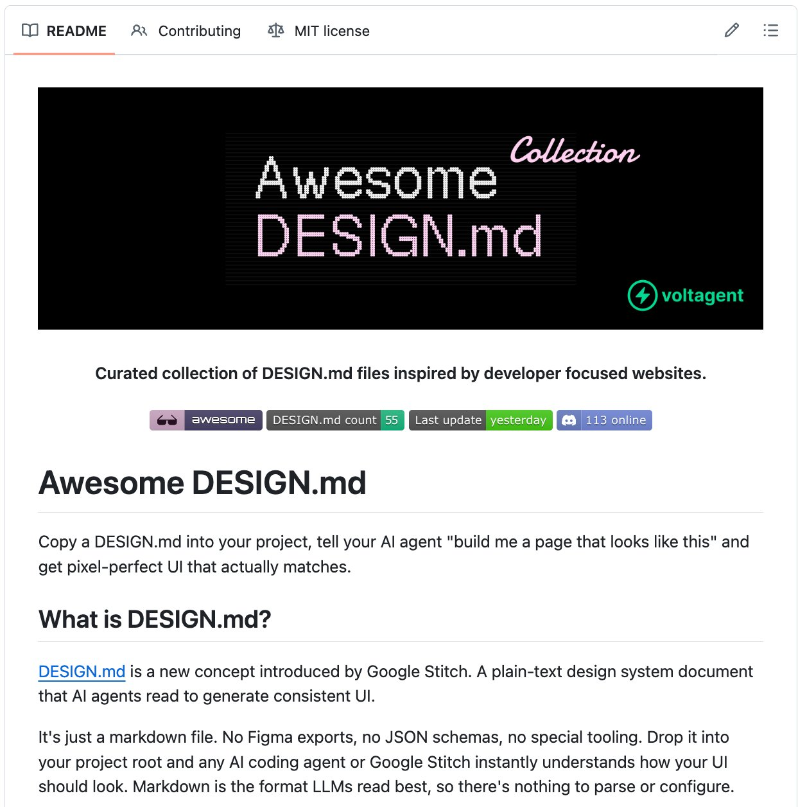

# 🚨 Someone reverse-engineered the design systems of Apple, Spotify, Airbnb, and 30+ billion-dollar companies. Packed

> Source: https://x.com/heynavtoor/status/2040339518822432893 — @heynavtoor (Nav Toor) — posted Sat Apr 04 08:03:43 +0000 2026 — 144 replies, 749 reposts, 7978 likes, 18271 bookmarks, 1475325 views — captured 2026-09-21T15:05:37Z
> Author bio: Helping you master AI daily with step-by-step AI guides, latest news, & practical tools • DM for Collabs

## Post

@heynavtoor

🚨 Someone reverse-engineered the design systems of Apple, Spotify, Airbnb, and 30+ billion-dollar companies.

Packed each one into a single file. Free.

It's called Awesome Design MD.

Drop one file into your project. Your AI agent builds UI that looks like Spotify. Or Apple. Or Airbnb. Instantly.

Not screenshots. Not Figma links. A single DESIGN .md file that captures every color, font, spacing value, button style, and layout pattern from a real website. In a format AI agents read and reproduce.

Here's the difference:

Tell Claude Code "build me a landing page" and it gives you generic UI.

Tell Claude Code "build me a landing page" with Spotify's DESIGN .md in your project and it gives you Spotify.

Here's what's inside:

→ Apple. Premium white space, SF Pro typography, cinematic imagery.
→ Spotify. Vibrant green on dark, bold type, album-art-driven layout.
→ Airbnb. Warm coral accent, photography-driven, rounded UI.
→ Linear. Ultra-minimal, precise spacing, purple accent.
→ SpaceX. Stark black and white, full-bleed imagery, futuristic.
→ BMW. Dark premium surfaces, precise German engineering aesthetic.
→ NVIDIA. Green-black energy, technical power aesthetic.
→ Uber. Bold black and white, tight type, urban energy.
→ Sentry, PostHog, Raycast, Cursor, ElevenLabs, and 20+ more.

Here's how to use it:

→ Pick a design system from the collection
→ Copy the DESIGN .md file into your project root
→ Tell your AI agent to use it
→ Get UI that matches the design language of a billion-dollar company

That's it. One file. Your AI agent now has the design taste of a $200/hour design consultant.

Designers charge $5,000+ for a custom design system. Companies spend $50,000+ building one from scratch.

This is free. 31 design systems. Copy. Paste. Ship beautiful UI.

Works with Claude Code, Cursor, Codex, and any AI coding agent that reads project files.

100% Open Source. MIT License.

## Media

Original: https://pbs.twimg.com/media/HFC9-rva8AE56mL.jpg?name=orig

## Comments

**@rarahh_bby** (2026-04-05T04:35:07.000Z) — https://x.com/rarahh_bby/status/2040649411307651385

followed you

**@itechnologynet** (2026-04-05T19:19:53.000Z) — https://x.com/itechnologynet/status/2040872070154744053

Ok, so they documented style, colors, and stuff ... not bad actually : kudos to that

But anyone thinking this replaces a competent design agency

**@steveMmattison** (2026-04-05T03:30:53.000Z) — https://x.com/steveMmattison/status/2040633244631060510

Awesome, useful af, ty!

**@NineArtss** (2026-04-05T10:38:34.000Z) — https://x.com/NineArtss/status/2040740875139965152

would appreciate an example

**@yaroo_dev** (2026-04-05T10:36:31.000Z) — https://x.com/yaroo_dev/status/2040740359911653768

The cheapest way to quickly redesign your entire codebase into another thing entirely. Why would I want to do that?

**@markmyprompt** (2026-04-04T12:16:11.000Z) — https://x.com/markmyprompt/status/2040403051568123935

Design taste just got commoditized, execution speed is the new advantage

**@bitcoin_eagle** (2026-04-05T11:21:30.000Z) — https://x.com/bitcoin_eagle/status/2040751681462263830

But is it already enshittified or before enshittification?

**@TomMarleyPlayed** (2026-04-05T17:36:34.000Z) — https://x.com/TomMarleyPlayed/status/2040846067944583350

Appreciate your effort here but the quality is far far away from any of these actual design systems. Shared some screenshots from the Airbnb example - I like the idea but it doesn’t seem usable surely?

**@s7trimm** (2026-04-04T23:38:55.000Z) — https://x.com/s7trimm/status/2040574868257681807

Who used it, share examples

**@chrisjohnston** (2026-04-05T21:43:13.000Z) — https://x.com/chrisjohnston/status/2040908140149944570

Many fonts are copyrighted and using them without a license could be copyright infringement. For instance, Apple fonts, such as San Francisco, are proprietary and licensed by Apple for specific uses, not sold.

**@AlwaysAlthough** (2026-04-05T16:11:46.000Z) — https://x.com/AlwaysAlthough/status/2040824730081493085

you are a legend for sharing this! thank you Nav

**@mrbiscuit** (2026-04-05T07:06:38.000Z) — https://x.com/mrbiscuit/status/2040687540533879092

This thing is getting spammed all over LinkedIn and now X

**@JaimeOrtega** (2026-04-05T19:27:06.000Z) — https://x.com/JaimeOrtega/status/2040873884849758260

If you are a designer and your first reaction is to bookmark this instead of cringing, you are probably going to struggle in this next era of design.

**@DanKasparov** (2026-04-05T05:14:43.000Z) — https://x.com/DanKasparov/status/2040659376944607281

Spotify has terrible ux

**@futrgoosefarmer** (2026-04-05T17:58:33.000Z) — https://x.com/futrgoosefarmer/status/2040851602832077191

This is pure bullshit. I bet it produces worse result than hiring a designer from Fiverr who just opened Figma 1am last night.
