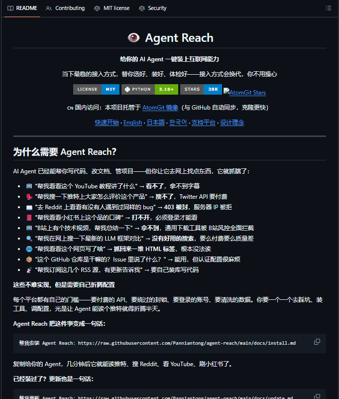

# WHAT IF CHATGPT HAD FREE ACCESS TO THE ENTIRE INTERNET? Agent-Reach open-source research

> Source: https://x.com/RodmanAi/status/2066063057277583700
> Author: Leonard Rodman (@RodmanAi)
> Posted: 2026-06-14T07:39:53Z
> Stats (at capture): 20,694 views · 170 likes · 25 replies · 41 reposts · 251 bookmarks · 1 quotes
> Captured: 2026-09-21T14:35:05Z

## Post

WHAT IF CHATGPT HAD FREE ACCESS TO THE ENTIRE INTERNET?

What if AI agents could search Twitter, Reddit, GitHub, and YouTube without paying for APIs?

That's exactly why Agent-Reach is blowing up on GitHub right now.

A new open-source project called Agent-Reach is exploding on GitHub.

It lets AI agents browse:

• Twitter/X posts and profiles
• Reddit threads and comments
• GitHub repos and issues
• YouTube videos and search results
• 10+ other platforms

All from a single install.

The crazy part?

Most AI agents are practically blind because API costs add up fast.

Twitter API? $$$
Reddit API? Rate limits.
YouTube API? Quotas.
Enterprise research tools? Even worse.

Agent-Reach skips all of that.

Setup takes about 2 minutes:

pip install agent-reach
agent-reach doctor
connect to your agent
done

Now your agent can perform real internet research without burning money on API subscriptions.

Perfect for:

• Research agents
• Market intelligence
• Competitive analysis
• Trend monitoring
• Content discovery

It's open source.
MIT licensed.
Works with Claude Code, Cursor, Aider, LangChain, and most agent frameworks.

23,000+ GitHub stars and climbing.

The biggest surprise?

People are still paying hundreds every month for data access that many agents can now get for free.

Bookmark this before you buy another API subscription.

↓ Repo in comments

## Media

Photo (`media/media_0.jpg`, 1600×900, 152 KB). Original: https://pbs.twimg.com/media/HKwhUH3akAA3tUk.jpg?name=orig

Photo (`media/media_1.png`, 681×801, 98 KB). Original: https://pbs.twimg.com/media/HKwhYAoacAA5Iom.png?name=orig

## Author bio (at capture)

Agentic AI builder. Loud opinions. Useful tools. 60k on LinkedIn • 42k on YouTube • Collabs promotions@rodman.ai
Location: Chicago, IL
Website: https://rodman.ai

## Thread

None (`replying_to` null). No author self-replies recovered via bridge (0 reply articles visible).

## Comments

25 replies per API. 0 visible. Bridge (logged-in, own tab, page URL verified before every extract, 3–8 scroll rounds per tweet): conversation returned only the main-post `<article>`; 0 reply `<article>` elements visible on any of the 15 tweets (one transient 2nd `<article>` on 2097738059844657256 was the embedded X-Article card, not a reply). A loading skeleton sat unresolved behind the reply position; reload did not resolve it — conversation endpoint not serving children to this session. fx/vx APIs return counts only, no reply list. `r.jina.ai` on `x.com`: AbuseAlleviation 403; on `fixupx.com`: login wall.
