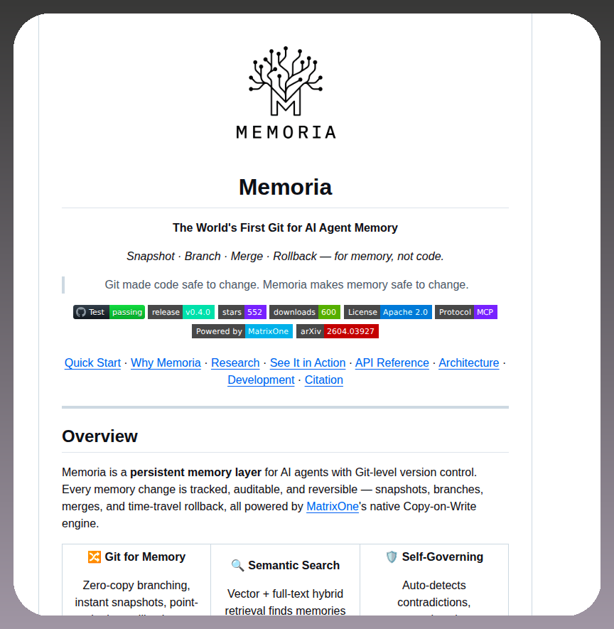

# Version controls AI agent memory with snapshots, branches, and merges https://github.com/matrixorigin/Memoria

> Source: https://x.com/tom_doerr/status/2087208634493095978 — Tom Dörr (@tom_doerr) — captured 2026-09-04T06:49:24Z

## Post

**Author:** Tom Dörr (@tom_doerr)
**URL:** https://x.com/tom_doerr/status/2087208634493095978

Version controls AI agent memory with snapshots, branches, and merges

https://github.com/matrixorigin/Memoria

## Media

## Links

- https://github.com/matrixorigin/Memoria
