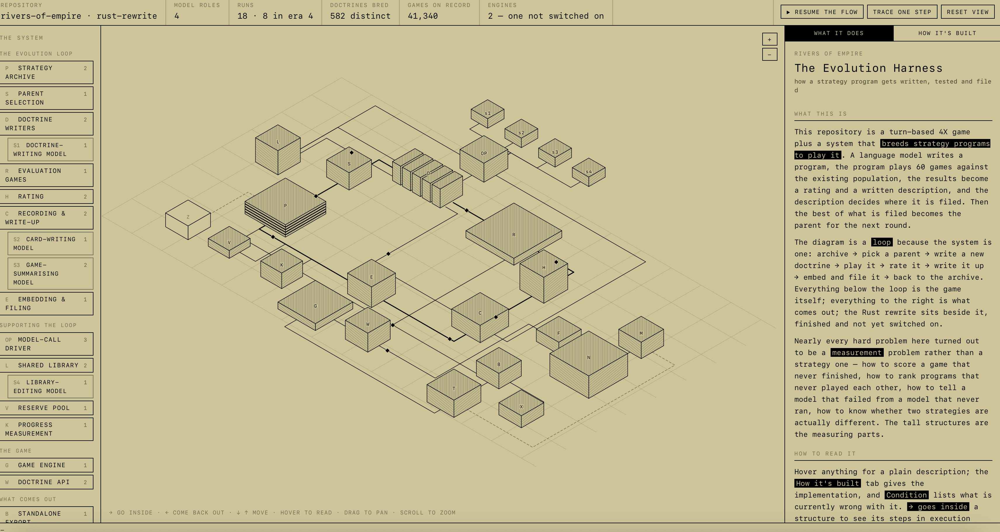

# i've started having claude turn my codebases into visual diagrams so i can discuss the codebases with claude more easily

> Source: https://x.com/fleetingbits/status/2088016749849682120
> Author: FleetingBits (@fleetingbits)
> Captured: 2026-09-04T06:49:28Z

## Post

i've started having claude turn my codebases into visual diagrams so i can discuss the codebases with claude more easily - the moving dots are data snippets that i can inspect

## Media

