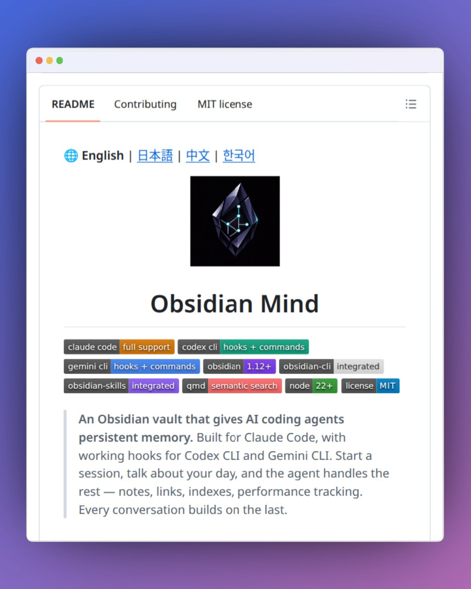

# Bro... imagine giving Claude Code a strong fuckin memory. 🧠 Obsidian Mind is an open-source Obsidian vault that gives AI

> Source: https://x.com/rammcodes/status/2088231655177924993
> Author: @rammcodes
> Captured: 2026-09-04T07:36:42Z

## Post

Bro... imagine giving Claude Code a strong fuckin memory. 🧠

Obsidian Mind is an open-source Obsidian vault that gives AI coding agents persistent memory across sessions.

It helps your agent keep track of projects, decisions, tasks, notes, and context, so it doesn't have to start from zero every time.

Works with Claude Code, Codex CLI, and Gemini CLI.

This is actually useful for AI coders :)

Source 🔗: github(DOT)com/breferrari/obsidian-mind

Follow me for more amazing AI, Coding & Web Dev insights 💎

## Media

## Links

- https://github.com/breferrari/obsidian-mind
