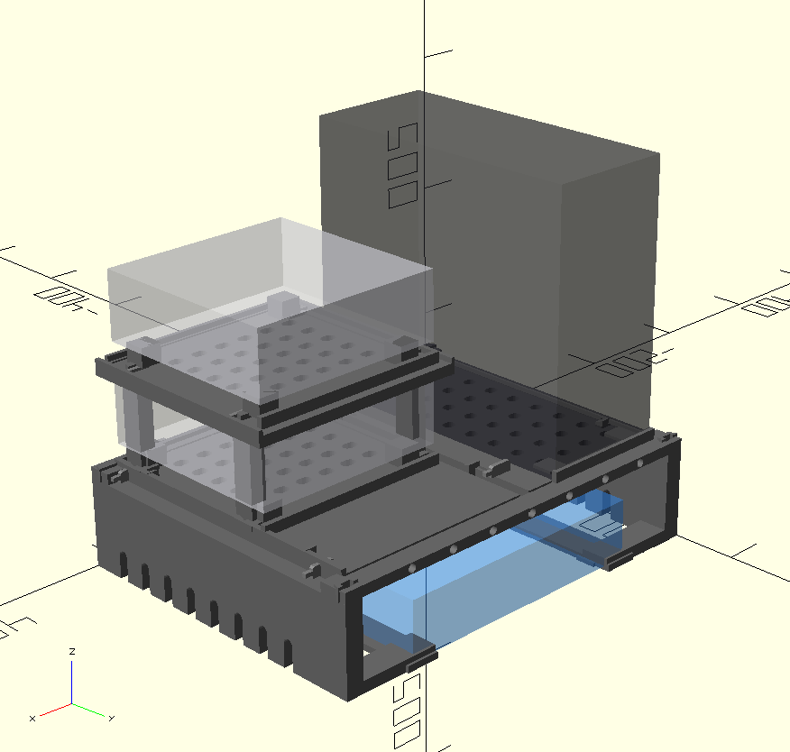
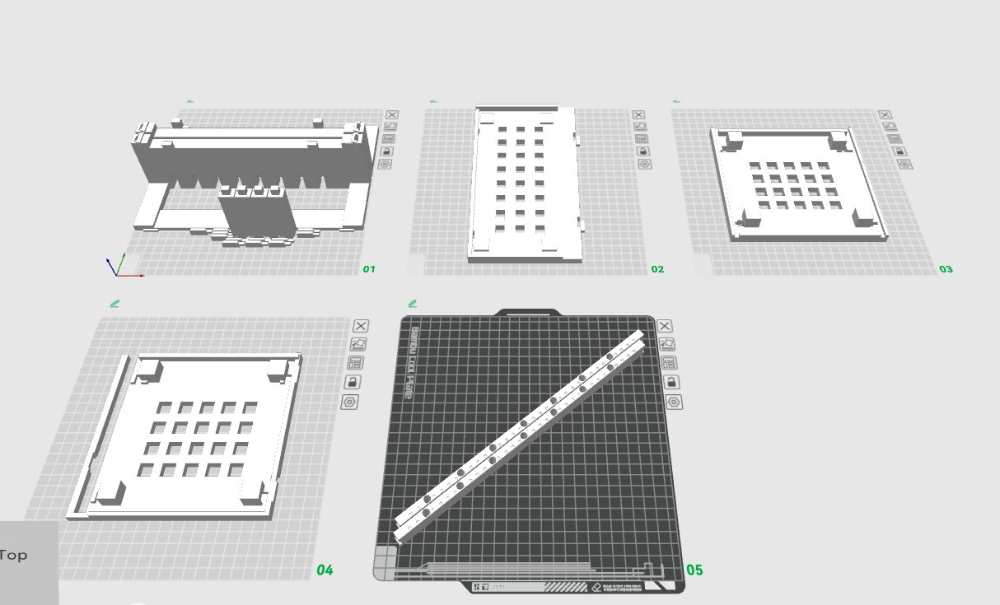

# OpenSCAD + Cursor + grill-me is incredible! I just made a custom homelab server device rack 1. Create an empty folder wi

> Source: https://x.com/anaisbetts/status/2088252062454751483
> Author: ani (@anaisbetts)
> Captured: 2026-09-04T06:49:28Z

## Post

OpenSCAD + Cursor + grill-me is incredible! I just made a custom homelab server device rack

1. Create an empty folder with grill-me
2. Plan mode, tell it the size of your space and list the items in the rack
3. Hit Go
4. Dump the STLs into Bambu Studio

## Media

