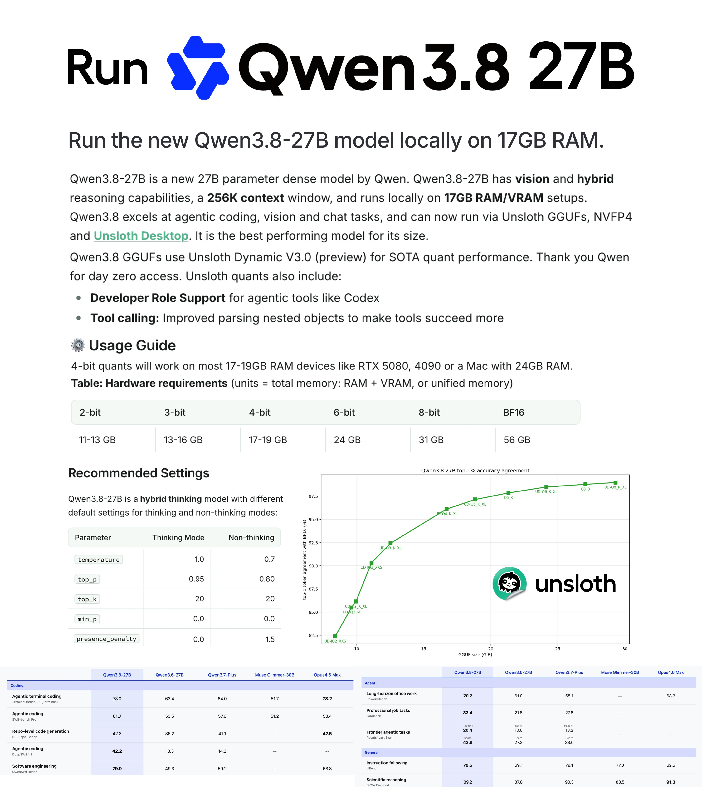

# Qwen3.8-27B can now be run locally! ✨ Run on 17GB RAM via Unsloth Dynamic GGUFs. Qwen3.8-27B is by far the strongest mod

> Source: https://x.com/UnslothAI/status/2088281537427235320
> Author: Unsloth AI (@UnslothAI)
> Captured: 2026-09-04T06:49:29Z

## Post

Qwen3.8-27B can now be run locally! ✨

Run on 17GB RAM via Unsloth Dynamic GGUFs.

Qwen3.8-27B is by far the strongest model for its size. We also uploaded NVFP4 quants.

GGUF: https://huggingface.co/unsloth/Qwen3.8-27B-GGUF
Guide: https://unsloth.ai/docs/models/qwen3.8

## Media

## Links

- https://huggingface.co/unsloth/Qwen3.8-27B-GGUF
- https://unsloth.ai/docs/models/qwen3.8
