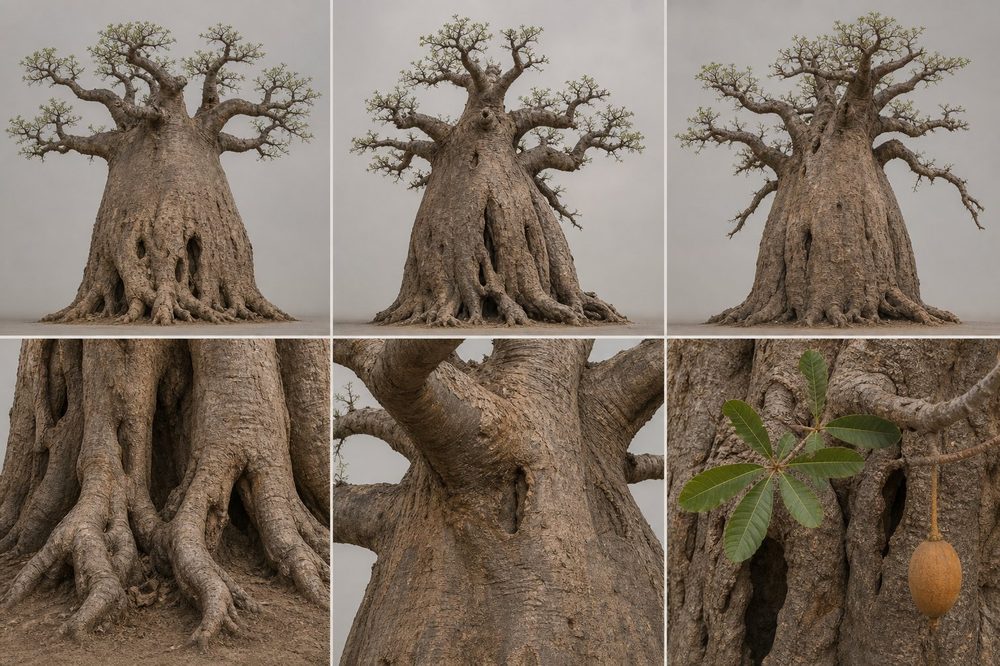
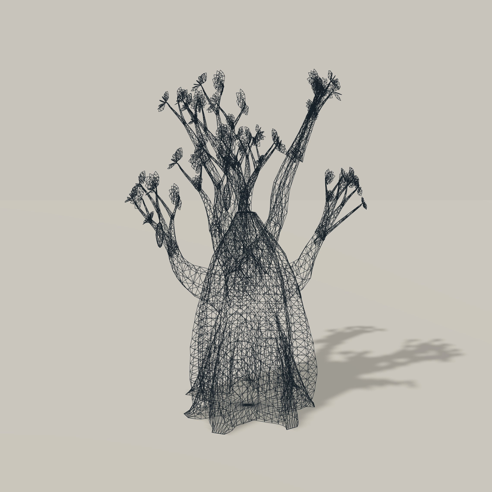
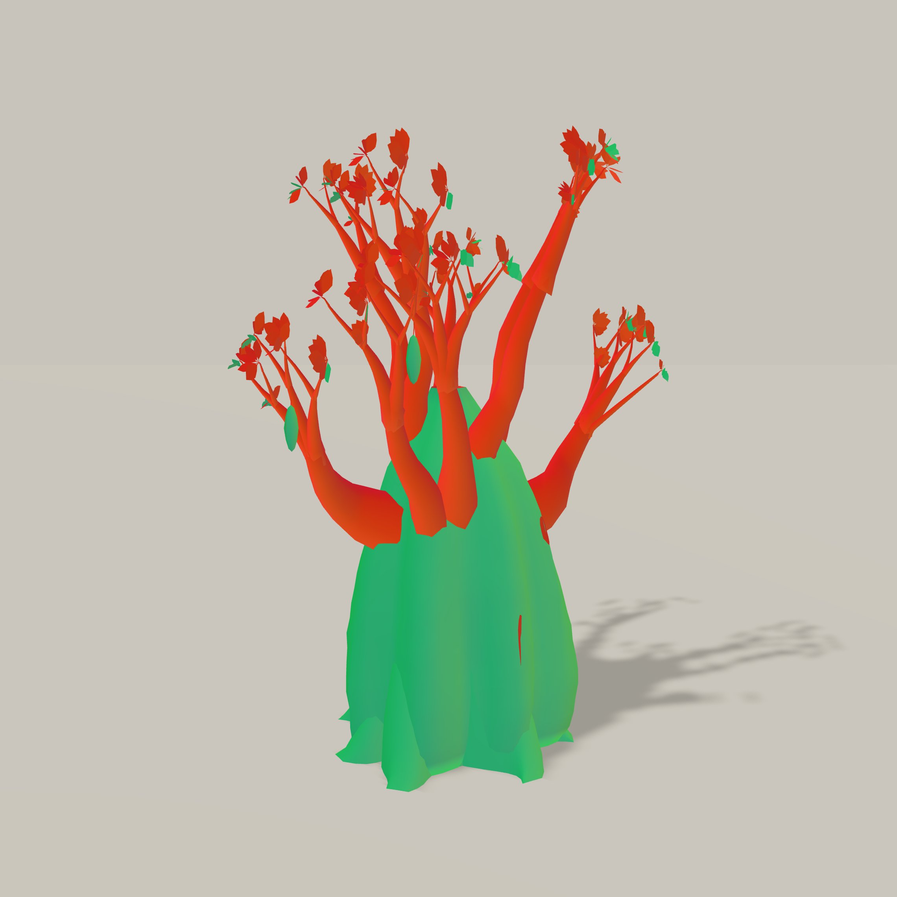
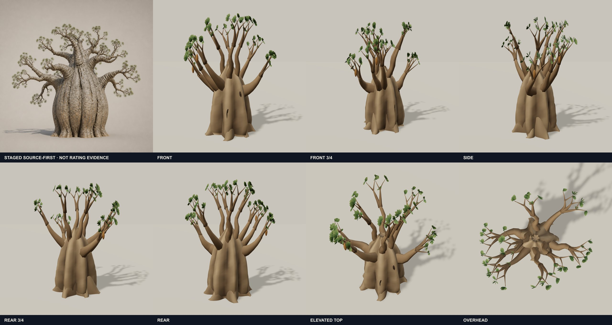

# #Threejs Here is how you will create detailed models using ai.  1) You need very good reference images 2) You need to

> Source: https://x.com/goxr3plus/status/2089094757750595713 — @goxr3plus (GoXR3Plus Studio) — posted Sun Aug 16 20:59:38 +0000 2026 — likes 11 · reposts 1 · replies 2 · views 1278 (at capture)

> Author bio: I create games, mobile apps, desktop apps, websites and real life gardens with beautiful flowers 🌸. Be kind to others cause life will come for all of us.

## Post

#Threejs Here is how you will create detailed models using ai.

1) You need very good reference images
2) You need to create a very good harness that captures the native bytes of the 3d scene / blender + screenshots from angles
3) On every iteration you have a rating system

## Media

Original (photo): https://pbs.twimg.com/media/HP30luxWEAAmBtN.jpg?name=orig

Original (photo): https://pbs.twimg.com/media/HP30mKQWYAAA8Ur.jpg?name=orig

Original (photo): https://pbs.twimg.com/media/HP30mm2WUAE8ULy.jpg?name=orig

Original (photo): https://pbs.twimg.com/media/HP30m7EXcAAcJo3.jpg?name=orig

## Thread

### @goxr3plus — [2089095217639010373](https://x.com/goxr3plus/status/2089095217639010373)

> @threejs 4) You tell your harness to apply texture mapping to your model when it's good enough.
>
> For example on the above images on the 4rth image the model is still on its second iteration. It may need 10+ iterations to look like the reference image.

### @goxr3plus — [2089095896847831520](https://x.com/goxr3plus/status/2089095896847831520)

> @threejs Truth is you can't vibe code everything. You need to understand what you are doing.
>
> Open you ai tool and ask it to explain you what are  textures, shaders, basic concepts of blender what is this what is that.
>
> Don't just prompt prompt prompt. You need to undertand how it works.

## Comments

No other visible replies.
