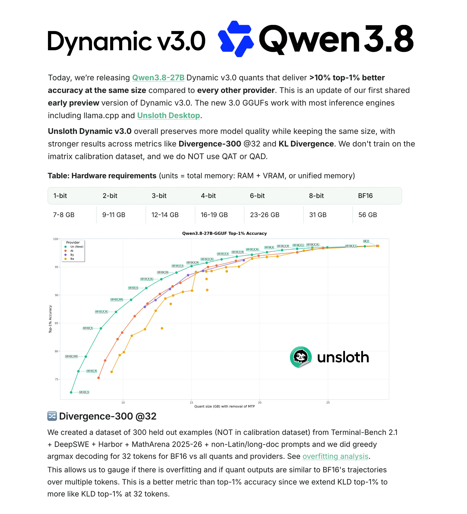

# We’re releasing new Qwen3.8-27B GGUFs with 10% higher accuracy. Unsloth Dynamic V3 outperforms others by >10% on Div-300

> Source: https://x.com/UnslothAI/status/2090103470015828184
> Author: Unsloth AI (@UnslothAI)
> Captured: 2026-09-04T06:49:31Z

## Post

We’re releasing new Qwen3.8-27B GGUFs with 10% higher accuracy.

Unsloth Dynamic V3 outperforms others by >10% on Div-300, KLD & more benchmarks.

We also release 1-bit quants that retain 77% accuracy. Run on 8GB RAM.

Blog: https://unsloth.ai/docs/basics/dynamic-3.0-ggufs
GGUF: https://huggingface.co/unsloth/Qwen3.8-27B-GGUF

## Media

## Links

- https://unsloth.ai/docs/basics/dynamic-3.0-ggufs
- https://huggingface.co/unsloth/Qwen3.8-27B-GGUF
