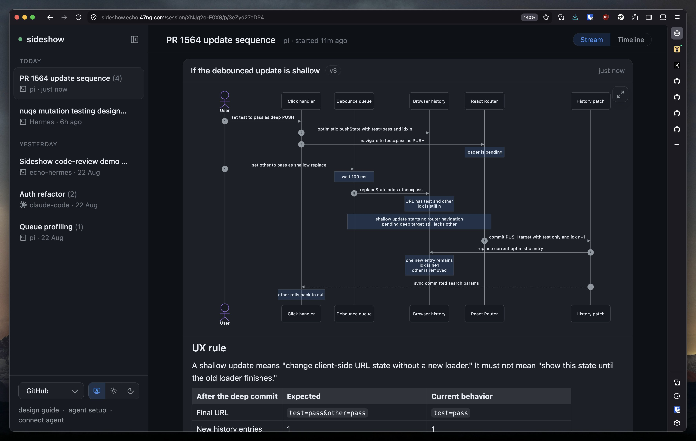

# Weekend project: setting up @bentlegen's http://sideshow.sh to visually understand & interact with my agents' work. This

> Source: https://x.com/fortysevenfx/status/2091622497393225801
> Author: @fortysevenfx
> Captured: 2026-09-04T07:36:44Z

## Post

Weekend project: setting up @bentlegen's http://sideshow.sh to visually understand & interact with my agents' work.

This is really good. If there is ever a path towards not reading the code, this kind of UX is a step in the right direction.

## Media

