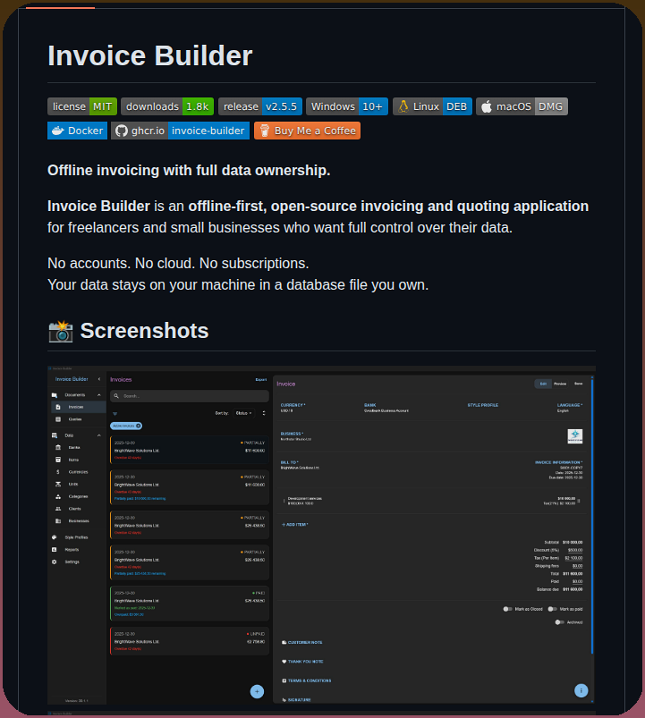

# Invoice Builder is an offline-first invoicing application for freelancers and small businesses. It creates and exports i

> Source: https://x.com/tom_doerr/status/2091729720303874220
> Author: @tom_doerr
> Captured: 2026-09-04T07:36:45Z

## Post

Invoice Builder is an offline-first invoicing application for freelancers and small businesses. It creates and exports invoices and quotes while storing all data locally in a database file, eliminating the need for cloud subscriptions or account registration.

https://github.com/piratuks/invoice-builder

## Media

