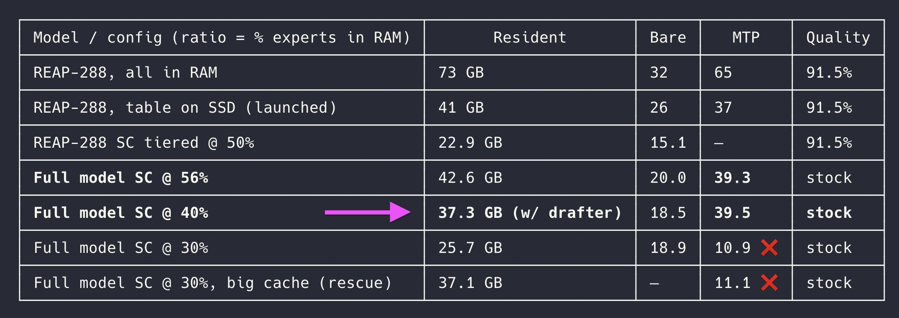

# Another Qwen3.8-Flash-Next breakthrough I stored 60% of experts on disk which stream to memory on-demand. Similar techni

> Source: https://x.com/EyalToledano/status/2093429897188299113
> Author: Eyal Toledano (@EyalToledano)
> Captured: 2026-09-04T06:49:46Z

## Post

Another Qwen3.8-Flash-Next breakthrough

I stored 60% of experts on disk which stream to memory on-demand. Similar technique as n-gram streaming

Just eval'd with FULL experts (no prune) running on just 37gb of memory and decoding at 40 tok/s on my M4 Max

Hold on to your socks!

## Media

