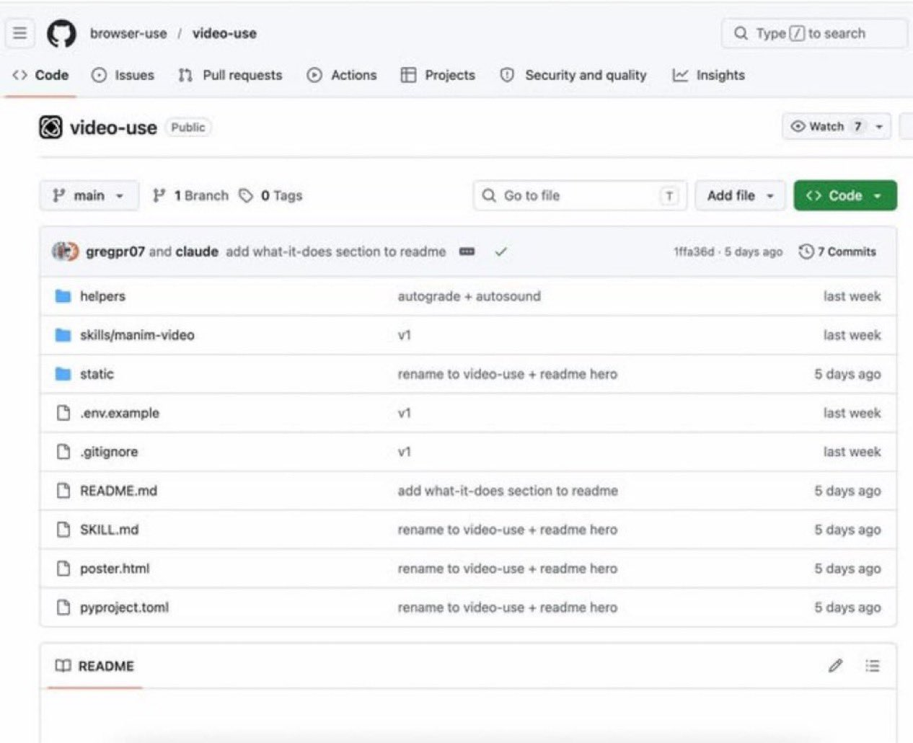

# 🚨 ADIÓS A LA EDICIÓN DE VIDEO Alguien acaba de crear una herramienta de edición de video gratuita para Claude Code... y 

> Source: https://x.com/lisaknowsai/status/2094061655990702150
> Author: @lisaknowsai
> Captured: 2026-09-04T07:36:47Z

## Post

🚨 ADIÓS A LA EDICIÓN DE VIDEO

Alguien acaba de crear una herramienta de edición de video gratuita para Claude Code... y es una locura.

Literalmente solo tienes que soltar tu material sin procesar + archivos en una carpeta.

Eso es todo.

Se encarga de TODO:

•Corta los clips
•Elimina las palabras de relleno
•Añade subtítulos
•Aplica corrección de color y filtros
•Maneja animaciones
•Renderiza el video final

Sin línea de tiempo. Sin edición manual. Sin rodeos.

Honestamente, esto va más allá de herramientas como Remotion.

No solo te ayuda a crear videos… hace la edición por ti.

El proyecto es open source en GitHub.

Se llama Video Use.

link debajo ⬇️

## Media

