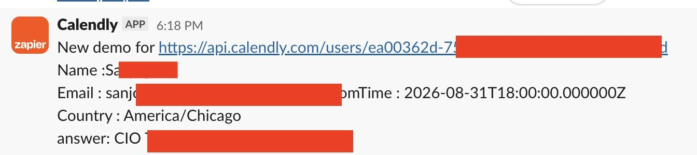

# GrokBot booked a demo via GojiberryAI MCP (97 prospects / 24h)

> Source: https://x.com/pierreeliottlal/status/2094326291906310180
> Author: Pierre-Eliott Lallemant (@pierreeliottlal)
> Posted: 2026-08-31T07:27:53Z
> Stats (at capture): 7,371 views · 66 likes · 12 replies · 6 reposts · 112 bookmarks · 1 quote
> Captured: 2026-09-02T18:49:18Z

## Post

GrokBot booked a demo with a 50-person company in less than 24 hours.

On a Friday night.

Here’s the exact setup:

→ I asked GrokBot to define a very specific ICP: job titles, company types, keywords, competitors, funding signals, etc.

→ Connected it to the [@gojiberryai](https://x.com/gojiberryai) MCP + our LinkedIn accounts.

→ GrokBot created outreach agents based on the ICP + buying signals it identified.

→ It found 97 prospects matching the criteria.

→ Enriched them with emails + phone numbers.

→ Researched every prospect individually.

→ Wrote a personalised message for each one.

→ And started sending connection requests.

Less than 24 hours later:

97 prospects contacted  
33 accepted  
15+ replied  
1 demo booked

And the demo came from a company with a 50-person team.

GrokBot came up with ICPs and messaging angles I honestly wouldn’t have thought of myself.

You can already do all of this directly inside [@gojiberryai](https://x.com/gojiberryai).

But putting GrokBot on top makes experimentation insanely fast.

You can test a new ICP, try a completely different messaging angle, launch outreach, and then ask GrokBot what’s actually working.

All from one conversation.

I’m going to let this run for a few more days and see where it goes.

But the more I experiment with this, the more I think SaaS is going headless.

Instead of opening 15 different dashboards, we’ll just tell Claude, GrokBot, or ChatGPT what we want done.

And the software underneath will just execute.

## Media

Slack still (`media/photo.jpg`, 1344×300, 41 KB) — Calendly via Zapier “New demo” ping at 6:18 PM. Name/email/API tail redacted in red. Visible: time `2026-08-31T18:00:00.000000Z`, timezone America/Chicago, answer field starts “CIO”.

## Author bio (at capture)

CEO [@gojiberryai](https://x.com/gojiberryai) (YC P26) | Building AI agents that find & book meetings with your next customers | 2,000 customers in 10 months | 1x exit  
Website: https://gojiberry.ai/

## Thread

### Pierre-Eliott Lallemant ([@pierreeliottlal](https://x.com/pierreeliottlal)) — [2094326998394871987](https://x.com/pierreeliottlal/status/2094326998394871987)

> Try https://gojiberry.ai for free here:

291 views · 2 likes · 1 bookmark. Product card: “Gojiberry AI - Grow your sales with warm leads & high intent outreach.”

## Comments

fx/vx return counts only. Visible replies from `r.jina.ai` on `http://fixupx.com/pierreeliottlal/status/2094326291906310180`, then `api.fxtwitter.com`. `r.jina.ai` on `x.com` blocked. Threadreader login wall.

12 replies on the original. 1 author self-reply + 1 first-level visible. Remaining ~10 behind X login. 1 quote unlisted.

### Mikhail (adhd arc) ([@short_usd](https://x.com/short_usd)) — [2094327144646365491](https://x.com/short_usd/status/2094327144646365491)

> tbf that's a prettty good conversion

92 views.

## Links

- https://github.com/romangojiberryAI/gojiberryai-sales-os
- https://gojiberry.ai/
- https://mcp.gojiberry.ai/mcp
- https://app.gojiberry.ai/registration
- https://x.com/gojiberryai/status/2095081419202560010
- https://x.com/pierreeliottlal/status/2094892848042725416

- **https://github.com/romangojiberryAI/gojiberryai-sales-os** — item `github-romangojiberryAI-gojiberryai-sales-os`. MIT, **70★** / 21 forks at this capture (GitHub API; existing `source.json` still has 69★ / 20 forks). Created 2026-09-01 (the day after this tweet). Hosted MCP `https://mcp.gojiberry.ai/mcp` (HEAD 200 `application/json`).
- Later CEO tree + video: item `x-2094892848042725416` (2026-09-01).
- Brand recap: item `x-2095081419202560010` (2026-09-02).
