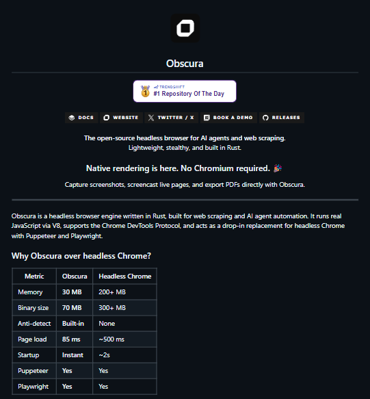

# Obscura — Rust headless browser for agents (claims ~22k★)

> Source: https://x.com/0xJokker/status/2094427822064279870
> Author: Jokker (@0xJokker)
> Posted: 2026-08-31T14:11:20Z
> Stats (at capture): 113,994 views · 1,762 likes · 46 replies · 211 reposts · 2,844 bookmarks · 12 quotes
> Captured: 2026-09-02T18:33:15Z

## Post

UN DESARROLLADOR ACABA DE HACER LO QUE GOOGLE LLEVA AÑOS IGNORANDO

Creo un navegador en Rust pensado especificamente para automatizar tareas, web scraping y agentes de IA

> Consume 30MB de RAM
> Las paginas cargan en 85ms
> Bloquea +3.500 trackers automaticamente
> Evita anuncios, analitica y scripts de tracking
> Tiene renderizado nativo. Sin Chromium

Se llama Obscura

Y tiene algo que Chrome jamas va a tener

Cada sesion genera una huella digital diferente. GPU, canvas, audio, bateria... todo randomizado

Los detectores no pueden atraparlo porque se comporta exactamente como Chrome real

Es un reemplazo directo de Puppeteer y Playwright

Sin Nodejs. Sin dependencias. Un solo binario

Tiene +22k estrellas en GitHub. 100% open source. Gratis

REPOO 👇

## Media

README-style still (`media/photo.png`, 541×583, 40 KB) — Obscura wordmark, Trendshift “#1 Repository Of The Day”, comparison table vs headless Chrome (30 MB / 70 MB binary / anti-detect / 85 ms / instant startup / Puppeteer + Playwright). Same claims as the post body.

## Author thread (repo URL)

Immediate self-reply [2094427823976886345](https://x.com/0xJokker/status/2094427823976886345) (same second as the note-tweet):

> https://github.com/h4ckf0r0day/obscura

8,868 views · 72 likes · 9 reposts · 135 bookmarks. GitHub card: “The headless browser for AI agents and web scraping.”

## Author bio (at capture)

Builder, Web3 + AI & Trader || Building @UltravioletaDAO || @AvaxTeam1🔺@Team1LatAm member || Team @casaweb3  
Location: XXX. No profile website.

## Thread

fx/vx return counts only. Self-reply with the GitHub card came from `r.jina.ai` on `http://fxtwitter.com/0xJokker/status/2094427822064279870` (fixupx 403 truncated the thread). Alfons + nested from fxtwitter HTML on Alfons’s status, then fx/vx APIs. Threadreader login wall. nitter.net offline.

46 replies on the original. 2 first-level visible (author repo card + Alfons). 3 nested on Alfons. Remaining ~41 behind X login. 12 quotes unlisted.

### Jokker ([@0xJokker](https://x.com/0xJokker)) — [2094427823976886345](https://x.com/0xJokker/status/2094427823976886345)

> https://github.com/h4ckf0r0day/obscura

The “REPOO 👇” target. 8,868 views · 72 likes · 9 reposts · 135 bookmarks.

## Comments

### Alfons 🐂🀄️ ([@0xalfons](https://x.com/0xalfons)) — [2094444514928677045](https://x.com/0xalfons/status/2094444514928677045)

> La parte realmente interesante no son los 30 MB de RAM.
> Es diseñar un navegador pensando desde el inicio en agentes y automatizacion, en lugar de adaptar un navegador tradicional para que los soporte.

4,902 views · 14 likes · 3 replies.

#### Jokker ([@0xJokker](https://x.com/0xJokker)) — [2094583832049541505](https://x.com/0xJokker/status/2094583832049541505)

> seeee por eso me llamo la atencion y me gusto

4,239 views · 1 like.

#### Uriel ([@uri__13](https://x.com/uri__13)) — [2094696557576589582](https://x.com/uri__13/status/2094696557576589582)

> Y como haces que Codex (por ejemplo) lo use? Hay que crear una skill sí o sí o hay plugin oficial?

29 views. Unanswered in the visible thread.

#### Ambitious Realism ([@AmbRealismX](https://x.com/AmbRealismX)) — [2094766408068399222](https://x.com/AmbRealismX/status/2094766408068399222)

> so very interesting...

GIF attached on X; not stored here. 17 views.

## Links

- https://github.com/h4ckf0r0day/obscura
- https://x.com/0xJokker/status/2094427823976886345
- https://obscura.sh
- https://docs.obscura.sh
- https://x.com/obscura_sh
- https://github.com/h4ckf0r0day/obscura/releases
