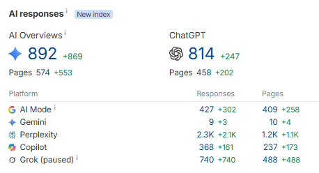

# A brand followed the advice in this article and generated more than $25,000 from ChatGPT, Google and Perplexity-driven t

> Source: https://x.com/alexgroberman/status/2094450512938856802
> Author: Alex Groberman (@alexgroberman)
> Captured: 2026-09-04T06:50:06Z

## Post

A brand followed the advice in this article and generated more than $25,000 from ChatGPT, Google and Perplexity-driven traffic.

## Thread

Captured via fxtwitter.

## Media

