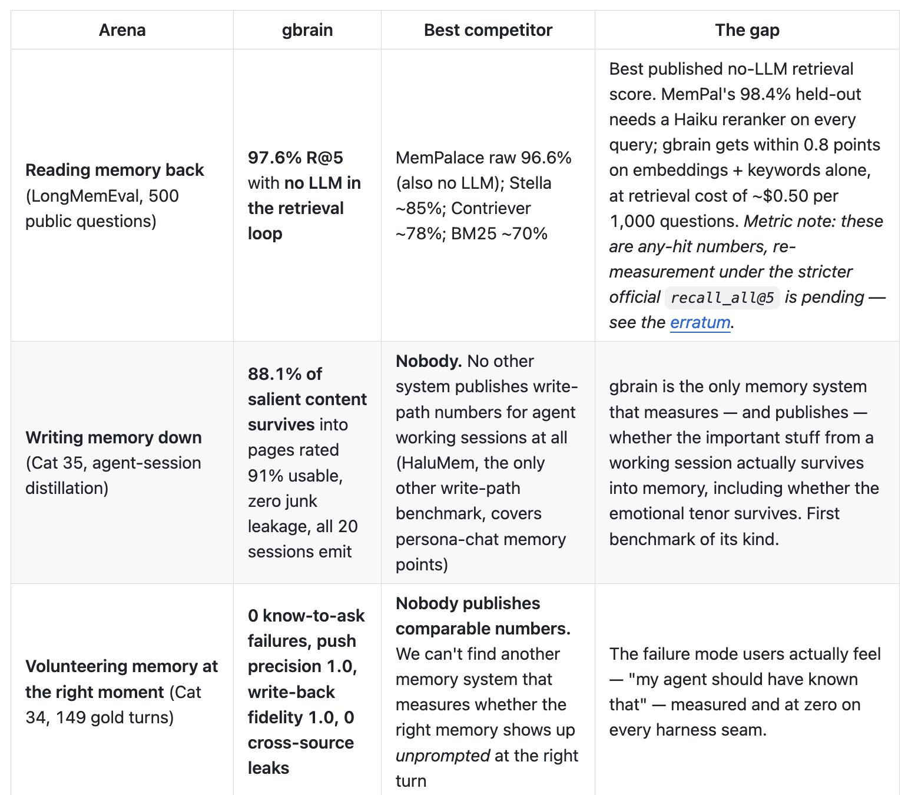

# GBrain evals — retrieval without LLM-in-loop + memory-save

> Source: https://x.com/garrytan/status/2094462971598754010
> Author: Garry Tan (@garrytan)
> Posted: 2026-08-31T16:31:00Z
> Stats (at capture): 52,953 views · 601 likes · 99 replies · 50 reposts · 664 bookmarks · 7 quotes
> Captured: 2026-09-02T18:49:18Z

## Post

I just made some new GBrain evals that help prove that my retrieval-for-AI-agent open source layer is SOTA for reading memory back without LLM-in-loop

And I've also added evals for memory-save from agent transcript, which is the best way to enrich your brain

Receipts at https://github.com/garrytan/gbrain-evals

## Media

README-style comparison table (`media/photo.jpg`, 1542×1352, 266 KB) — columns Arena / gbrain / Best competitor / The gap. Three rows in the still:

- **Reading memory back** (LongMemEval, 500 public questions): **97.6% R@5, no LLM in the retrieval loop** vs MemPalace raw 96.6% (also no LLM); Stella ~85%; Contriever ~78%; BM25 ~70%. Caption flags any-hit vs pending official `recall_all@5` erratum.
- **Writing memory down** (Cat 35, agent-session distillation): **88.1% of salient content survives** into pages rated 91% usable, “zero junk leakage,” all 20 sessions emit. “Nobody” as competitor.
- **Volunteering memory at the right moment** (Cat 34, 149 gold turns): 0 know-to-ask failures, push precision 1.0, write-back fidelity 1.0, 0 cross-source leaks.

Repo README at capture is longer (PrecisionMemBench, relational recall, self-audit). CHANGELOG after this tweet (0.6.0, 2026-09-01) revises some of the still’s wording — see `research.md`.

## Author bio (at capture)

President & CEO [@ycombinator](https://x.com/ycombinator) —Founder [@garryslist](https://x.com/garryslist)—Creator of GStack & GBrain—designer/engineer who helps founders—SF Dem accelerating the boom loop  
Location: San Francisco, CA  
Website: https://youtube.com/garrytan?sub_confirmation=1

## Thread

fx/vx return counts only. `r.jina.ai` on `x.com` blocked (AbuseAlleviation until 2026-09-02T19:31:55Z). `r.jina.ai` on `http://fixupx.com/garrytan/status/2094462971598754010` listed **three replies without status IDs**. User profile pages on fixupx returned 422. Threadreader login wall. nitter.space Cloudflare challenge.

99 replies on the original. 3 first-level visible (IDs unlisted). Remaining ~96 behind X login. 7 quotes unlisted.

None (`replying_to` null). Body + GitHub URL in `post.md`.

## Comments (IDs not in fixupx HTML)

### [@teneo_protocol](https://x.com/teneo_protocol)

> Most people think agent memory = vector search. It isn't. The real challenge is deciding what deserves to survive and retrieving it at exactly the right moment.

### [@Elev_30](https://x.com/Elev_30)

> the eval set and the retrieval layer have the same author. what does gbrain score on a memory benchmark somebody else wrote?

### [@iabdul_wasey](https://x.com/iabdul_wasey)

> memory evals are the part everyone skips. most agent memory demos measure 'did it store' and never 'did it retrieve the right thing under a paraphrase'. and retrieval without llm-in-loop is the latency win: sub-100ms recall instead of a full model call per lookup

## Links

- https://github.com/garrytan/gbrain-evals
- https://github.com/garrytan/gbrain
- https://arxiv.org/abs/2604.21284
