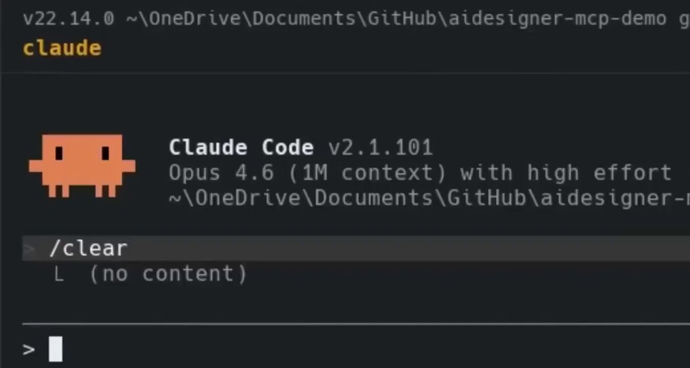

# MCP that clones any site's HTML/CSS for Claude Code (AIDesigner)

> Source: https://x.com/robinstetic/status/2094467179320119498
> Author: robin. (@robinstetic)
> Posted: 2026-08-31T16:47:43Z
> Stats (at capture): 23,737 views · 385 likes · 22 replies · 61 reposts · 476 bookmarks · 2 quotes
> Captured: 2026-09-02T18:33:15Z

## Post

Esta persona le dio a Claude Code la capacidad de replicar el diseño de cualquier web.

Montó un MCP que analiza el HTML/CSS de cualquier página y extrae colores, tipografía y componentes.

Resultado: interfaces limpias por fin.

Guárdatelo 🔖

## Media

[media/video.mp4](media/video.mp4)

55.7s amplify video (`media/video.mp4`, 1350×720, 7.7 MB) + thumb (`media/thumb.jpg`, 1200×640). Demo of Claude Code in `aidesigner-mcp-demo` calling the **AIDesigner** MCP (`aidesigner-frontend` skill, `get_credit_status`) to clone/inspire from live URLs (browserbase.com, linear.app, cluely.com, PostHog-style SnooStats, agent0, yellowpages.com / wunderground.com before-after). Tweet/thread does not include a URL; product from the video is [AIDesigner MCP](https://www.aidesigner.ai/ai-ui-design-mcp).

## Author bio (at capture)

25 | turning AI products into brands people remember | @aiscwork  
Website: https://aiscwork.com

## Thread

fx/vx return counts only. Visible replies from `r.jina.ai` on fixupx.com / fxtwitter.com, then re-fetched via vx/fx APIs. Nested robin reply from fxtwitter HTML on kai’s status. Threadreader login wall. nitter.net offline.

22 replies on the original. 3 first-level visible. 1 nested (robin). Remaining ~18 behind X login. 2 quotes unlisted. No MCP/repo URL in the tweet or in the captured replies (one reply is “Wheres the link?”).

None on the original (`replying_to` null). robin’s captured reply is nested under kai (below), not a link drop.

## Comments

### ratheon ([@ramondi62306813](https://x.com/ramondi62306813)) — [2094536164858343833](https://x.com/ramondi62306813/status/2094536164858343833)

> Wheres the link?

138 views · 1 like. Unanswered in the visible thread.

### Dima Glushakov ([@DGlushakov41949](https://x.com/DGlushakov41949)) — [2094472230650421464](https://x.com/DGlushakov41949/status/2094472230650421464)

> El MCP resuelve bien la capa visual, Robin. El reto de verdad está en capturar estados, comportamiento responsive y accesibilidad, ahí se nota si Claude Code reconstruye el sistema o solo imita una captura.

335 views · 1 like.

### kai. ([@kaido_xr](https://x.com/kaido_xr)) — [2094468002632663342](https://x.com/kaido_xr/status/2094468002632663342)

> buen uso de MCP, este es de los casos que tienen sentido de verdad

922 views · 1 like · 1 reply.

#### robin. ([@robinstetic](https://x.com/robinstetic)) — [2094470675972964493](https://x.com/robinstetic/status/2094470675972964493)

> se nota cuando alguien resuelve un problema real en vez de conectar por conectar

845 views. Still no product URL.

## Links

- https://www.aidesigner.ai/ai-ui-design-mcp
- https://www.aidesigner.ai/docs/mcp
- https://www.aidesigner.ai/
- https://www.aidesigner.ai/website-cloner
- https://api.aidesigner.ai/api/v1/mcp
- https://www.npmjs.com/package/@aidesigner/agent-skills
- https://aiscwork.com
