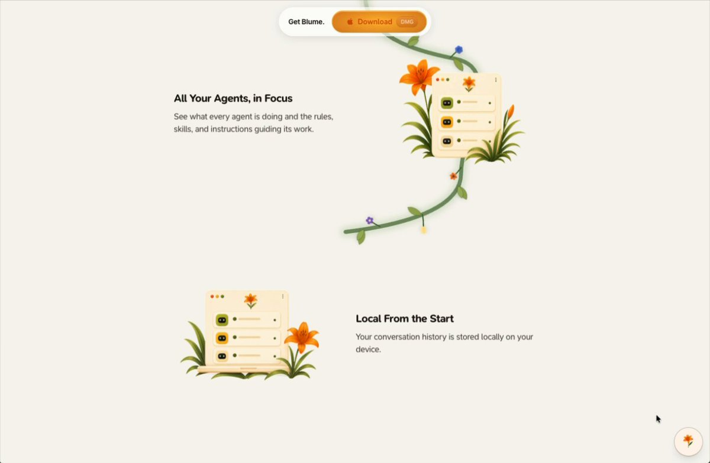

# How we built the blume.codes landing page (X article)

> Source: https://x.com/olavlj/status/2094524951025914278
> Author: olav (@olavlj)
> Posted: 2026-08-31T20:37:17Z
> Stats (at capture): 46,503 views · 424 likes · 13 replies · 20 reposts · 1,285 bookmarks · 6 quotes
> Captured: 2026-09-02T18:49:18Z

## Post

many have asked how we built our landing page. today we are spilling the tea!

excited to see what you come up with https://x.com/i/article/2094493136743473152

## Article
[How We Built a Next-Level Landing Page (and how you can too)](https://x.com/i/article/2094493136743473152) — created 2026-08-31T20:37:17Z (same timestamp as the tweet). 68 content blocks via `api.fxtwitter.com`. Direct article URL login-walled; body from the fxtwitter article payload.

Preview: “Building beautiful websites is easy now, but it wasn’t always like this. In my first company this was a perpetual frustration. We hired expensive agencies and designers who spent months building…”

Cover: `media/article-cover.jpg` (1070×428, 27 KB) — “All Your Agents, in Focus” + cream UI card among foliage.

Four elements the article walks through (see `research.md`):

1. Hero parallax (Codex + GPT image layers; Makoto Shinkai-ish landscape)
2. Interactive product “screenshots” (Turborepo: landing page consumes the same UI package as the Electron app)
3. Flowery “journey” vector vine (scroll-drawn path + daily-seeded Dicebear flower crowns)
4. Flower theme picker (six themes, including generated page graphics)

## Media

[media/article-video-interactive.mp4](media/article-video-interactive.mp4)
[media/article-video-theme.mp4](media/article-video-theme.mp4)
[media/article-video-vine.mp4](media/article-video-vine.mp4) (from the article)

- Hero still (`media/article-hero-still.jpg`, 1199×896) — blume hero: “Tired of steering your coding agents?”, Download DMG Apple Silicon v1.0.71, floating Cursor/Codex/Claude Code windows over sunflower field.
- Reference landscape (`media/article-reference.jpg`, 1200×799) — the Codex vibe still (flowers, depth, Shinkai-like sky).
- Layer cards (`media/article-layers.jpg`, 1199×675) — eight panels from far mountains to foreground flowers.
- Interactive demo video (`media/article-video-interactive.mp4`, 16.4s, 1420×926, 2.3 MB) + thumb. Entity sits under “Interactive Product Demo”.
- Vine video (`media/article-video-vine.mp4`, 11.8s, 1420×926, 831 KB) + thumb. Entity sits under the sprouting-vine section.
- Theme video (`media/article-video-theme.mp4`, 19.3s, 1420×926, 3.5 MB) + thumb. Entity sits under the six-flower theme section.

The tweet itself has no native photo/video; the card is the article.

## Author bio (at capture)

galactic problem solver and seer of the future  
• founder & ceo [@blumedotcodes](https://x.com/blumedotcodes)  
Location: Toronto, Ontario  
Website: http://blume.codes

## Thread

fx/vx return counts only. `r.jina.ai` on `x.com` blocked (AbuseAlleviation until 2026-09-02T19:31:55Z). `r.jina.ai` on `http://fixupx.com/olavlj/status/2094524951025914278` and `/i/status/...` rendered the **article body**, not a reply list. fxtwitter HTML same. Threadreader login wall.

13 replies on the tweet. **0 visible.** 6 quotes unlisted. Remainder behind X login.

None (`replying_to` null). The “thread” is the X article linked in the tweet (`2094493136743473152`), captured in `post.md` / `research.md`.

## Comments

None visible without X login.

## Links

- https://x.com/i/article/2094493136743473152
- https://blume.codes
- https://fal.ai
- https://www.dicebear.com
