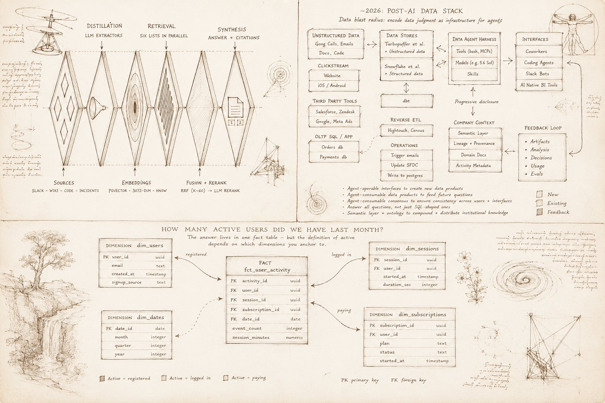

# AI-native company #3: centralized intelligence layer

> Source: https://x.com/medriscoll/status/2094558408259272998
> Author: Michael E. Driscoll (@medriscoll)
> Posted: 2026-08-31T22:50:14Z
> Stats (at capture): 16,411 views · 93 likes · 6 replies · 8 reposts · 216 bookmarks · 1 quote
> Captured: 2026-09-02T18:33:15Z

## Post

What the #3 defining feature of an AI-native company?

"Centralized intelligence layer that aggregates structured and unstructured data, documents, and business logic into a single source of truth that is queryable & agentic work can be done on top of." *

This is what data teams at [@tryramp](https://x.com/tryramp), [@cerebras](https://x.com/cerebras), and [@AnthropicAI](https://x.com/AnthropicAI)  have been building and writing about lately. If you want to follow the frontier, here are links to the relevant articles:

The Shape and Feel of the Post-AI Data Stack
https://x.com/iandmacomber/status/2094161204579098774 (by [@iandmacomber](https://x.com/iandmacomber) of Ramp)

Cerebras:  How we built our knowledge base
https://x.com/cerebras/status/2077822555159945507 (by [@hi_im_isaac_](https://x.com/hi_im_isaac_), [@learnwdaniel](https://x.com/learnwdaniel), [@gaozenghao](https://x.com/gaozenghao))

How Anthropic enables self-service data analytics with Claude (by [@clementpzy](https://x.com/clementpzy) and colleagues) https://x.com/ClaudeDevs/status/2062274312363770064

* Original post by [@businessbarista](https://x.com/businessbarista) here: https://x.com/businessbarista/status/2094213970215231831

## Media

Da Vinci–styled collage (`media/photo.jpg`, 1536×1024, 302 KB): Cerebras-style retrieval funnel (Slack/wiki/code → distillation → pgvector → RRF/rerank), Ramp “~2026 post-AI data stack” (Snowflake + Turbopuffer, data agent harness with tools/MCPs/models/skills), and a star-schema sketch for “how many active users last month.”

## Quoted post

[Alex Lieberman (@businessbarista), 2026-08-31T00:01:33Z](https://x.com/businessbarista/status/2094213970215231831) — 104,003 views · 849 likes · 112 replies · 82 reposts · 2,345 bookmarks · 22 quotes

Note-tweet “30 features of an AI native company.” Item 3 is the quoted intelligence-layer sentence. Full list is in the fx payload; not duplicated here.

## Linked posts (not captured as folders)

- Ramp / Ian Macomber: https://www.iandmacomber.com/blog/post-ai-data-stack (tweet 2094161204579098774; 114,712 views · 430 likes · 24 replies at capture)
- Cerebras X article “How we built our knowledge base” (article id 2077808214062825472) + https://www.cerebras.ai/blog/how-we-built-our-knowledge-base (tweet 2077822555159945507; 3,593,441 views · 5,600 likes · 99 replies)
- Anthropic: https://claude.com/blog/how-anthropic-enables-self-service-data-analytics-with-claude (tweet 2062274312363770064; 4,191 likes · 91 replies)

## Author bio (at capture)

Founder @RillData, building the fastest BI tool for humans and agents.  
Location: San Francisco, CA.  
Website: http://www.rilldata.com/

## Thread

fx/vx return counts only. Visible replies from `r.jina.ai` on fixupx.com / fxtwitter.com, then vx/fx APIs. Quoted Lieberman is in `post.md`, not a reply. Threadreader login wall. nitter.net offline.

6 replies on the original. 3 first-level visible. RMB’s tweet shows 1 nested reply that was not listed. Remaining 3 login-walled. 1 quote unlisted.

None (`replying_to` null). Body is the note-tweet in `post.md`.

## Comments

### Rob Bailey ([@RMB](https://x.com/RMB)) — [2094565845884080286](https://x.com/RMB/status/2094565845884080286)

> Great post MD!

187 views · 2 likes · 1 reply (nested not listed).

### David Gasquez ([@davidgasquez](https://x.com/davidgasquez)) — [2094714982906708067](https://x.com/davidgasquez/status/2094714982906708067)

> Wrote about #3 too recently.
>
> https://x.com/davidgasquez/status/2085803390391460099
>
> There are still many things to figure out. I'd love to see more companies posting and sharing their approach!

170 views · 2 likes. Quoted [2085803390391460099](https://x.com/davidgasquez/status/2085803390391460099):

> Wrote about why context engineering is a data problem.
>
> Organizations need to own the process that turns raw sources into useful artifacts for their agents.
>
> Much of this is work data teams already know how to do!

Blog: https://davidgasquez.com/context-engineering-is-a-data-problem

### Finlay ([@finlayekins](https://x.com/finlayekins)) — [2094597350778188000](https://x.com/finlayekins/status/2094597350778188000)

> Fully agree! We implement our own version of this for customers, I wonder if the future of this will be a tool like Glean, or an on-prem version that the company owns themselves

137 views · 2 likes.

## Links

- https://x.com/iandmacomber/status/2094161204579098774
- https://www.iandmacomber.com/blog/post-ai-data-stack
- https://x.com/cerebras/status/2077822555159945507
- https://www.cerebras.ai/blog/how-we-built-our-knowledge-base
- https://x.com/ClaudeDevs/status/2062274312363770064
- https://claude.com/blog/how-anthropic-enables-self-service-data-analytics-with-claude
- https://x.com/businessbarista/status/2094213970215231831
- https://x.com/davidgasquez/status/2085803390391460099
- https://davidgasquez.com/context-engineering-is-a-data-problem
- https://www.rilldata.com/
