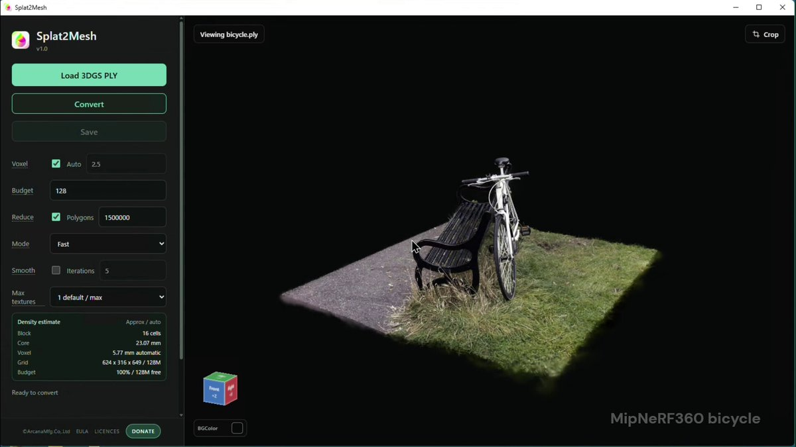

# Splat2Mesh launch (JA) — 3DGS PLY → OBJ/GLB

> Source: https://x.com/ArcanaMfg/status/2094648474377839018
> Author: Arcana Mfg.Co.,Ltd. | 株式会社Arcana製作所 (@ArcanaMfg)
> Posted: 2026-09-01T04:48:07Z
> Stats (at capture): 59,854 views · 604 likes · 0 replies · 117 reposts · 625 bookmarks · 10 quotes
> Captured: 2026-09-02T18:33:15Z

## Post

3DGSをMeshへ変換するソフトウェア「Splat2Mesh」を本日公開しました！
3D Gaussian SplattingデータをOBJ / GLB形式へ変換できます。
個人利用・非商用利用は無料です。
https://arcana-mfg.com/splat2mesh/
English: https://arcana-mfg.com/en/splat2mesh/
#Splat2Mesh #3DGS #LichtFeldStudio #3DPrint

## Media

[media/quoted-video.mp4](media/quoted-video.mp4)

Launch tweet has no native stills. It **quotes** the Aug 28 teaser, whose 70.6s amplify video is stored here (`media/quoted-video.mp4`, 1920×1080, 32.7 MB) + thumb (`media/quoted-thumb.jpg`, 1200×675) — Splat2Mesh v1.0 UI loading MipNeRF360 `bicycle.ply`. The 110 MB installer was **not** downloaded (HEAD `Content-Length: 115644270`).

Already in this library (not rewritten): product page `web-arcana-splat2mesh` (https://arcana-mfg.com/en/splat2mesh/) and 3dnchu recap `x-2094826117056414132`.

## Quoted post

[Arcana Mfg. (@ArcanaMfg), 2026-08-28T03:32:17Z](https://x.com/ArcanaMfg/status/2093179838249251011) — 58,947 views · 384 likes · 10 replies · 58 reposts · 307 bookmarks · 3 quotes

> 3DGSをメッシュ変換するソフトを近日公開予定です。
> ローカル環境で動作し、GPUなども不要です。
> 基本無料でどなたでもご利用いただけるように準備しています！
> #3DGS #LichtFeldStudio #3DPrint

## Author bio (at capture)

長野県で活動中のベンチャー企業です。
全身3Dスキャナーや卓上3Dスキャナーの開発·販売や様々な受託開発をしています。
Great ideas for tomorrow! We are developing 3D scanners.
#FacTrans #3DScanner #ArcanaMfg  
Location: 長野県東御市.  
Website: https://arcana-mfg.com/

## Thread

fx/vx return counts only. `r.jina.ai` on fixupx.com / fxtwitter.com showed the launch tweet + quoted teaser and **no replies**. Threadreader login wall. nitter.net offline.

0 replies on the original. 10 quotes exist; none listed by fx/vx. Quoted Aug 28 teaser has 10 replies of its own (not this conversation; not expanded here).

None (`replying_to` null). Body is the launch post in `post.md`. The quoted status is the same account’s teaser, not a reply.

## Comments

None captured. Quote tweets unlisted.

## Links

- https://arcana-mfg.com/en/splat2mesh/
- https://arcana-mfg.com/splat2mesh/
- https://x.com/ymt3d/status/2094826117056414132
- https://x.com/ArcanaMfg/status/2093179838249251011
- https://arcana-mfg.com/
- https://github.com/ArcanaMfg
- https://3dnchu.com/archives/splat2mesh/
