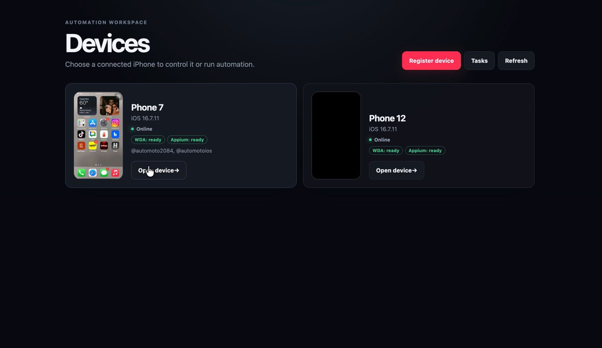

# done, it's open source now ✅ iOS phone farm - register real iPhones, watch + control them live in the browser, schedule

> Source: https://x.com/consumerxai/status/2094671763020132565
> Author: An Nayal (@consumerxai)
> Posted: Tue Sep 01 06:20:40 +0000 2026
> Stats (at capture): 969,472 views · 4,227 likes · 106 replies · 1788260120 reposts · 10,947 bookmarks · 27 quotes
> Captured: 2026-09-21T13:30:16Z

## Post

done, it's open source now ✅

iOS phone farm - register real iPhones, watch + control them live in the browser, schedule tiktok on a postgres-backed scheduler. 

free, self-hosted, apache-2.0.

- git: https://github.com/Git-Agni/prod-FARM-IOS-Core
- DIY steps: https://gethandler.ai/ios-farm

## Media

[media/quoted-video.mp4](media/quoted-video.mp4)

Originals:

- quoted: https://video.twimg.com/amplify_video/2092166032999710720/vid/avc1/2718x1574/80T3ThIGky6XO0tj.mp4?tag=29
- quoted thumb: https://pbs.twimg.com/amplify_video_thumb/2092166032999710720/img/MPdntVQM_96GGMzw.jpg

## Author bio (at capture)

🪐 building http://agniverse.co (growth universe for apps)
❤️‍🔥 built flamme (acquired by arya)
👩‍🌾 win tiktok with @handlerai_
💭 "ffs, not again"

## Quoted post

[An Nayal (@consumerxai)](https://x.com/consumerxai/status/2092166236801007754) — Tue Aug 25 08:24:36 +0000 2026
— 455,977 views · 452 likes · 37 replies · 15 reposts · 624 bookmarks

> complete remote controlled iOS phone farm
> 
> learning from the chinese friends, building a better version
> 
> shall we open source this?

## Thread

### @consumerxai — [https://x.com/consumerxai/status/2094679153887039618](https://x.com/consumerxai/status/2094679153887039618) — 2026-09-01T06:50:02.000Z

we're running it on our end and no shadow ban

ofc account needs to have no duplicate content, not get flagged by using AI etc (as long as you follow general rules, this gives same exact results as manual human posting)

### @consumerxai — [https://x.com/consumerxai/status/2095055562635633138](https://x.com/consumerxai/status/2095055562635633138) — 2026-09-02T07:45:45.000Z

chufei iphone yiwai, bu yao zhunbai shenme qiata de. zhi yao you ge macbook he iphones jiu keyi

mai iphone 8 huozhe 10, bu yong mai tai gui de

### @consumerxai — [https://x.com/consumerxai/status/2094694883625967791](https://x.com/consumerxai/status/2094694883625967791) — 2026-09-01T07:52:32.000Z

yes please do and put in feedback 

### @consumerxai — [https://x.com/consumerxai/status/2095113062730916297](https://x.com/consumerxai/status/2095113062730916297) — 2026-09-02T11:34:14.000Z

wda + appium + iOS actions

### @consumerxai — [https://x.com/consumerxai/status/2094741767161835893](https://x.com/consumerxai/status/2094741767161835893) — 2026-09-01T10:58:50.000Z

holy let's make it happen 

### @consumerxai — [https://x.com/consumerxai/status/2094741478371418172](https://x.com/consumerxai/status/2094741478371418172) — 2026-09-01T10:57:41.000Z

no ai slopping please

### @consumerxai — [https://x.com/consumerxai/status/2094683768967827613](https://x.com/consumerxai/status/2094683768967827613) — 2026-09-01T07:08:22.000Z

go get printing bro 

## Comments

### @andiliu — [https://x.com/andiliu/status/2094932568340935031](https://x.com/andiliu/status/2094932568340935031) — 2026-09-01T23:37:00.000Z

Awesome, I've been looking for a reliable group control software all along. What do we need to prepare to get it up and running?

### @bygregorr — [https://x.com/bygregorr/status/2094718547599487340](https://x.com/bygregorr/status/2094718547599487340) — 2026-09-01T09:26:34.000Z

the postgres scheduler is table stakes, live browser control of real iPhones is the actual hard part

### @mustafakndgzl — [https://x.com/mustafakndgzl/status/2094741017748443338](https://x.com/mustafakndgzl/status/2094741017748443338) — 2026-09-01T10:55:51.000Z

You're goat how do you connect all this device at the same time

### @StartupSpells — [https://x.com/StartupSpells/status/2095882985174421527](https://x.com/StartupSpells/status/2095882985174421527) — 2026-09-04T14:33:37.000Z

does this use mac mini or mac only?

i saw it needs xcode.

### @PSGDev — [https://x.com/PSGDev/status/2094678473344499757](https://x.com/PSGDev/status/2094678473344499757) — 2026-09-01T06:47:19.000Z

WDA/Appium ain't getting you shadow banned by TikTok?

### @neuebaseline — [https://x.com/neuebaseline/status/2094683456748027915](https://x.com/neuebaseline/status/2094683456748027915) — 2026-09-01T07:07:08.000Z

You the best man! Will definitely try this out

### @HamoudyFK — [https://x.com/HamoudyFK/status/2094994128551493872](https://x.com/HamoudyFK/status/2094994128551493872) — 2026-09-02T03:41:38.000Z

Can it be used to send mass sms/imessage?

### @adhritaggarwal7 — [https://x.com/adhritaggarwal7/status/2095555058041749926](https://x.com/adhritaggarwal7/status/2095555058041749926) — 2026-09-03T16:50:34.000Z

doesn't work on windows?

## Links

- https://github.com/Git-Agni/prod-FARM-IOS-Core
- https://gethandler.ai/ios-farm
- https://x.com/consumerxai/status/2092166236801007754
